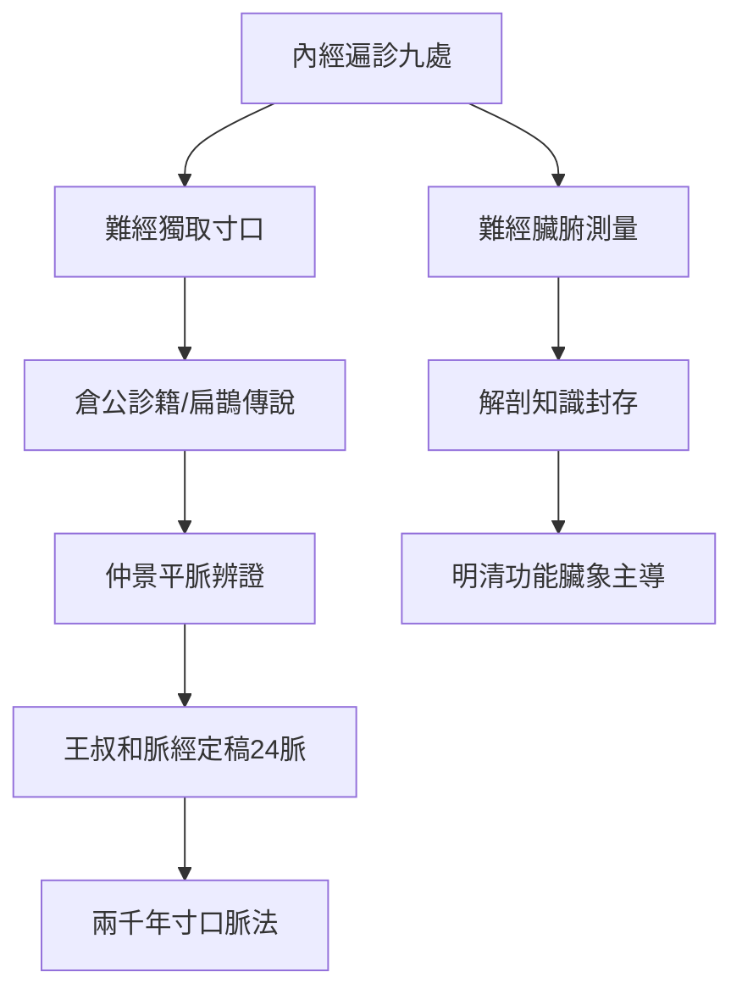

## -0150 - 《難經》（八十一難：向內經提問的人）

## 案件摘要

**本案的偵探不留姓名，只留下八十一個問題。**

《黃帝八十一難經》，託名秦越人（扁鵲）所作，約成書於西漢，以「設問—作答」的格式，對《黃帝內經》的疑難之處連續發問八十一難。它的篇幅只有內經的零頭，卻在三個戰場上完成了突破：脈學的「獨取寸口」、解剖的首次系統測量、命門與三焦的理論創建。如果說內經是立法（見 `[-0200-黃帝內經](-0200-黃帝內經.md)`），難經就是第一部釋憲——而且這位匿名釋憲者，把中醫診斷學的主幹（寸口脈法）直接裝進了未來。

## 前因 -- 為什麼會有這個案子

- **內經的脈法雜而未定**：內經遍診法需切診頭、手、足三部（人迎、寸口、趺陽等九處），臨床不便，標準不一。
- **扁鵲傳說的醫學遺產**：《史記·扁鵲倉公列傳》記載扁鵲「特以診脈為名耳」，能「視見垣一方人」——望而知之的傳說塑造了「診斷萬能」的傳統期待，難經託名扁鵲正為承接此一診斷學路線。
- **倉公「診籍」的實證傳統**：西漢淳于意留下二十五例醫案，記脈象與預後——脈診作為可記錄、可檢驗的證據，已在漢初醫案中出場。
- **解剖學的窗口期**：漢代刑獄與王莽時期對罪犯的解剖（王莽使太醫與巧屠「刳剝之，量度五臟」），提供了難經中器官測量數據的現實來源。

## 線索與推理 -- 謎題：全身血流，為何只摸手腕一格？

**推理一：獨取寸口——把九處切口壓縮成一處。** 難經第一難即宣言：

$$ \text{十二經皆有動脈，獨取寸口，以決五臟六腑死生吉凶之法} $$

理由：寸口（手腕橈動脈）為「脈之大會」，手太陰肺經所過，而肺朝百脈——全身氣血都要過肺，故肺經上的這一處脈動是全身循環的「中央監測站」。以現代生理學語言翻譯：**橈動脈搏動是心輸出量、血管張力、血液性狀的即時讀數**；以系統語言翻譯：這是對單一觀測點做全身推斷的降維方案。仲景《傷寒論》遍診各處但以寸口為主，王叔和《脈經》（見 `[0280-脈經王叔和](0280-脈經王叔和.md)`）正式定稿——兩千年後，中醫門診摸的仍是這一寸。

**推理二：脈位建模——浮沉遲數的物理學。** 難經第四難以陰陽定位脈性：浮者陽也，沉者陰也；第五難以按壓深度分五層候五臟（三菽之重候肺，六菽心，九菽脾，十二菽肝，按之至骨腎）——**以按壓壓力梯度對應組織深度**，這是一個可重複操作的分層測量協議。雖然「五層對應五臟」的映射缺乏解剖依據，但其操作化思路（標準化壓力、標準化位置）是古代診斷學中罕見的嚴謹。

**推理三：解剖測量——中國最早的器官定量報告。** 第四十二難記載：胃大一尺五寸、徑五寸，長二尺六寸；小腸長三丈二尺；大腸長二丈一尺——**給出尺寸與重量的臟腑測量表**。推理價值不在數字對不對（數字明顯脫胎於實物測量加傳聞），而在於「敢量化」的態度：中醫理論傳統中唯一一次大規模的解剖定量化，此後反而被功能臟象說掩蓋。

**推理四：命門與三焦——理論的創新節點。** 第三十六難提出「命門者，諸精神之所舍，原氣之所繫也，男子以藏精，女子以繫胞，其氣與腎通」——把「命門」樹為生命原氣的樞紐。這個後來被明代趙獻可、張景岳發展成「命門學說」（類似代謝與內分泌總樞紐的猜想）的概念，最早的系統論述正在本案。三焦「有名而無形」（第三十八難）則是中醫史上第一樁著名的理論懸案——一個無實體的功能分區，直到現代仍有人嘗試以腹膜腔、細胞外基質、代謝網絡來對應它。

```python
# 難經的「問答知識庫」結構
def nanjing_qa(n):
    topics = {1: "獨取寸口", 2: "脈分尺寸", 4: "陰陽脈法",
              22: "脈不至的原因", 25: "經脈長度", 36: "命門",
              38: "三焦無形", 42: "臟腑度量", 58: "傷寒五種",
              63: "五臟積聚", 68: "針補瀉之法", 81: "虛實補瀉"}
    return f"第{n}難: {topics.get(n, '脈/經/臟/針/穴 諸問')}"

# 八十一難的主題分布: 脈學(1-21) 經絡(22-29) 臟腑(30-47)
#            疾病(48-61) 腧穴(62-68) 針法(69-81)
```

**推理五：針刺補瀉的操作化。** 第六十九至八十一難詳論迎隨補瀉、虛則補其母、實則瀉其子——把五行生剋變成針灸處方規則。這套規則使針灸從「哪裡痛扎哪裡」升級為有推理鏈的治療系統。



## 結案 -- 後果與影響

- **寸口脈法成為世界醫學史上持續時間最長的標準化診斷協議**：從漢至今，位置（掌後高骨為關）、深度（浮中沉）、計時（一息四五至）的規範未變。
- **《難經》的注釋史**：三國呂廣首注，其後楊玄操、滑壽《難經本義》、徐大椿《難經經釋》——一本八十餘頁的問答集，累積了二十餘家注本。
- **命門學說的遠期回報**：明代命門派（趙獻可比命門為「走馬燈」之火）實際上是在為「全身代謝總調節器」尋找理論位置——現代有人將其與下丘腦—垂體—腎上腺軸、粒線體功能做映射比較。
- **三焦之謎懸而未決**：2021 年有團隊提出間質（interstitium）與三焦的對應假說，雖爭議大，但顯示本案的懸案仍有被重新啟動的偵查動力。
- **一句話結案**：難經最偉大的發明不是任何一個答案，而是「問」的格式——對經典存疑、對切口發問、對器官量化。中醫傳統裡一直存在這條懷疑主義的暗線，只是它常常被崇古的主流淹沒。

## 關鍵人物與文獻

- 秦越人（扁鵲）——託名作者；《史記》為其立傳，是中國醫家入正史列傳的第一人。
- 淳于意（倉公）——漢初診籍二十五案，醫案傳統的實證源頭。
- 滑壽《難經本義》（元代）——公認最佳注本。
- 徐大椿《難經經釋》（清代）——以經釋難、以難正經的批判性校讀，訓詁考據式醫學批評的典範。
- 李建民《死生之域：周秦漢脈學之源流》——寸口脈法成立史的權威研究。
- 馬王堆帛書《脈法》《陰陽脈死候》——難經之前的脈學草稿，本案的出土旁證。
