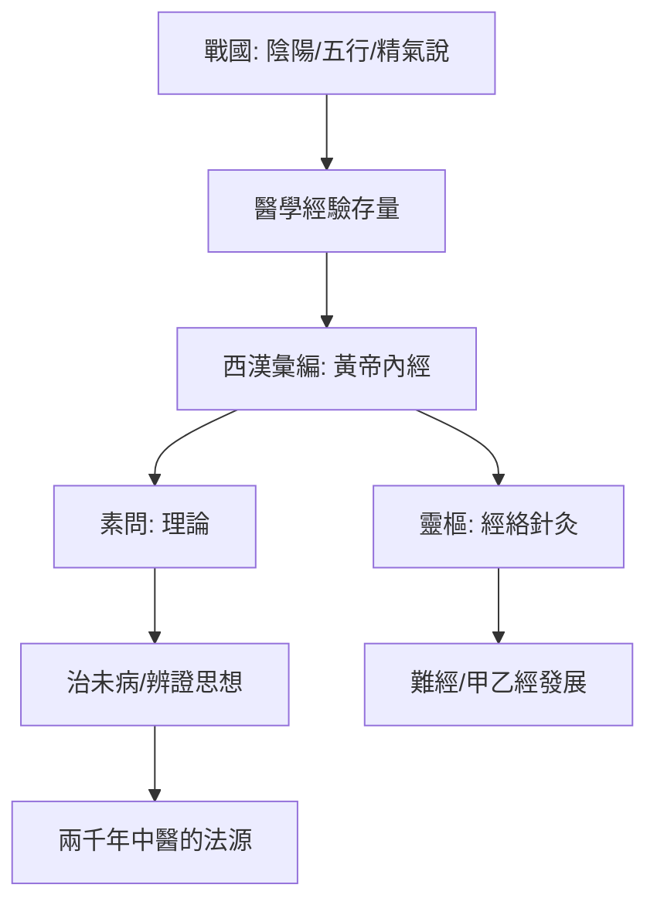

## -0200 - 《黃帝內經》成書（陰陽五行的總綱，把身體寫成一個國家）

## 案件摘要

**本案的兇手（或者說：偵探的導師），是一本託名給軒轅黃帝的書。**

《黃帝內經》並非一人一時之作，而是戰國至西漢間醫學論文的彙編，托名黃帝與岐伯等臣問答，約於西漢（前 2 世紀前後）彙集成書，分《素問》九卷八十一篇與《靈樞》九卷八十一篇。它是中醫史上第一次系統性的「理論總綱」：以陰陽五行為公理系統，以臟象經絡為解剖生理學，以「治未病」為預防醫學宣言。此前醫學是散落的經驗（本案上承 `[-1250-甲骨文疾病記載](-1250-甲骨文疾病記載.md)`），此後兩千年中醫的每一次辯論，都要回到這本書找法源依據。

## 前因 -- 為什麼會有這個案子

- **諸子百家的哲學成熟**：陰陽說（《易傳》）、五行說（鄒衍）在戰國已完備，齊國稷下學宮的精氣說（管子）提供了「氣」的宇宙論。醫學只是把現成的哲學公理系統拿來建模身體。
- **經驗醫學的存量已足夠大**：砭石、湯藥、導引、按蹻各有積累，但缺乏統一理論——就像擁有大量實驗數據卻沒有統一的物理學框架。
- **戰國—秦漢的官僚制思維**：郡縣制、職官制提供了「身體即國家」的隱喻模板——君主（心）、官員（十二官）、道路（經絡）、稅收（氣血）。
- **西漢的典籍整理運動**：漢成帝時劉向、劉歆校書，《七略》中有《方技略》，醫書被正式納入國家圖書分類——「醫經七家，二百一十六卷」，內經是唯一傳世者。
- **一樁懸案**：今本《素問》含唐代王冰補入的七篇大論（五運六氣），《靈樞》一度亡佚、由北宋高麗進獻本補回——我們今天讀到的版本，本身就是拼圖重組的結果。

## 線索與推理 -- 謎題：為什麼要「託名黃帝」？陰陽五行如何替身體建模？

**推理一：託名是權威工程，不是造偽醜聞。** 戰國諸子皆「託古」——墨家託夏禹、道家託黃帝。醫學論文托名黃帝與岐伯問答，是為了讓散落的方技知識獲得超越學派的政治權威。「岐黃」從此成為醫學的代名詞——本案的被告，其實是一場成功的學術品牌建設。

**推理二：陰陽五行是身體的第一套「作業系統」。** 《素問·陰陽應象大論》的總綱：

$$ \text{陰陽者，天地之道也，萬物之綱紀，變化之父母} $$

五行對應表把身體與宇宙連成一張網：

| 五行 | 木 | 火 | 土 | 金 | 水 |
|---|---|---|---|---|---|
| 臟 | 肝 | 心 | 脾 | 肺 | 腎 |
| 腑 | 膽 | 小腸 | 胃 | 大腸 | 膀胱 |
| 五味 | 酸 | 苦 | 甘 | 辛 | 鹹 |
| 五志 | 怒 | 喜 | 思 | 悲 | 恐 |
| 季節 | 春 | 夏 | 長夏 | 秋 | 冬 |

```python
# 五行生剋：身體的迴饋控制模型
sheng = {"木": "火", "火": "土", "土": "金", "金": "水", "水": "木"}  # 相生
ke    = {"木": "土", "土": "水", "水": "火", "火": "金", "金": "木"}  # 相剋

def health_check(zang):
    # 例: 肝病會傳脾（木剋土）——「見肝之病，知肝傳脾，當先實脾」
    target = ke["木"]  # 脾
    return f"肝有病 → 預先補{target}，阻斷傳變"

print(health_check("肝"))  # 預測式治療的雛形
```

**推理三：臟象學說是「功能建模」而非「解剖描述」。** 內經並非不知解剖（《靈樞·經水》明言「若夫八尺之士……其死可解剖而視之」），但它選擇以功能定義臟腑：心主血脉藏神、肺主氣司呼吸、脾主運化、肝主疏泄藏血、腎主水藏精。一個「臟」是一組生理功能的代號，而非一團器官組織。這使中醫臟腑能跨越解剖誤差（如「脾」混合了消化與免疫功能）而依然自洽——**模型不需要對應器官，只需要對應臨床規律**。

**推理四：經絡是身體的交通網。** 《靈樞》用大量篇幅描述十二經脈、奇經八脈、腧穴與刺法。經絡的臨床依據是循證性的：按壓、針刺某處能緩解遠端疼痛（如合谷治牙痛）。古人的推理是：既然有遠端聯繫，必有其通路——於是畫出了經絡圖。這張圖在兩千年後成為針刺麻醉（見 `[1971-針刺麻醉震驚西方](1971-針刺麻醉震驚西方.md)`）的理論地圖。

**推理五：「治未病」是預防醫學的最早宣言。** 《素問·四氣調神大論》：

$$ \text{聖人不治已病治未病，不治已亂治未亂} $$

並以「夫病已成而後藥之，譬猶渴而穿井，鬥而鑄兵」作結——這與現代公共衛生「一級預防」的概念結構完全同構。



## 結案 -- 後果與影響

- **法源地位**：漢以後凡重大醫學爭論皆引內經為據；唐王冰次注《素問》（762 年）成為標準版本；宋校正醫書局（見 `[1057-宋校正醫書局](1057-宋校正醫書局.md)`）再次校定——它被制度化為科舉醫學教育的核心教材。
- **理論生態系**：難經補其脈學、傷寒論補其臨床、千金方補其方劑——內經提供公理，後世提供定理。金元四大家（見 `[1152-劉完素火熱論與金元四大家](1152-劉完素火熱論與金元四大家.md)`）全部以「重讀內經」為旗號開戰。
- **現代迴響**：2018 年中科院團隊以代謝組學驗證「見肝傳脾」的腸肝軸機制；「治未病」成為現代預防醫學與健康管理的官方口號；五運六氣與時間生物學（chronobiology）的比較研究持續發表。
- **侷限的坦白**：內經的哲學建模解釋力極強（什麼都能解釋），但可否證性極弱——這正是它長壽的原因，也是現代科學挑戰它的入口。本案不迴避這個矛盾：**一個不能錯的理論，只能靠外部的測量來更新它**。
- **一句話結案**：內經沒有留下解剖圖，留下的是一張關係圖——它把身體寫成一個有官職、有交通、有季節的國家，而兩千年後的科學家發現，這個國家的某些行政區劃，居然還畫得不算太差。

## 關鍵人物與文獻

- 岐伯、伯高、少師、雷公——託名問答中的「臣」，岐伯被尊為醫祖，「岐黃之術」因此得名。
- 劉向、劉歆父子——西漢校書，《方技略》為醫籍分類之始。
- 王冰（唐代）——次注《素問》，補運氣七篇，版本學上功過參半。
- 楊上善《黃帝內經太素》——最早的完整注本之一，日本傳抄本保存了大量佚文。
- 李約瑟《中國科學技術史·醫學卷》、席文（Nathan Sivin）*Traditional Medicine in Contemporary China*——內經科學史的經典分析。
- 馬王堆漢墓醫書（《足臂十一脈灸經》《陰陽十一脈灸經》，前 168 年入葬）——內經經絡學說的「草稿版」，本案最重要的旁證：十一脈如何擴充為十二脈，展示了理論的演化過程。
