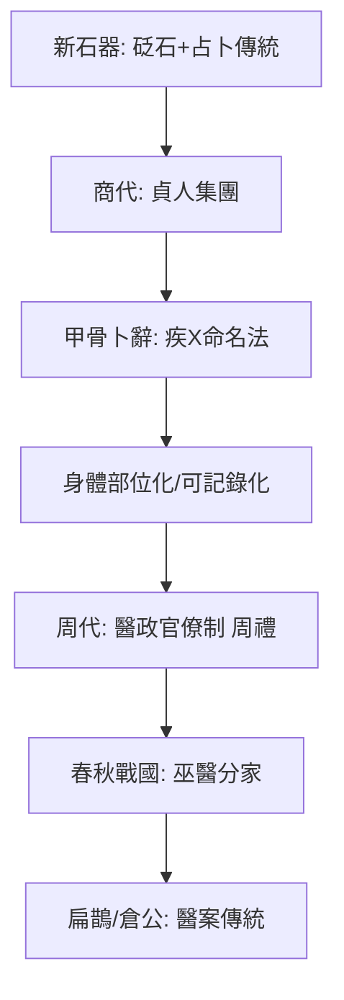

## -1250 - 甲骨文疾病記載（商王在龜甲上追蹤病假的 3300 年）

## 案件摘要

**本案最古老的證物，是一片刻著「疾齒」的牛肩胛骨。**

公元前十三世紀前後，商王武丁時期的殷墟甲骨卜辭中，出現了超過五十種疾病的記載：疾首（頭痛）、疾目（眼病）、疾耳、疾齒、疾腹、疾身、疾趾，甚至「疾年」（流行病年）與「瘋疾」（精神疾患）。商王生病時不找醫生，而是讓貞人（占卜師）灼燒龜甲獸骨、觀察裂紋、向祖先與鬼神提問：「王疾齒，唯有害？」「疾齒，唯黃尹害？」——疾病在當時不是生理事件，而是一樁**靈異案件**：要偵查的是哪位作祟的祖先、哪陣不祥的風。但正因為如此，中國最早的疾病檔案誕生了：它把「病」從混沌中切出來，變成可以被命名、被追問、被記錄的對象。本案要偵查的，是這個「把病變成檔案」的起點。

## 前因 -- 為什麼會有這個案子

- 新石器時代的中國已有「巫醫不分」的考古線索：賈湖遺址（約前 6000 年）出土的骨笛與龜甲占卜組合，顯示占卜儀式傳統早於文字數千年。
- 商代（約前 1600–前 1046）是**占卜官僚化**的時代：王室設貞人集團，凡祭祀、征伐、田獵、氣象、疾病，皆卜而後行。占卜產生的卜辭被刻在甲骨上歸檔——商是中國第一個「以檔案治國」的王朝。
- 商人的宇宙觀：祖先靈與自然神（河、嶽、帝）掌握人間禍福。疾病被理解為「降疾」——是帝或先妣降下的懲罰，或是「蠱」「禍風」作祟。
- 同時代的實際醫療仍然存在：考古出土了砭石（石製尖器，用於刺破膿瘍或放血）、骨針；《山海經》也保留了早期藥物知識的碎片。**占卜是診斷的儀式外殼，砭石是治療的硬體**——兩者並行。

## 線索與推理 -- 謎題：為什麼「疾病檔案」會誕生在占卜桌上？

謎題是：一套以鬼神解釋疾病的系統，為何反而成為醫學史的起點？

**推理一：占卜的提問格式，本身就是最早的「問診單」。** 卜辭有固定句式：時間（干支）＋主體（王／婦好）＋病名（疾X）＋疑問（唯有害？不有害？）。這是一個結構化的資料庫欄位設計：

```python
# 甲骨卜辭的「疾病記錄 schema」
record = {
    "date": "甲子",        # 干支紀日——中國最早的時間序列編碼
    "patient": "王",        # 主體
    "symptom": "疾齒",      # 病名：身體部位 + 疾
    "suspect": "祖乙",      # 假設的病因：哪位祖先作祟
    "action": "禦祭",       # 處方：獻祭以禦除
    "result": "亡咎"        # 占斷結果（驗證！）
}
```

注意最後一欄：卜辭會記錄占斷結果，事後有驗辭。**有假設、有處置、有回溯驗證**——這正是「案例記錄」的三要素，只差病因的解釋模型還錨定在靈界。

**推理二：「疾X」的命名法藏著解剖學的雛形。** 疾首、疾目、疾耳、疾自（鼻）、疾口、疾齒、疾舌、疾手、疾肘、疾脛、疾止（趾）、疾腹——商人用「身體部位＋疾」造詞，意味著他們已經把身體拆解為**可局部化病變的器官清單**。這個「部位—疾病」對應框架，將在兩千年後的《黃帝內經》中升級為臟腑經絡體系。

**推理三：「疾年」「雨疾」暗示流行病觀察。** 卜辭「貞：疾年，其死？」把疾病與年份關聯，追問群體死亡率；「雨疾」（如雨般散布的疾病）則是對傳染現象的直觀捕捉。這是流行病學視角的萌芽——雖然解釋仍是鬼神，**但觀察單位已經是「人群」而非「個人」**。

**推理四：商代已有「醫」字的前身與醫事組織的線索。** 周代文獻《周禮》記載「醫師上士二人、下士二人」，掌「醫之政令」，分食醫、疾醫、瘍醫、獸醫——這種醫政官僚制的源頭，很可能追溯至商代管理占卜與醫療的貞人系統。官僚制把醫療從巫術中逐步剝離：周代已有「巫彭」「巫咸」與「醫」並稱，春秋戰國之際，「信巫不信醫，六不治也」（《史記·扁鵲倉公列傳》）的宣言出現，巫醫正式分家。



值得偵查的細節：著名的武丁配偶婦好卜辭中，有「婦好孕，嘉？不佳？」（懷孕吉利嗎？）的記錄，追問分娩吉凶——這批「婦好產育卜辭」可視為中國最早的產科檔案。

## 結案 -- 後果與影響

- **檔案傳統的誕生**：甲骨文開啟了中國醫學「以文字記病」的傳統，經《周禮》、扁鵲倉公「診籍」（漢代醫案，見《史記》）、宋代官修醫書，一直到現代中醫病歷——「病要寫下來、留下來、拿出來對照」的傳統三千年未斷。
- **身體部位化思維的伏筆**：「疾X」命名法為後世臟腑辨證提供了思維模板：先定位，再論因。本案可直接視為 `[-0200-黃帝內經](-0200-黃帝內經.md)` 的遠祖。
- **巫醫分家的方向**：從「唯有害？」到「六不治」，中國醫學走了約九百年完成世俗化——比希臘醫學（希波克拉底《論聖病》約前 400 年）稍晚，路徑相似：都是先「把病從神手上拿回來」。
- **流行病學萌芽**：「疾年」「雨疾」的群體視角，伏脈千年後的《傷寒雜病論》（見 `[0210-傷寒雜病論張仲景](0210-傷寒雜病論張仲景.md)`）——那正是東漢末年大疫的直接產物。
- **一句話結案**：龜甲上的裂紋是假的，但「王疾齒」是真的——占卜的目的論是錯的，它的記錄格式卻是對的。醫學史常常如此：**正確的資料結構比正確的理論活得更久**。

## 關鍵人物與文獻

- 武丁（商王，約前 1250–前 1192 在位）——甲骨卜辭疾病記載最密集的時期，其配偶婦好的產育卜辭是早期產科檔案。
- 貞人集團——商代的占卜官僚，實際上是中國最早的一批「疾病記錄員」。
- 郭沫若《卜辭通纂》《殷契粹編》——甲骨文疾病記載系統性釋讀的奠基之作。
- 胡厚宣《殷商史》——對卜辭中「疾年」與商代疾病觀的權威整理。
- 李建民《死生之域：周秦漢脈學之源流》——追溯從占卜到脈診的知識轉型。
- 河南安陽殷墟（1928 年起發掘）——本案所有物證的出土地。
