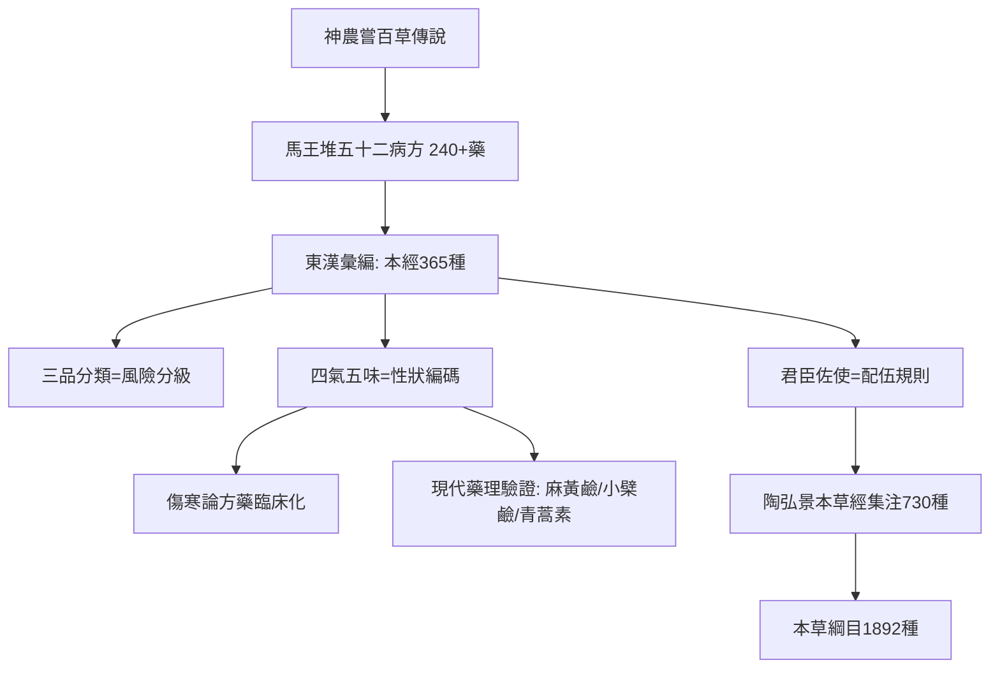

## 0100 - 《神農本草經》（365 種藥物的第一次品級分類）

## 案件摘要

**本案的物證是一份藥物目錄，署名是一位神話中的農夫。**

《神農本草經》約成書於東漢（匯集先秦至漢代的用藥經驗），託名嘗百草的神農氏，收載藥物 365 種（應周天之數：上藥 120、中藥 120、下藥 125），以三品分類，開創了中藥「四氣五味」「君臣佐使」的理論框架。它不是藥典而是**藥物哲學**：每一味藥都被放進「性味歸經—功效—配伍」的推理網路。兩千年後，這份清單裡的麻黃、大黃、常山、附子、黃連逐一被現代藥理學拆解出有效成分——本案要偵查的，是這份清單為何能穿越兩千年的時間審查。

## 前因 -- 為什麼會有這個案子

- **口傳藥學的文本化**：「神農嘗百草，一日而遇七十毒」（《淮南子》）的傳說，代表先民以自身為試驗室的血淚試錯；漢代需要把這些試錯結果標準化。
- **方士與服食文化的推動**：漢武帝時代的求仙風氣使「上藥延命」的需求暴漲——三品分類中的上品「久服輕身延年」，直接反映了服食派的議程。
- **內經已有藥性理論的框架**（五味入五臟、五禁），但缺一份完整的藥物清單——理論有作業系統，缺應用軟體。
- **出土旁證**：馬王堆《五十二病方》（前 168 年入葬）已載藥 240 餘種、武威漢墓《治百病方》載藥約百種並記劑型——漢代藥學的「草稿本」早已流通。

## 線索與推理 -- 謎題：沒有化學分析的時代，如何給藥物分級？

**推理一：三品分類是一個風險分級系統。**

| 品 | 數量 | 定義 | 邏輯 |
|---|---|---|---|
| 上品 | 120 | 君，主養命，多服久服不傷人 | 低毒、可長期（人參、甘草、地黃） |
| 中品 | 120 | 臣，主養性，斟酌其宜 | 有偏性、需辨證（當歸、黃連、麻黃） |
| 下品 | 125 | 佐使，主治病，不可久服 | 有毒、攻邪（大黃、附子、烏頭、巴豆） |

這實質上是**以毒性與適用時程為軸的藥物風險矩陣**——比「有效成分濃度」粗糙，但方向正確：毒性強者攻病，毒性低者調養。附子、烏頭被放進下品，是無數中毒案例換來的分類。

**推理二：四氣五味是藥物的「性狀編碼」。** 每味藥以「氣（寒熱溫涼）＋味（酸苦甘辛鹹）」編碼。推理結構：病有寒熱（證），藥有寒熱（性），故「療寒以熱藥，療熱以寒藥」——**以藥性之偏，矯病性之偏**。這是把治療建模為對稱性的抵銷：

$$ \text{寒證} + \text{熱藥} \rightarrow \text{中和} \qquad \text{熱證} + \text{寒藥} \rightarrow \text{中和} $$

現代驗證的一例：黃連（大苦大寒）主含小檗鹼（berberine），廣譜抗菌、抗炎、降糖——治「濕熱痢疾」的傳統適應症，與其抗腸道病原作用驚人地吻合（黃連素的現代研究見 `[2015-青蒿素諾貝爾獎與現代中醫藥研究](2015-青蒿素諾貝爾獎與現代中醫藥研究.md)` 的延伸案件）。

**推理三：君臣佐使——配伍是藥物的組織學。** 「藥有君臣佐使，以相宣攝合和」：主病者為君，佐君者為臣，應臣者為佐使。配伍使單味藥升級為處方系統，並隱含藥物相互作用的分類（後世「七情」：單行、相須、相使、相畏、相殺、相惡、相反——相殺即解毒配伍，相畏即毒性制約）。

**推理四：被時間驗證的明星藥物清單。**

```python
# 本草經收載藥物的現代藥理「結案報告」
verdicts = {
    "麻黃":   "麻黃鹼—擬交感神經, 支氣管擴張 (1920s 陳克恢)",
    "大黃":   "蒽醌類—瀉下, 逐『瘀』",
    "常山":   "常山鹼—抗瘧, 有效性早於青蒿素的發現線",
    "黃連":   "小檗鹼—抗菌/降糖",
    "人參":   "人參皂苷—適應原樣作用",
    "當歸":   "藁本內酯—子宮平滑肌調節",
    "附子":   "烏頭鹼—強心但劇毒, 炮製減毒",
    "栝樓":   "天花粉蛋白—中期妊娠引產 (1970s)",
}
for drug, finding in verdicts.items():
    print(f"{drug}: {finding}")
```

注意麻黃一案：1924 年留美藥理學家陳克恢從麻黃分離出麻黃鹼並闡明其擬交感作用，成為從中藥走向國際藥理學的第一座橋——本經「麻黃止咳逆上氣」的記載，在兩千年後被分子機制完全接住。

**推理五：烏頭、附子與炮製的毒理智慧。** 本經明知附子有毒（下品），後世卻發展出「炮製減毒」：久煎使烏頭鹼水解為毒性低數百倍的烏頭原鹼。這是**透過加工改變毒物動力學**的古代方案——化學上完全成立。



## 結案 -- 後果與影響

- **本草學的正典化起點**：陶弘景《本草經集注》（500 年）擴至 730 種並創自然分類；蘇敬《新修本草》（659 年，世界最早國家藥典之一）擴至 844 種；李時珍《本草綱目》（1578 年）達 1892 種（見 `[1578-本草綱目李時珍](1578-本草綱目李時珍.md)`）——365 種的原點不斷擴容。
- **藥性理論統治至今**：現行中藥學教材的分類（解表、清熱、瀉下……）與「性味歸經」描述，骨架仍是本案。
- **現代藥理的總收穫**：青蒿（本經列上品）、常山、麻黃、附子、天花粉等陸續析出有效成分，2015 年青蒿素獲諾貝爾獎（見 `[2015-青蒿素諾貝爾獎與現代中醫藥研究](2015-青蒿素諾貝爾獎與現代中醫藥研究.md)`）是這條線的最高獎章。
- **反面物證**：上品中的硃砂（含汞）、雄黃（含砷）「久服神仙」的記載，是本案最危險的錯誤——服食丹藥文化據此毒死了不止一位皇帝，成為明代以降醫家批判煉丹術的主要靶子。
- **一句話結案**：本經的偵查方法是「以身試藥＋世代累計」，它的資料可信度取決於樣本量與時間——兩千年後現代藥理學複核，清單命中率之高令人吃驚；但硃砂那幾行提醒我們：**沒有對照組的古老試驗，救人的數量與殺人的數量會一起沉澱在同一卷書裡**。

## 關鍵人物與文獻

- 神農（託名）——「本草」之名即「以草本為本」的藥物學統稱。
- 陶弘景（456–536）——《本草經集注》，整理散佚的本經文句並創分類法。
- 陳克恢（1898–1988）——麻黃鹼研究的完成者，協和醫學院出身、後任禮來藥廠藥理部主任，中藥現代藥理研究的開山者。
- 馬王堆《五十二病方》、武威漢簡《治百病方》——漢代方藥實物的出土旁證。
- 尚志鈞《神農本草經校點》、王家葵《神農本草經研究》——輯復與研究的重要成果。
- 《吳普本草》《名醫別錄》——本經與集注之間的過渡文獻層。
