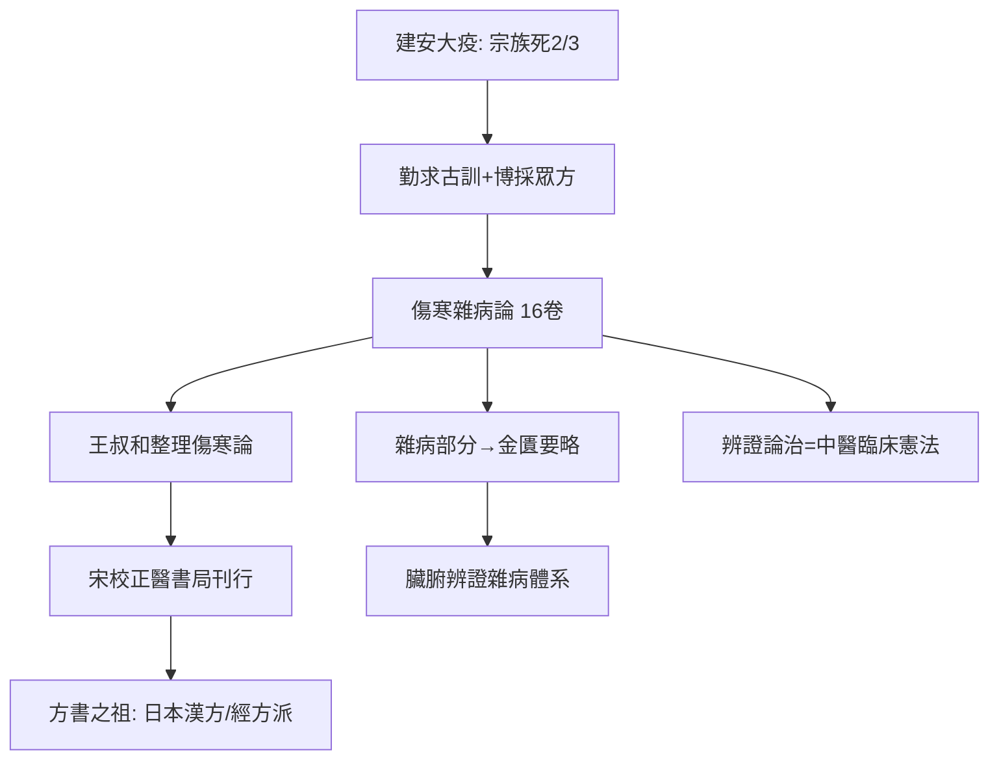

## 0210 - 張仲景《傷寒雜病論》（大疫之年的辨證論治憲法）

## 案件摘要

**本案的案發現場，是一個人口正在被瘟疫清空的帝國。**

東漢末年，戰亂與大疫接連不斷——張仲景在《傷寒雜病論》自序中沉痛記載：「余宗族素多，向餘二百，建安紀年以來，猶未十稔，其死亡者，三分有二，傷寒十居其七。」家族兩百餘人十年間死了三分之二，其中七成死於「傷寒」。他因此「勤求古訓，博採眾方」，約於建安年間（200–210 年前後）完成《傷寒雜病論》十六卷。原書戰亂中散佚，經西晉王叔和整理為《傷寒論》、宋代再校正，成為流傳至今的「方書之祖」。本案的核心發明是**辨證論治**：不針對病名，而針對「證」（症狀群＋病勢）動態用方——六經辨證把疾病寫成一個有章節、有分支、有預後的流程圖。

## 前因 -- 為什麼會有這個案子

- **建安大疫的流行病學背景**：東漢末年（171、173、179、182、185 年均有大疫記載），戰亂遷徙使疫病反覆爆發；曹植《說疫氣》記「家家有殭屍之痛，室室有號泣之哀」。醫學被逼到牆角：現有理論解釋得了，救不了命。
- **方藥存量與理論脫節**：本經（見 `[0100-神農本草經](0100-神農本草經.md)`）有藥無方之系統，內經有理論有十三方但臨床操作不足；伊尹《湯液經法》一系的經方派口訣正在民間流傳。
- **仲景的雙重身份**：南陽人張機（仲景），相傳曾任長沙太守（此說晚出、存疑），《傷寒論》自序顯示他原本习「方士」之術——他是理論與經方兩個傳統的合流者。
- **王叔和的關鍵整理**：仲景原書亡佚近半，西晉太醫令王叔和整理《傷寒論》部分（見 `[0280-脈經王叔和](0280-脈經王叔和.md)`）——本案能開庭，半數功勞在這位整理者。

## 線索與推理 -- 謎題：同一場瘟疫，為什麼不同病人要用不同藥？

**推理一：六經辨證把病程寫成狀態機。** 傷寒論以三陽三陰六經刻畫外感病的演變：

```python
# 六經辨證：外感病的狀態轉移模型
def six_channels(patient):
    stages = {
        "太陽": "惡寒發熱+頭項強痛 → 表證 (麻黃湯/桂枝湯)",
        "陽明": "大熱大汗大渴脈洪 → 裡熱證 (白虎湯/承氣湯)",
        "少陽": "寒熱往來+胸脅苦滿 → 半表半裡 (小柴胡湯)",
        "太陰": "腹滿而吐+食不下 → 脾虛寒 (理中湯)",
        "少陰": "脈微細+但欲寐 → 心腎虛衰 (四逆湯)",
        "厥陰": "消渴+氣上撞心 → 寒熱錯雜 (烏梅丸)",
    }
    # 治療 = 判定當前狀態 + 給出對應處方
    return stages[patient.state]

# 關鍵: 同一個病(瘟疫), 不同狀態 → 不同處方
# "觀其脈證, 知犯何逆, 隨證治之" —— 動態調控宣言
```

「隨證治之」是本案的法理核心：**治療對象不是「病」，而是「證」——病人當下的總體反應狀態**。這使同一張方子（如小柴胡湯）可以跨疾病使用，也使同一疾病在病程不同階段需要換方——這是一種早期的「個體化、動態化治療協議」。

**推理二：經方的雙盲雛形——方證對應。** 傷寒論條文的形式是「症狀組合＋方名＋藥物劑量」的緊密綁定，例如桂枝湯：「太陽中風，陽浮而陰弱，嗇嗇惡寒，淅淅惡風，翕翕發熱，鼻鳴乾嘔者，桂枝湯主之。」每一條都是一個**納入標準＋排除標準＋處方**的臨床試驗記錄格式。日本漢方醫學後來把「方證對應」推向極致——至今日本 148 種漢方製劑納入國民健保，直接承襲傷寒論條文。

**推理三：劑量學與煎服法的工程學。** 仲景方的藥物劑量以兩、銖計，煎法（先煎麻黃去上沫）、服法（桂枝湯「服已須臾，啜熱稀粥一升餘，溫覆令一時許，遍身漐漐微似有汗」——**以粥助攻、控制發汗程度**）、禁忌（「不可令如水流離，病必不除」）構成完整的給藥協議。這種操作細節的密度，在十七世紀前的世界醫籍中極為罕見。

**推理四：代表方的現代藥理複核。**

| 方 | 組成核心 | 現代研究指向 |
|---|---|---|
| 麻黃湯 | 麻黃、桂枝、杏仁、甘草 | 麻黃鹼支氣管擴張＋發汗解熱 |
| 白虎湯 | 石膏、知母、粳米、甘草 | 解熱抗炎，知母皂苷/芒果苷 |
| 小柴胡湯 | 柴胡、黃芩、半夏…… | 抗炎免疫調節，日本研究最深入 |
| 四逆湯 | 附子、乾薑、甘草 | 強心抗休克；烏頭鹼減毒與配伍制毒 |
| 烏梅丸 | 烏梅、細辛、附子…… | 驅蟲＋調節腸道菌群的新假說 |
| 承氣湯 | 大黃、芒硝、厚朴、枳實 | 蒽醌瀉下＋腸道屏障保護（危重症「肺腸軸」研究） |

大黃的案例值得偵查：現代重症醫學發現大黃可維持危重病人胃腸道屏障功能、降低多器官衰竭風險——承氣湯「通裡攻下」的戰略價值，在兩千年後的加護病房找到了新的戰場。

**推理五：傷寒與溫病的世紀之爭在此埋線。** 傷寒論以「傷寒」統括外感熱病，但條文中已有「溫病」「風溫」之名。後世發現江南溫熱氣候下的熱病用辛溫的麻桂常嫌不對症——這條縫隙在千年後被葉天士撕開（見 `[1746-葉天士溫熱論與溫病學派](1746-葉天士溫熱論與溫病學派.md)`）。



## 結案 -- 後果與影響

- **辨證論治成為中醫臨床的最高範式**：與整體觀念並稱兩大特色；「同病異治、異病同治」的原理直接源於本案。
- **經方派與時方派的千年譜系**：清代徐大椿、日本古方派吉益東洞主張「回到仲景」；現代經方國際化（日本漢方、美國中藥顆粒劑市場）仍以傷寒方為主力。
- **醫聖崇拜的形成**：仲景被尊為「醫聖」（明代正式確立），南陽醫聖祠至今為醫學朝聖地——一位在大疫中失去家族的人，成為所有瘟疫時代的守護神。
- **2020 年的新戰場**：新冠疫情中，清肺排毒湯（由麻杏石甘湯、射干麻黃湯、小柴胡湯、五苓散合方化裁）被納入中國診療方案並開展臨床研究——傷寒論的方證邏輯在冠狀病毒面前重新開庭。
- **一句話結案**：張仲景的偉大不在發明了一種藥，而在發明了一種「如何面對未知的疫病」的演算法：先觀察病人的反應狀態，再匹配對應的干預，隨證應變。**在病原體還要等一千七百年才現形的時代，他先把「怎麼治」的作業系統寫完了。**

## 關鍵人物與文獻

- 張機（仲景），南陽郡人——本案作者，建安醫學的最高峰。
- 王叔和——西晉太醫令，整理《傷寒論》的關鍵人物（另見 `[0280-脈經王叔和](0280-脈經王叔和.md)`）。
- 皇甫謐——「仲景垂妙於定方」的最早評價者之一。
- 成無己《注解傷寒論》（金代）——首個全面注本，以經注論。
- 柯琴《傷寒來蘇集》、徐大椿《傷寒論類方》——清代傷寒學的兩大路線（按證類 vs 按方類）。
- 吉益東洞《類聚方》——日本古方派「方證相對」的宣言。
- 《金匱要略》——雜病部分，北宋校正本，臟腑辨證與雜病方的淵藪。
- 建安紀年大疫與曹植《說疫氣》——本案流行病學背景的一手史料。
