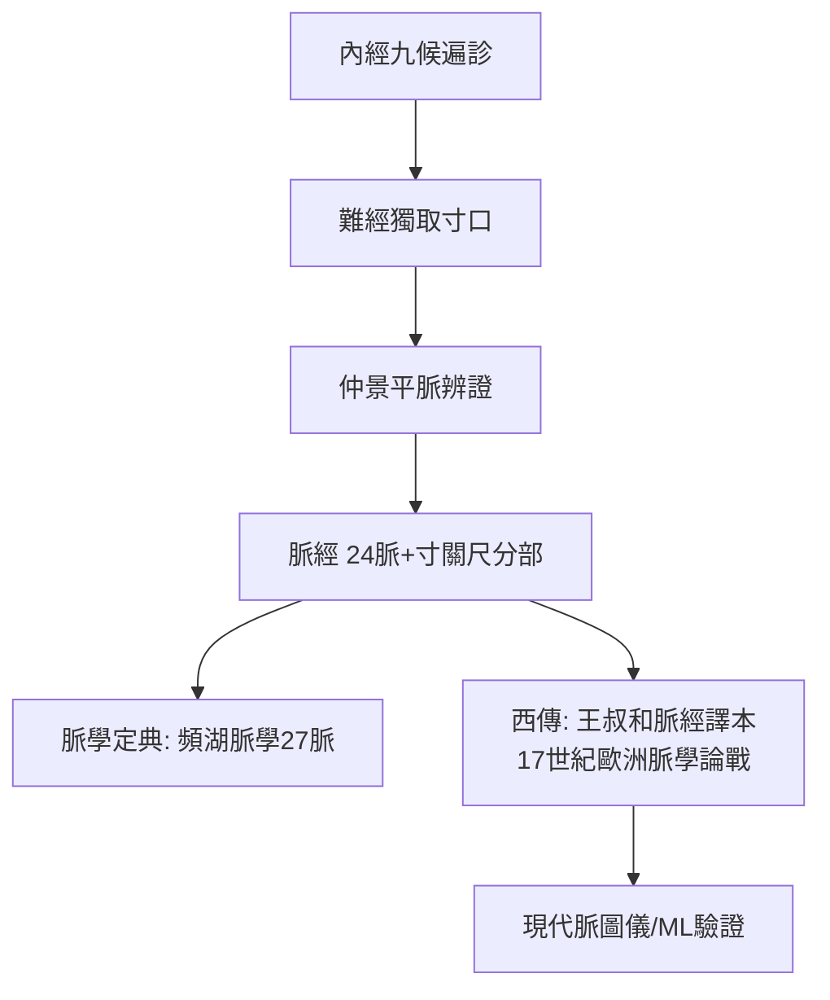

## 0280 - 王叔和《脈經》（二十四脈：把指尖的觸感變成標準語彙）

## 案件摘要

**本案的兇器，是三根手指；本案的難題，是如何把指尖的觸感寫成字典。**

王叔和（名熙，西晉太醫令，山陽高平人）約於魏晉之際（260–280 年間）完成《脈經》十卷九十八篇。在此之前，脈法散在內經、難經、傷寒論諸書，名稱混亂、指下難明——「脈理精微，其體難辨……在心易了，指下難明」是本案的原始困境。王叔和的破案手法是**標準化**：統一定名二十四種脈象（浮、芤、洪、滑、數、促、弦、緊、沉、伏、革、實、微、澀、細、軟、弱、虛、散、緩、遲、結、代、動），逐一給出指下形態描述、主病與鑑別。他還做了一件改變後世診斷史的事：確立「獨取寸口」的定位分部（寸關尺配臟腑）。同時，他整理了瀕臨亡佚的《傷寒論》（見 `[0210-傷寒雜病論張仲景](0210-傷寒雜病論張仲景.md)`）——**一個人在同十年裡，既編寫了診斷字典，又搶救了臨床憲法。**

## 前因 -- 為什麼會有這個案子

- **脈名大混亂**：內經以來，同一脈象有數種異名，同一名詞各書所指不一；缺乏主觀體驗的溝通協議，師徒之間全靠口傳手授。
- **難經已定寸口之位，未定脈形之名**：`[-0150-難經](-0150-難經.md)` 完成「獨取寸口」的降維，但二十四脈的形態學辭典尚待編纂。
- **晉代太醫署制度的需要**：醫政官僚化要求可傳授、可考核的診斷標準——太醫令王叔和身在其位，正是標準化的既得推手。
- **仲景遺稿正待整理**：王叔和「撰次仲景遺論甚精」，他在編《脈經》時把傷寒論條文一併收錄（《脈經》卷七八），使本案同時成為傷寒論的第一個載體。

## 線索與推理 -- 謎題：一種看不見摸不著（只摸得著）的證據，如何寫進案卷？

**推理一：以比喻與對照建立脈形的「操作定義」。** 王叔和描述芤脈：「浮大而軟，按之中央空，兩邊實」——像按蔥管；澀脈：「細而遲，往來難，且散，或一止復來」——輕刀刮竹。這些比喻是**將連續的觸覺訊號離散化為可比對特徵**的方案。二十四脈本質上是一個特徵向量系統：

$$ \text{脈象} = f(\text{位置（浮沉）}, \text{速率（遲數）}, \text{節律（結代促）}, \text{長度（長短）}, \text{寬度（洪細）}, \text{張力（弦緊軟）}, \text{流利度（滑澀）}) $$

```python
# 脈經的分類軸（現代脈圖分析的先聲）
AXES = {
    "depth":    ("浮", "沉"),        # 血管位置/充盈
    "rate":     ("數", "遲"),        # 心率: >90 vs <60 bpm 量級
    "rhythm":   ("促", "結", "代"),  # 心律不整: 促=速而中止, 結=緩而中止, 代=規則性中止
    "width":    ("洪", "細"),        # 血管口徑感
    "tension":  ("弦", "緊", "軟"),  # 血管張力(弦=高血壓/動脈硬化的經典指徵)
    "smoothness": ("滑", "澀"),      # 血流黏滯度的觸感
}
# 結代脈: 仲景已記「傷寒脈結代, 心動悸, 炙甘草湯主之」
# —— 心律不整的記錄早於心電圖 1600 年
```

**推理二：寸關尺配臟腑——把一分鐘的觸診變成全身掃描。** 《脈經》確立掌後高骨為關、關前為寸、關後為尺，並規定左右手六部分候臟腑（左寸心、左關肝膽、左尺腎；右寸肺、右關脾胃、右尺命門/腎）。這個映射沒有解剖依據，卻有臨床動機：**單一觀測點必須承載全身資訊**。它是否「真實」至今仍是科學爭議，但作為一個標準化的探針網格，它讓兩千年來的醫生有了共同的座標系。

**推理三：主病表——脈象與預後的資料庫。** 《脈經》大量記載「X脈主Y病」與死候脈（如「三部脈如雀啄者死」——雀啄脈、魚翔脈、蝦游脈等怪脈，多對應嚴重心律不整與臨終狀態）。這是把脈象當作**預後生物標記（prognostic biomarker）**使用的系統化嘗試。

**推理四：客觀化的未竟之業。** 王叔和的困境在序言中已自我診斷：「胸中了了，指下難明」——脈象的傳遞依賴師承，主觀性是天花板。這個問題要等到二十世紀的脈圖儀（壓力感測器+頻譜分析）來接手：現代研究試圖以機器學習分辨浮沉遲數，其中「遲數」（心率）「結代」（心律不整）等軸確實可以硬體直接驗證——**二十四脈中有幾個維度是真訊號、幾個是安慰劑儀式，正是本案留給未來的待驗清單。**



**推理五：本案的國際支線。** 《脈經》經絲綢之路西傳，十七世紀被耶穌會士與荷蘭醫師引介入歐洲（1640 年代起有拉丁文節譯），引發歐洲關於「脈診能否診病」的激烈論戰——萊登學派甚至有過「以脈診作醫學博士論文答辯」的記錄。一部西晉的脈學字典，意外成為中西醫最早的交戰場之一。

## 結案 -- 後果與影響

- **脈學定典**：此後每一代脈學著作——高陽生《脈訣》（託名）、李時珍《瀕湖脈學》（27 脈＋四言舉要）——都以《脈經》為地基。
- **寸關尺座標系沿用至今**：臨床脈診的位置、分部、指力，一千七百年未變。
- **傷寒論經由脈經保存**：卷七八收錄仲景條文，是宋代校正本之前最重要的文本源頭之一。
- **客觀化賽道開啟**：脈圖儀、多感測器陣列、深度學習脈象分類在 2010 年代後成為熱門課題；脈診的「可驗證部分」（心率、心律、血管張力）與「存疑部分」正在被逐軸拆解——本案的證物終於送進現代實驗室。
- **一句話結案**：王叔和做的是一件表面平淡、實則偉大的事——**給不可言傳的體驗立名目**。醫學進步常常不是發現新器官，而是發明新詞彙：二十四個脈名，就是醫生之間可以互相核對的二十四種證據編號。

## 關鍵人物與文獻

- 王叔和（名熙）——魏晉太醫令，《脈經》作者、《傷寒論》整理者；「脈學之父」。
- 張仲景——《脈經》保存的條文是其平脈辨證的直接來源。
- 高陽生（五代）——託名王叔和的《脈訣》歌訣，通俗流傳最廣，也最受清代考據家抨擊。
- 李時珍《瀕湖脈學》——27 脈的集大成歌訣，見 `[1578-本草綱目李時珍](1578-本草綱目李時珍.md)`。
- 《脈經》西譯——17 世紀歐洲的節譯與萊登大學脈學論戰，中西醫交流的早期物證。
- 現代脈圖研究——脈象儀與機器學習分類的系統綜述（2010s 以降）。
