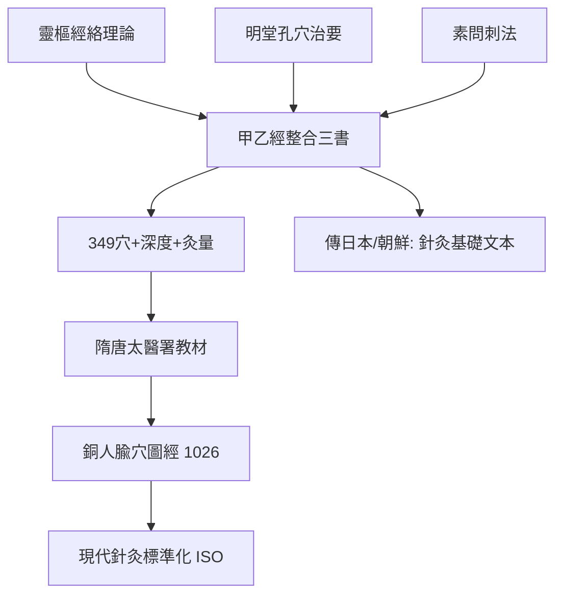

## 0282 - 皇甫謐《針灸甲乙經》（癱子在書齋裡畫出針灸地圖）

## 案件摘要

**本案的偵探，是一位被疾病釘在書桌前的中年人。**

皇甫謐（215–282），魏晉之際的隱士學者，中年患風痺疾（類風濕性關節炎的經典推測），半身苦痛、屢欲自殺，卻轉而苦讀醫書「習覽經方，手不輟卷，遂盡其妙」。他於魏甘露年間起編、太康三年（282 年）前後成書的《黃帝三部針灸甲乙經》（簡稱《甲乙經》），把《素問》《靈樞》《明堂孔穴針灸治要》三部書「刪其浮辭，除其重複，論其精要」，整理成十二卷一百二十八篇——中國第一部系統針灸學專著：定位 349 個腧穴（單穴 49、雙穴 300）、統一穴位命名與取穴法、以部位分篇、每穴標注深度與灸壯。本案要偵查的是：一位自身癱瘓的病人，如何為針灸學完成了第一次全國土地測量。

## 前因 -- 為什麼會有這個案子

- **針灸知識三書分立**：內經論理而穴少、《明堂孔穴針灸治要》專載穴位但已散亂——理論與穴位清單脫節，醫者各記各的穴位，誤差可達數寸。
- **自身的痛**：皇甫謐得風痺後「軀半不仁，右脚偏小」，針灸是他親身求生的技術——本案的每一個穴位定位，作者都可能是第一個受試者。
- **魏晉服散風氣的副作用**：五石散（寒食散）流行，皇甫謐自己也曾誤服受害（「隆冬裸袒食冰」），親歷藥毒之苦，使他對醫學文獻的嚴謹性有切膚要求。
- **國家醫學教育的需求**：晉代以後太醫教育需要標準教材——《甲乙經》正是以「部—穴—主治—刺法」四欄位組織的教學格式。

## 線索與推理 -- 謎題：穴位是什麼？如何在皮膚上給「看不見的點」定位？

**推理一：穴位是被「匯流」出來的點。** 《甲乙經》的穴位命名多有水文隱喻：太淵、曲池、合谷、陽谿、湧泉、水溝——氣血如水流，穴位如江河的匯口、池沼、泉眼。古人的推理結構是：既然刺激某些點能改變遠處病痛，這些點必是「氣」的樞紐——**以水的網路類比神經—血管的網路**。雖然類比錯了介質，但「身體存在遠端調控點」的觀察是真的：合谷治面口疾、足三里治胃病，這些遠端效應在現代以牽涉痛、神經節段、迷走神經刺激等機制獲得部分解釋。

**推理二：取穴的幾何協議——骨度分寸。** 《甲乙經》採用「骨度分寸法」：以自身骨節為標尺（前髮際至後髮際 12 寸、臍至橫骨 5 寸……），使取穴不受身材差異影響——**每人一把自己的尺**。配合「同身寸」與體表標誌（「佐驗骨度」），這是一套可重複的身體測量協議，比「距離目測」的誤差控制高出一個量級。

**推理三：穴位的資料結構。** 每穴的著錄格式高度一致：

```python
# 甲乙經穴位著錄 schema（教科書格式的祖先）
acupoint = {
    "name":   "足三里",             # 標準名
    "location": "膝下三寸, 䯒外廉",   # 定位（骨度法）
    "belong": "足陽明胃經",           # 歸經
    "depth":  "刺入一寸五分",         # 針刺深度（安全參數！）
    "moxa":   "灸三壯",              # 灸量
    "indications": ["胃病", "腹脹", "腸鳴"],  # 主治
}
# 共 349 穴, 單穴49 + 雙穴300 —— 世界最早的穴位資料庫之一
```

注意「刺入一寸五分」這類深度參數：古代針具粗長、無菌條件差，深度規範本質上是**安全劑量學**——胸背部穴位嚴限深度以防氣胸，是歷代針灸醫療事故換來的紅線。

**推理四：以痛為驗的校準。** 《甲乙經》繼承「按其處，應在中而痛解」的壓痛定位傳統——穴位不是純粹的幾何點，而是「按壓有應、按之快然」的體徵點。這使定位協議包含了一個**病人的即時回饋通道**：尺上的寸可以錯，壓痛不會錯。現代研究發現多數經穴與肌筋膜激痛點（trigger points）高度重合，正是這條線索的現代迴響。

**推理五：癱子的自體實驗。** 皇甫謐序中自述「嘗一遭苦厄，三試醫者，皆術踈而無驗」——他痛感於庸醫誤人，故本書反覆強調禁忌與誤刺後果。一個殘疾的病人寫出的教科書，反而處處是防呆設計。



## 結案 -- 後果與影響

- **針灸教育正典**：隋唐太醫署設針博士，以《甲乙經》為教材；唐政府據之校訂《明堂》；孫思邈《千金方》的穴位篇大量承襲（見 `[0652-千金方孫思邈](0652-千金方孫思邈.md)`）。
- **宋代的鎖定**：1026 年王惟一奉敕鑄針灸銅人、撰《銅人腧穴針灸圖經》，穴位以青銅實體鎖定並用於醫官考試（考試時銅人塗蠟、注水，刺中則水出）——穴位標準化走到「國家計量基準」等級。
- **國際傳播**：《甲乙經》八世紀傳入日本、朝鮮，成為東亞針灸的共同母本；2010 年「中醫針灸」列入 UNESCO 人類非物質文化遺產。
- **現代驗證的進展與限度**：針刺鎮痛的內啡肽機制（韓濟生等 1970s 起的研究）、電針刺激迷走神經抗炎的神經免疫學研究（2020 年代熱點）為本案提供了部分硬科學支撐；但「經絡實體解剖結構」至今未被證實——**穴位與效應是真證物，經絡的解剖學身分仍是懸案**（見 `[1971-針刺麻醉震驚西方](1971-針刺麻醉震驚西方.md)`）。
- **一句話結案**：皇甫謐用一身病痛換來的，不是神效，而是精確——把口耳相傳的「老師傅的手感」，改寫成「寸、分、壯、禁」的公開標準。**醫學從師徒祕傳走向可核對，這一步在任何文明都要付出代價，他的代價是自己半身不仁的身體。**

## 關鍵人物與文獻

- 皇甫謐（字士安，號玄晏先生，215–282）——安定朝那人，隱居著述，兼為醫史學家（《帝王世紀》作者）。
- 王惟一——北宋針灸銅人與《銅人腧穴針灸圖經》（1026），本案標準化的宋代極致。
- 楊繼洲《針灸大成》（1601）——集明以前針灸大成，與《甲乙經》並為針灸雙典。
- 韓濟生——針刺鎮痛神經化學機制（內啡肽/腦啡肽）研究的開創者。
- Ma、Ma & Cho《Acupuncture and Moxibustion as an Evidence-Based Therapy》——現代針灸實證研究的綜述代表。
- 敦煌卷子《明堂五臟論》《新集備急灸經》——甲乙經系譜的出土旁證。
