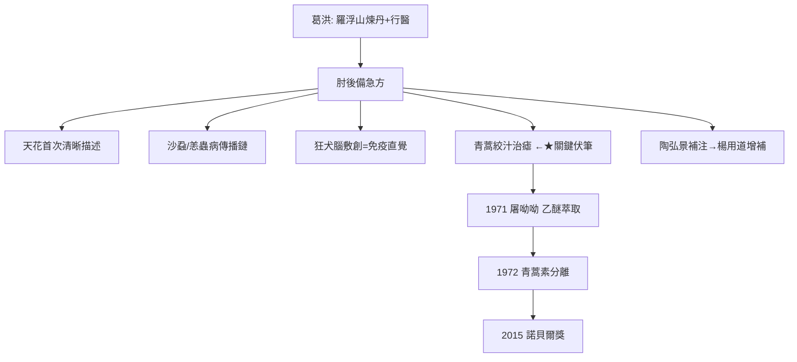

## 0340 - 葛洪《肘後備急方》（山野救急手冊：把醫學裝進袖子）

## 案件摘要

**本案的物證，是一本可以塞進袖子的鄉下急救手冊；它在 1670 年後為諾貝爾獎提供了線索。**

葛洪（283–343，號抱朴子），東晉道士、煉丹家與醫家，於東晉初年（約 340 年前後）編成《肘後救卒方》三卷（後經陶弘景補增、金代楊用道再增補為《肘後備急方》八卷）。此書的設計目標極其務實：「率多易得之藥……兼之以灸」，讓窮鄉僻壤、無醫無藥之地也能自救。它第一次系統記載了天花的臨床描述、沙蝨（恙蟲病立克次體）傳染與防治、以青蒿絞汁治瘧（「青蒿一握，以水二升漬，絞取汁，盡服之」）、狂犬咬傷後的處理（殺犬取腦敷創——原始免疫的線索）以及「屍注」（結核傳染）的認識。1616 年後，屠呦呦正是從這一行青蒿記載中拿到關鍵線索，於 1972 年分離出青蒿素（見 `[1972-青蒿素屠呦呦](1972-青蒿素屠呦呦.md)`）。

## 前因 -- 為什麼會有這個案子

- **晉代的醫療地理不平等**：醫書多為宏篇、藥物多為貴品（參、茸、珠、玉），南方瘴癘之地的貧民根本用不上——葛洪在羅浮山煉丹行醫，直面基層需求。
- **道教的雙重遺產**：葛洪是煉丹術大家（《抱朴子》論金丹），丹爐高溫技術與藥物化學實踐，塑造了他「動手試藥」的路數；但服食求仙的文化也製造了大量鉛汞中毒——本案是這枚硬幣的光面。
- **南方傳染病譜系**：瘴瘧、沙蝨、注病在晉代南方高發，提供了本書傳染病觀察的「案發地」。
- **急救醫學的定位空白**：傷寒論治大病、千金方集大成（尚在未來），中間缺「當下就要救」的現場手冊。

## 線索與推理 -- 謎題：沒有顯微鏡的道士，如何「看見」看不見的病原？

**推理一：天花的第一次正面肖像。** 《肘後方》記「比歲有病時行，仍發瘡，頭面及身，須臾周匝……瘡瘍隆起如泡，隨即破，癰疽類也……劇者多死」，並指出得過一次者不再復發。**形態學描述＋免疫終身性觀察**——這是世界醫學文獻中天花的第一份清晰素描，比西方（Rhazes 論天花與麻疹，910 年）早近六百年。

**推理二：沙蝨與「看不見的傳播載體」。** 「山水間多有沙蝨……甚細，正赤如毛，著人入皮，能殺人」——恙螨叮咬傳播立克次體；葛洪不僅描述蟲體（「針挑取蟲，正赤如丹砂」——立克次體在光學顯微鏡下要到 1930 年代才被看見，但載體恙螨是肉眼可辨的），更記載用竹葉或馬齒莧敷、灸創口防治。**傳播鏈推理的古代原型**：他沒有「微生物」概念，卻鎖定了「蟲—叮咬—病」的因果鏈。

**推理三：狂犬腦的免疫直覺。** 「療猘犬咬人方：仍殺所咬犬，取腦傅之，後不復發。」推理鏈：狂犬腦中或有「致狂之物」，取之敷創可誘導不復發——與 1885 年巴斯德用乾燥狂犬脊髓製備疫苗在邏輯上同構（病原集中於神經組織＋局部接種誘發免疫）。這是**主動免疫概念的古代直覺**，距離巴斯德疫苗整整 1545 年（另見人痘接種 `[1681-人痘接種術](1681-人痘接種術.md)`）。

**推理四：青蒿治瘧——被水溫卡住的有效性。** 「青蒿一握，以水二升漬，絞取汁，盡服之」——注意關鍵細節：**漬、絞，不是煎煮**。屠呦呦團隊的推理正是從此細節引爆：高溫煎煮會破壞有效成分，乙醚低溫萃取（1971 年第 191 次樣本）才得到抗瘧活性提取物，1972 年分離青蒿素。葛洪為何寫「絞汁」而非「煮」？最可能的解釋是嶺南民間經驗的偶得與口傳——**有效，古人不知道為什麼有效；現代知道為什麼，是因為注意了古人「不煮」的細節。**這是本案最精采的偵查伏筆（詳見 `[1972-青蒿素屠呦呦](1972-青蒿素屠呦呦.md)`）。

```python
# 肘後方的「急救知識工程」設計
def elhoufang_design():
    principles = {
        "藥物可及": "率多易得之藥 —— 賤價、田野自採",
        "操作簡單": "灸、绞汁、敷、含 —— 不需複雜器械",
        "按症索方": "以症狀為索引（卒心痛/卒腹痛/卒死）",
        "傳染病專章": "傷寒/時行/屍注/瘴癘 集中收錄",
    }
    return principles
# 「卒X」體例: 以『急』為索引鍵 —— 與現代急診分診的邏輯同構
```

**推理五：「屍注」——傳染病的抽象。** 「屍注、鬼注者……大略使人寒熱、淋瀝、怳怳默默，不知其所苦，而累年積月，漸就頓滯，以至於死，死後復傳之旁人。」——慢性消耗病＋人傳人的明確記載。以「注」（灌注、傳注）命名傳染，是中國傳染病概念史上最重要的一步：**病會「過人」，故須隔、須防**。



## 結案 -- 後果與影響

- **急救醫學的譜系起點**：陶弘景《補闕肘後百一方》、孫思邈《千金方》的急症篇、宋代《太平聖惠方》的救急門，皆承此譜。
- **傳染病認知的基石**：天花、沙蝨、注病的記載成為後世《諸病源候論》（見 `[0610-諸病源候論巢元方](0610-諸病源候論巢元方.md)`）與溫病學派的先聲。
- **煉丹術的雙面遺產**：葛洪記載的丹方（鉛汞砷製劑）成為後世內服丹藥中毒的淵源，但也保存了最早的無機化學操作記錄——火法煉丹的外溢，包括火藥的雛形。
- **諾貝爾級的引用**：青蒿素成為本案最高規格的「結案陳詞」——屠呦呦 2015 年諾獎演說的題目即《青蒿素的發現：傳統中醫藥送給世界的禮物》，第一張引用的幻燈片就是《肘後備急方》那一行。
- **一句話結案**：葛洪的偉大在於他知道自己的讀者是誰——窮人、村醫、趕不及醫生的家屬。**頂級醫學都想寫給皇帝看，這本書是寫給田埂上的急救現場的。而一個道士在 340 年隨手寫下「絞汁」二字，在 1670 年後殺死了數百萬瘧原蟲。**

## 關鍵人物與文獻

- 葛洪（字稚川，自號抱朴子，283–343）——句容人，隱居羅浮山，煉丹、行醫、著述三位一體。
- 鮑姑——葛洪之妻，中國醫史最早有名字的女灸法家，廣州越岡艾灸傳承者。
- 陶弘景——《補闕肘後百一方》（500 年前後），本案第一代增補者（另見本草線）。
- 楊用道——金代增補（《廣肘後方》），引入《證類本草》藥方。
- 屠呦呦——1971–72 年從「絞汁」線索通向青蒿素（見 `[1972-青蒿素屠呦呦](1972-青蒿素屠呦呦.md)`）。
- 《抱朴子內篇》——煉丹與養生體系，理解葛洪方法論的必讀文獻。
- 李約瑟《中國科學技術史》化學卷——對葛洪丹法的科學史定位。
