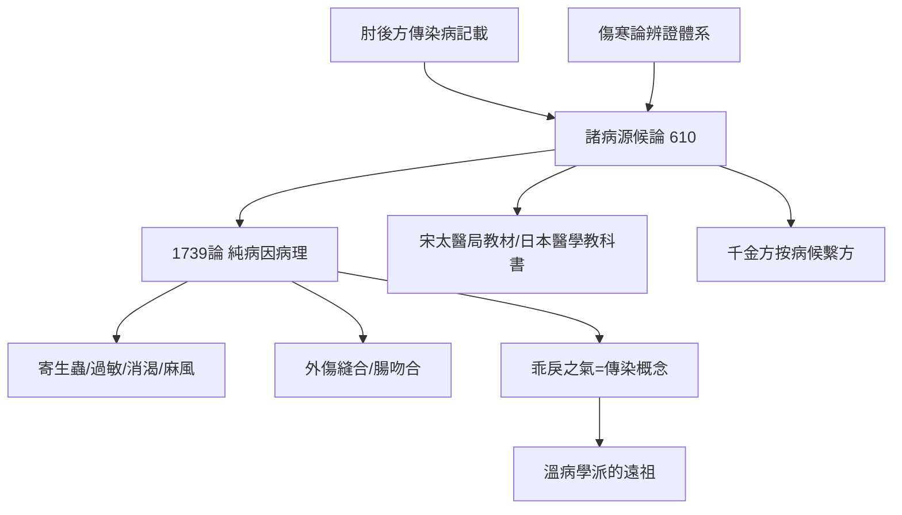

## 0610 - 巢元方《諸病源候論》（隋代的病因病理百科：只有病理，沒有處方）

## 案件摘要

**本案的物證是一部奇怪的醫書：一千七百多種病症，一張處方都不開。**

大業六年（610 年）前後，隋太醫博士巢元方奉敕主持編成《諸病源候論》五十卷，記載內、外、婦、兒、五官諸科病症 1739 論，逐條論述「源」（病因）與「候」（症候表現）——而**幾乎全書不載方藥**。這是中醫史上一次罕見的學科分工：病因病理學與治療學正式分家。本書第一次系統記載了寄生蟲病（蟲由飲食不潔而生的推論）、漆瘡（接觸性過敏的個體差異）、消渴（糖尿病「小便至甜」）、麻風（惡疾的傳染認知）、燙傷與外傷縫合（腸吻合術的記載）等。本案要偵查的謎題是：**為什麼皇帝要一本不治病的醫書？**

## 前因 -- 為什麼會有這個案子

- **隋代醫政的國家工程**：隋煬帝大業年間編修諸多官方典籍（如《區宇圖志》等巨帙），醫學知識的國家化整理是同一波工程。
- **病因學的積壓**：傷寒論偏外感、肘後方偏急救，散在文獻中的病因認識（痰飲、諸蟲、注病、瘴氣）缺乏總整理。
- **太醫署的教學需求**：作為官方教材，先講「什麼是病、為什麼得病」，處方留給其他書——課程表式的分工。
- **巢元方的職位**：太醫博士——帝國最高醫學教席，由他主持，本書天然帶有「國家標準答案」的身分。

## 線索與推理 -- 謎題：一部沒有處方的醫書，憑什麼成為經典？

**推理一：只寫病理，是為了不寫錯處方。** 剝離治療內容後，本書可以：收錄大量無特效藥的病症（如癭瘤、腳氣、諸癲）；對病因做純描述性推理而不受藥物利益干擾；作為**鑑別診斷的圖鑑**供任何學派使用。這是「診斷學獨立成科」的宣言——比西方以病理解剖學為基礎的疾病分類學（Morgagni, 1761）早了 1151 年，雖然前者基於症候推理、後者基於屍檢。

**推理二：寄生蟲學的前置推理。** 「九蟲候」「三蟲候」詳述寸白蟲（絛蟲）：「此蟲生長，多因食生魚、生牛肉……相生連綿，長至一二丈。」——**食生肉→蟲生體內→長達丈餘**的因果鏈。絛蟲鏈體長度可達數米，觀察完全成立；「食生魚」對應華支睪吸蟲（肝吸蟲）的南方傳統也吻合現代流行病學。病因是「蟲」而非「鬼神」，本案在公元 610 年就把腸道寄生蟲病從巫術清單上劃掉了。

**推理三：過敏的個體差異——漆瘡候。** 「人有稟性畏漆者，見新漆，便覺面上癢，然後胸臂脛腨悉皆瘙痒，面為之起腫……亦有性自耐者。」——同樣接觸、有人發病有人不發，巢元方的解釋是「稟性」差異。這是**接觸性過敏＋個體易感性**的完整臨床描述，比 Allergy 概念（1906 年 von Pirquet）早 1296 年。

**推理四：外科與創傷的硬核記錄。** 「金瘡腸斷候」詳述腸斷的縫合：「腸兩頭見者，可速續之，採以桑皮細線縫合……勿令洩氣。」並有血管結紮（「金瘡驚悸候」相關的止血原則）、清創縫合與石膏固定的線索。這些記錄表明隋代外科已有無菌意識的雛形（「須急縫之，忌用伊芳線」等細節）——本案的物證在軍陣外傷的急診室。

**推理五：瘟疫的「乖戾之氣」。** 「傷寒時氣病候」提出：疫病「皆由歲時失和……其傷於四時氣者，皆由時行之氣……人感乖戾之氣而生病，多相染易」，並主張「須預服藥及為法術以防之」——雖然法術並列，但「相染易」的傳染性＋「預防服藥」的公共衛生主張已經出場。這條線索直通溫病學派（見 `[1746-葉天士溫熱論與溫病學派](1746-葉天士溫熱論與溫病學派.md)`）。

**推理六：消渴與「小便至甜」。** 本書已記消渴病人小便如脂似麩、其氣如溺糖——唐代孫思邈、王燾進一步明言「小便至甜」（甄立言的記載常被引），並提出節制米麵酒肉的飲食療法。**多飲多尿＋尿甜＋飲食控制**——糖尿病三聯徵與生活方式干預，本案在七世紀的版本已相當完整（比 Thomas Willis 在 1674 年命名 mellitus 蜜般的，早千年）。

## 結案 -- 後果與影響

- **國家醫學標準**：唐代太醫署將其列為必修教材；宋代校正醫書局刊定（見 `[1057-宋校正醫書局](1057-宋校正醫書局.md)`）；八世紀東傳日本，為《醫心方》主要依據之一。
- **「候」的詞法遺產**：中醫「證候」「症候」的用語體系由本書奠定——辨證論治的「證」其實是本案「候」的理論升級。
- **病理學與治療學分工的示範**：後世《聖濟總錄》（1118）採「論—候—方」三段式結構，正是巢元方＋處方的合體格式。
- **性病敘事的一支**：本書「疳瘡」「妒精瘡」諸候是東方醫學對生殖器潰瘍的早期系統描述（另見性病史書 `../性病的歷史/0061-諸病源候論疳瘡.md`——同一事件在另一本書的分支案件）。
- **一句話結案**：巢元方做的，是把「病」從一團混沌整理成一千七百個可辨認的「候」——**先分類，再談治療**。全書無一張處方，卻讓所有處方從此有了座標。這提醒我們：醫學史上最容易被低估的貢獻，是把問題問清楚。

## 關鍵人物與文獻

- 巢元方——隋太醫博士，本案主持者，生平史料僅存數行。
- 《諸病源候論》——50 卷、67 門、1739 論。
- 孫思邈——《千金要方》大量沿用其病候分類後繫以方藥（見 `[0652-千金方孫思邈](0652-千金方孫思邈.md)`）。
- 宋綬等——北宋校正醫書局校刊本，今傳本之祖。
- 丹波康賴《醫心方》（984）——日本引錄巢氏病候的活化石，保存大量佚文。
- 甄志亞《中國醫學史》、李建民《旅行者的史學》相關篇章——病候學分類史研究。
