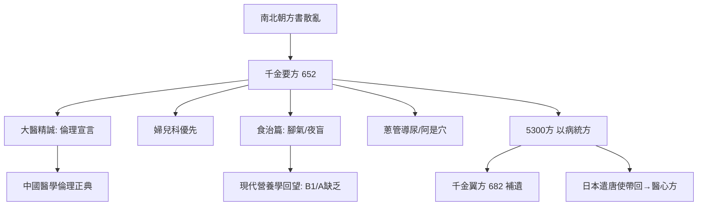

## 0652 - 孫思邈《千金要方》（大醫精誠：一位 140 歲傳說中的醫者的百科全書）

## 案件摘要

**本案的偵探活了「一百四十餘歲」（傳說），留下了一句職業倫理宣言與五千三百張方子。**

孫思邈（約 581–682），京兆華原人，隱居終南山行醫著述，於永徽三年（652 年）完成《備急千金要方》三十卷——自序宣稱「人命至重，有貴千金，一方濟之，德逾於此」，故以「千金」名書。全書收方 5300 餘首，涵蓋婦、兒、內、外、五官、食治、養性、平脈、針灸；晚年再撰《千金翼方》三十卷補遺。本案的三個核心發明：**醫學倫理的獨立宣言**（「大醫精誠」篇）、**婦兒科的優先地位**（婦人方列全書之首）、以及**食治與腳氣病的營養學洞察**（用含 B 群的穀皮、動物肝臟治腳氣與夜盲）。這是中醫史上第一部真正的臨床醫學百科全書。

## 前因 -- 為什麼會有這個案子

- **方書散亂、檢索困難**：晉唐之間方書逾百種，「人命至重」，翻檢不及即誤人性命——孫思邈的解決方案是「以類相從、以病統方」的大型索引。
- **道教養生傳統的正面資產**：孫思邈兼通老莊與佛典，服餌、導引、房中、食治的知識被去巫化地系統收錄——與葛洪的煉丹狂熱不同（見 `[0340-葛洪肘後備急方](0340-葛洪肘後備急方.md)`），他明確反對濫服丹石：「寧食野葛，不服五石。」
- **南北醫學合流的窗口**：隋唐大一統使江南、山東、關中各地方技得以匯總，「博採群方」首次有了帝國規模的取樣空間。
- **個人長壽的活體證明**：孫氏本人年逾百歲（生年有 541 說與 581 說之爭），其養生理論自帶「活體背書」。

## 線索與推理 -- 謎題：為什麼倫理宣言會排在醫書的第一卷？

**推理一：「大醫精誠」——醫學倫理的東方憲章。** 全書開篇論醫習業，卷一「大醫精誠」宣言：

$$ \text{凡大醫治病，必當安神定志，無欲無求，先發大慈惻隱之心，誓願普救含靈之苦} $$

並列出具體禁令：不分貴賤貧富長幼妍蚩，皆如至親之想；不得瞻前顧後、自慮吉凶；到病家「縱綺羅滿目，勿左右顧眄」；「雖及狸鼠之肉（酒肉）……不得有絲毫之念」。推理結構：**醫學的權威來自對生命的責任，而非對權貴的依附**。這份宣言與希波克拉底誓言（見 `../性病的歷史/-0400-希波克拉底精滴症.md` 一書的倫理線）在時空兩端遙相呼應，且更具操作性——它規範的是具體行為細節而非抽象誓詞。

**推理二：婦兒科優先——把最弱勢的病人排到卷首。** 「婦人方」三卷列全書之先，理由直白：「婦人之別有方者，以其胎妊、生產、崩傷之異故也」；「先婦人小兒，而後丈夫耆老者，則是崇本之義也」。婦科獨立分科由此書定調——在孕產婦死亡率極高的時代，這是流行病學意義上的優先級排序：**先救死亡風險最高的群體**。

**推理三：腳氣病與營養學的意外收穫。** 孫思邈分腳氣為「腫」（濕腳氣）與「不腫而緩弱」（乾腳氣），並提出用粳米穀皮、蜀椒、豆豉、牛乳、動物肝臟防治——現代視角：腳氣病即維生素 B1 缺乏症（精米地區高發），穀皮含硫胺素、動物肝臟亦富 B 群。**用含 B1 的食物治 B1 缺乏**——營養缺乏病的食療方案比西方（Eijkman 1897 年的雞腳氣實驗、1929 年諾獎）早了 1245 年。夜盲同理：「暮年昏暗」用羊肝（維生素 A）。

**推理四：蔥管導尿——工程學思維的急診案例。** 記載「凡尿不在胞中，為胞屈僻，津液不通，以蔥葉除尖頭，內陰莖孔中，深三寸，微用口吹之，脹大，津液大通便愈」——**吹氣法軟式導尿管**，世界最早的導尿記載之一。推理：尿瀦留→需建立通道→就地取材（蔥葉）→以吹氣造成壓差導流。這是本案最漂亮的「現場偵查」範例。

**推理五：阿是穴與「以痛為腧」。** 「有阿是之法，言人有病痛，即令捏其上，若裡當其處，不問孔穴，即得便快成痛處，即云阿是。」——承認穴位之外存在壓痛有效點，等於**為針灸預留了經驗主義的後門**（承繼 `[0282-針灸甲乙經](0282-針灸甲乙經.md)` 的壓痛校準傳統）。

**推理六：火藥的意外副產品。** 《丹經》佚文記「硫黃、硝石各二兩……伏火」的配方線索被視為最早火藥配方之一——孫思邈的丹術實驗（去毒方向而非殺傷方向）間接儲存了氧化還原反應的關鍵資料。醫書、丹書、兵書在唐代共用同一套化學檔案。

## 結案 -- 後果與影響

- **臨床百科的範式**：王燾《外臺祕要》（752）四十卷仿其體例收方 6000 餘；宋代《太平聖惠方》《聖濟總錄》皆是「千金體」的帝國放大版。
- **醫德傳統的定錨**：「大醫精誠」至今是中醫院校入學必讀，與醫學生宣誓並行——本案成為職業倫理的常設判例。
- **日本醫學的基因**：《醫心方》（984）大量引錄千金方；孫思邈在日本被奉為「藥王」，奈良藥師寺傳說以其為原型。
- **藥王崇拜**：民間尊孫思邈為「藥王」，藥王廟遍布華北——一位醫者的「神格化」本身是醫療社會史的重要物證。
- **一句話結案**：孫思邈把三件事寫進了同一本書：怎麼治病、怎麼對待病人、怎麼過一種不生病的日子。**第一件會過時，後兩件不會——這就是為什麼一本處方集被記住的第一頁，是倫理。**

## 關鍵人物與文獻

- 孫思邈（約 581–682）——京兆華原人，唐初隱逸醫家，「藥王」。
- 唐太宗、高宗——屢徵不仕，賜爵不受（與魏徵修史問對的傳說）。
- 王燾《外臺祕要》——本案體例的直接繼承者。
- 丹波康賴《醫心方》——千金方文獻的日本儲存層。
- 《千金要方》林億等校注序（宋校正醫書局，1066）——「術愈於諸方」的官方認證。
- 李約瑟《中國科學技術史》——腳氣食療與火藥線索的科學史定位。
