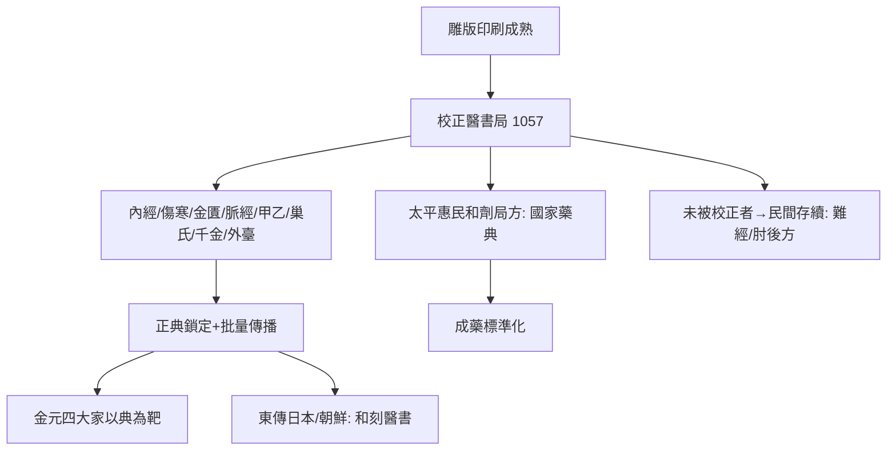

## 1057 - 宋校正醫書局（國家級醫籍勘誤工程：皇帝與編輯部）

## 案件摘要

**本案的案發地點不是醫館，而是皇家的編輯部。**

嘉祐二年（1057 年），宋仁宗詔設「校正醫書局」於編集院，命掌禹錫、林億、蘇頌、張洞等人（後增高保衡、孫奇等）校勘歷代醫籍。自 1057 至神宗熙寧年間約二十年，完成《素問》《傷寒論》《金匱要略》《金匱玉函經》《脈經》《甲乙經》《諸病源候論》《千金要方》《千金翼方》《外臺祕要》等十餘部醫典的系統校勘、注音、刊行。本案是一次**文獻考古＋出版工程**：若沒有這個編輯部，我們今天讀到的仲景、叔和、巢氏、思邈將是另一些文本，甚至不存在。古典中醫的「正典」地位，正是在這間北宋辦公室裡蓋章的。

## 前因 -- 為什麼會有這個案子

- **印刷術的革命條件**：五代馮道刻九經（932 起）開雕版印正典之例；北宋國子監刻書制度化——**醫書第一次可以「批量、一致、長存」**。手抄時代的脫誤、互異、亡佚問題，第一次有了工程級解法。
- **朝廷的疫情焦慮**：北宋人口破億、城市密集，天聖至嘉祐間疫病頻發（1049 年河北大疫等），朝廷以頒方、施藥、刊書應對——醫書是國家防疫基礎設施的一部分。
- **仁宗的醫學傾向**：仁宗朝醫政活躍（翰林醫官院、太醫局改革），校正醫書局是其文化工程的組成。
- **文本的危急狀態**：《傷寒論》賴荊州刻本與高繼沖進獻本勉強流傳；《靈樞》殘缺，後賴高麗進獻（1092）補全——古典醫籍正在消亡的邊緣。

## 線索與推理 -- 謎題：校對古書，如何成為一次醫學革命？

**推理一：校勘即整理史料，整理史料即重構學科。** 林億等人的方法極其嚴謹（在 1065 年的條件下）：廣搜異本互校、「以他書之文證本書之文」（旁校法）、注出刪增、加注音（「音訓」）、疑者存疑（「校注不校改」原則——改動僅在「字義昭然」處，餘皆出校語）。以《素問》為例：奏稱「搜訪中外，裒集眾本，寖尋其義，正其訛舛……疑則缺之」，歷時數年成《重廣補注黃帝內經素問》。**這是宋代考據學方法在醫學上的第一次總演練**——比清代乾嘉考據早六百年。

**推理二：傷寒論的「出土」改變了臨床醫學的權力結構。** 1065 年校正《傷寒論》刊行，仲景方從「散佚傳說」變成「標準教材」；宋金之際由此爆發傷寒學大論戰（成無己、龐安時、許叔微、郭雍……），金元四大家（見 `[1152-劉完素火熱論與金元四大家](1152-劉完素火熱論與金元四大家.md)`）的每一次「糾偏仲景」都以校正本為靶子。**先有印刷的正典，才有對正典的反叛**——這是知識社會學的因果鏈。

```python
# 校正醫書局的「出版時間表」
projects = {
    1057: "設局: 掌禹錫/林億/蘇頌/張洞",
    1066: "千金要方/千金翼方 刊行",
    1068: "脈經 刊行",
    1065: "傷寒論 刊行 (1065-69間)",
    1069: "素問 重廣補注刊行",
    1071: "金匱要略/玉函經",
    1072: "甲乙經",
    1073: "諸病源候論",
    1074: "外臺祕要",
}
for year, event in sorted(projects.items()):
    print(year, event)
# 十年十餘部 —— 中國醫學史上最大規模的國家出版工程之一
```

**推理三：刊行即標準化，標準化即淘汰。** 國子監版本一經頒行，各地州學、書坊翻刻，異本迅速邊緣化——文本的「市場壟斷」。代價：未入校正名單的方書（如大批唐代民間方書）因失去出版通路而加速亡佚。**正典化的硬幣反面是滅失**：本案既是搶救，也是篩選。

**推理四：同期的配套工程——國家藥典與醫學教育。** 同一世紀：982–992 年《太平聖惠方》百卷、1046 年《慶曆善救方》、1076 年設太醫局賣藥所（官藥局，後為惠民和劑局）、1107–1110 年《太平惠民和劑局方》——**政府親自做藥廠與藥典**。校正醫書局是這套「國家醫療體系」的文獻支柱。和劑局方的標準成藥（至寶丹、蘇合香丸、藿香正氣散）至今仍在使用。

**推理五：校正本的「漏網之魚」也值得偵查。** 《靈樞》在校正期未被完成（後 1092 年高麗進獻《黃帝針經》始得刊行）；《肘後方》《難經》不在局中——它們以民間抄刻路徑存續。**國家工程有邊界，知識傳播總有野生通道。**



## 結案 -- 後果與影響

- **我們閱讀的「古代」其實是北宋的**：今本內經、傷寒、金匱、脈經、巢氏、千金、外臺，文本形態皆由校正局定錨——古典中醫是北宋印刷品的直接後代。
- **考據學傳統進入醫學**：從林億校語到宋代《傷寒論》研究，再到清代考據派醫家（徐大椿《醫學源流論》《難經經釋》），「以證據校經典」的作風一脈相承。
- **出版業與醫學的共生**：福建建陽、杭州的書坊自宋起成為醫書重鎮，醫學知識的民主化始於雕版。
- **朝鮮與日本**：高麗以醫書為外交籌碼（進獻換賜書），日本鐮倉—室町期的「五山版」醫書多自宋刊——校正局重塑了整個東亞的醫學文本圈。
- **一句話結案**：本案證明了一個常被忽略的命題——**醫學史的一半是出版史**。那些救人的方子在竹簡上死過一次、在紙上將死第二次，是一群北宋編輯用刻刀把它們救活到今天。偉大的醫學典籍背後，站著一位下詔的皇帝和一群查錯字的官員。

## 關鍵人物與文獻

- 宋仁宗——詔設校正醫書局的決策者，其朝為北宋醫政高峰。
- 掌禹錫、林億、蘇頌、張洞、高保衡、孫奇——校正團隊核心；林億為實際執筆主力，其校語是今天考訂宋本的關鍵指紋。
- 蘇頌——兼任天文學家（水運儀象台），顯示校正局的人才濟濟。
- 高繼沖（荊南節度使家族）——進獻《傷寒論》寫本的關鍵節點。
- 高麗使團——1092 年進獻《黃帝針經》，《靈樞》復歸。
- 錢超塵《宋本校勘研究》、岡西為人《宋以前醫籍考》——本案文獻學的現代偵查報告。
