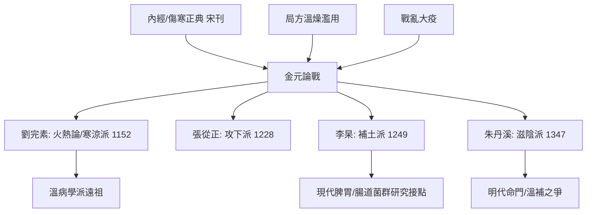

## 1152 - 劉完素火熱論與金元四大家（一場持續百年的醫學內戰）

## 案件摘要

**本案的戰場是一場學術內戰，戰士只有四位主帥，兵器是同一本《黃帝內經》。**

金元時期（12–14 世紀），北方戰亂與疫病交逼，醫學界爆發了中醫史上最激烈的理論論戰——史稱「金元四大家」：劉完素（河間，約 1120–1200）倡「火熱論」，主寒涼攻邪；張從正（子和，1156–1228）倡「攻下論」，汗吐下三法祛邪；李杲（東垣，1180–1251）倡「脾胃論」，補土昇陽；朱震亨（丹溪，1281–1358）倡「相火論」與「陽常有餘、陰常不足」，主滋陰降火。四人同讀內經，結論互相矛盾——這正是本案的謎題：**為什麼同一部經典，在四十年間被讀出四種相反的醫學？**

## 前因 -- 為什麼會有這個案子

- **校正醫書局的正典效應**：1057 年後傷寒論、內經批量刊行（見 `[1057-宋校正醫書局](1057-宋校正醫書局.md)`），人人可讀原典——「回到經典」成為每個學派起兵的合法性來源。
- **官方局方的僵化**：《太平惠民和劑局方》統治成藥市場，溫燥香竄藥（香、燥、熱）濫用成風——劉完素的第一槍正是對著局方的濫溫燥打的。
- **北方的大疫與戰亂**：金元易代，戰爭、饑荒、疫病反覆；李杲親歷汴京圍城大疫（1232 年，「都人之不受病者萬無一二」），倉卒求醫、餓腹勞倦的病人與承平日前的病人完全不同——**疫情譜系決定理論取向**。
- **儒醫階層的興起**：「不為良相，便為良醫」——科舉失意的儒者轉入醫學，把理學的論辯風格（格物、辨異、著書立說）帶進醫界。

## 線索與推理 -- 謎題：四人四論，誰是對的？

**推理一：劉完素——疫情偏熱，所以藥該偏涼。** 劉氏著《素問玄機原病式》（約 1152 年起，成於 1180s），抓住內經「病機十九條」中諸風、諸熱、諸痛癢瘡「皆屬於火/熱」的文句，將六氣病機擴展為「六氣皆從火化」；治法主辛涼解表、表裡雙解（防風通聖散）。「傷寒」多用涼藥——因為他所見的疫病譜系偏溫熱。**他的「錯誤」（把溫病當傷寒治涼）其實是前瞻：這正是溫病學派的前身**（見 `[1746-葉天士溫熱論與溫病學派](1746-葉天士溫熱論與溫病學派.md)`）。

**推理二：張從正——「病由邪生，攻邪已病」。** 《儒門事親》（約 1228）宣言「先論攻其邪，邪去而元氣自復」，以汗、吐、下三法統攝百病（瓜蒂散吐、舟車丸下、防風通聖汗）。他甚至將情志病以「以情勝情」的行為療法處理（悲勝怒的「擊鼓驅憂」案例）。批判性最強、也最激進——被後世稱「攻下派」。他與現代醫學的共鳴點：**清除病因（病原/毒素/鬱積）優於一味扶正**，與抗感染治療的邏輯神似。

**推理三：李杲——圍城裡的饑民教會他補土。** 李杲師承張元素，親歷 1232 年汴京大疫：城破後居民「飲食失節、勞倦所傷」而病者接踵。他著《脾胃論》（1249）提出「內傷脾胃，百病由生」「火與元氣不兩立」，以補中益氣湯（黃耆、人參、白朮、升麻、柴胡……）昇陽益氣。關鍵區分：**外感傷寒 vs 內傷虛損**——餓出來的熱不是感染，不能用苦寒攻邪。這是「鑑別外感與內傷」的重大臨床進步；補中益氣湯的甘溫除熱，現代可對應於營養不良/慢性消耗狀態下的代謝與免疫恢復。

**推理四：朱丹溪——「陽常有餘，陰常不足」。** 朱震亨（浙江義烏人，師從羅知悌，匯通劉、張、李三家）著《格致餘論》（1347），以理學「太極動而生陽、靜而生陰」立論：人之一身陰精難成易虧，相火妄動則煎灼真陰，故主滋陰降火（大補陰丸），並著《茹淡論》節飲食、《色欲箴》節房事。他接住了南方（江浙）病人多陰虛火旺的臨床現實——**丹溪學派統治明初醫界百年**。

**推理五：系統性解讀——四家其實是四個「病人亞群」。** 把四人放到各自的流行病學坐標：

| 醫家 | 地域/年代 | 病人群 | 核心證 | 用藥方向 |
|---|---|---|---|---|
| 劉完素 | 河間，金初 | 北方熱疫 | 火熱 | 寒涼 |
| 張從正 | 宛丘，金末 | 邪實壅盛 | 邪結 | 汗吐下 |
| 李杲 | 真定/汴京，蒙古圍城 | 饑荒勞倦 | 中氣虛陷 | 甘溫補益 |
| 朱丹溪 | 江南，元末 | 富逸陰虛 | 相火妄動 | 滋陰降火 |

結論浮出：**四人不是四個真理，而是四個亞群的四種適配**。「辨證論治」的深層含義至此顯影——證是人群與環境的函數。這也是本案給現代醫學的啟示：任何療法的有效性，都綁定於其所面對的疾病譜與人群狀態。

**推理六：學派的制度化——師承與地域。** 河間→（羅知悌）→丹溪，劉→朱構成跨代傳承；易水學派（張元素）→李杲為另一支。「學派」以師承譜系、地域、著作與反對誰來自我定義——中醫史上第一次出現「以論戰自我定位」的學術生態，類似西方的學派之爭（蓋倫派 vs 方法派），但以註疏與醫案為戰場。

## 結案 -- 後果與影響

- **理論多元常態化**：此後「宗某家」成為中醫自我介紹的方式；明清的溫補派（薛己、趙獻可、張景岳）與反溫補的攻邪派（徐大椿、陳修園）繼續這場內戰。
- **溫病學派的種子**：劉完素「熱論」經明代王履《醫經溯洄集》「溫病不得混稱傷寒」的中介，直接開出清代葉、薛、吳、王四家。
- **社會學遺產**：儒醫化、地域學派、醫案文學（丹溪治驗）——醫學成為士大夫文化的一部分。
- **現代迴響**：補中益氣湯/四君子湯與腸道菌群、免疫調節研究；滋陰方與抗炎抗氧化研究——金元諸方的藥理現代化仍在進行。
- **一句話結案**：四大家辯了一百年，勝負判詞遲至今天才寫清：**他們都對，只是對各自的病人。**內經是同一部，疫情不是同一場——這正是「辨證」二字的終極含義。

## 關鍵人物與文獻

- 劉完素（字守真，河間人）——《素問玄機原病式》《素問病機氣宜保命集》。
- 張從正（字子和）——《儒門事親》。
- 李杲（字明之，號東垣老人）——《脾胃論》《內外傷辨惑論》。
- 朱震亨（字彥修，號丹溪）——《格致餘論》《丹溪心法》（門人輯）。
- 張元素（易水）——臟腑辨證用藥體系，李杲之師。
- 王履《醫經溯洄集》——金元到溫病學派的理論橋樑。
- 任應秋《中醫各家學說》——四大家學術定位的現代標準敘述。
