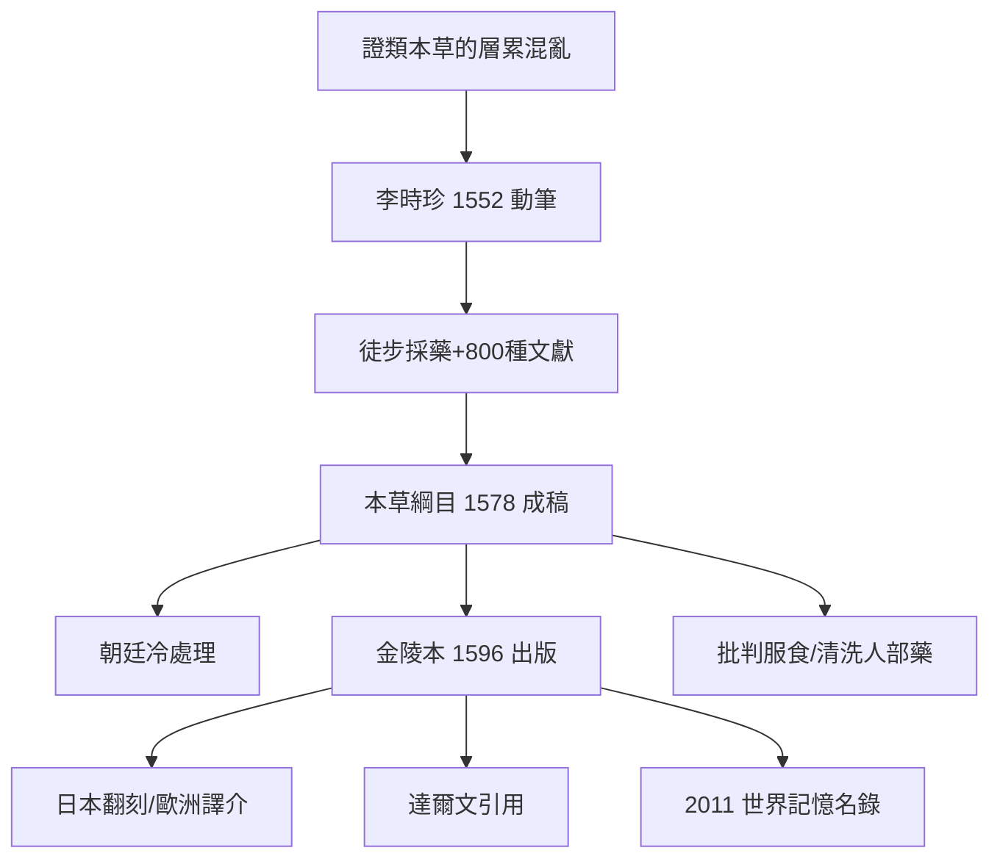

## 1578 - 李時珍《本草綱目》（1892 種藥物、52 卷、一位醫生用 27 年建立的百科）

## 案件摘要

**本案的物證，重達一個書架。**

李時珍（1518–1593），蘄州人，三代醫家，於 1552 年起重修本草，歷時二十七年（三易其稿），至萬曆六年（1578 年）完成《本草綱目》五十二卷，收藥 1892 種（新增 374 種）、附方 11096 首、插圖 1109 幅。書成後朝廷不置可否，1590 年由南京書商開雕，1596 年（李時珍去世三年後）出版，金陵本。達爾文在《變異》中引用其中金魚與家雞資料，稱之為「中國古代的百科全書」；2011 年金陵本入選聯合國《世界記憶名錄》。本案要偵查的是：一個被官方拒絕的醫生，如何單人完成了一部帝國級的博物學工程。

## 前因 -- 為什麼會有這個案子

- **本草正典的三百年欠賬**：唐慎微《證類本草》（1082 前後）成為宋金元藥物學的實際標準，但層累抄錄、綱目混亂、真偽並陳——「品數既煩，名稱多雜」，同名異物、異名同物遍地。
- **李時珍的動機來自第一線誤診**：他親見醫者以「防葵」誤代「狼毒」、以「黃精」誤代「鉤吻」致人死命——**藥名之亂是會殺人的**。
- **明代的知識生態**：理學格物傳統＋博物學民間化＋出版業繁榮（金陵、建陽書坊），使私人撰述巨著成為可能；官方（禮部/太醫院）卻無修典計畫。
- **個人的家世資本**：父親李言聞為當地名醫（著《四診發明》），李時珍本人曾中秀才、三試舉人不第，轉而專醫——他同時擁有醫、儒、出版三種網路。

## 線索與推理 -- 謎題：沒有國家支持、沒有分類學傳統，如何給 1892 種藥物建目錄？

**推理一：以「綱目」重構分類法。** 全書以「部—類」二級分類（16 部 60 類）：水、火、土、金石、草、穀、菜、果、木、服器、蟲、鱗、介、禽、獸、人——**從無機到有機、從低等到高等的大致演化序列**（這個序列令後世生物學家驚訝）。每藥之下固定欄位：

```python
# 本草綱目的「標準著錄格式」
entry = {
    "釋名": "正名+別名+得名之由",      # 命名學: 消滅同名異物
    "集解": "產地/形態/採集/鑑別",     # 形態學描述
    "修治": "炮製方法",               # 藥物加工
    "氣味": "性味/毒性",              # 藥性理論
    "主治": "功效主治",               # 臨床適應症
    "發明": "歷代各家論說+李時珍按語",  # 批判性綜述
    "附方": "相關驗方",               # 應用
}
# 1892 種 x 7 欄位 —— 資料工程的量級
```

「釋名」與「集解」兩欄是本書的革命：**把本草從「功效清單」升級為「命名—形態—生態—鑑別」的博物志**。

**推理二：實證驗證的徒步偵查。** 李時珍「漁獵群書，搜羅百氏」，更「一一採視，頗得其真」：遠遊武當、廬山、茅山、牛首山，採標本、訪藥農、漁夫、獵戶、礦工；親自飼養观察蘄蛇（遠志「滁州白者不真」式的產地辨偽遍布全書）。對傳說他逐一「質驗」：否決服食水銀長生（「水銀乃至陰之精……令人喪生」——直接批判葛洪以降的服食傳統）、澄清「穿山甲通乳」等傳說中的以訛傳訛。**他是本草傳統中第一位系統的懷疑論審查者。**

**推理三：「人部」藥的倫理清理。** 舊本草收錄的「人血、人肉、胎盤、月水、木乃伊」等人部藥，李時珍大量斥為「穢藥」：「紅鉛（經血）妄言長生，愚人信之……此方士之謬。」只保留人髮、人中黃等極少數並加嚴格限定——**這是本草傳統內部一次罕見的倫理清洗**。

**推理四：科學價值的抽樣複核。**

| 記載 | 現代複核結果 |
|---|---|
| 曼陀羅花「熱酒調服三錢，少頃昏昏如醉，割瘡灸火」 | 東莨菪鹼麻醉作用——古代麻醉藥記錄 |
| 常山治瘧 | 常山鹼抗瘧活性確認（但催吐副作用限制應用） |
| 土茯苓治梅毒 | 明代梅毒流行的對症記錄，現代仍入梅毒輔助方 |
| 金魚家化變異 | 達爾文引用的變異證據 |
| 「蓮實（千年不壞）可種」 | 古蓮子發芽實驗（1950s 普蘭店古蓮子成功萌發）證實 |

**推理五：出版的曲折——官方沉默、書商成全。** 1580、1590 年李時珍兩次求助於王世貞作序（「歲歷三十稔，書考八百餘家，稿凡三易」）；進呈朝廷後禮部僅批「書留覽」——**帝國的回應是收藏而非推廣**。最終金陵書商胡承龍刻成。推理結論：本案的正典地位不是朝廷授予的，是市場與後世學者（清《四庫全書》收入、日本翻刻 11 次）追認的。



## 結案 -- 後果與影響

- **本草學的終點站與新起點**：清代趙學敏《本草綱目拾遺》（1765）再增 716 種——綱目之後，本草學從「集大成」轉向「拾遺訂正」。
- **國際傳播**：1735 年杜赫德《中華帝國志》節譯介紹，歐洲自然史學界（布豐等）得以取材；日本、朝鮮、越南的翻刻與續修構成東亞博物學網絡。
- **現代中藥資源學的地基**：今天中藥材鑑定（性狀、產地、道地）的方法論骨架仍是「釋名—集解」式描述。
- **反面物證**：書中亦有荒誕條目（寡婦床頭塵土、縊死繩等巫術殘留）——李時珍自己常以「此理不可解」存疑著錄。**一位十六世紀的懷疑論者也無法完全掙脫他的時代。**
- **一句話結案**：李時珍的偉大公式是：**一手翻八百種書，一手抓活的藥**。朝廷沒有給他編修官的名分，他便自任全國藥物普查的特派員——二十七年、一雙腳、三易其稿。本草綱目證明：帝國不做的工程，個人也可以做完，只要他肯用一輩子。

## 關鍵人物與文獻

- 李時珍（字東璧，號瀕湖，1518–1593）——蘄州人；子李建元進呈遺稿，孫李樹宗代呈朝廷。
- 李言聞——父，蘄州名醫，本書的啟蒙與藥材網路來源。
- 王世貞——序作者，「格物之通典」的評語使書身價倍增。
- 胡承龍——金陵書坊主，本案的出版恩人；金陵本為祖本（2011 年入選世界記憶名錄）。
- 唐慎微《證類本草》——李時珍直接批判與繼承的底本。
- 達爾文《動物和植物在家養下的變異》——引用金魚、家雞條目。
- 李約瑟《中國科學技術史》——「明代最偉大的博物學成就」的定位。
