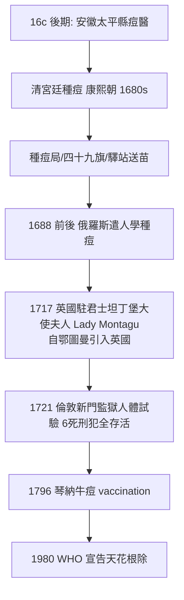

## 1681 - 人痘接種術（在疫苗發明前 104 年，中國人先用病毒防疫）

## 案件摘要

**本案的兇手是天花，偵探是一批無名的江湖醫生與一位推廣它的皇帝。**

人痘接種術（variolation）——將天花患者的痘漿、痘痂或乾痂粉末接種到健康人的鼻孔（旱苗法、水苗法）或皮膚（痘衣法）——使人患一次輕症天花而獲終身免疫。此術至遲在十六世紀後期已在民間流行，清代於康熙年間（約 1680s）被官方正式推行：康熙帝自述「朕堅意為之，遂令此滿洲人等，皆得無恙」；1681 年前後設置「種痘局」並向蒙古、俄羅斯輸出技術。1796 年琴納（Edward Jenner）發明牛痘接種（vaccination），104 年後科學防天花的時代開啟——但本案的關鍵在於：**在「病毒」「免疫」兩個概念都還不存在的世界裡，人痘醫生們憑什麼敢把病原體塞進健康人的鼻子？**

## 前因 -- 為什麼會有這個案子

- **天花的統治**：清代入關後天花肆虐尤其兇險（滿人缺乏免疫背景），順治帝疑似死於天花；康熙幼年患痘倖存（留下面疤），選立他為帝的重要理由之一正是「已出過痘」——**免疫狀態決定皇位繼承**。
- **「熟苗」技術的民間積累**：十六世紀隆慶年間（1567–72），寧國府太平縣的痘醫已發展「種痘法」；清代《醫宗金鑑》（1742）「幼科種痘心法要旨」總結四法：痘衣法、痘漿法、旱苗法、水苗法。
- **關鍵的安全工程——「苗」的選養**：接種材料不直接用重病者的痘漿，而是選擇**輕症患者的痘痂、乾燥貯存、甚至連續傳代「養苗」以減毒**——《醫宗金鑑》稱熟苗「種屢有效，屢經試驗」。這實質上是**人體傳代減毒（serial passage attenuation）**的經驗版本：比巴斯德的減毒疫苗原理早兩個多世紀。
- **康熙的政治決斷**：康熙二十年後宮廷全面種痘（皇子皆種），1681 年起命內務府廣寧等赴邊外給蒙古四十九旗種痘；「上既親種之，復頒之遐邇」。

## 線索與推理 -- 謎題：誰教會了人類「得一次小病，防一生大病」？

**推理一：從「倖存者偏誤」到「免疫終身性」的觀察。** 葛洪《肘後方》對天花的首次清晰描寫已含「得過一次，終身不復」的免疫觀察（見 `[0340-葛洪肘後備急方](0340-葛洪肘後備急方.md)`）。推理鏈：此病只得一次→接觸輕症或可換終身免疫→**主動暴露優於被動等待**。這是人類第一次把「感染」從純災難重新解讀為可管理的交易。

**推理二：接種途徑的選擇——為什麼是鼻孔？** 旱苗、水苗法以銀管將痘痂粉吹入鼻孔，黏膜吸收；痘衣法讓健康兒童穿患者內衣。中醫的解釋是「苗引胎毒外出」（胎毒學說：痘疹乃父母遺毒，種痘使毒外透）——理論是錯的，操作卻有效：呼吸道接種確實能誘導黏膜與全身免疫。**有效的原因要到 1798 年琴納與 1880 年代巴斯德才被揭開，但有效的操作先於解釋 150 年存在。**

**推理三：「熟苗」的減毒工程——本案最精采的物證。** 《醫宗金鑑》記載選苗標準：苗經連續傳種、精加選煉則為「熟苗」，藥力「提拔愈精」，種之「太平」無虞；直接取自重症患者者為「時苗」，兇險。

| 概念 | 人痘的方案 | 現代對應 |
|---|---|---|
| 選輕症患者 | 「時苗」中取良 | 減毒株篩選 |
| 乾燥貯存 | 痘痂紙包藏於瓶 | 疫苗穩定化 |
| 人體連續傳代 | 連種遞傳數代為熟苗 | serial passage 減毒 |
| 效果與風險分級 | 時苗危險/熟苗「太平」 | 毒力評級 |

**推理四：風險的誠實記錄。** 人痘不是無害的：仍有約 1–2% 的致死率（引發真天花），且接種者成為傳染源。痘醫文獻並不隱瞞「種痘不慎，反致貽害」——**在無法量化風險的時代，這已是極限的風險溝通**。正是這個風險，等著琴納用牛痘來歸零：擠奶女工患過牛痘者不再出天花——牛痘對人幾乎無害，免疫卻交叉成立（cross-immunity），1796 年 5 月 14 日菲普斯（James Phipps）接種牛痘，人類免疫學的現代紀元開始。

**推理五：本案的國際傳播路線。**

鄂圖曼路線的細節值得偵查：Lady Mary Wortley Montagu 於 1717 年自伊斯坦堡引入英國，而鄂圖曼的種痘術很可能經絲路與俄羅斯路線源自中國——**中國經驗經兩次轉手，在倫敦完成進化前的最後一程**。1721 年倫敦試驗與其後的爭議（神學家斥之「違逆天意」），預演了所有疫苗時代的爭論。

## 結案 -- 後果與影響

- **免疫學思想的先聲**：人痘是「以毒攻毒→主動免疫」人類思想史的第一級台階；琴納牛痘→巴斯德減毒（狂犬 1885）→現代疫苗學，譜系的根扎在安徽的痘醫行會裡。
- **天花的最終根除**：1980 年 5 月 8 日 WHO 宣告天花滅絕——本案的終局，是這場接力賽的完整獲勝。
- **制度遺產**：清種痘局是中國最早的國家免疫規劃；《醫宗金鑑》把種痘納入官修醫典，是傳統醫學吸納新技術的示範。
- **反面教訓**：人痘的風險與「痘漿法直接取漿」的野蠻變種，說明**技術的倫理與質量控制必須與技術同步**——這條教訓在疫苗猶豫仍盛的今天並不過時。
- **一句話結案**：人痘醫生們不知道病毒是什麼，卻做了三件對的事：**觀察免疫終身性、選擇輕症減毒、記錄風險**。而這三件事，正是兩百五十年後所有疫苗研發的流程圖。

## 關鍵人物與文獻

- 安徽寧國府太平縣痘醫群——本案的無名發明者（隆慶年間）。
- 康熙帝——宮廷推行與邊疆輸出的政治推手；《庭訓格言》自述種痘決斷。
- 吳謙等《醫宗金鑑》（1742）「幼科種痘心法要旨」——人痘技術的官方總結，本案最重要的技術文獻。
- Lady Mary Wortley Montagu——1717 年鄂圖曼→英國傳播的關鍵人物。
- Edward Jenner——1796 年牛痘接種（菲普斯為首例），1798 年《牛痘原因與效果的調查》。
- WHO——1980 年天花根除宣言。
- 范行準《中國預防醫學思想史》——人痘起源與傳播史的權威考證。
