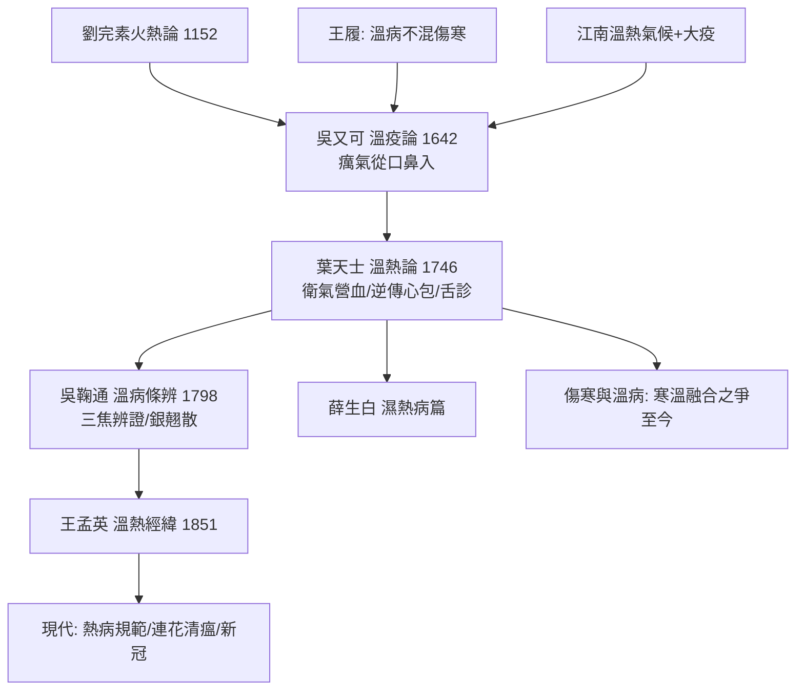

## 1746 - 葉天士《溫熱論》與溫病學派（給熱病換一套地圖的人）

## 案件摘要

**本案的偵探被稱為「天醫星」，他在傷寒論的地圖上畫出了一張新地圖。**

葉桂（字天士，1666–1745），蘇州人，出身醫學世家，十四歲喪父後轉師十七人，「師門廣博，網羅家學」，臨床五十年、日診數十乃至百人，為清代第一臨床大家。其溫病思想由門人華岫雲等輯錄為《溫熱論》（又名《外感溫熱篇》，1746 年前後刊行），提出「溫邪上受，首先犯肺，逆傳心包」的傳變路線、**衛氣營血辨證**（「在衛汗之，到氣才可清氣，入營猶可透熱轉氣……入血就恐耗血動血，直須涼血散血」）與辨舌驗齒診法。此後吳鞠通《溫病條辨》（1798）立三焦辨證與銀翹散等名方、薛生白《濕熱病篇》、王孟英《溫熱經緯》——溫病學派正式脫離傷寒體系自立門戶。本案的謎題：**為什麼張仲景的傷寒地圖，在江南失靈了？**

## 前因 -- 為什麼會有這個案子

- **地理與氣候的疾病譜差異**：傷寒論的經驗產自北方（南陽），用麻桂辛溫解表對付「太陽傷寒」；江南水鄉濕熱氤氳、外感以溫熱病居多——**辛溫發汗於溫病，如同火上添油**（「桂下之誤」）。
- **瘟疫的頻率升級**：明末清初江南人口稠密、城市工商化，疫病（包括疑似流行性斑疹傷寒、流感類熱病）反覆爆發；吳又可《溫疫論》（1642）已提出「疫者感天地之癘氣……從口鼻而入」——**病原從口鼻、非從皮毛**的革命性觀點先於本案。
- **劉完素—王履—吳又可的理論鋪墊**：金元劉完素「六氣皆從火化」（見 `[1152-劉完素火熱論與金元四大家](1152-劉完素火熱論與金元四大家.md)`）、明王履「溫病不得混稱傷寒」、吳又可癘氣說——溫病學的地基已打好，缺一位臨床整合者。
- **葉天士的臨床資料壟斷**：日診百人的四十餘年，使他成為當時擁有最大「溫病病例庫」的醫生——《溫熱論》本質上是江南溫病大資料集的規律提煉。

## 線索與推理 -- 謎題：同是發熱，為何要用兩套辨證系統？

**推理一：傳播途徑的改寫。** 傷寒論的模型：邪自皮毛而入，六經由表入裡；葉氏的新模型：

$$ \text{溫邪上受（口鼻）} \rightarrow \text{首先犯肺} \rightarrow \text{逆傳心包} \quad \text{或} \quad \text{順傳胃（氣分）} $$

「逆傳心包」解釋了臨床最兇險的一幕：高熱迅速神昏譫語（現代視角：中樞神經受累/膿毒症腦病）——傷寒六經模型對這條「快車道」無牌可打，衛氣營血模型則直接標注了危機節點與處理方案（涼開三寶：安宮牛黃丸、紫雪丹、至寶丹）。**新地圖的價值在於畫出了舊地圖沒有的急彎。**

**推理二：衛氣營血——病程的四級分層。**

| 層次 | 病位/深度 | 特徵 | 治法 |
|---|---|---|---|
| 衛分 | 表淺 | 發熱微惡寒、口微渴 | 辛涼解表（銀翹、桑菊） |
| 氣分 | 臟腑功能層 | 壯熱大渴、汗出脈洪 | 清氣（白虎湯類） |
| 營分 | 營陰耗損 | 身熱夜甚、神煩、舌絳 | 透熱轉氣（清營湯） |
| 血分 | 耗血動血 | 出血、發斑、神昏 | 涼血散血（犀角地黃湯） |

這是**以病理深度與體液損耗為軸的四級警示系統**——比六經的陰陽分層更貼合溫熱病的實際病程，且每層都有明確的治療接口。「入營猶可透熱轉氣」尤其精妙：在營分仍設法把邪熱透出氣分而解——**治療窗的搶時間思維**。

**推理三：舌診的升級為主訴證據。** 《溫熱論》幾乎一半篇幅在論舌：白苔主表/濕、黃苔主熱、絳舌主營熱、紫晦主肝腎陰竭；配合驗齒（齒縫流血、齒垢）、辨斑疹白㾦——**把舌變成溫病的進度條**。溫病學派使舌診成為與脈診並列的第一等診斷證據（脈經時代的脈診見 `[0280-脈經王叔和](0280-脈經王叔和.md)`），這是客觀化指標（可視、可照片、現代可數位化）的重要躍升。

**推理四：治法的化學傾向——辛涼與甘寒的崛起。** 溫病方的藥材清單（銀花、連翹、薄荷、石膏、知母、生地、麥冬、犀角、牛黃）與傷寒方（麻黃、桂枝、附子、乾薑）幾乎是兩個化學世界。現代藥理抽樣：金銀花/連翹的綠原酸等抗病原抗炎、石膏解熱、牛黃與膽紅素/膽酸的中樞作用、麥冬皂苷與強心——**辛涼甘寒組合的現代藥理畫像，整體偏向解熱、抗炎、抗感染、保護神經與體液支持**——與溫病「清熱存陰」的治療目標吻合。

**推理五：吳鞠通的三焦辨證——第二張地圖的完成。** 吳鞠通《溫病條辨》（1798）以上中下三焦統轄溫病（上焦肺與心包、中焦脾胃、下焦肝腎），實質是**以臟腑定位補充衛氣營血的深度定位**；銀翹散、桑菊飲、清營湯、加减復脈湯等成方，使溫病學有了自己的「方書之祖」。銀翹散在 2019–2022 年新冠期間的連花清瘟等製劑中直接復活——**本案的地圖，在 270 年後的冠狀病毒疫情中重新投入使用**。

**推理六：傷寒與溫病——內戰的餘波與融合。** 溫病學派並未推翻傷寒論，而是劃界並存（經方派對溫病派在清代繼續互抨——徐大椿、陳修園護傷寒，葉吳系統執江南）；20 世紀「寒溫融合」成為教材共識（病因分風寒風溫、辨證兼容兩套）。**兩張地圖各自覆蓋了對方照不到的疫病地帶。**

## 結案 -- 後果與影響

- **熱病治療的實戰升級**：溫病方劑成為此後兩百年中國南方熱病的主力；安宮牛黃丸至今是中樞感染與中風昏迷的常用急救中成藥。
- **舌診的體系化**：現代舌診客觀化（舌象色譜、機器視覺、深度學習舌診儀）的直接文獻起點。
- **傳染病學的中介地位**：吳又可癘氣說＋溫病傳變模型，是細菌學傳入前中國傳染病理論的最高形態——比 Koch 時代早兩百年給出了「口鼻入、異於傷寒」的傳染病獨立框架。
- **2020 年的再驗證戰場**：新冠診療方案中的清肺排毒湯、化濕敗毒方，其辨證邏輯（疫毒犯肺、濕邪彌漫、清熱化濕）完全是溫病學派的操作系統；國際期刊上的相關 RCT 結果分化，但「溫病理論框架仍在服役」此事本身，已由疫情證明。
- **一句話結案**：葉天士沒有反對張仲景，他只是發現地圖上江南這一塊是空白的——**同一種病在不同氣候、不同人群、不同傳播方式下，需要不同的座標系**。衛氣營血四個字，是兩百年江南瘟疫用命換來的分層圖。

## 關鍵人物與文獻

- 葉桂（天士，1666–1745）——蘇州人，「師十七師」；門人輯《臨證指南醫案》為其醫案集大成。
- 華岫雲——輯錄《溫熱論》與《臨證指南醫案》的關鍵整理者。
- 吳又可（有性）——《溫疫論》（1642），癘氣說的獨立提出者。
- 吳鞠通（瑭）——《溫病條辨》（1798），三焦辨證與溫病方書之祖。
- 薛雪（生白）《濕熱病篇》、王士雄（孟英）《溫熱經緯》——溫病學的濕熱與整合兩翼。
- 《溫熱論》「在衛汗之，到氣才可清氣……入血就恐耗血動血，直須涼血散血」——本案的總綱原文。
- 《溫病條辨》與新冠疫情診療方案（清肺排毒湯等）的比較研究——本案的當代續卷。
