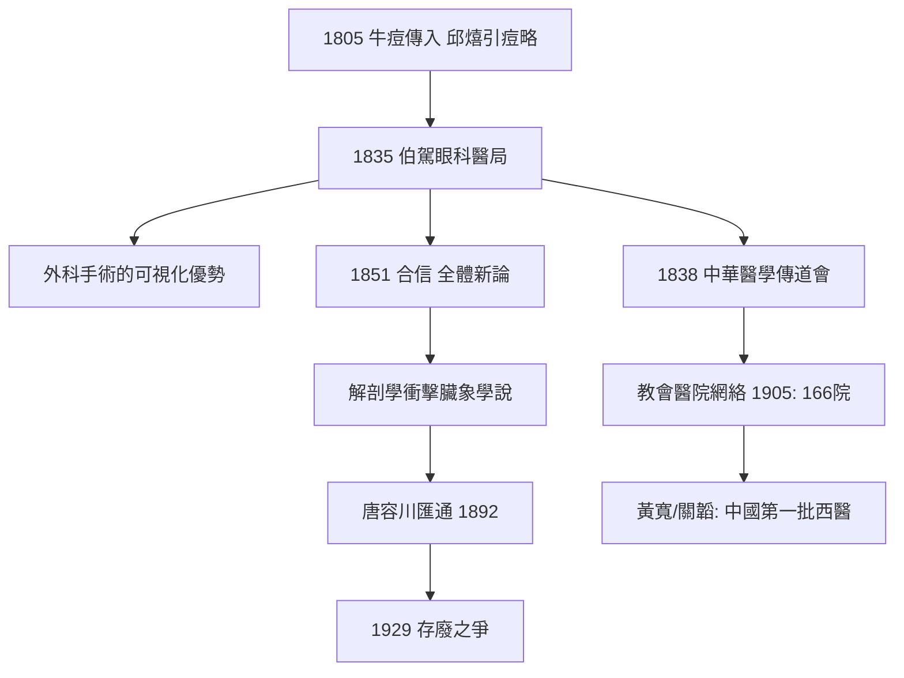

## 1835 - 伯駕眼科醫局與西醫東漸（解剖刀進入廣州：兩種醫學的第一次攤牌）

## 案件摘要

**本案的案發地點，是廣州十三行旁一間租來的小屋。**

1835 年 11 月 4 日，美國傳教醫師彼得·伯駕（Peter Parker，1804–1888，耶魯醫學院畢業、受公理會差遣）在廣州十三行新豆欄開設「眼科醫局」（Ophthalmic Hospital，後名博濟醫院），以治白內障與腫瘤開局——第一年診治病人 2152 人次。伯駕以西方外科術震動嶺南：切除巨大面部腫瘤、取膀胱結石、白內障手術；1836 年設醫學班培訓中國助手，1855 年起黃寬等成為中國最早的西醫學位醫生；孫中山 1886 年曾在博濟習醫。本案是**西醫系統性登陸中國**的起點：從此中醫不再是一個文明內唯一的醫學，而是必須與另一套本體論、另一套技術、另一套組織方式同場競技的傳統。二十一世紀的「中西醫關係」，案發現場在這間小屋。

## 前因 -- 為什麼會有這個案子

- **鴉片貿易與閉關的裂口**：廣州一口通商，傳教士被禁布道，醫療成為唯一合法的「接觸接口」——伯駕的口號是「以醫療為福音的先鋒」。
- **「痘瘡張」的先例**：1805 年皮爾遜（Alexander Pearson）攜牛痘苗抵澳門、廣州，聘中國人邱熺等施種牛痘——牛痘（見 `[1681-人痘接種術](1681-人痘接種術.md)` 的現代化版本）已先於西醫其他的技術進入中國，並由邱熺著《引痘略》以經絡學說解釋接種——**中國人已示範了「用中醫話語吸納西技」的模式**。
- **西醫此時的技術優勢**：麻醉尚未普及（乙醚麻醉 1846）、但解剖學、外科切除、眼科器械、光學檢查已形成對中醫外科的代差；傳染病細菌學還未到來（1880s）。
- **中醫的自信狀態**：清代醫學以溫補與傷寒/溫病之爭為主，體系自足；對「泰西醫學」的認知近乎空白——俞正燮甚至相信「臟腑形態中西異」的荒誕說法。

## 線索與推理 -- 謎題：病人用腳投票，醫學的權威由什麼決定？

**推理一：外科的「可視化暴擊」。** 伯駕的招牌案例是切除面部巨大腫瘤（記錄中瘤重逾斤、患者不堪見人）：中醫文獻對此類腫瘤（「瘤贅」）早有描述但幾無根治手段；西醫刀到瘤落、可視可證。**外科手術是最不需要理論翻譯的醫學**——它直接以效果說服。病人數量暴增（第一年 2152 人次，數年後年逾萬人次）證明：醫學競爭的第一戰場是療效可見處。

**推理二：解剖學的本體論衝擊。** 伯駕的醫學班與合信（Benjamin Hobson）的系列譯書——《全體新論》（1851）、《西醫略論》《內科新說》《婦嬰新說》——把解剖圖譜系統引入。合信明言：「醫學之要，首在明臟腑。」**這對中醫臟象學說是正面衝撞**：中醫的「心主神明」「左肝右肺」在人體解剖圖前面臨解釋危機。王清任《醫林改錚》（1830，見下）已先在此前以觀察屍體「改正」解剖錯誤——中醫內部的「解剖修正主義」與西醫解剖學幾乎同時抵達，卻路徑不同。

**推理三：教會醫院的擴張與「醫療傳教」的雙刃。** 1838 年「中華醫學傳道會」（Medical Missionary Society）成立；鴉片戰後，1859 年嘉約翰（John Glasgow Kerr）主持博濟，增設精神病院、出版《中西醫學報》（1880，中國最早的西醫期刊）；到 1905 年教會醫院約 166 所、診所 241 間。推理要點：**西醫的擴張以制度（醫院、學校、期刊、雜誌）為載體，而非僅以醫生個體**——這是兩種醫學競爭的真正不對稱：中醫的師承診所模式 vs 西醫的標準化機構模式。

**推理四：中國人的反應光譜——本案最值得細讀的線索。**

| 立場 | 代表 | 主張 |
|---|---|---|
| 拒斥 | 大多數守舊儒醫 | 「夷技」不足道、解剖違倫 |
| 實用吸納 | 邱熺《引痘略》 | 用經絡話語解釋牛痘 |
| 解剖修正 | 王清任《醫林改錯》(1830) | 「業醫診病當先明臟腑」，親訪刑場義冢驗屍 |
| 匯通 | 唐容川（1892 起，另案） | 中西醫各有本原，可互參 |
| 資產階級西化 | 孫中山（1886 習醫於博濟） | 轉向西醫乃至革命 |

注意王清任的時間點：他在伯駕來華**之前五年**出版《醫林改錯》，以四十二年時間觀察屍體（「見未嘗見」），改正古書臟腑錯誤三十餘條，並創血府逐瘀湯。**中醫內部的實證衝動先於西方衝擊而存在**——這是本案最微妙的推理結論：西醫東漸不是從零引入懷疑精神，而是為既存的懷疑者提供了外部盟友與新的測量工具。

**推理五：病人用腳投票的流行病學。** 博濟病人從士紳到苦力，總督、巡撫贈匾，欽差林則徐也曾請伯駕診疝氣（留下病歷）——**精英的選擇啟動了示範效應**。到 19 世紀末，「開刀找西醫、調養找中醫」的分工在民間成形：兩種醫學在中國病人的實踐裡已經開始分域共存，遠早於任何官方政策。

## 結案 -- 後果與影響

- **中西醫二元格局的形成**：清末民初的醫療市場從此是「兩種醫學、一套病人」；本案是這個格局的開局。
- **醫學教育的中國近代化**：博濟→1866 年附設南華醫學校（中國最早的西醫教學機構之一）→黃寬（愛丁堡醫學博士）、關韜等第一代華人西醫→孫中山、康德黎，以及後來夏葛醫學堂（女西醫教育）。
- **翻譯運動的醫學分線**：合信、傅蘭雅（《格致彙編》）、德貞等譯書構成「西學東漸」的醫學支流，「解剖」「生理」「細胞」等譯詞由此定著。
- **中醫的應激與轉型**：從邱熺的話語吸納、王清任的解剖修正，到唐容川匯通（見 `[1892-中西匯通唐容川](1892-中西匯通唐容川.md)`）、惲鐵樵「中醫西說各有其理」，再到 1929 年存廢之戰（見 `[1929-中醫存廢之爭](1929-中醫存廢之爭.md)`）——中醫的現代化論述是在本案造成的壓力下逐層生成的。
- **一句話結案**：伯駕沒有打敗中醫，他只是打開了一扇門，讓中國病人同時看見兩種醫學。**外科刀與解剖圖不需要翻譯就會說話——真正被改變的，是「醫學」這個詞在中國的定義：從唯一的道統，變成眾多選項之一。**

## 關鍵人物與文獻

- Peter Parker（伯駕，1804–1888）——耶魯出身、美部會傳教士，後任美國駐華公使；「傳教醫學之父」。
- Alexander Pearson（皮爾遜）——1805 年牛痘傳華，著《英吉利國新出種痘奇書》。
- 邱熺——《引痘略》（1817），以經絡理論接引牛痘的先行者。
- Benjamin Hobson（合信，1816–1873）——《全體新論》等四書，西醫知識系統譯介的第一人。
- John Glasgow Kerr（嘉約翰）——博濟醫院院長逾半世紀，中國西醫教育的重要建設者。
- 王清任——《醫林改錯》（1830），中醫內部的解剖修正主義者與活血化瘀先驅。
- 黃寬——英國愛丁堡醫學博士，中國第一位西醫學位醫生（1857 回國）。
- 關肇直/吳義雄《在宗教與世俗之間——基督教新教傳教士在華南沿海的早期傳教活動》——本案的制度史研究。
