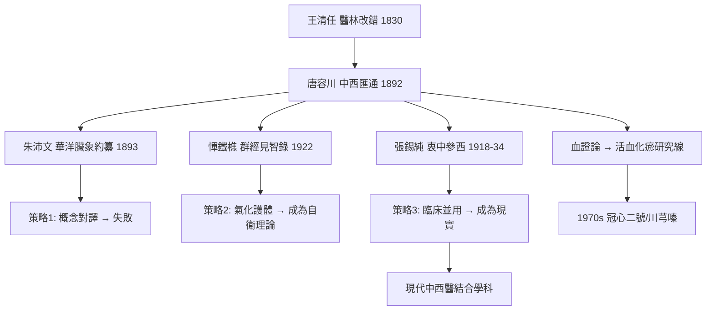

## 1892 - 中西匯通與唐容川（第一代「中西醫結合」理論家的突圍）

## 案件摘要

**本案的偵探是一位在考場與手術室之間徘徊的進士。**

唐宗海（字容川，1846–1897），四川彭縣人，光緒十五年（1889 年）中進士，卻以醫名世。1892 年前後，他完成《中西匯通醫經精義》（1892 年刊）等「匯通」系列——《血證論》（1884）、《本草問答》、《傷寒論淺注補正》、《金匱要略淺注補正》——正式舉起「中西匯通」的旗幟：「不存疆域異同之見，但求折衷歸於一是。」他嘗試以西方解剖生理印證中醫臟腑氣化（如以「胰腺即是脾之脂膏」、以血液循環解「心主血脈」），也以中醫理論批評西醫所短（「西醫只知形跡，不知氣化」）。本案是**中醫面對西學衝擊的第一場系統性理論自救**：承認西學之長、保衛中醫之體。匯通派的失敗之處與遺產，同樣值得驗屍。

## 前因 -- 為什麼會有這個案子

- **西醫的制度性擴張**（見 `[1835-伯駕眼科醫局與西醫東漸](1835-伯駕眼科醫局與西醫東漸.md)`）：教會醫院、醫學校、解剖圖譜已形成壓力；甲午戰敗（1895）後「中體西用」思潮席捲，醫學必然被納入「體用」框架。
- **王清任《醫林改錯》的內部先聲**：1830 年起，「臟腑要改」的聲音已在體制內存在；匯通派接手了這條線。
- **唐容川的雙重訓練**：儒學舉人/進士＋家傳醫學＋在廣州親見西醫手術（其子隨外國醫生習醫）——他是極少數同時掌握兩套話語的人。
- **血證的臨床動機**：《血證論》源於其父咯血之病，「彌留之際，嘔血數升」——唐氏遍檢方書、自療其家，因成此書，以「止血、消瘀、寧血、補血」四法綱領血證。

## 線索與推理 -- 謎題：兩種互不相容的醫學，真的能「匯通」嗎？

**推理一：匯通的三種策略（本案的偵查路線圖）。**

| 策略 | 內容 | 案例 |
|---|---|---|
| 1. 對應翻譯 | 把中醫概念映射到西醫實體 | 「三焦即網膜」「胰即脾」「心臟即君主之官的物質基礎」 |
| 2. 功能護體 | 承認解剖不符，但主張中醫言「氣化」非「形跡」 | 「中醫之五臟是氣化的臟，非血肉的臟」 |
| 3. 互補分工 | 西醫長於形跡（手術/急救），中醫長於氣化（調理/預防） | 「形跡歸西，氣化歸中」 |

策略 1 產生了大量勉強的映射（多數被後世推翻）；策略 2 成為此後百年中醫自衛的主要理論裝備；策略 3 事實上成為今日臨床分域的現實。**三種策略各有命運：翻譯失敗、護體成功、分工成真。**

**推理二：《血證論》——匯通背後的硬臨床。** 剝離理論口號，《血證論》是一部紮實的臨床專著：四法綱領（「止血為第一要法，消瘀為第二法，寧血為第三法，補血為收功法」），創十灰散、瀉心湯類的運用細則，提出「離經之血便是瘀」。**這條「瘀血」線索直通未來**：清代王清任血府逐瘀湯（見 `[1835-...]` 的附線）＋唐容川血證論 → 1970s 中國活血化瘀研究（冠心二號、川芎嗪抗血小板）→ 現代中醫藥最成功的一條藥理線。匯通派最有效的遺產不是他們的理論翻譯，而是他們整理的臨床經驗。

**推理三：同代人與後繼者的接力。** 匯通譜系：唐容川（1892）→朱沛文《華洋臟象約纂》（1893，更重實證、直言「宜從洋醫」於解剖處）→惲鐵樵《群經見智錄》（1922，提出「內經之五臟非血肉之臟，乃四時的五臟」——策略 2 的哲學完成式）→張錫純《醫學衷中參西錄》（1918–1934，實踐派：石膏阿司匹林湯、以中藥理論吸納西藥——臨床匯通的極致）。**匯通運動的演化方向明確：從「解剖對應」退到「功能哲學」再落到「臨床並用」——理論上步步後退，實踐上步步前進。**

**推理四：匯通的死結——兩套本體論不可通約。** 唐容川們失敗的根本原因值得解剖：中醫概念（氣、陰陽、五行、藏象）是**關係與過程的語言**，西醫概念（器官、細胞、分子）是**實體與結構的語言**；一對一翻譯注定產生範疇錯誤（category error）。「三焦即網膜」之所以荒謬，不是因為三焦神秘，而是因為它們根本不在同一張概念網上。**真正的匯通只能在「臨床結果」與「機制驗證」的層面發生，而不能在「概念對譯」層面發生**——這正是後來「中西醫結合」（以研究方法匯通而非以概念匯通）與匯通派的分界線。

**推理五：本案與 1929 年的因果接線。** 匯通派證明了中醫「可以」與現代科學對話的企圖，也暴露了「概念匯通」不可行——這個教訓直接塑造了 1929 年存廢之戰後中醫的論述策略（見 `[1929-中醫存廢之爭](1929-中醫存廢之爭.md)`）：放棄解剖對應、強調療效與科學化改造。**匯通派輸掉了理論，卻贏下了議程。**

## 結案 -- 後果與影響

- **「中西醫結合」的譜系起點**：從匯通到 1950s 毛澤東「團結中西醫、中西醫合作」，到現代中西醫結合學科（陳可冀院士的冠心病血瘀證研究、吳咸中的急腹症通裡攻下研究）——唐容川是這條制度線的第一環。
- **《血證論》的長期回報**：活血化瘀成為中醫藥現代研究中出產硬科學論文最多的領域之一；血府逐瘀湯（王清任方，唐氏發揚）的臨床研究覆蓋冠心病、眼底出血等。
- **理論自衛裝備的定型**：「中醫臟腑是功能模型而非解剖實體」——由惲鐵樵完成、至今仍是中醫理論防線的標準表述；它保衛了中醫，也埋下了「不可證偽」的批評隱患。
- **一句話結案**：唐容川的匯通像一次失敗的翻譯——詞對不上、句法不通；但他在翻譯失敗的地方做了兩件對的事：**整理臨床真經驗、開啟對話議程**。後世的中西醫結合，繼承的不是他的翻譯，而是他的問題。

## 關鍵人物與文獻

- 唐宗海（容川，1846–1897）——《中西匯通醫經精義》《血證論》《本草問答》匯通五書；光緒進士。
- 王清任《醫林改錯》（1830）——血府逐瘀湯與解剖修正，匯通的內部先聲。
- 朱沛文《華洋臟象約纂》（1893）——匯通派中最重實證者。
- 惲鐵樵《群經見智錄》（1922）——「四時的五臟」，匯通到科學化的轉樞（1929 案主角之一）。
- 張錫純《醫學衷中參西錄》——石膏阿司匹林湯、鎮肝熄風湯；臨床匯通的最高峰。
- 陳可冀《血瘀證與活血化瘀研究》——匯通遺產的現代科學化版本。
- 趙洪鈞《近代中西醫論爭史》——本案的權威史學整理。
