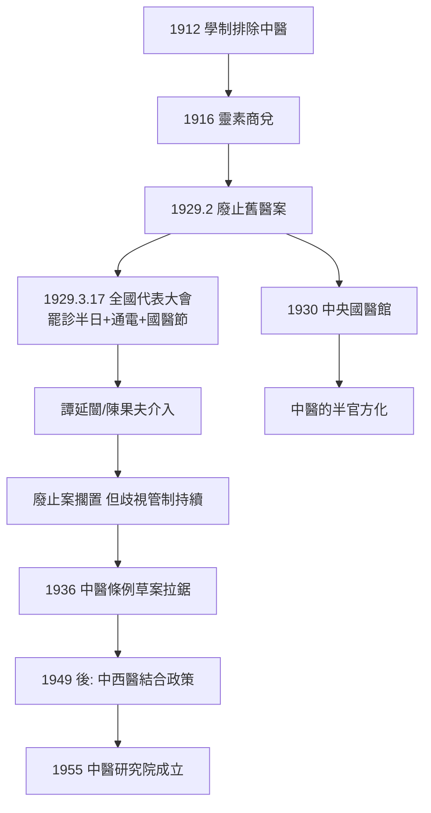

## 1929 - 中醫存廢之爭（廢止中醫案：一場決定十萬人生計與一種文明醫學存亡的行政突襲）

## 案件摘要

**本案的兇器，是一紙行政公文；防禦工事，是三萬封電報與一次罷診。**

1929 年 2 月 23–26 日，南京國民政府衛生部召開中央衛生委員會第一次會議，通過余雲岫起草的《規定舊醫登記案原則》（「廢止舊醫以掃除醫事衛生之障礙案」），設計了釜底抽薪的三步走：舊醫（中醫）登記至 1931 年止、限 50 歲以下者、不再設舊醫學校、限制宣傳。**不直接禁絕、而是斷其新生與教育**——余雲岫的殺招在於用「科學化」之名行「自然消亡」之實。3 月 17 日，全國醫藥團體代表大會在上海召開（十五省 243 縣 281 個團體），並全國罷診半日、通電抗爭；「三一七」成為國醫節的由來。教育部與衛生部隨後把中醫校改稱「傳習所」「學社」、醫院改「醫館」，歧視性管制持續到抗戰。本案是中醫史上最接近死亡的一次。

## 前因 -- 為什麼會有這個案子

- **西醫現代性的政治化**：晚清「中體西用」→民初科學主義（「賽先生」）→五四新文化運動把「科學 vs 迷信」變成進步與落後的二元敘事——中醫被貼上「舊」「玄」的標籤，余雲岫正著《靈素商兌》（1916），逐條批判內經「荒誕」。
- **余雲岫（1879–1954）的個人簡歷**：留學大阪醫科大學，受日本明治「漢醫廢止」經驗的強烈影響——他的提案本質上是**把日本漢醫廢止案（1874–1895）搬進中國**。日本經驗是本案的「外國先例卷宗」。
- **中西匯通的失敗後果**：匯通派（見 `[1892-中西匯通唐容川](1892-中西匯通唐容川.md)`）未能完成理論匯通，中醫在「科學」的審判庭上缺乏辯護語言——學理上失分，制度上失守。
- **醫政權力的爭奪**：西醫人數極少（1929 年約數千人，且集中都市）但掌握政府醫政話語；中醫約數十萬人卻無制度代表——**少數現代化者借國家機器對抗多數傳統行業**。
- **教育部的長期壓制**：1912 年學制（壬子癸丑學制）即未列中醫教育——「教育系統不承認」已持續十七年，本案是教育壓制升級為執業消滅。

## 線索與推理 -- 謎題：為什麼廢止案用了「登記限制」而非「禁止」？

**推理一：余雲岫的消滅演算法。** 直接禁止在政治上不可行（數十萬從業者＋社會依賴），於是設計「斷代」方案：

```python
# 廢止案的「自然消亡」演算法（余雲岫設計）
def abolish_tcm():
    steps = {
        1: "舊醫登記限 1931 年止 —— 之後不得新取得執業資格",
        2: "登記限 50 歲以下 —— 排除資深者？不: 讓年長者自然退休",
        3: "禁止舊醫學校 —— 切斷教育傳承",
        4: "禁止新聞宣傳 —— 切斷社會認可",
        5: "舊醫不得診斷法定傳染病、不發死亡證明 —— 邊緣化其職能",
    }
    # 15-20 年後: 無新人、無學校、無認證 → 中醫自然死亡
    return "不加禁止, 而令其絕種"
```

這個方案的可怕在於**全程不使用「禁止」二字**——每一條都以「管理」「整理」「科學化」為名。它預演了官僚系統消滅一個行業的標準手法。

**推理二：中醫的反擊——本案的防禦工事如何搭建。** 3 月 17 日的代表大會做出四件事：定「三一七」為國醫節、組全國醫藥團體總聯合會、通電政府與各省、**罷診半日**。罷診是關鍵一擊：數十萬醫者同時歇業，全國病人立刻感受到醫療真空——**以服務能力證明社會必要性**。此外請出政治庇護人：譚延闓（行政院長）親任國醫館理事長、陳果夫/陳立夫的 CC 系支持、地方軍政要員具結擔保——中醫用傳統政治網絡對抗現代官僚技術。6 月，蔣介石表態「中醫中藥為國粹」，廢止案實質擱置。

**推理三：論戰的內容——雙方各自的強證據與弱證據。**

| 陣營 | 強證據 | 弱證據 |
|---|---|---|
| 廢止派（余雲岫等） | 內經理論的解剖學錯誤；中醫對白喉、產褥熱、傷寒病死率的劣勢；日本漢醫廢止的先例 | 以為「科學」已完備可裁決一切；忽視中醫群體的社會功能；一概而論否定經驗層 |
| 存續派（陳存仁、謝利恆、惲鐵樵等） | 數十萬從業者的社會覆蓋（西醫根本無法接盤）；療效經驗的積累；國民性與文化論述 | 多訴諸國粹/情理而非學理；未能建立可檢驗的療效標準 |

惲鐵樵的辯護是學理上最高明的一手（《群經見智錄》1922 已完成：「內經之五臟，非血肉之五臟，乃四時的五臟」——**承認解剖層敗退、把戰場遷移到功能模型**，見 `[1892-中西匯通唐容川](1892-中西匯通唐容川.md)` 案的策略 2）。余雲岫的強處則在解剖事實與統計劣勢——**一場雙方各有半張真理牌的對決**。

**推理四：日本的先例卷宗。** 明治政府 1874 年《醫制》起逐步把漢方醫逐出執業與教育（1895 年帝國議會否決漢醫繼續請願案，漢方正式退出主流）——余雲岫親歷此過程，視之為「醫學進化的必然」。但偵查發現日本案的不同處：漢方當時已無強大的政治後台，而中國中醫有深厚的士紳網絡與文化正當性（「國醫」之名的成功，正是把醫學問題轉換為民族問題）。**同一劇本，不同土壤，結局迥異。**



## 結案 -- 後果與影響

- **「國醫」身分的建立**：中醫由「舊醫」成功正名為「國醫」——命名的勝利成為文化自信的象徵資本，並直接影響其後「中醫藥」的國家定位。
- **歧視性管制的延續與終結**：中央國醫館（1930）半官方化中醫；直到 1950 年代新政府「團結新舊醫」政策、1955 年中醫研究院成立、1956 年四所中醫學院設立，中醫才真正進入國家教育與科研體制——**本案的冤屈遲到二十六年才平反，而平反的方式是前所未有的國家扶持**。
- **科學化改造的內化**：存廢之戰使「中醫必須科學化」成為中醫內部的共識（從惲鐵樵到承淡安針灸實驗、到建國後的中西醫結合）——外部的否定壓力轉化為內部的現代化動力。
- **余雲岫的晚節**：1949 年後他仍主張「改造舊醫」，但新政府選擇了團結路線；1954 年余氏去世，其《古代疾病名候疏義》仍為醫史文獻學重要成果——**論戰的敵手，同時是文獻的功臣**。
- **一句話結案**：廢止案沒有殺死中醫，反而殺死了中醫的傲慢——**一種傳統醫學被迫在「被消滅」與「被改造」之間選擇了後者**。這場生死劫的真正遺產是：中醫此後的每一步（科學化、學院化、標準化、青蒿素），都在回應 1929 年提出的審判問題。

## 關鍵人物與文獻

- 余雲岫（字岩，1879–1954）——廢止案起草人，《靈素商兌》《古代疾病名候疏義》作者。
- 謝利恆、陳存仁、秦伯未、張贊臣——3.17 大會的組織者（陳存仁《銀元時代生活史》存有親歷記）。
- 惲鐵樵——「四時的五臟」理論防線的構築者。
- 譚延闓、陳果夫——政治庇護人；中央國醫館（焦易堂任館長）。
- 承淡安——針灸實驗與《中國針灸治療學》，中醫科學化的實幹支線。
- 趙洪鈞《近代中西醫論爭史》——本案最系統的史學檔案。
- 日本漢醫廢止案（1874–1895）——本案的「外國先例」：小泉秀吉、和多利造等請願失敗史。
