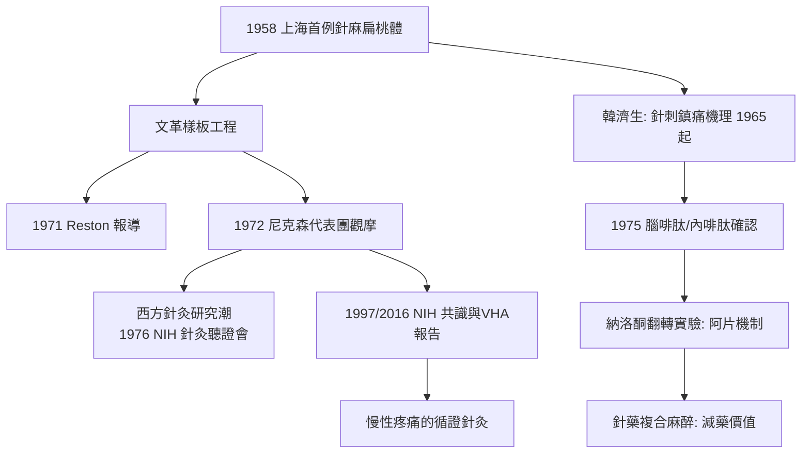

## 1971 - 針刺麻醉震驚西方（沒有麻藥的手術室：一場意識形態與神經科學的相遇）

## 案件摘要

**本案的證物，是一段讓世界醫學界瞠目的手術影像。**

針刺麻醉（acupuncture anesthesia）：在病人清醒狀態下，以手法或電針刺激穴位（如合谷、內關、足三里），輔以少量鎮靜藥，完成甲狀腺切除、肺葉切除甚至開顱手術。此技術在 1958 年上海起已開展，1971 年 7 月《紐約時報》記者詹姆斯·萊斯頓（James Reston）在北京以針灸治療術後腹痛的親歷報導，以及 1971–72 年隨尼克森訪華的醫學代表團（包括 Walle Nauta、E. Grey Dimond 等）現場觀摩針麻開胸手術，使其震驚西方——冷戰高壓下的中國手術室，成為國際醫學的突擊參觀現場。本案要偵查兩層謎題：**針麻為什麼部分有效？以及，為什麼它被宣傳成「完全有效」？**

## 前因 -- 為什麼會有這個案子

- **1958 年的「技術躍進」語境**：上海第一人民醫院以針刺代替藥物麻醉完成扁桃體摘除（1958.8），正值「超英趕美」的群眾性技術革新運動——針麻從一開始就承載政治期待，「廢藥麻醉」被宣傳為無產階級醫學的勝利。
- **文獻根據的回溯建構**：針麻的支持者引《內經》刺法、《後漢書》華佗「麻沸散」與《三國演義》關羽刮骨療毒「不用麻藥」——歷史依據其實薄弱，但經絡理論（見 `[0282-針灸甲乙經](0282-針灸甲乙經.md)`）提供了穴位選擇的實際操作地圖。
- **文革的特殊條件**：科研被政治接管，「樣板」需求使針麻成為對外展示窗口；1972 年起大批外國代表團獲准參觀——**開放是表演性的，表演也帶來了真實的科學接觸**。
- **同期的實驗室突破**：1965 年起北京醫學院韓濟生團隊開始針刺鎮痛機制研究——本案的「表演層」之下，藏著一條真實的神經科學偵查線。

## 線索與推理 -- 謎題一：扎幾根針，為什麼能鎮痛？

**推理一：內源性鎮痛系統的解密（本案的硬科學部分）。** 韓濟生等的系統研究揭示針刺鎮痛的時間依賴性：需要誘導期（20–30 分鐘捻針）、有後效應、可被納洛酮（鴉片受體拮抗劑）部分翻轉——這指向**內源性阿片肽**。1975 年後鏈條完成：腦啡肽（1975，Hughes）、內啡肽被確認；針刺促使中樞釋放腦啡肽/β-內啡肽與強啡肽，經導水管周圍灰質—延髓—脊髓的下行抑制系統關閉傷害性訊息（閘門控制的升級版）。同時電針頻率決定釋放何種阿片肽（低頻→腦啡肽/β-內啡肽，高頻→強啡肽）。

$$ \text{針刺刺激} \rightarrow \text{內阿片肽釋放} \rightarrow \text{下行抑制系統} \rightarrow \text{脊髓背角痛覺傳遞受抑} $$

此外非阿片通路（5-HT、去甲腎上腺素、膽囊收縮素 CCK 的抗鎮痛反饋）也參與——**針刺鎮痛是真實的、機制逐步被解析的神經現象**。2000 年代 fMRI 與正子掃描進一步顯示針刺激活腦島、前扣帶迴等痛覺網路。2010 年 Acupuncture in Medicine 及 Cochrane 系列綜述確認：針刺對慢性疼痛（腰痛、膝骨關節炎、偏頭痛預防）有超過安慰劑的小效應——**真，但效應量有限**。

**推理二：謎題二——為什麼針麻手術「成功率」被宣傳得遠高於實際？** 偵查發現三個被掩蓋的變數：

```python
def針麻真相():
    factors = {
        "病人篩選":   "只選對針刺反應好、年輕、意願強的病人",
        "輔助用藥":   "術中常規給杜冷丁/芬太尼/局麻 —— 純針麻極少",
        "手術改良":   "為配合針麻, 簡化術式(如肺切除改針麻適應的術式)",
        "失敗轉換":   "中途失敗改全麻者, 不計入統計失敗",
    }
    return factors
# 1970s 中期官方資料逐漸承認: 針麻適用率僅覆蓋部分手術,
# 1980 年代起在中國正規醫院, 針麻退居輔助地位(針藥複合麻醉)
```

**推理三：為什麼清醒手術仍有價值？——本案的反轉結論。** 針藥複合麻醉（少量麻藥＋電針）的正當價值逐漸顯形：術後甦醒快、減少阿片類用量與副作用（老年、心肺功能差病人受益）、某些手術（甲狀腺手術需病人發聲配合保護喉返神經）清醒有利。2000 年代以來，針藥複合麻醉在甲狀腺、顱底手術的臨床研究重新升溫——**針麻沒有成為麻醉學，卻成為麻醉學的一個減藥工具**。

**推理四：穴位特異性的爭議——本案的懸而未決處。** 針麻理論依賴「穴位選對則效強」；但大量對照試驗顯示真穴與「假穴」（非經非穴）的差異小於預期。兩種解釋並存：（1）淺表刺激（不論何處）皆激活內源性鎮痛；（2）穴位差異存在但效應量小、需要更精細的設計分辨。**本案至今無終審判決——「刺激有效」與「穴位特異」是兩個不同強度的命題。**



**推理五：地緣政治的副產品。** 1972 年後的「針灸熱」使西方第一次大規模正視中醫：1973 年美國已有針灸立法（內華達等州），1997 年 NIH 共識聲明承認針刺對特定疼痛的證據，2016 年 VHA/ Joint Commission 將針灸納入阿片危機的替代方案——**冷戰的宣傳戰，意外為針灸敲開了循證醫學的大門**。

## 結案 -- 後果與影響

- **針刺鎮痛成為中醫現代科學研究最成功的領域**：韓濟生團隊四十餘年研究、發表數百篇機制論文；電針刺激（TEAS）已成為加速康復外科（ERAS）中的減鎮痛輔助技術。
- **方法論的教訓**：針麻的宣傳式報導（成功率虛高）後來成為中國醫學界自我批判的案例——1990 年代以來「針刺麻醉」的科學重述，正是對本案「表演層」的清理。
- **國際針灸的正規化與爭議**：WHO 2002 年針灸適應症清單、ISO 針具標準（2014）、「中醫針灸」入選非遺（2010）——制度化與循證化並行，安慰劑對照的批評亦持續。
- **一句話結案**：針麻案證明了一件被政治宣傳包裹、卻實實在在的事——**人體有自己的藥房**。針刺撥動了它；而證明這一點的，不是手術室裡的政治掌聲，而是納洛酮翻轉實驗那支小小的拮抗劑。

## 關鍵人物與文獻

- 韓濟生（1928–2024）——北京醫學院/北京大學神經科學家，針刺鎮痛機制的系統研究者，本案科學線的主偵。
- James Reston——紐約時報記者，1971.7.26《Now, About My Operation in Peking》，引爆西方關注。
- Walle Nauta、E. Grey Dimond——1972 隨訪代表團的核心醫學家。
- 辛育齡——針麻肺切除手術的臨床開拓者（中日友好醫院首任院長）。
- 上海針麻協作組——1958–70s 樣板工程的實施者。
- 1997 年 NIH Consensus Statement on Acupuncture；Vickers et al., 系列個體病人資料 meta 分析（Arch Intern Med 2012; Acupunct Med 2018）——針刺鎮痛循證地位的裁定書。
