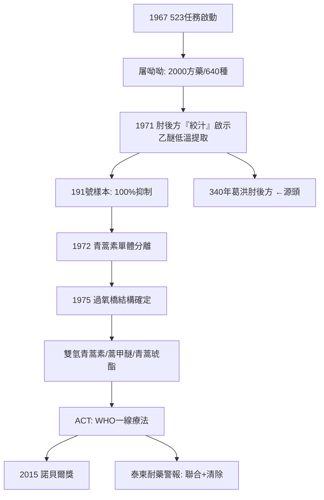

## 1972 - 屠呦呦與青蒿素（第 191 次實驗：一本古書救了幾百萬人）

## 案件摘要

**本案的關鍵證物只有一行古文：青蒿一握，以水二升漬，絞取汁，盡服之。**

1967 年 5 月 23 日，毛澤東下令啟動「523 任務」（代號取自日期），全國六十餘家單位、五百餘名科研人員投入抗瘧藥研發——背景是越戰中瘧原蟲對氯喹普遍耐藥，雙方軍隊因瘧疾減員超過戰傷。中醫研究院的屠呦呦（1930–2021）被任命為組長之一，系統篩查兩千餘個方藥、整理 640 種候選；1971 年 10 月 4 日，第 191 號樣本——**青蒿乙醚中性提取物**——對鼠瘧原蟲抑制率 100%；1972 年分離出有效單體青蒿素（qinghaosu/artemisinin）。1977 年首次臨床試驗成功於海南，其後雙氫青蒿素、蒿甲醚、青蒿琥酯衍生物問世，2000 年代 WHO 推薦青蒿素聯合療法（ACT）為全球瘧疾一線治療。2015 年，屠呦呦獲諾貝爾生理學或醫學獎——中國本土科學家第一個諾貝爾科學獎。本案的謎題：**為什麼金雞納與氯喹之後，一種中式草藥能再次打開抗瘧的大門？**

## 前因 -- 為什麼會有這個案子

- **瘧疾的耐藥危機**：氯喹（1944 年代合成）在 1960 年代全面失效（耐藥瘧原蟲自泰柬邊境擴散）；越戰使問題軍事化——美軍做自身的 523 對應研究（甲氟喹線），中國做 523 任務。
- **中醫藥的政策背景**：1950s「西學中」運動使一批受過現代藥理訓練的研究者進入中醫研究院——屠呦呦 1955 年北京醫學院畢業、1959–62 年參加「西學中班」，**她本人就是匯通與存廢之爭（見 `[1892-...]` `[1929-...]`）歷史壓力下產生的「中西雙語」科學家**。
- **523 任務的分工**：化學合成組（篩選數萬化合物失敗）、中醫藥組（屠呦呦任組長）、臨床與現場組——本案是國家級大科學工程的草台班子版本。
- **青蒿的前史**：青蒿（《神農本草經》上品，見 `[0100-神農本草經](0100-神農本草經.md)`）歷代本草都提治瘧，但傳統煎劑效價不穩；葛洪《肘後備急方》的「絞汁」記載（見 `[0340-葛洪肘後備急方](0340-葛洪肘後備急方.md)`）是本案的密碼本。

## 線索與推理 -- 謎題：瘧疾為何藏於青蒿？為何只有「絞汁」有效？

**推理一：系統篩選為何先失敗？** 屠呦呦團隊早期青蒿提取物抑制率時高時低（12%–84%），幾近放棄。偵查關鍵：**為什麼結果不穩定？**——不同批次藥材、不同煎煮溫度，有效成分含量劇烈波動。線索重新指向《肘後備急方》那行字：「絞取汁」——不是煎。推理躍遷：

$$ \text{煎煮（~100°C）} \Rightarrow \text{有效成分破壞} \qquad \text{絞汁/低溫萃取（乙醚，~35°C 沸點）} \Rightarrow \text{活性保留} $$

1971 年改用乙醚低溫提取，191 號樣本抑制率 100%。**古人的操作細節裡藏著化學：過氧橋鍵對熱不穩定。**

**推理二：青蒿素的化學——本案最漂亮的物證。** 1972 年單體分離、1975 年由中國科學院有機所（周維善等）定出結構：**含過氧橋的倍半萜內酯**。作用機制（1990s–2010s 逐步闡明）：過氧橋在瘧原蟲血紅素（heme）催化下產生自由基，烷化蛋白質與脂質，破壞原蟲代謝——瘧原蟲消化血紅蛋白的「廚房」正是它的死穴。這解釋了為什麼對耐氯喹株依然致命：**機制完全不同，無交叉耐藥。**

```python
# 523 任務的篩選漏斗（本案的偵查流程）
funnel = {
    "收集方藥": 2000+,      # 民間驗方+本草文獻
    "初步整理": 640,        # 篩掉重複與明顯荒謬
    "藥材提取物篩選": 380,   # 動物模型(鼠瘧/猴瘧)
    "有效提取物": 100+,
    "關鍵躍遷": 191,        # 第191號樣本: 青蒿乙醚中性提取物
    "單體分離": 1,          # 青蒿素 (1972)
}
# 教訓: 化學合成組篩了數萬化合物未成 —— 文獻與民間經驗是高先驗機率的礦脈
```

**推理三：臨床與衍生物的工程化。** 1972 年屠呦呦等以自身試藥確定安全性後，1972 年 10 月至海南臨床試用（間日瘧 21 例全部退熱、瘧原蟲轉陰）；1973 年發現雙氫青蒿素效價更高；其後上海藥物所（蒿甲醚）、廣西（青蒿琥酯）完成衍生物。**從提取物到單體到衍生物到聯合用藥**——本案完整演示了現代藥物開發鏈條，只是鏈條的起點是一行公元 340 年的方書。

**推理四：耐藥的陰影——本案未完的章節。** 2000 年代末，泰柬邊境再次出現青蒿素延遲清除（delayed parasite clearance）——耐藥幽靈回歸。WHO 對策：ACT 聯合用藥（青蒿素＋長半衰期搭檔藥如哌喹）、清除性用藥運動。推理教訓：**單一靶點的奇蹟藥終將被演化追上，聯合與清除是唯一活路**——金雞納的故事正在重演，但這次人類有先例可循。

**推理五：榮譽的分配之爭——本案的社會學尾巴。** 2011 年拉斯克獎、2015 年諾獎均單獨授予屠呦呦，引發「集體成果個人領獎」的爭議（523 任務參與者羅澤淵、李國橋、吳伯良、朱海等各有關鍵貢獻）。屠呦呦在諾獎演說中多次引用團隊與 523 集體——**大科學時代的發明權認定，是本案留給科學社會學的附卷**。



## 結案 -- 後果與影響

- **瘧疾死亡率的斷崖**：全球瘧疾死亡從 2000 年的約 73.6 萬降至 2015 年前後的 40 萬餘（WHO World Malaria Report）——ACT 是最大貢獻者之一，非洲兒童為主要受益群體。
- **中醫藥研究的範式樣板**：從古籍線索→現代提取→單體→機制→衍生物→循證臨床，青蒿素模式成為「中藥現代化」的教科書路徑（與砒霜治白血病 `[1999-砒霜治急性前骨髓球白血病](1999-砒霜治急性前骨髓球白血病.md)` 並列為兩大成功案例）。
- **2015 諾獎的象徵意義**：與坎貝爾/大村智（阿維菌素）同獎——「對抗寄生蟲病的革命性療法」；中醫藥第一次以不可辯駁的方式進入世界科學最高殿堂。
- **一句話結案**：本案的兇手是瘧原蟲，兇器是青蒿素的過氧橋，線索是一行古文，偵探是一位沒有博士頭銜、三無科學家（無留洋、無院士、無論文大戶）的藥學研究者。**葛洪寫下「絞汁」時不知道自己在做低溫萃取；屠呦呦讀懂那行字時，替古人完成了實驗設計。**

## 關鍵人物與文獻

- 屠呦呦（1930–2021）——中醫研究院/中國中醫科學院研究員；2015 年諾貝爾生理學或醫學獎（與坎貝爾、大村智同獎）；2016 年國家最高科學技術獎。
- 523 任務集體——六十餘單位五百餘人；李國橋（臨床感染試藥）、羅澤淵（黃花蒿素分離）、魏振興、朱海等各有關鍵貢獻。
- 周維善——青蒿素結構測定（有機化學線）。
- 葛洪《肘後備急方》治寒熱諸瘧方——「青蒿一握，以水二升漬，絞取汁，盡服之」。
- 屠呦呦諾獎演講《青蒿素的發現：傳統中醫藥送給世界的禮物》（2015.12.7，卡羅林斯卡醫學院）。
- Tu, Y., "The discovery of artemisinin (qinghaosu) and gifts from Chinese medicine", *Nature Medicine* 17 (2011)。
- WHO, *Guidelines for the Treatment of Malaria*（ACT 治療指南）。
