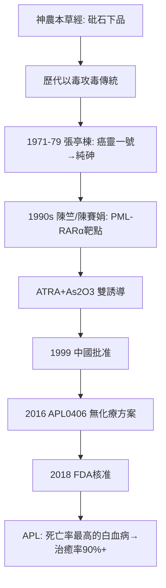

## 1999 - 砒霜治急性前骨髓球白血病（最毒的藥，最準的靶）

## 案件摘要

**本案的兇器是中國最著名的毒藥——砒霜（三氧化二砷），而它現在是白血病的第一線用藥。**

1970 年代，黑龍江哈爾濱醫科大學附屬第一院的張亭棟在民間驗方「癌靈一號」（含砒霜、輕粉/氯化汞、蟾酥）的基礎上追查：動物實驗與臨床顯示有效成分是**砒霜（As₂O₃）**，遂單用砒霜注射液治療急性早幼粒細胞白血病（APL，急性前骨髓球白血病）——1979 年起報導，1990 年代上海血液學研究所王振義、陳竺、陳賽娟團隊闡明機制：砷劑靶向 PML-RARα 融合蛋白、誘導白血病細胞**分化與凋亡**；與全反式維甲酸（ATRA）聯用後，APL 從「最兇險、死亡率最高的急性白血病」（未治療者中位生存數週）變成**治癒率超過 90% 的可治癒白血病**。1999 年國家藥監局正式批准亞砷酸注射液；2016 年起西方多中心試驗（Lo-Coco 等）確認低劑量砷＋ATRA 無化療方案，美國 FDA 於 2018 年核准。本案的謎題：**一味殺人無數的古典毒藥，如何在分子層面成為最精準的靶向藥？**

## 前因 -- 為什麼會有這個案子

- **砒霜的醫學雙面史**：《神農本草經》將砒石列下品（見 `[0100-神農本草經](0100-神農本草經.md)`），歷代外科以砒蝕瘡祛腐（枯痔散、砒劑治梅毒永充的歷史另見性病史書）；《本草綱目》明言其劇毒（見 `[1578-本草綱目李時珍](1578-本草綱目李時珍.md)`）——**以毒攻毒是中藥傳統內建的思想**。
- **民間驗方的線索**：1960–70 年代黑龍江林甸縣一位老中醫以含砒方治癌的傳說，經醫療隊考察上報——張亭棟受派調查，確認藥物對某些白血病人有退熱、止血、腫瘤縮小的效果。
- **APL 的特殊性**：1980s 王振義已發現 ATRA 可誘導 APL 細胞分化（1986 年首例成功）——**「誘導分化而非殺死」的治療哲學**已開闢；砷劑恰好也走這條路，兩者機制互補。
- **陳竺/陳賽娟的雙語團隊**：上海瑞金醫院團隊兼具臨床血液學與分子生物學訓練——本案需要能同時讀懂中藥毒理與基因融合蛋白的人。

## 線索與推理 -- 謎題：砒霜殺人，也救人？它到底殺的是誰、救的是誰？

**推理一：從三味藥到一味藥——成分的偵查。** 「癌靈一號」含砒霜、輕粉（氯化亞汞）、蟾酥。張亭棟等的體外與動物實驗逐味排除：汞劑毒大效弱、蟾酥非必需——**砒霜是唯一有效且安全的活性成分**。這是本案的第一場偵查：把民間複方還原為單一化學實體——與青蒿素路徑（見 `[1972-青蒿素屠呦呦](1972-青蒿素屠呦呦.md)`）完全同構：**驗方→複方→單體→機制**。

**推理二：分子靶點的鎖定。** 1991 年後陳竺、陳賽娟團隊與 Chen G.Q. 等的工作揭示：

$$ \text{As}_2\text{O}_3 \rightarrow \text{結合 PML-RAR}\alpha \text{ 融合蛋白的 PML 結構域} \rightarrow \text{蛋白降解（SUMO 泛素化途徑）} \rightarrow \text{細胞分化/凋亡} $$

APL 的遺傳學本質是 t(15;17) 染色體易位產生 PML-RARα 融合蛋白（阻止髓系細胞分化）；砷劑直接降解這個「犯罪分子」，ATRA 則「策反」其 RARα 端——**雙重打擊，互補解藥**。砷在低濃度促分化、高濃度促凋亡的劑量依賴性，也與傳統「以毒攻毒」的直覺在分子層面重新對接。

**推理三：臨床證據的升級鏈。**

| 階段 | 證據 | 結果 |
|---|---|---|
| 1970s 哈爾濱 | 案例系列（張亭棟等） | 部分緩解，機制不明 |
| 1990s 上海 | 機制＋臨床（陳竺/王振義） | CR 率 >90%，PCR 轉陰病例 |
| 1999 | 中國 NMPA 批准亞砷酸注射液 | 官方藥物化 |
| 2000s | ATRA＋砷＋化療全球試驗 | 治癒率 ~90% |
| 2013–2016 | Lo-Coco APL0406（NEJM） | **低劑量砷＋ATRA 不輸化療、毒性更低** |
| 2018 | FDA 批准（Trisenox 適應症擴展） | 全球一線 |

**推理四：劑量與毒理的平衡木。** 砷劑治療窗的偵查：治療用低劑量靜滴（10 mg/日），避免急慢性砷中毒；監測心電圖（QT 延長風險）；代謝物（甲基砷酸）經尿排出。**中毒與治療的差別只是劑量與監測**——本案是「是藥三分毒」最字面的註腳。

**推理五：本案的歷史辯證。** 值得偵查的反諷：砒霜曾因用作殺人毒藥（潘金蓮案的文化記憶）與職業中毒（砷礦工人）被醫學全面放逐；19 世紀西方也曾用 Fowler 氏液（亞砷酸鉀）治白血病但被化療取代——**藥物的死亡與復活取決於靶點知識何時到位**。1878 年 Fowler 氏液治白血病的報告與 1999 年的砷劑，隔了 120 年，中間站著 1970 年代黑龍江的一位赤腳醫生。

## 結案 -- 後果與影響

- **APL 成為第一個幾乎完全可治癒的急性白血病**——血液學的里程碑；中國方案（ATRA＋砷劑）成為全球標準，且以極低藥價服務發展中國家。
- **中醫藥研究的第二個諾獎級樣板**：與青蒿素並列「驗方—單體—靶點—循證」的兩大成功範式；陳竺後任衛生部部長/全國人大副委員長，陳賽娟、張亭棟多次被提名諾獎（2015 年湯森路透引文桂冠）。
- **「以毒攻毒」的科學平反**：砷劑之後，中藥毒劇藥（附子、雷公藤、馬錢子）的現代研究獲得理論合法性——關鍵是**找到靶點、定量給藥、監測毒理**。
- **機制的再擴展**：砷劑對其他腫瘤（多發性骨髓瘤、MDS）的試驗持續；砷代謝與腸道微生物組的研究開闢新線。
- **一句話結案**：砒霜沒有變，變的是我們對白血病的理解——**當你找到了罪犯的唯一死穴，毒藥就是手術刀**。中醫「以毒攻毒」說了兩千年，直到 PML-RARα 被鎖定的那一天，這句話才第一次有了分子式。

## 關鍵人物與文獻

- 張亭棟（1932–2024）——哈爾濱醫科大學第一附屬醫院，癌靈一號到純砷劑的臨床開拓者（2015 年「引文桂冠獎」入圍者）。
- 王振義（1924–2025）——ATRA 誘導分化治療之父，2010 年國家最高科學技術獎。
- 陳竺、陳賽娟——上海瑞金醫院/上海血液學研究所，砷劑機制與全球方案的完成者。
- 韓銳、孫洪德——早期藥理與臨床協作者；哈醫大一院「癌靈一號」研製組。
- Lo-Coco, F. et al., "Retinoic acid and arsenic trioxide for acute promyelocytic leukemia", *NEJM* 369 (2013)。
- Zhang, T. et al., 哈爾濱早期報導（1979）；Chen, G.Q. et al., *Blood* (1996/1997) 砷誘導凋亡系列。
- 《神農本草經》《本草綱目》砒石條——本案的古典文獻卷宗。
