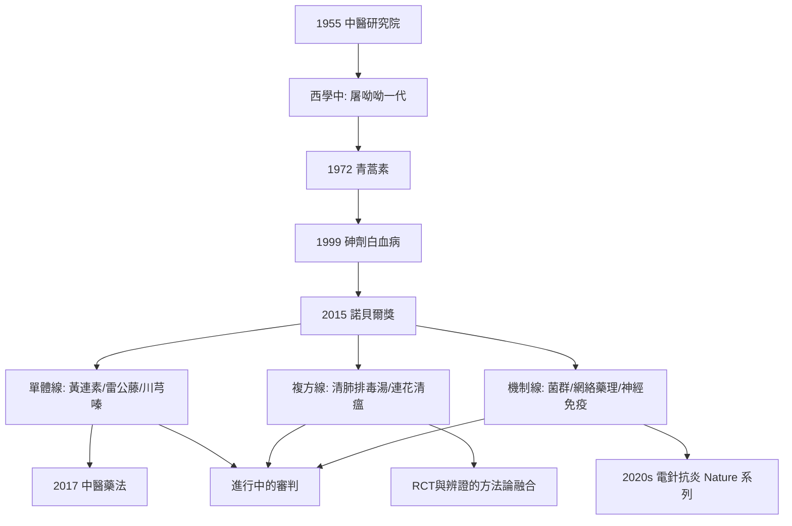

## 2015 - 青蒿素諾獎與現代中醫藥研究（驗證的時代：黃連素、複方與循證的審判庭）

## 案件摘要

**本案是終審判決書的起草現場——但庭審仍未結束。**

2015 年 10 月 5 日，卡羅林斯卡醫學院宣布：屠呦呦獲諾貝爾生理學或醫學獎（青蒿素，見 `[1972-青蒿素屠呦呦](1972-青蒿素屠呦呦.md)`），與坎貝爾/大村智（阿維菌素）同享「對人類最具破壞性寄生蟲疾病的革命性治療」之譽。這是中醫藥現代化六十年工程的加冕禮，也是新一輪審判的開庭：**哪些中藥經得起 RCT 與分子機制的雙重檢驗？哪些只是傳說與安慰劑？**本案偵查現代中醫藥研究的三條主戰線：單體藥物（黃連素、砷劑、天花粉蛋白）、複方與辨證的循證化（針灸、通裡攻下、活血化瘀）、以及機制科學（腸道菌群、網絡藥理學、神經免疫）。

## 前因 -- 為什麼會有這個案子

- **政策基礎設施**：1955 年中醫研究院成立、1956 年四所中醫學院、1950s「西學中」（毛澤東：「中國醫藥學是一個偉大的寶庫」）；1980s 中西醫並重入憲（1982）、1997 年《中醫藥條例》、2017 年《中醫藥法》——**中醫藥研究從自救變成國策**。
- **方法論的引入**：1979 年後 RCT、GCP、循證醫學（1992 Cochrane）、組學技術（基因組、代謝組、單細胞）逐級武裝了中藥研究——「驗證的工具箱」在四十間逐年完備。
- **諾獎前的積累**：青蒿素（1972）、砷劑（1999）、麻黃鹼（1924）、黃連素（1917–2010s）、天花粉蛋白（1970s 引產）、雷公藤（免疫抑制）——一串「單體成功案例」證明瞭礦脈的存在，也暴露了複方驗證的困難。
- **產業與市場的推力**：中藥產業規模萬億級、國際植物藥市場競爭（FDA 植物藥指南 2004）——科學驗證同時是學術問題與貿易壁壘問題。

## 線索與推理 -- 謎題一：單體線——哪些中藥成分已通過現代藥理的審判？

```python
# 現代中醫藥「結案名冊」（截至 2020s 的代表判例）
verdicts = {
    "青蒿素":      "★ 過氧橋殺瘧原蟲 — 2015 諾獎",
    "三氧化二砷":  "★ PML-RARα 靶向 — APL 治癒率 90%+ (2018 FDA)",
    "麻黃鹼":      "★ 擬交感 — 陳克恢 1924, 國際藥理學起點",
    "小檗鹼(黃連素)": "抗菌/降糖: AMPK 激活、LDL 下調 (2004 Nature Med 等線索) — 熱門但臨床證據分級中等",
    "天花粉蛋白":  "核糖體失活蛋白 — 中期妊娠引產, 1980s 臨床",
    "雷公藤甲素":  "免疫抑制 — 類風濕/腎病, 毒性管理是關鍵",
    "川芎嗪":      "抗血小板/鈣拮抗 — 活血化瘀線 (1970s 中科院)",
    "丹參酮/丹酚酸":"抗炎抗氧化 — 心血管大量研究",
    "紫杉醇":      "☆ 嚴格說非中藥 — 但源自植物藥篩選傳統",
}
for drug, v in sorted(verdicts.items()):
    print(f"{drug}: {v}")
```

黃連素（小檗鹼）值得單獨偵查：傳統主治「濕熱痢」（見 `[0100-神農本草經](0100-神農本草經.md)` 黃連條），現代研究揭示其抗腸道病原、透過腸肝軸調節脂代謝（抑制 NPC1L1、激活 AMPK/AMP 感知通路）、調節腸道菌群增加產短鏈脂肪酸菌——**「清濕熱」與「腸道微生態調節」的對應假說正在被檢驗**。臨床證據：降糖降脂有 Meta 分析支持但 RCT 質量參差，尚未成為國際指南藥物——**本案的「有罪推定緩期執行」狀態**。

## 線索與推理 -- 謎題二：複方與辨證——循證醫學能審判一個整體醫學嗎？

**推理一：針灸的循證化（部分通過）。** Cochrane 系列綜述與 Vickers 等個體病人資料分析（2012/2018，約 2 萬病例）：針刺對慢性疼痛優於假針刺與常規治療，但效應量僅為部分真實（真 vs 假差異小）——**結論：有真效應，不全是安慰劑，效應適中**（詳見 `[1971-針刺麻醉震驚西方](1971-針刺麻醉震驚西方.md)`）。2016 年 VHA/聯合委員會把針灸納入阿片危機替代方案——實踐上已部分「結案」。

**推理二：複方的困境——本案最難的案中案。** RCT 的邏輯（固定干預、單一終點、安慰劑對照）與辨證論治的邏輯（動態個體化、隨證加減）存在方法論衝突。解法正在演化：實用性臨床試驗（pragmatic trial）、自適應設計、以「證」分層的亞組分析。案例：2020 年新冠中的清肺排毒湯、連花清瘟——**觀察性研究與 RCT 結果不一、國際接受度分化**，複方循證化仍是進行時。

**推理三：機制科學的三把新鑰匙。**

1. **腸道菌群**：「脾主運化」與菌群代謝軸（四君子湯、補中益氣湯的菌群調節研究；葛根芩連湯降糖與菌群改變的 2018 年 RCT 伴隨菌群分析）——**「後天之本」獲得了微生物組的物質載體候選**。
2. **網絡藥理學**：複方多成分—多靶點的系統生物學建模（2020s 熱潮，需警惕假陽性泛化）——「君臣佐使」被翻譯成網絡拓撲語言的嘗試。
3. **神經—免疫反射**：電針刺激足三里激活迷走神經—腎上腺抗炎軸（2020 年代馬秋富等 Nature/NEJM 研究，包括電針對膿毒症的動物實驗）——**經絡穴位與神經解剖的映射研究正處於黃金期**。

**推理四：失敗與教訓——本案的負面卷宗。** 坦白地清點：中藥注射劑不良反應事件（魚腥草注射液 2006 年叫停）、馬兜鈴酸腎病與致癌（1993 比利時事件起，馬兜鈴科藥物全面整頓）、複方丹參滴丸 FDA III 期結果未達主要終點（2016 報告）、大陸中成藥循證等級總體偏低——**寶庫裡有真金，也有硃砂**（硃砂案的歷史呼應見 `[0100-神農本草經](0100-神農本草經.md)` 的反面物證）。科學驗證不是為了「證明中醫全對」，而是**逐條審判、留真去偽**。

**推理五：本體論的調和正在發生。** 六十年驗證的總結律：**臨床有效與理論正確可以分離**——青蒿素有效而「青蒿性寒」的理論不需要為真；砷劑有效而「以毒攻毒」只是劑量工程的詩意說法。中醫的未來身分可能不是「另一種科學」，而是**世界上最大的、尚未完成篩選的天然產物與臨床觀察資料庫**——而篩選工具，正是本案法庭上的這一套。



## 結案 -- 後果與影響

- **國際科學界的承認門檻**：青蒿素＋砷劑證明瞭「古典文獻＋現代方法」路線的高產；但國際藥監（FDA）至今僅批准個位數植物來源藥——**篩選漏斗遠未跑完**。
- **中醫藥的雙軌定位**：中國境內的「醫療服務＋文化遺產＋產業」三重身分，與國際上的「天然產物研究資源＋補充醫學」身分並行——本案的判決仍在兩個法庭分開進行。
- **教育的轉向**：中醫院校課程中循證醫學、流行病學、科研方法論成為必修——1929 年存廢之戰（見 `[1929-中醫存廢之爭](1929-中醫存廢之爭.md)`）提出的審判問題，已內化為中醫自己的畢業考題。
- **一句話結案**：2015 年諾獎不是中醫的平反，而是篩選的加速——**一個兩千年的臨床資料庫，正在被兩百年的科學方法重新盤點**。青蒿素與砒霜證明寶庫有真金；馬兜鈴酸證明寶庫也有毒；而盤點本身，就是二十一世紀中醫藥的主任務。

## 關鍵人物與文獻

- 屠呦呦——2015 年諾貝爾生理學或醫學獎（詳見 `[1972-青蒿素屠呦呦](1972-青蒿素屠呦呦.md)`）。
- 陳竺、陳賽娟、王振義——砷劑與 APL（見 `[1999-砒霜治急性前骨髓球白血病](1999-砒霜治急性前骨髓球白血病.md)`）。
- 韓濟生——針刺鎮痛機制（見 `[1971-針刺麻醉震驚西方](1971-針刺麻醉震驚西方.md)`）。
- 馬秋富——電針刺激迷走—腎上腺抗炎軸的神經解剖學研究（Nature 2020/2021 系列）。
- 陳可冀——血瘀證與活血化瘀的循證研究（冠心病），中西醫結合的臨床標竿。
- Vickers, A.J. et al., "Acupuncture for chronic pain: individual patient data meta-analysis", *Arch Intern Med* 172 (2012)。
- Liu et al., 黃連素降脂機制（*Nature Medicine* 2004 相關線）；葛根芩連湯菌群 RCT（*EBioMedicine* 2018）。
- WHO Traditional Medicine Strategy 2014–2023／ICD-11 傳統醫學章節（2019）——制度化層的官方卷宗。
