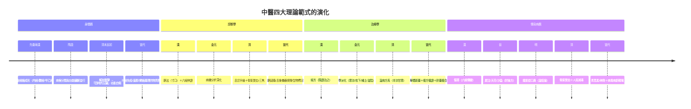

# 中醫的歷史：從甲骨文的「疾齒」到青蒿素的過氧橋——一份兩千年的臨床與理論檔案

> 本書以「推理探案」的體例，為中醫史上的每個關鍵事件寫一篇 wiki：
> 謎題是什麼（脈象能告訴我們什麼？瘧疾為何藏於青蒿？）？前因是什麼？線索與推理如何展開？
> 背後的理論（陰陽五行、臟象經絡、辨證論治、藥性理論）如何構建，現代藥理與臨床科學又如何驗證或推翻？
> 每篇檔名以年份開頭（4 位數，負年以 `-` 開頭，如 `-0150-難經.md`）。

## 雙線主軸

| 線 | 演變 |
|---|---|
| **理論建構線** | 靈異病因 → 陰陽五行/臟象經絡 → 六經辨證 → 病機分類 → 脈舌客觀化 → 功能模型自衛 → 科學化驗證 |
| **臨床實效線** | 巫醫一體 → 經方湯液 → 急救手冊 → 國家出版與藥典 → 瘟疫新地圖 → 傳染病預防 → 單體新藥與循證 |

---

## 年表（非常詳細版）

### 第一篇：巫與醫的分家——占卜桌上的疾病檔案

| 年份 | 事件 | 意義 | wiki |
|---|---|---|---|
| 約前 6000 | 賈湖遺址骨器與占卜組合 | 占卜儀式傳統的史前層 | 同上 |
| 約前 1250–1190 | 商王武丁期殷墟甲骨：疾首/疾目/疾齒/疾腹五十餘病名；「疾年」「雨疾」；婦好產育卜辭 | 中國最早的疾病記錄：身體部位化＋可記錄化＋群體視角 | [-1250-甲骨文疾病記載](-1250-甲骨文疾病記載.md) |
| 前 11 世紀起 | 《周禮》醫政官僚制（食醫/疾醫/瘍醫/獸醫） | 醫療的國家化 | 同上 |
| 約前 500–前 300 | 扁鵲（秦越人）行醫傳說；「六不治」宣言 | 巫醫分家的象徵事件 | 同上 |
| 約前 300 | 馬王堆《足臂十一脈灸經》等帛書（前 168 入葬） | 經絡理論的「草稿版」 | 同上 |
| 約前 150 | 《難經》八十一難：獨取寸口、臟腑度量、命門三焦 | 診斷標準化的第一步 | [-0150-難經](-0150-難經.md) |

### 第二篇：體系的大爆炸——內經、本草與經方

| 年份 | 事件 | 意義 | wiki |
|---|---|---|---|
| 約前 200–前 100 | 《黃帝內經》成書：《素問》《靈樞》各 81 篇 | 陰陽五行公理系統＋臟象經絡＋「治未病」；託名黃帝的權威工程 | [-0200-黃帝內經](-0200-黃帝內經.md) |
| 約前 100 | 淳于意「診籍」25 案（載於《史記》） | 中國最早的醫案檔案 | [-0150-難經](-0150-難經.md) |
| 約 100 | 《神農本草經》365 種：三品分類、四氣五味、君臣佐使 | 藥物哲學的開端；麻黃/大黃/常山/黃連的兩千年驗證伏筆 | [0100-神農本草經](0100-神農本草經.md) |
| 約 200–210 | 建安大疫；張仲景《傷寒雜病論》：六經辨證、113 方、「隨證治之」 | 辨證論治憲法誕生；「方書之祖」 | [0210-傷寒雜病論張仲景](0210-傷寒雜病論張仲景.md) |
| 約 260–280 | 王叔和《脈經》：24 脈標準化、寸關尺分部；整理《傷寒論》 | 指下體驗的字典化；傷寒論的第一個載體 | [0280-脈經王叔和](0280-脈經王叔和.md) |
| 282 | 皇甫謐《針灸甲乙經》：349 穴＋深度＋灸量 | 針灸學第一次土地測量；癱子作者的自體實驗 | [0282-針灸甲乙經](0282-針灸甲乙經.md) |
| 約 340 | 葛洪《肘後備急方》：天花、沙蝨、狂犬腦、青蒿絞汁、屍注 | 窮人急救手冊；1670 年後為諾獎提供關鍵線索 | [0340-葛洪肘後備急方](0340-葛洪肘後備急方.md) |
| 500 | 陶弘景《本草經集注》730 種＋《補闕肘後百一方》 | 本草自然分類的開創 | 同上 |
| 約 610 | 巢元方《諸病源候論》：1739 論，全書不載方藥 | 病因病理學獨立成科；寄生蟲/過敏/消渴/腸吻合記錄 | [0610-諸病源候論巢元方](0610-諸病源候論巢元方.md) |
| 652 | 孫思邈《千金要方》：5300 方、「大醫精誠」、婦兒優先、腳氣食療、蔥管導尿 | 臨床百科＋醫學倫理憲章 | [0652-千金方孫思邈](0652-千金方孫思邈.md) |
| 659 | 蘇敬《新修本草》（國家藥典，844 種） | 世界最早的官修藥典之一 | [0100-神農本草經](0100-神農本草經.md) |
| 682 | 《千金翼方》補遺成書 | 千金體系的完成 | 同上 |
| 752 | 王燾《外臺祕要》40 卷 6000 方 | 千金體例的帝國放大版 | 同上 |

### 第三篇：帝國的編輯部——印刷、正典與學派內戰

| 年份 | 事件 | 意義 | wiki |
|---|---|---|---|
| 984 | 丹波康賴《醫心方》（日本） | 漢醫文獻的日本儲存層 | [0610-諸病源候論巢元方](0610-諸病源候論巢元方.md) |
| 1057 | 宋仁宗設校正醫書局（掌禹錫、林億等）：校刊內經/傷寒/金匱/脈經/甲乙/巢氏/千金/外臺 | 國家級醫籍勘誤工程；「我們讀的古代是北宋的」 | [1057-宋校正醫書局](1057-宋校正醫書局.md) |
| 1076 | 太醫局設賣藥所（後惠民和劑局） | 政府親自做藥廠 | 同上 |
| 1082 前後 | 唐慎微《證類本草》 | 宋金元藥物學實際標準 | [1578-本草綱目李時珍](1578-本草綱目李時珍.md) |
| 1107–1110 | 《太平惠民和劑局方》 | 國家成藥標準；溫燥濫用的伏筆 | [1152-劉完素火熱論與金元四大家](1152-劉完素火熱論與金元四大家.md) |
| 1152 起至 1180s | 劉完素《素問玄機原病式》：「六氣皆從火化」，主寒涼 | 金元四大家第一槍 | 同上 |
| 約 1228 | 張從正《儒門事親》：汗吐下攻邪 | 攻下派 | 同上 |
| 1249 | 李杲《脾胃論》：內傷脾胃、甘溫除熱（汴京圍城大疫的產物） | 補土派；外感與內傷的鑑別 | 同上 |
| 1247 | 宋慈《洗冤集錄》：驗屍操作手冊（縊勒鑑別、生前死後傷、火燒、溺死） | 世界最早的系統法醫學專著 | [1247-洗冤集錄宋慈](1247-洗冤集錄宋慈.md) |
| 1308 | 王與《無冤錄》 | 法醫學姊妹篇，東傳朝鮮日本 | 同上 |
| 1347 | 朱丹溪《格致餘論》：「陽常有餘、陰常不足」，滋陰降火 | 滋陰派；四大家收官 | [1152-劉完素火熱論與金元四大家](1152-劉完素火熱論與金元四大家.md) |

### 第四篇：明清的巔峰——本草集大成、溫病新地圖與免疫先聲

| 年份 | 事件 | 意義 | wiki |
|---|---|---|---|
| 1567–1572 | 隆慶年間安徽太平縣痘醫發展種痘法 | 人痘接種的民間起源 | [1681-人痘接種術](1681-人痘接種術.md) |
| 1578 | 李時珍《本草綱目》成稿（52 卷、1892 種、11096 方；1596 金陵本刊行） | 個人完成的博物學工程；批判服食、清洗人部藥 | [1578-本草綱目李時珍](1578-本草綱目李時珍.md) |
| 1642 | 吳又可《溫疫論》：「癘氣從口鼻而入」 | 細菌學之前的傳染病獨立框架 | [1746-葉天士溫熱論與溫病學派](1746-葉天士溫熱論與溫病學派.md) |
| 1681 前後 | 康熙設種痘局、四十九旗種痘；技術經俄羅斯西傳 | 國家免疫規劃的先聲 | [1681-人痘接種術](1681-人痘接種術.md) |
| 1717 | Lady Montagu 自鄂圖曼把種痘引入英國 | 中國經驗的兩次轉手進化 | 同上 |
| 1730 | 王清任著手訪驗屍體（《醫林改錯》1830 刊行） | 中醫內部的解剖修正主義 | [1835-伯駕眼科醫局與西醫東漸](1835-伯駕眼科醫局與西醫東漸.md) |
| 1742 | 《醫宗金鑑》「幼科種痘心法要旨」：時苗/熟苗減毒 | 人體傳代減毒的經驗版 | [1681-人痘接種術](1681-人痘接種術.md) |
| 1746 | 葉天士《溫熱論》：衛氣營血辨證、逆傳心包、舌診升級 | 溫病學派的地圖革命 | [1746-葉天士溫熱論與溫病學派](1746-葉天士溫熱論與溫病學派.md) |
| 1765 | 趙學敏《本草綱目拾遺》＋716 種 | 本草學的拾遺訂正期 | [1578-本草綱目李時珍](1578-本草綱目李時珍.md) |
| 1796 | 琴納牛痘接種（菲普斯首例） | 人痘路線的科學化終點 | [1681-人痘接種術](1681-人痘接種術.md) |
| 1798 | 吳鞠通《溫病條辨》：三焦辨證、銀翹散 | 溫病方書之祖 | [1746-葉天士溫熱論與溫病學派](1746-葉天士溫熱論與溫病學派.md) |
| 1851 | 王孟英《溫熱經緯》 | 傷寒溫病文獻總整合 | 同上 |

### 第五篇：碰撞與存亡——西醫東漸、匯通與存廢之戰

| 年份 | 事件 | 意義 | wiki |
|---|---|---|---|
| 1805 | 皮爾遜攜牛痘抵澳門廣州；邱熺《引痘略》以經絡解牛痘 | 西技的話語吸納模式 | [1835-伯駕眼科醫局與西醫東漸](1835-伯駕眼科醫局與西醫東漸.md) |
| 1835 | 伯駕廣州眼科醫局（博濟醫院）開業 | 西醫系統性登陸中國的起點 | 同上 |
| 1838 | 中華醫學傳道會成立 | 教會醫療網絡的制度化 | 同上 |
| 1851 | 合信《全體新論》等譯書 | 解剖學的本體論衝擊 | 同上 |
| 1866 | 博濟附設南華醫學校；黃寬等第一批華人西醫 | 醫學教育的近代化 | 同上 |
| 1874–1895 | 日本漢醫廢止案 | 余雲岫「外國先例卷宗」的來源 | [1929-中醫存廢之爭](1929-中醫存廢之爭.md) |
| 1884–1897 | 唐容川《血證論》《中西匯通醫經精義》（1892 刊） | 中西匯通的第一面旗 | [1892-中西匯通唐容川](1892-中西匯通唐容川.md) |
| 1893 | 朱沛文《華洋臟象約纂》 | 匯通派的實證翼 | 同上 |
| 1912 | 民初學制不列中醫教育 | 教育系統的長期壓制 | [1929-中醫存廢之爭](1929-中醫存廢之爭.md) |
| 1916 | 余雲岫《靈素商兌》逐條批判內經 | 廢止派的理論預備 | 同上 |
| 1922 | 惲鐵樵《群經見智錄》：「四時的五臟」 | 功能模型的哲學防線 | [1892-中西匯通唐容川](1892-中西匯通唐容川.md) |
| 1929.2 | 衛生部中央衛生委員會通過余雲岫《廢止舊醫案》 | 中醫最接近死亡的一次 | [1929-中醫存廢之爭](1929-中醫存廢之爭.md) |
| 1929.3.17 | 全國醫藥團體代表大會、罷診半日、定國醫節 | 中醫的總動員防禦 | 同上 |
| 1930 | 中央國醫館成立（譚延闓任理事長） | 中醫的半官方化 | 同上 |

### 第六篇：驗證的時代——針刺麻醉、青蒿素、砒霜與諾獎

| 年份 | 事件 | 意義 | wiki |
|---|---|---|---|
| 1955 | 中醫研究院成立；「西學中」運動 | 國家中醫藥科研體系的起點 | [2015-青蒿素諾貝爾獎與現代中醫藥研究](2015-青蒿素諾貝爾獎與現代中醫藥研究.md) |
| 1956 | 北京/上海/廣州/成都四所中醫學院 | 學院化元年 | [1929-中醫存廢之爭](1929-中醫存廢之爭.md) |
| 1958 | 上海首例針麻扁桃體摘除 | 針刺麻醉起步 | [1971-針刺麻醉震驚西方](1971-針刺麻醉震驚西方.md) |
| 1965 起 | 韓濟生團隊針刺鎮痛機理研究 | 本案的科學暗線 | 同上 |
| 1967.5.23 | 「523 任務」啟動（抗瘧全國攻關） | 青蒿素戰役的開端 | [1972-青蒿素屠呦呦](1972-青蒿素屠呦呦.md) |
| 1971.10.4 | 第 191 號樣本：青蒿乙醚提取物 100% 抑制鼠瘧 | 肘後方「絞汁」線索的兌現 | 同上 |
| 1971.7 | 萊斯頓《紐約時報》報導北京針灸親歷 | 針麻震驚西方的引信 | [1971-針刺麻醉震驚西方](1971-針刺麻醉震驚西方.md) |
| 1972 | 尼克森訪華醫學代表團觀摩針麻；青蒿素單體分離 | 冷戰醫學交流與中藥現代化雙線 | 兩案並讀 |
| 1972–79 | 張亭棟確認砒霜為「癌靈一號」有效成分，治 APL | 砒霜治白血病的起點 | [1999-砒霜治急性前骨髓球白血病](1999-砒霜治急性前骨髓球白血病.md) |
| 1975 | 腦啡肽/內啡肽確認；青蒿素過氧橋結構測定 | 兩條線的機制硬科學到位 | 兩案並讀 |
| 1986 | 王振義 ATRA 治 APL 首例成功 | 誘導分化治療哲學 | [1999-砒霜治急性前骨髓球白血病](1999-砒霜治急性前骨髓球白血病.md) |
| 1990s | 陳竺/陳賽娟闡明砷劑靶向 PML-RARα | 以毒攻毒獲得分子式 | 同上 |
| 1997 | NIH 針灸共識聲明 | 針刺鎮痛的循證承認 | [1971-針刺麻醉震驚西方](1971-針刺麻醉震驚西方.md) |
| 1999 | 中國批准亞砷酸注射液；隨後 ATRA＋砷成 APL 全球標準 | APL 治癒率 90%+ | [1999-砒霜治急性前骨髓球白血病](1999-砒霜治急性前骨髓球白血病.md) |
| 2000s | WHO 推薦 ACT 為瘧疾一線；泰柬耐藥警報 | 青蒿素的全球戰果與未完章節 | [1972-青蒿素屠呦呦](1972-青蒿素屠呦呦.md) |
| 2006 | 魚腥草注射液事件叫停；馬兜鈴酸整頓持續 | 安全性審查的負面卷宗 | [2015-青蒿素諾貝爾獎與現代中醫藥研究](2015-青蒿素諾貝爾獎與現代中醫藥研究.md) |
| 2010 | 「中醫針灸」入選 UNESCO 非遺 | 文化身分的確認 | [0282-針灸甲乙經](0282-針灸甲乙經.md) |
| 2011 | 金陵本《本草綱目》入選《世界記憶名錄》；拉斯克獎授予屠呦呦 | 文獻與科學的雙重加冕 | 兩案並讀 |
| 2013–2016 | APL0406 試驗：低劑量砷＋ATRA 無化療方案 | 中國方案成國際一線 | [1999-砒霜治急性前骨髓球白血病](1999-砒霜治急性前骨髓球白血病.md) |
| 2015.10.5 | 屠呦呦獲諾貝爾生理學或醫學獎 | 中國本土科學第一個諾獎；驗證時代的加冕 | [2015-青蒿素諾貝爾獎與現代中醫藥研究](2015-青蒿素諾貝爾獎與現代中醫藥研究.md) |
| 2017 | 《中醫藥法》施行 | 中醫藥的法律身分 | 同上 |
| 2018 | FDA 核准砷劑 APL 適應症 | 中國方案的最後一道關卡 | [1999-砒霜治急性前骨髓球白血病](1999-砒霜治急性前骨髓球白血病.md) |
| 2019 | ICD-11 傳統醫學章節 | 中醫進入國際疾病分類 | 同上 |
| 2020–2022 | 新冠疫情：清肺排毒湯（經方合方）入診療方案；溫病理論再服役 | 兩千年辨證框架的現場檢驗 | [0210-傷寒雜病論張仲景](0210-傷寒雜病論張仲景.md) |
| 2020s | 電針迷走神經—腎上腺抗炎軸研究（Nature 系列）；腸道菌群與「脾主運化」；網絡藥理學；舌診機器視覺 | 機制科學的黃金期 | [2015-青蒿素諾貝爾獎與現代中醫藥研究](2015-青蒿素諾貝爾獎與現代中醫藥研究.md) |

---

## 核心線索：四大理論的演變

## 四個「驗證成功」的現代樣板（本案群的收束）

| 樣板 | 古籍源頭 | 現代成果 | 機制層 |
|---|---|---|---|
| 青蒿素 | 肘後方「青蒿絞汁」 | 2015 諾獎、ACT 全球一線 | 過氧橋自由基殺瘧原蟲 |
| 砷劑 | 本草經「以毒攻毒」 | APL 治癒率 90%+、2018 FDA | 降解 PML-RARα 融合蛋白 |
| 針刺鎮痛 | 內經/甲乙經刺法 | NIH 共識、慢性疼痛循證 | 內源性阿片肽＋下行抑制 |
| 麻黃鹼 | 本草經「止咳逆上氣」 | 國際藥理學起點（1924） | 擬交感神經作用 |

## 閱讀路線建議

- **主幹線**（理論與典籍）：`-1250-甲骨文` → `-0200-內經` → `-0150-難經` → `0210-傷寒論` → `0280-脈經` → `0282-甲乙經` → `1057-校正醫書局` → `1578-本草綱目` → `1929-存廢之爭` → `2015-諾獎與現代研究`
- **藥物線**：`0100-神農本草經` → `0652-千金方` → `1578-本草綱目` → `1972-青蒿素` → `1999-砒霜白血病` → `2015-現代研究`
- **傳染病線**：`0340-肘後方` → `1247-洗冤集錄`（法醫旁支）→ `1681-人痘` → `1746-溫病學派` → `1835-西醫東漸` → `1972-青蒿素`
- **針灸線**：`-0200-內經` → `0282-甲乙經` → `0652-千金方`（阿是穴）→ `1971-針刺麻醉` → `2015-現代研究`
- **社會史線**：`1057-校正醫書局` → `1152-金元四大家` → `1929-存廢之爭` → `1892-中西匯通` → `2015-現代研究`

---

## 延伸書目（本案群的證據室）

- 李約瑟《中國科學技術史》醫學與化學卷
- 陳邦賢《中國醫學史》、范行準《中國醫學史略》《中國預防醫學思想史》
- 甄志亞《中國醫學史》、常存庫《中國醫學史》（教材系）
- 李建民《死生之域：周秦漢脈學之源流》《發現古脈》
- 趙洪鈞《近代中西醫論爭史》
- 馬堪溫、 Paul Unschuld（文樹德）《Chinese Medicine in History》；Unschuld, *Huang Di Nei Jing Su Wen* 英譯
- 錢超塵《傷寒論文獻通考》、岡西為人《宋以前醫籍考》
- 屠呦呦《青蒿及青蒿素类药物》與 2015 諾獎演講
- 陳可冀《血瘀證與活血化瘀研究》；韓濟生《針刺鎮痛的神經化學原理》
