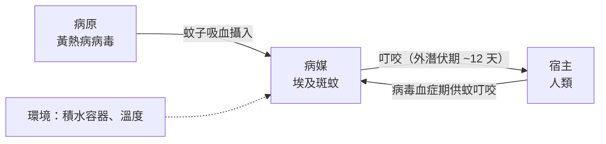

## 1900 - 里德黃熱病蚊媒（以命換證的蚊媒實驗）

## 案件摘要

1900 年夏，美國陸軍**黃熱病委員會**在哈瓦那展開一場前所未有的人體實驗：讓志願者被叮過黃熱病病人的蚊子叮咬。1900 年 11 月，委員會主持人**沃爾特·里德（Walter Reed）**正式確認——**埃及斑蚊（Aedes aegypti）是黃熱病的病媒**，兇手不是衣物與被褥上的「接觸傳染」。確認代價沉重：委員會成員 **Jesse Lazear 醫生死於自己的實驗**。滅蚊運動隨後讓哈瓦那與巴拿馬運河工區的黃熱病絕跡——病媒傳染病（vector-borne）的流行病學時代自此開啟。

## 前因 -- 為什麼會有這個案子

- **黃熱病的美洲噩夢**：黃熱病隨奴隸貿易從非洲抵達美洲，1793 年費城疫情殺死全城十分之一人口；19 世紀末美西戰爭中，美軍在古巴死於黃熱病者遠多於戰死。
- **當時的主流誤解——接觸傳染論（contagionism）**：
  - 黃熱病被認為由病人的衣物、床單「污染」傳播，防疫重點是燒毀衣物、封鎖港口。
  - 1881 年古巴醫生 **Carlos Finlay** 已提出蚊媒假說，但 20 年來無人能以實驗證實。
- **美國的動機**：占領古巴後要治理疫情；更要打通巴拿馬運河——法國公司 1880 年代正是敗給黃熱病（2 萬+ 工人死亡）。
- **X 是兇手**：**黃熱病病毒（Flavivirus）**——由埃及斑蚊傳播；病毒當時尚未被電子顯微鏡看見（人類直到 1927 年才分離出黃熱病毒），但流行病學已能定罪傳播鏈。

## 線索與推理 -- 數學式、程式、理論

**流行病學三角（epidemiological triangle）**——病媒傳染病的分析框架：



斑蚊生物學的關鍵參數：

| 參數 | 數值 | 戰役意義 |
|---|---|---|
| 斑蚊飛行範圍 | <100 公尺 | 滅蚊只需清潔「方圓百米」 |
| 外潛伏期（病毒在蚊體內成熟） | 約 10–14 天 | 病人隔離需 >14 天 |
| 產卵地點 | 清水容器（水缸、瓦罐） | 掀蓋、倒水即可斷鏈 |
| 溫度依賴 | <18°C 傳播力銳減 | 季節性疫情 |

委員會的實驗設計——**以人體為「培養皿」**：

```python
# Camp Lazear 實驗設計（1900 年 11 月-12 月）
experiments = [
    ("實驗組 A", "被感染後 12 天的蚊子叮咬", "2/2 發病"),
    ("實驗組 B", "穿著黃熱病死者的衣物、睡其床鋪（隔絕蚊）", "0/3 發病"),
    ("對照組",   "完全隔離於無蚊營區", "0/5 發病"),
]
for name, design, result in experiments:
    print(f"{name}：{design} → {result}")
```

**這組對比是定罪證據**：接觸「污染衣物」無人發病、被蚊叮咬者全部發病——接觸傳染論被推翻，蚊媒假說成立。Finlay 二十年前的推論獲得證實。

實驗的倫理重量：

$$
\text{科學收益} \;\overset{?}{\leq}\; \text{志願者風險} \quad\Rightarrow\quad \text{Lazear（1866–1900）以生命支付}
$$

志願者簽署了歷史上最早的**知情同意書**之一（明示感染風險、放棄求償），每人獲 100 美元——1900 年這筆錢是一般人近兩個月薪水，倫理爭議至今仍在（「金錢誘導」與「軍人身分」）。

## 結案 -- 後果與影響

- **哈瓦那滅蚊戰役**：William Gorgas 上校執行「斷鏈戰術」——清除積水、油覆水面、紗窗隔離。1902 年後哈瓦那黃熱病絕跡。
- **巴拿馬運河得救**：1904–14 年 Gorgas 在運河工區重施故技，黃熱病 1906 年後絕跡——法國敗給的病，被美國的衛生工程征服。
- **病媒流行病學誕生**：瘧疾（Ross, 1898）與黃熱病確立「病媒」概念，衍生出 Ross–Macdonald 數學模型與現代蟲媒病防治（對照 2015 年茲卡戰役：[2015-茲卡與新興蟲媒病](2015-茲卡與新興蟲媒病.md)）。
- **疫苗的後續**：1937 年 Theiler 開發 17D 減毒疫苗（1951 年諾貝爾獎）——人類終於有黃熱病疫苗，但蚊媒仍在。
- **倫理制度化**：本案是《紐倫堡公約》（1947）與《赫爾辛基宣言》（1964）人體實驗倫理的前史。

### Finlay 的孤獨二十年

Carlos Finlay 在 1881 年就提出蚊媒假說，甚至正確指認了埃及斑蚊這個物種。但他的實驗（用叮過病人的蚊子叮健康人）屢屢失敗——因為他不懂**外潛伏期（extrinsic incubation period）**：病毒在蚊體內需要約 12 天成熟，剛叮過病人的蚊子不具傳染力。Reed 團隊的關鍵改進正是「等 12 天再讓蚊子叮人」——一個參數的修正，讓 20 年的假說變成定罪證據。

### 從黃熱病到全球病媒戰線

本案確立的「病媒三角」框架之後被套用到：

| 病媒病 | 病媒 | 防治主軸 |
|---|---|---|
| 瘧疾 | 按蚊 | 殺蟲劑、藥物、（後來）疫苗 |
| 登革 | 埃及斑蚊/白線斑蚊 | 清除容器積水 |
| 黃熱病 | 埃及斑蚊 | 17D 疫苗＋滅蚊 |
| 茲卡 | 埃及斑蚊 | 同登革（見 [2015-茲卡與新興蟲媒病](2015-茲卡與新興蟲媒病.md)） |

共同敵人都是**同屬的兩種斑蚊**——120 年前 Gorgas 在哈瓦那清積水的方法論，至今仍是登革防治的第一線。

## 關鍵人物與文獻

- **Walter Reed**（1851–1902）：委員會主持人，實驗設計與論文署名者。
- **Jesse Lazear**（1866–1900）：以自身實驗殉職的委員會成員。
- **Carlos Finlay**（1833–1915）：蚊媒假說的原創者，20 年後獲平反。
- **William Gorgas**（1854–1920）：滅蚊戰役的執行將軍。
- **Reed, Carroll, Agramonte, Lazear (1900–01)**：黃熱病委員會報告與論文。
- 跨書連結：[2015-茲卡與新興蟲媒病](2015-茲卡與新興蟲媒病.md)、[1883-科霍霍亂弧菌](1883-科霍霍亂弧菌.md)。
