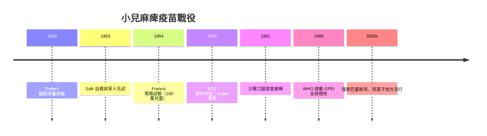

## 1955 - 沙克疫苗（180 萬兒童的史上最大試驗）

## 案件摘要

1955 年 4 月 12 日，密西根大學 Ann Arbor 的記者會上宣布：**Jonas Salk 的滅活小兒麻痺疫苗有效**。這個判決的依據是史上最大的人體試驗——1954 年 **Francis 現場試驗**，全美 44 州、約 180 萬兒童、雙盲安慰劑對照。疫苗保護力 60–90%，全美國教堂鐘聲齊鳴、報紙頭條如釋重負。但數週後爆發的 **Cutter 事故**（活病毒污染致 10 死、164 人癱瘓）提醒世人：疫苗的勝利需要監管制度護航。

## 前因 -- 為什麼會有這個案子

- **小兒麻痺的世紀恐慌**：
  - 1952 年美國疫情高峰：57,879 例、3,145 死、21,269 人留下癱瘓（多為兒童）。
  - 鐵肺（iron lung）病房、夏季「小兒麻痺季」的泳池與電影院關閉——每個家庭都在恐懼中過夏。
- **科學基礎的三大突破**：
  - 1949 年 **Enders、Weller、Robbins** 在非神經組織中培養出小兒麻痺病毒（1954 年諾貝爾獎）——沒有細胞培養，就沒有疫苗量產。
  - 三種血清型（I、II、III）的確認——疫苗必須三價。
  - **Salk 的滅活策略**：甲醛殺死病毒但保留抗原；**Sabin 的減毒策略**：口服活病毒（弱化株）。
- **March of Dimes**：小兒麻痺基金會以數億美元民間捐款資助研究與試驗——史上第一次「公民集資」的醫學大科學。
- **X 是兇手**：**小兒麻痺病毒（Poliovirus，腸道病毒屬）**——糞口傳播，1% 以下感染者出現脊髓前角神經元破壞與癱瘓。

## 線索與推理 -- 數學式、程式、理論

**Francis 現場試驗的統計設計**：

| 組別 | 人數（約） | 麻痺型病例（每 10 萬人） | 保護力 |
|---|---|---|---|
| 疫苗組（雙盲） | 200,745 | 16 | — |
| 對照組（雙盲安慰劑） | 201,229 | 57 | 72%（部分血清型更高，達 90%+） |
| 觀察組（僅接種者可分辨） | 338,778 | 32 | — |

$$
\text{疫苗效力} = \frac{AR_{\text{對照}} - AR_{\text{疫苗}}}{AR_{\text{對照}}} \times 100\% \approx 60\%\text{–}90\%
$$

其中 $AR$ 為攻擊率（attack rate）。雙盲設計（家長、醫師、評估者皆不知分組）排除了觀察偏差——180 萬人的樣本量讓統計功效近 100%。

群體免疫的門檻：小兒麻痺 $R_0 \approx 5\text{–}7$：

$$
p_c = 1 - \frac{1}{R_0} \approx 83\%\text{–}86\%
$$

試驗流程與後續戰役的時間線：



**Cutter 事故的技術根因**：Cutter 實驗室的甲醛滅活不完全、過濾步驟漏掉團聚的活病毒顆粒——5 萬兒童接種了含活毒疫苗。這導致：

```python
cutter = {
    "麻痺病例": "164 名接種兒童癱瘓（連帶家屬傳播 100+ 例）",
    "死亡": "10 人",
    "制度後果": "瓦倫委員會 → 成立生物製品標準局（今 FDA CBER）",
    "監管革命": "批次放行（lot release）制度：每批疫苗經國家實驗室檢驗",
}
for k, v in cutter.items():
    print(f"{k}：{v}")
```

## 結案 -- 後果與影響

- **美國消滅野生小兒麻痺**：1955 年後病例逐年崩落，1979 年美國最後一例野生型病例——疫苗上線 24 年即本土絕跡。
- **沙賓口服疫苗接棒（1961）**：口服、便宜、不需要注射器；弱毒株在腸道增殖可傳給接觸者（群體免疫放大），但極罕見地會突變回復毒力（VDPV）——兩種疫苗的優劣至今仍是根除戰役的技術辯論。
- **全球根除計畫（1988 GPEI）**：全球病例從 1988 年 35 萬例降至 2020 年代每年個位數至百位數；最後堡壘是巴基斯坦與阿富汗——戰亂、疫苗誤傳（政治宣稱疫苗是陰謀）與冷鏈困難是剩餘難點。
- **疫苗監管革命**：Cutter 事故確立的批次放行、GMP 與不良事件監測（VAERS 前身）制度，護航了此後所有疫苗——包括 2020 年的 mRNA 疫苗（見 `../生理醫學史/2020-mRNA疫苗.md`）。
- **科學政治的餘波**：Salk 與 Sabin 的「滅活 vs 減毒」之爭延續終生——兩種路線最終都被證明是對的。

### Ann Arbor 的 4 月 12 日

1955 年 4 月 12 日是佛蘭克林·羅斯福逝世十週年——他本人正是小兒麻痺最著名的患者。宣布大會透過閉路電視直播到全國，教堂鐘聲、學校放假、Salk 登上《時代》封面。但 Thomas Francis 在報告中如實陳述：疫苗對第二型病毒效力只有 60%、部分批次無效——媒體報導與科學保留之間的張力，正是後來 Cutter 事故的心理背景。

### 兩種疫苗的百年辯論

| | 沙克（IPV，滅活注射） | 沙賓（OPV，口服減毒） |
|---|---|---|
| 免疫類型 | 體液免疫為主 | 腸道黏膜＋體液免疫 |
| 群體免疫 | 間接 | 強（疫苗株可傳播給接觸者） |
| 安全性 | 極安全（滅活） | 極罕見 VDPV（疫苗衍生小兒麻痺） |
| 冷鏈需求 | 高 | 中 |
| 根除適用性 | 無疫苗衍生風險 | 可阻斷糞口傳播鏈 |

GPEI 現行的「停用 OPV 轉 IPV」的收尾策略（2016 起撤除第二型口服疫苗），正是這場 70 年辯論的制度性結論：**先靠 OPV 滅火，再靠 IPV 守門**。

## 關鍵人物與文獻

- **Jonas Salk**（1914–1995）：滅活疫苗發明人；名言「誰擁有專利？人民。太陽能屬於太陽。」
- **Thomas Francis Jr.**：試驗主持人與評估者，Salk 的恩師。
- **Albert Sabin**（1906–1993）：口服減毒疫苗發明人。
- **Enders, Weller, Robbins (1949)**：病毒細胞培養的諾貝爾獎突破。
- **Francis et al. (1957)**：*AJPH*，Evaluate the 1954 poliomyelitis vaccine field trial 的總結報告。
- 跨書連結：`../生理醫學史/1954-Salk小兒麻痺疫苗.md`、[1980-天花根除](1980-天花根除.md)（根除學的先例）。
