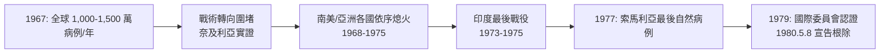

## 1980 - 天花根除（圍堵戰役學的完美收官）

## 案件摘要

1980 年 5 月 8 日，日內瓦世界衛生大會正式宣告：**天花已從地球上根除**。這是人類史上唯一被根除的人類傳染病（另外僅有牛瘟、2011）。這場 184 年的戰爭（自 1796 年牛痘起）的決勝關鍵，是 1967 年 D.A. Henderson 接手的強化計畫：從「大規模接種」轉向**「隔環圍堵（ring vaccination）」**——用 $R_0$ 數學、印度鄉村的監視網、分叉針與冷鏈，把最後的流行窩點一個個掐滅。

## 前因 -- 為什麼會有這個案子

- **根除的四個前提**（本案成為根除學教科書的原因）：
  - 只有**人類**是儲存宿主（無動物宿主可藏身）。
  - 潛伏期明確（~12 天）、無症狀不傳染——**病人出疹才傳播**，可見可追。
  - 康復者獲終身免疫、無復發。
  - 有效疫苗穩定、便宜、單次接種（牛痘）。
- **1959 年的第一嘗失敗**：WHO 啟動根除目標，但依賴各國自願、經費不足、大規模接種覆蓋不均——10 年後每年仍有數百萬病例。
- **1967 年的轉折**：
  - 蘇聯在聯合國提案強化計畫（蘇聯 1930 年代已根除天花，極力推動全球根除）；美國最初懷疑但後來成為最大資助者——**冷戰中罕見的美蘇合作**。
  - **D.A. Henderson** 接任計畫主持人，預算 $240 萬/年、團隊百人，目標 10 年根除。
- **戰術革命**：奈及利亞 1966–67 年疫情中，接種物資短缺，Foege 團隊被迫改用「只圍堵病例周邊」的應急戰術——竟意外奏效，成為戰役核心。

## 線索與推理 -- 數學式、程式、理論

**圍堵戰術的 $R_0$ 數學**——為什麼不必接種 100% 人口：

$$
R_{\mathrm{eff}} = R_0 \times \underbrace{S_{\text{ring}}}_{\text{圍堵環內易感比例}}
$$

天花的 $R_0 \approx 5$。若能對每個病例的**接觸圈**（家屬、鄰里、就醫網）快速接種，把環內易感比例壓到 $< 1/R_0 = 20\%$，則該傳播鏈必然熄滅：

```python
# 隔環圍堵 vs 大規模接種：誰能用更少疫苗滅火？
R0 = 5
# 大規模接種：需要全國覆蓋率
mass_coverage = 1 - 1/R0
# 圍堵：只需壓低「傳播鏈所在社群」的易感者
ring_coverage = 0.15   # 接觸圈快速接種 85%
R_eff = R0 * ring_coverage
print(f"大規模接種需要全國 {mass_coverage:.0%} 覆蓋率")
print(f"圍堵只需環內 {1-ring_coverage:.0%} 接種 → R_eff = {R_eff:.2f} < 1，傳播鏈熄滅")
```

**戰役工具箱**：

| 工具/制度 | 內容 | 意義 |
|---|---|---|
| 分叉針（bifurcated needle） | 讀取一次劑量、成本近零、易訓練 | 疫苗用量降 70%+ |
| 冷鏈 | 太陽能冰箱與保溫箱 | 疫苗到達無電力鄉村 |
| 搜尋與監視網 | 印度 10 萬+ 搜尋員、賞金制度、周報 | 病例從「報告」變「主動獵捕」 |
| 隔環圍堵 | 病例 → 追蹤接觸者 → 環狀接種 | 對症下藥的彈藥分配 |
| 蘇聯疫苗供應 | 冷凍乾燥疫苗（蘇聯供應 4.5 億劑） | 冷戰中的生命線 |

**印度的最後戰役（1973–75）**：疫情窩點在比哈爾、北方邦——1975 年 5 月印度最後一例。最後的自然病例是 1977 年 10 月索馬利亞 Merka 的廚師 Ali Maow Maalin（他原為醫院廚師，因接種隊未及而感染——康復後成為根除隊員）。

最後階段的戰役邏輯：



## 結案 -- 後果與影響

- **直接收益**：每年節省全球數十億美元（接種、隔離、治療成本）；估計根除投資的年報酬率達 46%——公共衛生史上投報率最高的項目。
- **根除學的建立**：隔環圍堵成為標準戰術——2014 年西非伊波拉疫情、2022 年猴痘（mpox）疫情都沿用了 ring vaccination。
- **雙重用途爭議**：根除後天花毒株僅存於美國 CDC（亞特蘭大）與俄國 VECTOR（新西伯利亞）兩處；1990 年代起 WHO 反覆辯論「銷毀 vs 保留」；911 之後天花成為**生物恐怖**首要威脅，美國甚至為軍人與第一線人員重新接種。
- **猴痘的接班人**：天花根除後，疫苗接種停止，猴痘病毒的生態位空出——2022 年 mpox 全球疫情是天花根除的長期生態後果之一。
- **本篇與公共衛生書的分工**：本篇聚焦「根除如何達成」的戰役學；政策與國際治理層面見公共衛生書的同名篇。

### 分叉針：根除戰役的低科技英雄

分叉針（bifurcated needle）由 Aaron Ismach 設計：兩股不鏽鋼叉、每針只吸取一次 0.0025 ml 疫苗，成本約數美分。訓練口訣「刺、挑」五秒鐘完成接種，非醫療人員一日可接種數百人。全球根除戰役共用掉數億支分叉針——**根除學的核心教訓之一：決定戰役成敗的常不是尖端科學，而是正確的簡單工具**。

### 根除學的成敗對照

天花之後的根除嘗試成績單：

| 目標疾病 | 年代 | 結果 | 失敗/成功原因 |
|---|---|---|---|
| 天花 | 1967–1980 | 成功 | 無動物宿主、症狀可見、單劑疫苗 |
| 瘧疾 | 1955–1969 | 失敗 | 病媒與病原皆抗藥、熱帶後勤崩潰 |
| 麻疹 | 2001 起倡議 | 進行中 | 需 95% 覆蓋、有症狀前傳播 |
| 小兒麻痺 | 1988 起進行 | 99.9% 達成 | 最後一哩受戰亂與疫苗政治阻撓 |
| 龍線蟲 | 1986 起進行 | 近成功 | 純行為介入（濾水）＋無疫苗 |

天花之所以是「唯一成功的人類傳染病」，差異全在**生物學前提**——這是本案留給根除學最重要的分類框架。

## 關鍵人物與文獻

- **D.A. Henderson**（1928–2016）：根除計畫主持人；*Smallpox: The Death of a Disease*（2009）。
- **William Foege**：圍堵戰術的原創者，後任 CDC 局長。
- **Viktor Zhdanov**：蘇聯科學家，1958 年提出根除提案的推手。
- **Ali Maow Maalin**：史上最後一位天花自然病例（1977），後來投身小兒麻痺根除。
- **WHO (1980)**：*The Global Eradication of Smallpox: Final Report*。
- 跨書連結：[1796-牛痘接種](1796-牛痘接種.md)、`../生理醫學史/1980-天花根除.md`、`../生理醫學史/1885-Pasteur狂犬疫苗.md`。
