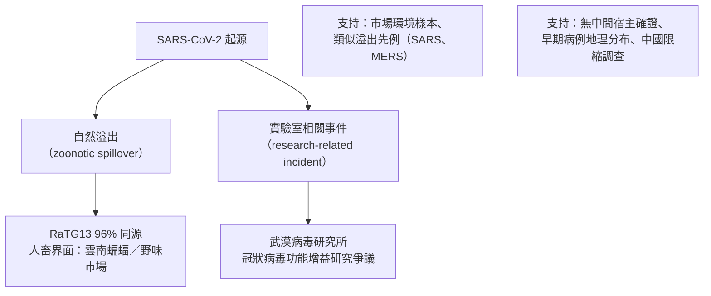

## 2019 - 新冠病原體偵查（48 小時定序共享的偵查革命）

## 案件摘要

2019 年 12 月下旬，武漢出現「不明原因肺炎」病例群。2020 年 1 月 10 日——從樣本上機到全球共享不到兩週——中國科學家公布 **SARS-CoV-2 全基因組**，這是**史上最快的病原體定序共享**。10 天內德國團隊發布 PCR 檢測引子、63 天內 mRNA 疫苗完成序列設計。本案是傳染病偵查技術的巔峰：定序、開放科學、變異株追蹤與起源調查，全部在一場大流行中即時上演。

## 前因 -- 為什麼會有這個案子

- **12 月 26–31 日的偵測起點**：武漢市中心醫院醫生（張繼先等）通報不明肺炎群聚；12 月 31 日武漢市衛健委公告、WHO 接獲通報——SARS 記憶（[2003-SARS冠狀病毒](2003-SARS冠狀病毒.md)）讓全球偵查系統快速啟動。
- **2019 年 12 月底—2020 年 1 月初的定序**：
  - 武漢病毒研究所、復旦大學張永振團隊等多方取得支氣管肺泡灌洗液樣本。
  - 元月 5 日張永振團隊完成定序並上傳；1 月 10–12 日基因組序列經 virological.org 等管道全球共享。
- **為什麼快**：宏基因組次世代定序（mNGS）＋ SARS 的冠狀病毒預判 + 開放共享文化（GISAID 平台）。
- **X 是兇手**：**SARS-CoV-2**——β 冠狀病毒屬、與 SARS-CoV 同屬 sarbecovirus 亞屬、全基因組與蝙蝠冠狀病毒 RaTG13 同源性 ~96%。

## 線索與推理 -- 數學式、程式、理論

**偵查時間線**——與歷史大案的定序速度對照：

| 案件 | 病原確認 | 從病例到定序 |
|---|---|---|
| 1918 大流感 | 79 年（1997–2005 復原） | — |
| 2003 SARS | ~4 個月 | — |
| 2019 新冠 | **~10 天** | 史上最快 |

**病毒演化的追蹤**——分子時鐘與變異株：

$$
t_{\text{MRCA}} \approx \frac{d}{2\mu} \quad,\quad \mu \approx 10^{-3} \text{ 替換/位點/年（冠狀病毒）}
$$

2020–22 年的變異株譜系（Pango lineage 命名）：

```python
variants = [
    ("Alpha (B.1.1.7)",  "2020.09 英國",   "N501Y 增強結合力"),
    ("Beta (B.1.351)",   "2020.08 南非",   "免疫逃逸"),
    ("Delta (B.1.617.2)","2020.10 印度",   "R0 ≈ 5-7，攻擊力最強"),
    ("Omicron (B.1.1.529)","2021.11 南非",  "50+ 突變、免疫逃逸最大、毒性較低"),
]
for name, origin, trait in variants:
    print(f"{name：18} 出現於 {origin}：{trait}")
```

**開放科學的基礎設施**：

| 平台 | 角色 |
|---|---|
| GISAID | 病毒序列的全球共享（2020 年累計數百萬條序列） |
| Nextstrain | 即時系譜可視化與變異株地圖 |
| Pango lineage | 變異株命名系統 |
| WHO lab network / COG-UK | 全球實驗室聯盟 |

**起源偵查——證據學的兩大假說**：



關鍵點：**兩個假說都不是「證據定罪」，而是「證據學的權衡」**——2021 年 WHO—中國聯合調查與 2023 年 US intelligence community 評估均無法給出最終結論；「難以排除」本身成為科學政治的核心爭議。這提醒我們：偵查技術再強，若關鍵現場（樣本、紀錄）不可及，仍無法定案。

## 結案 -- 後果與影響

- **疫苗的極速反擊**：2020 年 1 月 13 日 Moderna 完成 mRNA 疫苗序列設計、3 月人體試驗、12 月授權——從定序到接種 11 個月，史上最快；原理見 `../生理醫學史/2020-mRNA疫苗.md`。
- **定序共享成為新標準**：GISAID 共享數百萬條序列；「發布即共享」取代了 SARS 時代的期刊競逐——開放科學在大流行中勝出。
- **變異株時代的防疫**：Alpha→Delta→Omicron 的演化迫使人類加速加強針與雙價疫苗；分子流行病學成為日常公共衛生工具。
- **政策面的答卷**：封鎖、檢測、追蹤、疫苗分配（COVAX）的全球實驗——政策層面的完整分析見公共衛生書（2020 新冠答卷、2005 國際衛生條例等篇）。
- **未完之章**：起源調查仍開放中；「疫情預防（pandemic preparedness）」從此成為全球治理常設議題——但下一次溢出（Disease X）仍在等。

### 48 小時的關鍵決策：共享序列

2020 年 1 月 11 日前後，張永振團隊面對的不只是科學問題：序列共享意味著放棄論文優先權、暴露團隊於政治風險。他們選擇上傳——德國 Drosten 團隊得以在數日內設計 PCR 引子（1 月 17 日發布於 WHO 網站），全球檢測同步啟動。**序列共享的 48 小時，換來的是全世界診斷能力的提前數週**——以 1918 年的標準，那個時代連病原是什麼都要等 15 年。

### 起源爭議的證據學紀律

本案留給科學史的重要遺產是如何在**證據不完整**時保持推理紀律：

| 證據類型 | 支持自然溢出 | 支持實驗室相關 |
|---|---|---|
| 基因組 | RaTG13 高同源、無實驗室改造痕跡 | furin 切割位點的出現方式罕見 |
| 病例地理 | 華南海鮮市場早期聚集 | 早期病例分布未必以市場為中心 |
| 場域 | 中間宿主未尋獲（同 SARS 亦費時多年） | 研究所早期病樣、通報紀錄未完整公開 |

兩個假說各自缺少決定性證據——真正的教訓不是「答案為何」，而是**調查權限、樣本保留與透明度本身就是未來防疫能力的核心組成**。

## 關鍵人物與文獻

- **張永振**（復旦大學）：最早完成並共享 SARS-CoV-2 基因組的團隊主持人。
- **石正麗**（武漢病毒研究所）：蝙蝠冠狀病毒與 RaTG13 的研究者，起源爭議的核心人物。
- **Christian Drosten**（柏林夏里特）：1 月 17 日發布全球通用的 PCR 檢測引子。
- **Zhu, N. et al. (2020)**：*NEJM*，最早的新型冠狀病毒分離與鑑定論文。
- 跨書連結：[2003-SARS冠狀病毒](2003-SARS冠狀病毒.md)、`../生理醫學史/2020-mRNA疫苗.md`、`../性病的歷史/1981-CDC報告與愛滋降臨.md`（另一場「不明疾病偵查」的開端）。
