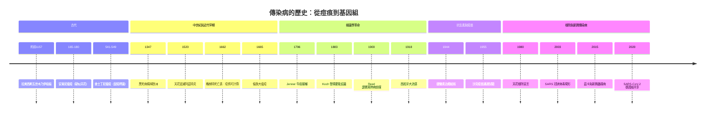

# 傳染病的歷史

> 從法老木乃伊上的痘痕，到武漢實驗室裡 48 小時內定序完成的病毒基因組——一部以「推理探案」體寫成的傳染病偵查史。

本書採用**雙線主軸**：

| 主軸 | 一句話 | 代表案件 |
|---|---|---|
| **病原線**：兇手現形 | 瘴氣 → 細菌 → 病毒 → 病原體基因組，人類一步步「看見」兇手的臉 | 1883 霍亂弧菌、2003 SARS-CoV、2020 SARS-CoV-2 |
| **戰役線**：人類反擊 | 人痘 → 牛痘 → 疫苗與抗生素 → 根除與監測，防禦體系的演化 | 1796 牛痘、1944 鏈黴素、1980 天花根除 |

---

## 歷史年表

### 第一篇　古代：疫病的第一次現身（前 1157 — 549）

| 年份 | 事件 | 意義 | wiki |
|---|---|---|---|
| 約 -1157 | 拉美西斯五世木乃伊面部痘痕 | 最古老的天花實體證據，天花在舊大陸已流行千年 | [-1157-天花與法老痘痕](-1157-天花與法老痘痕.md) |
| -400 前後 | 希波克拉底記錄「瘟疫」與流行病學觀察 | 醫學開始區分疫病與神罰 | — |
| 約 -200 | 中國《黃帝內經》論疫；印度文獻記載人痘觀念 | 輕症接種（variolation）傳統的遠源 | [-1157-天花與法老痘痕](-1157-天花與法老痘痕.md) |
| 165–180 | 羅馬安東尼瘟疫（疑似天花） | 帝國人口損失 10%+，蓋倫親歷記載 | [0165-安東尼瘟疫](0165-安東尼瘟疫.md) |
| 541–549 | 查士丁尼瘟疫（鼠疫桿菌，古代 DNA 已證實） | 拜占庭擴張終結，日死亡以萬計 | [0541-查士丁尼瘟疫](0541-查士丁尼瘟疫.md) |

### 第二篇　中世紀與近代早期：黑死病與生態交換（1347 — 1665）

| 年份 | 事件 | 意義 | wiki |
|---|---|---|---|
| 1347–1351 | 黑死病橫掃歐洲，死亡 1/3–1/2 人口 | 第二次鼠疫大流行開端；代罪羔羊與社會結構劇變 | [1347-黑死病](1347-黑死病.md) |
| 1520 | 天花毀滅阿茲特克，隨後印加 | 哥倫布大交換的「不平衡交換」；新大陸人口 90% 級崩落 | [1520-天花與阿茲特克](1520-天花與阿茲特克.md) |
| 1546 | Fracastoro 提出「疫種（seminaria）」接觸傳染說 | 細菌學說前 300 年的先知假說 | — |
| 1662 | John Graunt 分析倫敦死亡表 | 第一張生命表：疫情偵測從此可計算 | [1662-格朗特死亡表](1662-格朗特死亡表.md) |
| 1665–1666 | 倫敦大瘟疫（~10 萬死）與倫敦大火 | 疫情偵測實作、錯誤對策與瘟年科學（Newton） | [1665-倫敦大瘟疫](1665-倫敦大瘟疫.md) |

### 第三篇　啟蒙與細菌學革命：兇手的臉浮現（1796 — 1918）

| 年份 | 事件 | 意義 | wiki |
|---|---|---|---|
| 1796 | Jenner 以牛痘接種預防天花 | 人類第一次以科學武器正面擊敗傳染病 | [1796-牛痘接種](1796-牛痘接種.md) |
| 1854 | Snow 布羅德街水泵調查 | 流行病學田調方法的誕生 | — |
| 1864 | Pasteur 天鵝頸實驗，否定自然發生說 | 病原來自病原，而非瘴氣 | — |
| 1876–1882 | Koch 柯霍法則確立 | 病原鑑定的黃金標準 | — |
| 1883 | Koch 發現霍亂弧菌，擊敗瘴氣論 | 細菌學對公共衛生學的世紀對決落幕 | [1883-科霍霍亂弧菌](1883-科霍霍亂弧菌.md) |
| 1898 | Ross 證實瘧蚊傳播瘧疾 | 病媒傳染病（vector-borne）時代的開啟 | — |
| 1900 | Walter Reed 黃熱病委員會證實斑蚊傳播 | 人體實驗倫理與滅蚊戰役的起點 | [1900-里德黃熱病蚊媒](1900-里德黃熱病蚊媒.md) |
| 1918–1919 | 西班牙大流感：感染 5 億、死亡 5,000 萬+ | 史上最致命的單一傳染病事件 | [1918-西班牙大流感](1918-西班牙大流感.md) |

### 第四篇　抗生素與疫苗時代：正面戰場（1944 — 1961）

| 年份 | 事件 | 意義 | wiki |
|---|---|---|---|
| 1944 | 鏈黴素首度治癒結核病人 | 「白瘟」第一次可治癒 | [1944-鏈黴素治癒結核](1944-鏈黴素治癒結核.md) |
| 1948 | 英國 MRC 鏈黴素試驗 | 史上第一個隨機對照試驗 | [1944-鏈黴素治癒結核](1944-鏈黴素治癒結核.md) |
| 1954–1955 | 沙克疫苗 Francis 現場試驗（180 萬兒童） | 史上最大人體試驗；Cutter 事故催生疫苗監管 | [1955-沙克疫苗](1955-沙克疫苗.md) |
| 1961 | 沙賓口服減毒疫苗接棒 | 口服、便宜、可阻斷糞口傳播 | [1955-沙克疫苗](1955-沙克疫苗.md) |

### 第五篇　根除與新興傳染病：全球戰線（1980 — 2026）

| 年份 | 事件 | 意義 | wiki |
|---|---|---|---|
| 1980 | 世界衛生大會宣告天花根除 | 人類史上唯一根除的人類傳染病 | [1980-天花根除](1980-天花根除.md) |
| 1981 | CDC 報告五位男同性戀肺囊蟲肺炎病例 | 愛滋時代降臨 | — |
| 1988 | WHO 啟動小兒麻痺全球根除計畫（GPEI） | 根除學的第二次遠征 | [1955-沙克疫苗](1955-沙克疫苗.md) |
| 2002–2003 | SARS 疫情：8,098 病例、774 死 | 冠狀病毒現形；WHO 首次全球旅行警報 | [2003-SARS冠狀病毒](2003-SARS冠狀病毒.md) |
| 2015–2016 | 茲卡疫情與小頭畸形偵破 | 新興蟲媒病與 PHEIC 機制實戰 | [2015-茲卡與新興蟲媒病](2015-茲卡與新興蟲媒病.md) |
| 2019–2023 | COVID-19 大流行；48 小時內公布病毒基因組 | 史上最快的病原體定序共享 | [2019-新冠病原體偵查](2019-新冠病原體偵查.md) |

---

---

## 章節目錄

1. [-1157-天花與法老痘痕](./-1157-天花與法老痘痕.md) — 木乃伊臉上的第一枚證物
2. [0165-安東尼瘟疫](./0165-安東尼瘟疫.md) — 蓋倫親歷的帝國疫劫
3. [0541-查士丁尼瘟疫](./0541-查士丁尼瘟疫.md) — 古代 DNA 抓到的第一隻鼠疫桿菌
4. [1347-黑死病](./1347-黑死病.md) — 三年殺死半個歐洲的完美風暴
5. [1520-天花與阿茲特克](./1520-天花與阿茲特克.md) — 哥倫布大交換的不平衡交換
6. [1662-格朗特死亡表](./1662-格朗特死亡表.md) — 把「誰在死」變成可計算的問題
7. [1665-倫敦大瘟疫](./1665-倫敦大瘟疫.md) — 死亡表、貓狗屠殺與瘟年奇蹟
8. [1796-牛痘接種](./1796-牛痘接種.md) — 人類第一次正面擊敗傳染病
9. [1883-科霍霍亂弧菌](./1883-科霍霍亂弧菌.md) — 細菌學擊敗瘴氣論的世紀對決
10. [1900-里德黃熱病蚊媒](./1900-里德黃熱病蚊媒.md) — 以命換證的蚊媒實驗
11. [1918-西班牙大流感](./1918-西班牙大流感.md) — 五千萬死者的無名兇手
12. [1944-鏈黴素治癒結核](./1944-鏈黴素治癒結核.md) — 白瘟可治與 RCT 誕生
13. [1955-沙克疫苗](./1955-沙克疫苗.md) — 180 萬兒童的史上最大試驗
14. [1980-天花根除](./1980-天花根除.md) — 圍堵戰役學的完美收官
15. [2003-SARS冠狀病毒](./2003-SARS冠狀病毒.md) — 冠狀病毒的現形與快速熄滅
16. [2015-茲卡與新興蟲媒病](./2015-茲卡與新興蟲媒病.md) — 溢出時代的蚊媒全球戰線
17. [2019-新冠病原體偵查](./2019-新冠病原體偵查.md) — 48 小時定序共享的偵查革命

## 姊妹書連結

- [生理醫學史](../生理醫學史/README.md) — Jenner、Pasteur、Koch、Waksman 等免疫學與微生物學基礎篇
- [性病的歷史](../性病的歷史/README.md) — 梅毒、淋病、愛滋：以性接觸為軸的另一批傳染病
