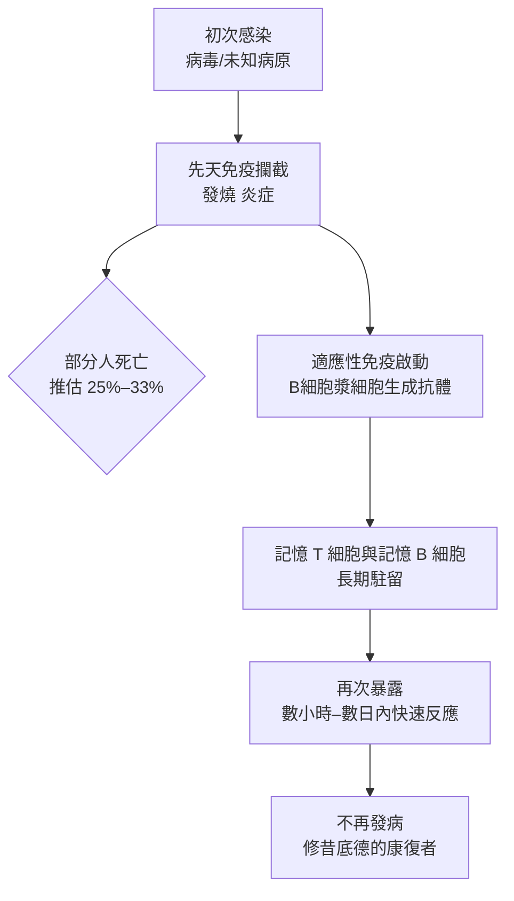

## -430 - 修昔底德與雅典瘟疫的康復者（免疫記憶的第一份目擊證詞）

## 案件摘要

**本案偵破的是免疫學史上最古老的線索：得過病的人，不會再得同樣的病。**

公元前 430 年，伯羅奔尼撒戰爭第二年，一場大瘟疫（後世推測為天花、麻疹、斑疹傷寒或某種未知病原）襲擊了被斯巴達圍困、人口擁擠的雅典。歷史學家修昔底德本人也染病倖存，他在《伯羅奔尼撒戰爭史》中寫下醫學史上第一條關於免疫的觀察：**「病人與垂死者無人照顧，因親友害怕染病而死；但那些曾經患病並已康復的人，最願意（也最有膽量）去照顧病患——因為他們知道，同樣的病不會第二次奪走他們。」** 希臘人稱此狀態為「免疫」（ἀσυλία／im-munitas，原義是「免除公務稅賦」——身體獲得了「免稅權」）。

## 前因 -- 為什麼會有這個案子

- **戰爭把流行病學實驗室搬進了城牆內**。雅典把阿提卡郊區人口全部撤入城內，過度擁擠＋水源污染＋屍體無人掩埋，構成大流行的完美條件；估計雅典約 1/4 至 1/3 人口死亡。
- **醫學無力**。希波克拉底學派的體液學說（見性病史 `../性病的歷史/-0400-希波克拉底精滴症.md` 同源傳統）能解釋「為何生病」，卻完全無法解釋「為何有人好了就不會再病」。
- **神罰論當道**。瘟疫被解讀為神怒，修昔底德刻意採取自然主義立場：「我只記述症狀與我親眼所見，不論病因為何。」
- **照護的兩難**。醫生最先大批死亡（「他們接觸病人最頻繁」），造成照護崩潰——這使得「誰能安全照顧病人」成為攸關城邦存亡的實際問題，而不只是好奇。

## 線索與推理 -- 數學式、程式、理論

**線索一：修昔底德的經驗觀察。** 他注意到三件事：(1) 康復者照顧病人幾乎不再染病；(2) 同一人只在流行中得病一次（頂多極輕微的第二次）；(3) 對別人致命的物質，對康復者無害。用現代語言重寫：

$$ \text{初次感染} \;\longrightarrow\; \text{康復} \;\Longrightarrow\; \Pr(\text{再感染且發病}) \approx 0 $$

**線索二：倖存者偏誤的偵探式排除。** 修昔底德不是在統計，但他的推理避開了當代人的兩個謬誤——把康復歸功於道德（「虔誠者得救」）或體質（「四體液平衡」）。他直接以**行為檢驗**：康復者若不具保護，他們在病房裡的死亡率應與常人相同。事實上他們大量倖存——這是史上第一次用「暴露＋存活」的對照式推理。

**線索三：免疫記憶的現代復盤。** 兩千四百年後我們知道，這個現象的機制是適應性免疫的記憶細胞：

現代免疫學把他的觀察形式化為「免疫記憶」：

$$ \text{二次反應時間} \;(\sim 3\ \text{天}) \ll \text{初次反應時間} \;(\sim 10\ \text{天}) $$

**線索四：後人接住這條線索。** 這段證詞在古代被反覆引用：希臘化時代的 Thucydides 讀者、拜占庭醫家，乃至 18 世紀的接種推動者（見 `1796-金納牛痘接種.md`）都以此證明「人為預先患病可以換取免疫」。修昔底德沒有解釋機制，但他提供了後續兩千年的**公理**：免疫是真實、可觀察、可依賴的現象。

## 結案 -- 後果與影響

- **免疫現象首次入史**。從此「得過病即有護身符」成為地中海—中東醫學常識，奠定了人痘接種（見 `1022-人痘接種傳入中國宮廷.md`）的心理與邏輯基礎。
- **康復者照護制度的原型**。古羅馬、中世紀瘟疫期間（黑死病、天花）普遍僱用康復者照顧病患與處理屍體——這是「免疫者最有價值」的社會實踐，直到血清學時代才被檢驗證實。
- **自然主義史學的方法遺產**。修昔底德「只記症狀、不猜病因」的立場，正是兩千年後臨床流行病學的態度：先建立現象，機制留給未來的偵探。
- **未解之謎**。雅典瘟疫的病原至今未定（2006 年 DNA 分析傾向傷寒沙門氏菌，仍有爭議）——這樁古代命案的兇手身份懸而未決，但被害人「為什麼有人活了下來」的問題，已被正確記錄。
- **一句話結案**：修昔底德沒有找到兇手，卻寫下了免疫學的第一條偵探守則——**兇手不會用同一招殺同一個人兩次**。

## 關鍵人物與文獻

- **修昔底德（Thucydides，約前 460–前 400）**——雅典將軍、史家；染病倖存，其《伯羅奔尼撒戰爭史》卷二 47–54 節的瘟疫記述是免疫記憶的第一份文獻。
- **雅典瘟疫（前 430–前 426）**——估計死亡 7.5 萬–10 萬人，重創雅典人口與士氣；伯里克利本人死於此疫。
- 原始文獻——Thucydides, *History of the Peloponnesian War*, Book II（英譯 R. Crawley, 1874）。
- 現代註腳——「immunity」一詞的拉丁形式 *immunitas* 源自羅馬法的免稅豁免；免疫學的命名本身就帶著「身體獲得法律豁免」的隱喻。
- 延伸閱讀——`1022-人痘接種傳入中國宮廷.md`、`1796-金納牛痘接種.md`（把修昔底德的觀察變成人工技術的兩步）。
