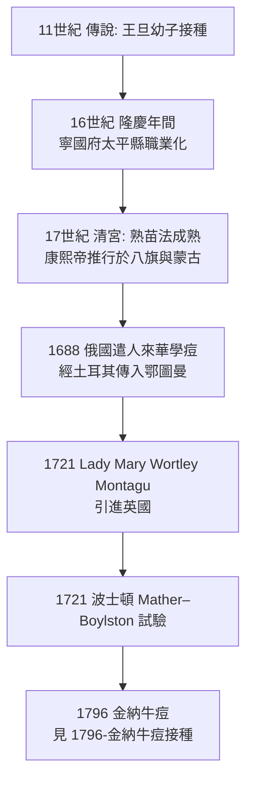

## 1022 - 人痘接種傳入中國宮廷（把免疫變成一門手藝）

## 案件摘要

**本案偵破的是：在細菌與病毒尚未被發現之前，人類如何憑經驗把致命的天花變成可控的感染。**

北宋真宗朝（11 世紀初），宰相王旦苦於天花已奪走數名子女，聽聞四川有醫者（後世傳為「峨嵋山人」）能以「種痘」防天花，遂延請入京為幼子王素接種。清代俞茂鯤《痘科金鏡賦集解》（1727）記載：「聞種痘之法起於明朝隆慶年間寧國府太平縣」，但更早的傳說可溯至宋真宗時期（約 1000–1022 年）。無論確切年份為何，到 16–17 世紀，人痘接種（variolation）已在中國南方形成職業化體系：**取癒合天花病人痘痂研粉，或以痘漿，吹入健康人鼻孔（旱苗法、水苗法），令其患一場可控的輕症，換取終身免疫**。這是人類第一次主動製造免疫。

## 前因 -- 為什麼會有這個案子

- **天花是古代最大殺手之一**。成人死亡率約 30%，兒童更高；倖存者留疤、致盲。中國自晉代葛洪《肘後方》（4 世紀）即有天花記述。
- **修昔底德公理的東方版**。「染過不再染」是普遍經驗（見 `-0430-修昔底德與雅典瘟疫的康復者.md`）——問題只剩：能否**人工地、安全地**得一次輕症？
- **痘疹醫學的積累**。宋代錢乙《小兒藥證直訣》以降，兒科痘疹辨證成熟；醫家長期觀察到「痘出不透則病重，痘透則毒解」的臨床規律，為「引毒外透」的接種思想提供理論外衣。
- **技術條件**。人痘的關鍵不是「敢做」，而是**選材與減毒的經驗法則**：選出疹第 7 天左右、癒後良好的病人之痘痂（「熟苗」），貯藏陳化數月以減低毒力——這正是後來巴斯德「毒力減弱」（attenuation，見 `1885-巴斯德狂犬病疫苗與減毒原理.md`）的經驗前身。

## 線索與推理 -- 數學式、程式、理論

**線索一：人痘的風險效益計算。** 天然天花死亡率約 $30\%$，人痘接種死亡率在成熟技術下約 $0.5\%$–$2\%$：

$$ \text{風險比} \;=\; \frac{\text{接種致死率} \sim 1\%}{\text{天然感染致死率} \sim 30\%} \;\approx\; \frac{1}{30} $$

即人痘把死亡風險壓低約 30 倍——這是前統計學時代可以感知、卻需要勇氣下注的賠率。

**線索二：熟苗法的減毒流程（經驗版減毒工藝）。**

```python
# 中國人痘「熟苗」製備的經驗流程（16–17 世紀復原）
def make_mature_scab(scab, months_stored, donor_survived=True):
    assert donor_survived, "只取輕症癒後良好者之痘痂"
    assert months_stored >= 3, "貯藏數月以陳化減毒"
    powder = grind(scab)              # 研粉
    powder = mix_with_warm_water(powder)  # 水苗法; 或棉花裹粉塞鼻(旱苗法)
    return powder

def variolate(child):
    powder = make_mature_scab(select_best_scab(), months_stored=6)
    insufflate(powder, nostril)       # 鼻孔吹入
    wait_days(6, 8)                   # 發熱出痘
    return "輕痘數顆 → 痂落 → 終身免疫（若運氣夠好）"
```

**線索三：從中國到世界之路。**



**線索四：康熙帝的推手角色。** 康玄燁幼年曾患天花倖存（留下麻臉），深知其害；他下令為皇族與八旗子弟種痘，並推廣至邊疆蒙古諸部（《庭訓格言》：「國初人多畏出痘……朕得種痘方，令子女皆種，遂無恙者」）。**免疫史上第一次由國家政權強力推廣的人工免疫政策**，比歐洲強制接種早了將近一個世紀。

## 結案 -- 後果與影響

- **免疫工程學的起點**。人痘證明了「可控的預先感染可以換取免疫」這條通路可行——1796 年金納只是把「要得一次病」換成「不必得病」（見 `1796-金納牛痘接種.md`）。
- **減毒概念的經驗起源**。「熟苗陳化減毒」的直覺，在 1885 年被巴斯德理論化為 attenuation（見 `1885-巴斯德狂犬病疫苗與減毒原理.md`）。
- **知識傳播史的公案**。人痘經俄國、鄂圖曼帝國傳入英歐；1721 年 Montagu 夫人在英國推廣、波士頓公進行首次帶對照意味的群體試驗——東方技術成為西方免疫學起飛的跑道。
- **陰影面**。人痘不是無害：接種者本身會傳染天花，造成散發流行；這正是金納反對人痘、主張牛痘的核心理由——**更安全的抗原，而非更熟練的手藝**。
- **一句話結案**：在看不見病原的時代，中國痘師用一百年的試錯找到了「選好苗、陳化減毒、鼻內接種」的經驗解——免疫學的第一件手工製品。

## 關鍵人物與文獻

- **王旦（957–1017）**——北宋宰相，因子女多歿於痘而求接種法；其子王素成為傳說中最早的宮廷接種者之一（見周輝《清波雜志》、朱純嘏《痘疹定論》）。
- **峨嵋山人（傳說人物）**——「峨眉山神醫以種痘法入京」的敘事母題；史實性存疑，但反映 11 世紀人痘概念已流通。
- **朱純嘏（1634–1718）**——清初痘醫，《痘疹定論》系統整理人痘法；奉詔為皇族種痘。
- **俞茂鯤**——《痘科金鏡賦集解》（1727）記「種痘起於明隆慶年間（1567–1572）寧國府太平縣」，是人痘職業化的重要文獻年代。
- 原始文獻——朱純嘏《痘疹定論》（1713）；俞茂鯤《痘科金鏡賦集解》（1727）；康熙《庭訓格言》。
- 延伸閱讀——`1721-波士頓人痘試驗與蒙塔古夫人.md`、`1796-金納牛痘接種.md`。
