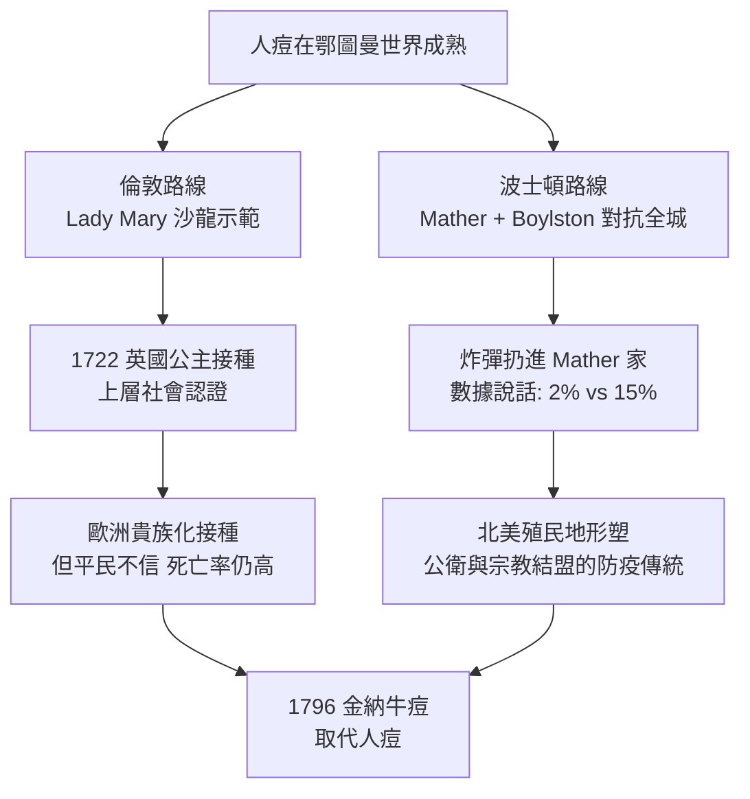

## 1721 - 波士頓人痘試驗與蒙塔古夫人（第一次群體免疫的社會實驗）

## 案件摘要

**本案偵破的是：人痘如何在一年之內，同時說服兩個英語世界——倫敦的沙龍與波士頓的清教徒城鎮——並留下史上第一份半對照的免疫效果數據。**

1721 年春，天花隨「海馬號」軍艦登陸波士頓；同一年，曾在鄂圖曼帝國親眼見證人痘的英國貴婦 Lady Mary Wortley Montagu 在倫敦公開為女兒接種。兩地同時上演的，是免疫學史上第一次「有數據的防疫辯論」：波士頓清教牧師 Cotton Mather（其非洲黑奴 Onesimus 告訴他非洲的接種法）說服醫生 Zabdiel Boylston 給約 240 名市民接種，儘管遭全城醫界圍剿，甚至有人向 Mather 家扔炸彈。結局：接種者死亡約 $2\%$，未接種的疫病人口死亡約 $15\%$——數字替爭論做了結案。

## 前因 -- 為什麼會有這個案子

- **人痘已旅行到鄂圖曼**。人痘經俄國、中亞傳入鄂圖曼帝國（土耳其語 *insibion*），由老婦接種師操作；倫敦大使館醫生 Charles Maitland 亦見證。
- **Lady Mary 的親身賭注**。1715 年她自己因天花毀容、1713 年其弟死於天花；1717 年她在君士坦丁堡為 5 歲兒子接種，1721 年回英後為 4 歲女兒接種——皇室成員（1722 年兩位公主接種）隨後跟進。
- **波士頓的資訊渠道**。Mather 1706 年問奴隸 Onesimus：「你得過天花嗎？」「得過，也種過。」「怎麼種？」「從痘裡取膿割開皮膚放進去——我這一輩子就不會得天花，像死過一次的人。」Mather 在日記裡興奮記下這段話，並查對皇家學會哲學彙刊中 Timonius（1714）的君士坦丁堡報告。
- **社會結構的對照**。倫敦是上流社會示範效應；波士頓是牧師＋單一醫生對抗整個醫界與報紙——兩條完全不同的說服路徑。

## 線索與推理 -- 數學式、程式、理論

**線索一：波士頓的原始數據。** 1721–1722 年波士頓人口約 11,000，天花感染約 5,900 人：

| 組別 | 人數 | 死亡 | 死亡率 |
|---|---|---|---|
| 接種人痘 | 約 240–280 | 約 6 | $\sim 2\%$ |
| 天然感染 | 約 5,900 | 約 850–900 | $\sim 15\%$ |

$$ \text{保護效果} \;=\; 1 - \frac{2\%}{15\%} \;\approx\; 87\% $$

**線索二：半對照的偵探價值與缺陷。** 這不是隨機分組：接種者多為富人且自願。批評者（William Douglass 醫生，哈佛唯一受訓醫師）指控接種會**傳播**天花——這個指控其實部分正確：人痘接種者的確能把天花傳給他人，接種期間散發的病例使流行延長。這是史上第一次有人提出「接種的群體外部性」概念，比 herd immunity 的理論化早了兩百年。

**線索三：兩條說服路徑的對照。**

**線索四：Benjamin Franklin 的反轉。** 當年費城醫界反對接種，Franklin 的幼子 1736 年死於天花，報紙一度傳言「因接種而死」；Franklin 公開闢謠（兒子未接種），並自此終身推廣接種——他後來與醫生合作出版的接種宣傳冊，是史上最暢銷的公衛小冊之一。數據與名人效應，兩百年前已是免疫學的傳播武器。

## 結案 -- 後果與影響

- **免疫學第一次用數字說服社會**。波士頓的 $2\%$ vs $15\%$ 是接種效益最早的群體數據，直接餵養了 18 世紀英國的接種統計學（Arbuthnot、Sutton 父子的改良法）。
- **「接種會傳播」的兩難被正式記錄**。人痘的天花傳播風險，成為後來「減毒疫苗也需注意毒力返祖」議題的先聲（對照 `1885-巴斯德狂犬病疫苗與減毒原理.md`）。
- **上層示範模式成型**。從英國公主到本篤十四世、凱瑟琳大帝（1768 年接種），貴族先接種以安民心的政治劇碼重複上演兩百年——直到 2020 年 COVID 疫苗直播接種，劇本未變。
- **陰影面**。Mather 遭炸彈攻擊、Boylston 被封鎖行醫——接種醫生的安全風險在 19 世紀反疫苗暴動中一再重演；免疫爭議從一開始就不是純科學問題。
- **一句話結案**：1721 年的偵探成果不是技術，而是方法——**把「該不該接種」從神學辯論變成死亡率對比**；免疫學自此踏入了社會說服的戰場。

## 關鍵人物與文獻

- **Lady Mary Wortley Montagu（1689–1762）**——英國駐鄂圖曼大使夫人、作家；1717 年為子接種、1721 年為女接種並在倫敦大力推廣，是英語世界人痘的關鍵推手。
- **Cotton Mather（1663–1728）**——波士頓清教牧師、皇家學會通訊會員；結合 Onesimus 的口述與皇家學會文獻力推接種，遭炸彈襲擊倖免。
- **Onesimus（約 1687–1730？）**——Mather 的非洲黑奴，可能來自西非 Akan 族；提供接種知識，1706 年受洗、1716 年購回自由。
- **Zabdiel Boylston（1679–1766）**——波士頓醫生，全城唯一執行接種者，亦為自己兩個孩子接種；後受聘於英國王室推廣接種。
- **Benjamin Franklin（1706–1790）**——1736 年痛失幼子後轉為接種的最有力民間宣傳者。
- 原始文獻——Zabdiel Boylston, *Historical Account of the Small-Pox Inoculated in New-England*（1726）；Timonius（E. Timoni）, Royal Society *Philosophical Transactions*（1714）。
- 延伸閱讀——`1022-人痘接種傳入中國宮廷.md`、`1796-金納牛痘接種.md`。
