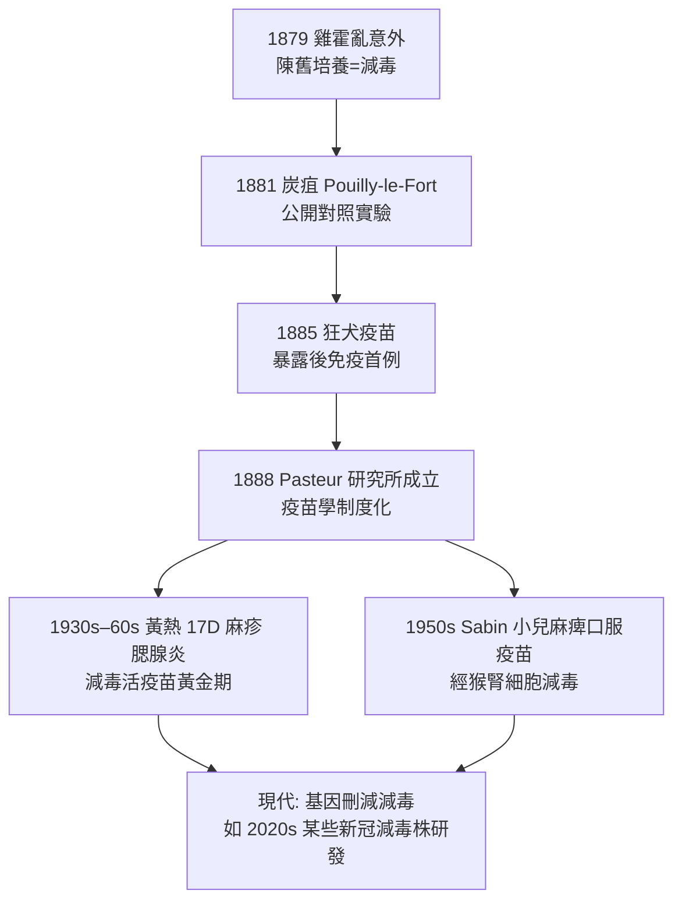

## 1885 - 巴斯德狂犬病疫苗與減毒原理（病原因為「老了、餓了、弱了」）

## 案件摘要

**本案偵破的是：免疫學從「經驗選苗」跨入「可設計的減毒」。**

1885 年 7 月 6 日，被瘋狗咬傷 14 處的 9 歲阿爾薩斯男孩 Joseph Meister 被母親帶到巴黎高等師範學院實驗室。Louis Pasteur 與助手 Émile Roux 已備妥「減毒狂犬病毒」（當時尚不知病毒為何物，只稱之為「超顯微的病原」）——以乾燥的兔脊髓逐步減弱毒力。Pasteur 決定賭上名譽為男孩接種：連續 13 針、毒力遞增的疫苗。Meister 存活。同年 10 月第二例（牧童 Jean-Baptiste Jupille）亦存活。自此「vaccination」泛指一切人工免疫，而「把病原養弱再送進人體」成為疫苗學的通用原理。

## 前因 -- 為什麼會有這個案子

- **1877–1879 雞霍亂的意外**。助手 Charles Chamberland 把培養基放暑假忘記接種，回來後用「陳舊雞霍亂菌」感染雞隻——雞只小病不死；再以新鮮強毒攻擊，雞仍存活。Pasteur 意識到：**陳舊培養＝毒力減弱＝天然疫苗**，並立刻聯想到金納的牛痘（1879 年他在致學院的報告中首次用「vaccination」稱呼此操作）。
- **1881 炭疽疫苗的公開對決**。Pasteur 以氧化鉀與高溫處理炭疽桿菌，在 Pouilly-le-Fort 農場公開實驗：25 隻接種羊 vs 25 隻對照羊；對照組全死，接種組全活——**減毒疫苗的首次大規模公開驗證**，方法論上完勝。
- **狂犬病的難題**。狂犬病原（後知為狂犬病毒，1903 年 Remlinger 分離確認）無法用當時技術在人工培養基上培養，且潛伏期數週至數月——這反常地成了優勢：**疫苗有時間在發病前追上病毒**。
- **巴斯德的個人執念**。少年時目睹家鄉 Jura 的瘋狼咬人惨劇；1846 年後他對「接種不可知」的恐懼有宗教般的敬畏，此案是理性與恐懼的對決。

## 線索與推理 -- 數學式、程式、理論

**線索一：減毒的原理化。** Pasteur 把陳舊培養的偶然發現，提煉為可操作的規則——**在異常環境下連續繼代，病原毒力下降**：

$$ \text{病毒/細菌} \xrightarrow[\text{連續繼代}]{\text{異常環境（乾燥、高溫、異種宿主）}} \text{毒力} \downarrow \;\land\; \text{免疫原性保留} $$

狂犬疫苗的具體工藝：

```python
# 巴斯德狂犬疫苗的減毒流程（1885 復原）
def attenuate_rabies():
    cord = infect_rabbit_spinal_cord("街頭狂犬病毒")   # 兔腦繼代
    cords = []
    for day in range(1, 15):
        cords.append(dry(cord, days=day))              # 空中乾燥 1–14 天
    # 乾燥越久 毒力越弱
    return sorted(cords, key=lambda c: virulence(c))   # 由弱到強

def treat_patient(name, bite_days_ago):
    assert bite_days_ago < 14, "潛伏期內才有勝算"
    for vaccine in attenuate_rabies():                 # 13 針 遞增毒力
        inject(name, vaccine)
    return name  # Joseph Meister: 存活
```

**線索二：免疫追擊的時間窗。** 狂犬疫苗本質上是**暴露後預防**：

$$ \text{接種完成時間} \;(\sim 14\ \text{天}) \;<\; \text{病毒抵達中樞神經時間} \;(\sim 21\ \text{天以上}) $$

免疫反應只需比病毒快——這是免疫學「以時間換空間」的經典應用。

**線索三：理論罩紗——「老病原」的化學想像。** Pasteur 主觀上認為減毒是「氧過多、營養不足」造成的化學老化；真正的遺傳基礎（基因缺失、序列突變）要到 20 世紀分子生物學才揭曉。這個理論錯了，方法論卻對了——**減毒可以在不知道機制時被經驗地實現**。

**線索四：從減毒譜系到現代疫苗。**



## 結案 -- 後果與影響

- **疫苗學成為工程學科**。從「金納的牛痘是自然恩賜」到「減毒可以設計」——1885 年之後，人類第一次覺得傳染病是**可被終結的工程問題**。
- **Pasteur 研究所的建立**。1887 年國際募款（含巴西皇帝、俄國沙皇）成立 Pasteur Institute，成為免疫學—微生物學的全球母港；Roux、Metchnikoff、Bordet 皆在此繼續破案（見 `1890-貝林白喉抗毒素.md`、`1895-博爾代發現補體.md`）。
- **倫理的先例**。Meister 案是首次「在無動物臨床試驗的情況下直接於人體使用新疫苗」；今日看來是倫理紅線，當時卻是「反正不接種必死」的絕境選擇——疫苗倫理的張力自此定型。
- **陰影面**。1902 年聖路易斯「馬腦髓疫苗污染」造成 13 名兒童死於破傷風——減毒活疫苗的量產品管問題；以及 Meister 的後話：1940 年德軍占領巴黎，傳說他為阻止納粹打開 Pasteur 墓而自殺（史實有爭議，但已成免疫學傳說的一部分）。
- **一句話結案**：Pasteur 最大的發現不是某一支疫苗，而是**「病原可以被馴化」**這條普適原理——從牛棚到實驗室，免疫學完成了從手藝到工學的升級。

## 關鍵人物與文獻

- **Louis Pasteur（1822–1895）**——化學家出身的微生物學之父；減毒疫苗、生源論駁斥、巴斯德消毒法；本研究為其生涯最高峰，1887 年中風後仍持續督導研究所。
- **Émile Roux（1853–1933）**——Pasteur 的得力助手，狂犬疫苗動物實驗的實際執行者；後創辦 Pasteur 研究所醫院，並主導白喉抗毒素（見 `1890-貝林白喉抗毒素.md`）。
- **Charles Chamberland（1851–1908）**——高壓滅菌鍋發明人；「忘掉接種」的意外主角，並發明可用於過濾細菌的 Chamberland 濾器（1884）——**病毒的發現工具**。
- **Joseph Meister（1876–1940）**——第一位狂犬疫苗接種者；後任 Pasteur 研究所門房與典藏管理員近半世紀。
- 原始文獻——Pasteur, Chamberland & Roux, *Comptes Rendus Acad. Sci.*, 1881（炭疽）、1884（狂犬）；Pasteur, *Méthode pour prévenir la rage après morsure*, 1885。
- 延伸閱讀——`1796-金納牛痘接種.md`、`1890-貝林白喉抗毒素.md`。
