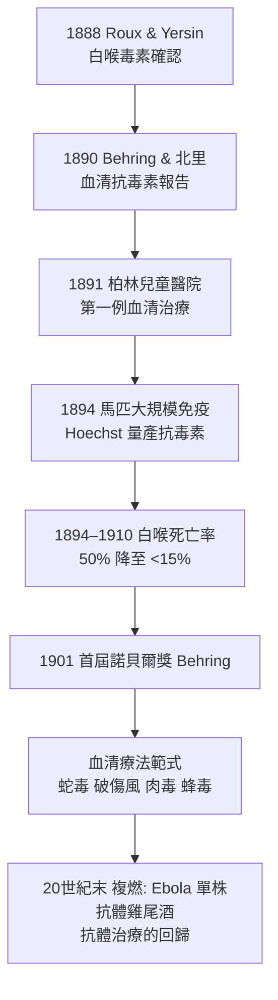

## 1890 - 貝林與北里白喉抗毒素（免疫的第一個「機制性」武器：血清療法）

## 案件摘要

**本案偵破的是：免疫為何有效？第一次有人從動物血液裡，撈出可以轉移給別人的「免疫物質」。**

1890 年，柏林 Koch 研究所的年輕軍醫 Emil von Behring 與日本訪問學者北里柴三郎發表關鍵實驗：以逐步加量的白喉毒素或破傷風毒素免疫家兔、天竺鼠與山羊後，這些動物的**血清**注入未免疫動物體內，可保護其抵禦致死劑量的病原毒素——他們稱之為「抗毒素」（antitoxin）。這是**體液免疫（humoral immunity）概念的誕生**：免疫不是抽象的「體質」，而是可以抽出、轉移、量產的化學實體。1891 年聖誕夜，柏林兒童醫院用馬血清抗毒素救活一名白喉病危女童；兒科白喉死亡率隨之腰斬。Behring 獲 1901 年首屆諾貝爾生理學或醫學獎。

## 前因 -- 為什麼會有這個案子

- **白喉是兒科頭號殺手**。1880 年代柏林每年約 5 萬名兒童感染白喉，死亡率高達 $40\%$–$50\%$；喉頭白膜窒息的慘狀令醫界絕望。
- **毒素學的基礎已備**。1883 年 Klebs 發現白喉桿菌、1884 年 Löffler 純培養；1888 年 Pasteur 研究所的 Roux 與 Yersin 證明**症狀由細菌的「可濾過毒素」造成**，而非細菌本身——這把治療靶點從「殺菌」轉為「中和毒素」。
- **北里的破傷風模型**。北里柴三郎在 Koch 研究所建立純培養的破傷風桿菌與動物模型，並已觀察到免疫動物血清能中和毒素——他帶來的方法學是本案的一半功勞。
- **Kitasato 與 Behring 的化學**。當時血清洗滌、血清分離、動物免疫的技術皆已成熟，缺的是一個把「血清」當作藥物的概念跳躍。

## 線索與推理 -- 數學式、程式、理論

**線索一：血清轉移實驗的邏輯。** 這是免疫學史上最乾淨的推理：

$$ \text{免疫動物血清} + \text{易感動物} \;\longrightarrow\; \text{抵抗致死毒素} $$

血清裡沒有活菌、沒有免疫細胞（當時尚不認識淋巴細胞）——**結論：保護力住在血清的某種化學分子裡**。Behring 稱之為「antitoxin」。這個實驗同時完成了一件史學大事：把「免疫」從形容詞變成名詞——它是一種**可轉移的物質**。

**線索二：劑量—中和的定量。** Behring 建立了「抗毒素單位」的概念：能保護 250 g 天竺鼠抵禦 100 個致死劑量毒素的血清量為 1 單位。這是**免疫學的第一套標準化計量**：

$$ \text{治療劑量} = k \times \text{毒素致死劑量} \quad (k \geq 10) $$

**線索三：從實驗室到藥廠。**

**線索四：理論的第一次交鋒——側鏈學說。** 血清療法提出了「抗毒素是什麼」的謎題。Ehrlich 的**側鏈學說**（1897，見 `1897-埃爾利希側鏈學說.md`）主張：細胞表面的側鏈（受體）被毒素結合後過量再生、脫落進血流，成為游離抗毒素——這是抗體生成機制的第一套理論，也是「受體」概念的誕生。Behring 並不關心理論，但他的血清為 Ehrlich 的理論提供了實驗對象：Ehrlich 後來主持抗毒素**標準化**（以乾燥毒素與抗毒素建立德國國家標準），是免疫學定量化的奠基工程。

## 結案 -- 後果與影響

- **血清療法紀元**。白喉抗毒素是第一種「機制明確、可計量、可量產」的免疫藥物；破傷風、蛇毒、肉毒抗毒素接踵而至——直到今日，抗蛇毒血清仍是同一路範式。
- **體液免疫 vs 細胞免疫的百年戰爭開打**。Behring 的成功使「血清中心論」統治免疫學 50 年；Metchnikoff 的吞噬細胞學說（1883，見 `1895-博爾代發現補體.md`）被邊緣化——這場學派鬥爭要到 1940s Chase 與 1960s T/B 細胞分工（見 `1965-T細胞與B細胞的分工.md`）才和解。
- **生物製藥產業的誕生**。Behring 與 Hoechst 的合作（馬場、血清工廠、專利、全球分銷）是**世界上第一家生物製藥企業**；「從免疫動物血清中提取治療蛋白」的範式，1975 年後被單株抗體（見 `1975-柯勒與米爾斯坦單株抗體.md`）取代，但商業模式一脈相承。
- **陰影面**。血清病（serum sickness）——注射馬血清後的免疫複合物病——是最早被認識的醫源性免疫疾病之一（1906 年 Pirquet 提出 serum sickness，也催生了「變態反應/allergy」概念，見 `1902-里謝發現過敏反應.md`）；以及 Behring 私德爭議（晚年壟斷專利、與同僚決裂）。
- **一句話結案**：Behring 與北里把免疫從「身體的一種狀態」變成「瓶子裡的一種藥」——從此免疫學有市場、有工廠、有劑量單位，也有了下一個謎題：**血清裡那個東西，到底是什麼？**

## 關鍵人物與文獻

- **Emil von Behring（1854–1915）**——德國軍醫、Koch 研究所研究員；首屆諾貝爾生理學或醫學獎（1901）；Marburg 大學教授，晚年經營血清工廠成鉅富。
- **北里柴三郎（1852–1931）**——日本細菌學家、Koch 弟子；破傷風純培養與血清療法共同作者；回國創建北里研究所，並與福澤諭吉共同創辦慶應義塾大學醫學部；遺憾：1901 年諾獎未與 Behring 同獲，被普遍視為諾獎史上的不公案例。
- **Émile Roux（1853–1933）與 Alexandre Yersin（1863–1943）**——白喉毒素的發現者（1888），為抗毒素提供了靶點；Roux 後主導白喉抗毒素的馬匹免疫量產。
- 原始文獻——Behring & Kitasato, *Über das Zustandekommen der Diphtherie-Immunität und der Tetanus-Immunität bei Thieren*, *Deutsche medizinische Wochenschrift*, 1890。
- 延伸閱讀——`1897-埃爾利希側鏈學說.md`、`1975-柯勒與米爾斯坦單株抗體.md`。
