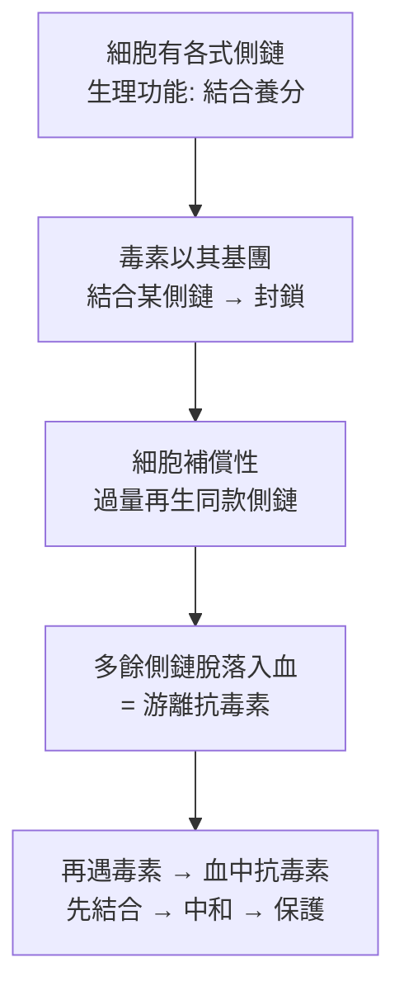

## 1897 - 埃爾利希側鏈學說（受體概念的誕生與第一套抗體理論）

## 案件摘要

**本案偵破的是：血清裡的抗毒素從哪裡來？細胞為什麼能「量身定做」對抗毒素的分子？**

1897 年，Paul Ehrlich 在《Die Wertbemessung des Diphtherieheilserums》（白喉血清的效價測定）系列論文中提出**側鏈學說**（Seitenkettentheorie, side-chain theory）：細胞表面原本就長有各種「側鏈」（Nebenketten），是與養分結合的鎖匙孔；當毒素以某個基團（hapten 半抗原）結合併封鎖側鏈，細胞會**過量再生**同款側鏈、多出來的部分**脫落進入血流**——這些游離的側鏈就是「抗毒素」。這是免疫學第一套完整的抗體生成理論，也是「受體」與「選擇性結合」概念的誕生——1908 年 Ehrlich 與 Metchnikoff 共享諾貝爾生理學或醫學獎。

## 前因 -- 為什麼會有這個案子

- **血清療法留下謎題**。Behring 的抗毒素（見 `1890-貝林白喉抗毒素.md`）證明血清裡有保護物質，但沒人知道它是什麼、從哪來、為何剛好對抗毒素。
- **染料化學的直覺**。Ehrlich 早年研究苯胺染料對細胞的選擇性染色（1878 年他已以亞甲藍分類肥大細胞），深知**「結合」是有化學專一性的**——這是「鎖與鑰」思維的來源。
- **抗毒素標準化的工程壓力**。德國需要為白喉抗毒素血清建立國家標準（限量、定量、可比較）——實務計量問題逼著 Ehrlich 去思考抗毒素的本質。
- **19 世紀末的細胞學**。細胞表面不是「裸膜」，而有各種功能構造的想法正在成形（營養攝取、離子交換）——Ehrlich 把免疫受體放在這條延長線上。

## 線索與推理 -- 數學式、程式、理論

**線索一：側鏈學說的三步推理。**

**線索二：專一性的化學化。** Ehrlich 的革命性在於：抗體與抗原的關係不是模糊的「適應」，而是**剛性化學結合**：

$$ \text{抗毒素} \;+\; \text{毒素} \;\rightleftharpoons\; \text{非共價複合物（鎖–鑰式）} $$

他甚至預言了半抗原（hapten）：小分子能結合抗體卻單獨不能誘發抗體——這個概念在 20 世紀 Landsteiner 的半抗原實驗（見 `1901-蘭茨泰納血型與輸血.md`）中被完整驗證。

**線索三：與 Metchnikoff 的對照與 1908 的和解。**

| | 側鏈學說（Ehrlich） | 吞噬學說（Metchnikoff） |
|---|---|---|
| 關鍵執行者 | 血清分子（化學） | 細胞（生物） |
| 專一性 | 預先存在的鎖匙孔 | 非特異性吞噬 |
| 實驗武器 | 白喉抗毒素 | 海星幼蟲的吞噬觀察 |

1908 年兩人共享諾貝爾獎——**評審當時就看懂了：免疫需要化學（體液）與細胞（細胞性）兩隻手**。這個和解要到 1960s T/B 細胞分工（見 `1965-T細胞與B細胞的分工.md`）才真正在機制層面完成。

**線索四：側鏈學說的錯誤與它催生的新理論。** 側鏈學說主張「**側鏈預先存在於細胞上**」——那麼，細胞怎麼可能預先備好對抗無限多種人工抗原（如 Landsteiner 合成的半抗原）的鎖匙孔？這個矛盾催生了 20 世紀的指令學說（instructive theory：抗原直接「模印」抗體）——而指令學說又被 1957 年 Burnet 的**克隆選擇學說**（見 `1957-伯內特克隆選擇學說.md`）推翻：Burnet 的「每個克隆只做一種抗體、抗原只是選擇者」，其實正是 Ehrlich「選擇（而非指令）」哲學的回歸與升級——偵探史上的「翻案」。

## 結案 -- 後果與影響

- **「受體」概念的誕生**。側鏈＝現代受體的直接祖先；1908 年之後，「細胞以表面分子辨識外界」成為生物醫學的普適原理，一路延伸到激素受體、神經遞質受體、T 細胞受體。
- **免疫學定量化的母基**。Ehrlich 以此學說為基礎建立德國抗毒素標準體系，是 WHO 生物標準品的原型。
- **選擇論哲學的伏筆**。「身體不是被抗原教出來的，而是早已備妥、被抗原選出來的」——這句話是克隆選擇學說的精神內核；Ehrlich 1897 年的理論在 60 年後以新形式復活。
- **陰影面**。側鏈學說在 1900s–1930s 因「預先存在無限側鏈」的不可能性被放棄，Ehrlich 晚年以「側鏈的側鏈」打補丁，理論日益繁瑣——科學史上，錯誤理論最珍貴的遺產是**它逼對手提出的正確問題**。
- **一句話結案**：Ehrlich 把免疫從「身體的一股氣」變成「細胞上的鎖與血中的鑰」——他沒找對鎖匠（克隆選擇是 1957 年的事），但他第一個畫對了鎖的形狀。

## 關鍵人物與文獻

- **Paul Ehrlich（1854–1915）**——德國免疫學家與化療之父；側鏈學說（1897）、抗毒素標準化、606 號洒爾佛散（1910，見性病史 `../性病的歷史/1910-埃爾利希洒爾佛散606.md`）；1908 年諾貝爾獎。
- **Elie Metchnikoff（1845–1916）**——吞噬細胞學說創立者；1908 年與 Ehrlich 同獲諾獎——免疫學第一次「雙手合十」。
- **Karl Landsteiner**——半抗原實驗（1917–1921）間接證明了「預先存在 + 選擇」的必要性，為克隆選擇鋪路。
- 原始文獻——Ehrlich, *Die Wertbemessung des Diphtherieheilserums und deren theoretische Grundlagen*, Klinisches Jahrbuch, 1897。
- 延伸閱讀——`1890-貝林白喉抗毒素.md`、`1957-伯內特克隆選擇學說.md`、`1965-T細胞與B細胞的分工.md`。
