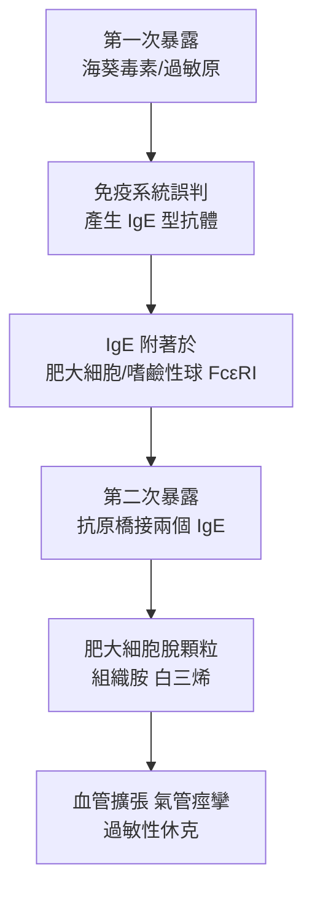

## 1902 - 里謝發現過敏反應（免疫的反面：身體反噬自己）

## 案件摘要

**本案偵破的是：免疫為什麼會殺人？海上皇后號上的狗給出了答案。**

1902 年 1 月，法國生理學家 Charles Richet 與 Paul Portier 隨摩納哥親王阿爾貝一世的遊艇「Princesse Alice II」出海，研究海葵毒素：先給狗注射亞致死劑量毒素，三週後再注射——**原本以為會產生保護性免疫，狗卻在數分鐘內休克死亡，劑量比第一次小得多**。Richet 把這個與免疫相反的現象命名為 **anaphylaxis**（ana＝反向，phylaxis＝保護：「失去保護」）。這是醫學史上第一次證明：**免疫系統可以過度反應而傷害宿主**——過敏、氣喘、休克、甚至自體免疫的大門由此打開。Richet 獲 1913 年諾貝爾生理學或醫學獎。

## 前因 -- 為什麼會有這個案子

- **疫苗與血清的副作用之謎**。人痘、牛痘、白喉抗毒素（見 `1890-貝林白喉抗毒素.md`）都偶發嚴重反應；1893 年柏林曾因抗毒素批號出問題，兒童接種後集體死亡——「治療為何反噬」是懸而未決的臨床謎題。
- **Arthus 的先行觀察（1903 前後）**。Maurice Arthus 幾乎同時發現：反覆皮下注射抗原，局部會出現紅腫壞死（Arthus 反應，Ⅲ 型過敏）——局部型與全身型在同一時間被偵破。
- **海葵毒素研究**。親王資助的海洋毒素計畫原是毒理學研究，Richet 的初衷是**開發抗毒素疫苗**——「造疫苗」意外造出了「反面疫苗」。
- **接種哲學的盲點**。當時普遍相信「少量毒素→免疫」（見 `1796-金納牛痘接種.md` 以來的範式）；沒有人系統性地問過：**免疫會不會反過來？**

## 線索與推理 -- 數學式、程式、理論

**線索一：劑量的悖論。** Richet 的實驗邏輯可寫為：

$$ \text{第一次}：\; \text{劑量 } D < LD_{50} \;\rightarrow\; \text{存活} $$
$$ \text{第二次（}3\text{ 週後）}：\; \text{劑量 } D' \ll D \;\rightarrow\; \text{死亡} $$

正常的免疫是「再遇同抗原，反應更快更強卻無害」；這裡是「再遇，反應更強且**致命**」。Richet 的關鍵洞察是把它定義為**免疫的病態面**，而非新病種。

**線索二：效應動力學。** 過敏反應的速度——分鐘級——排除了「細菌增殖」等慢過程，指向**已預先存在的分子**（後知為 IgE 與肥大細胞上的受體）：

**線索三：三型過敏的後續分型。** Richet 的全身型（Ⅰ 型）之後，免疫病理被偵破為多型：

| 型 | 機制 | 案例 | 偵破者/年代 |
|---|---|---|---|
| Ⅰ | IgE＋肥大細胞 | 過敏性休克、蕁麻疹 | Richet 1902；IgE 1966（見 `1966-石坂父子發現IgE.md`） |
| Ⅱ | 抗體攻擊細胞 | 輸血反應、Rh 溶血 | Landsteiner 1901（見 `1901-蘭茨泰納血型與輸血.md`） |
| Ⅲ | 免疫複合物 | 血清病、Arthus 反應 | Pirquet 1906；Arthus 1903 |
| Ⅳ | T 細胞 | 結核菌素、接觸性皮膚炎 | Landsteiner & Chase 1942（見 `1943-梅達沃與移植排斥的發現.md`） |

**線索四：名詞的誕生與臨床轉化。** Richet 在報告中刻意造了「anaphylaxis」以對比「prophylaxis」；1906 年 Pirquet 又提出「allergy」一詞（allos＋ergon＝異常反應力），涵蓋過敏與血清病。臨床偵破隨之而來：腎上腺素（1903 年起用於休克急救）、後來的抗組織胺（1937–1940s）、腎上腺皮質素（1949 Hench 治類風濕，1950 諾獎）——過敏從「怪病」變成「可治療的免疫失調」。

## 結案 -- 後果與影響

- **免疫學的雙面性被正式承認**。免疫不只是防衛，也是**風險**：過敏、血清病、後來的自體免疫與排斥（見 `1943-梅達沃與移植排斥的發現.md`）——免疫病理學作為分支誕生。
- **寄生蟲學的遠古伏筆**。20 世紀末偵破：IgE 系統真正的演化目的是抗寄生蟲（蠕蟲），過敏是它對現代環境的「錯誤目標」；「衛生假說」（1989 Strachan）把過敏激增與清潔環境連結——Richet 打開的盒子裡藏著寄生蟲史。
- **疫苗學的安全標準**。1902 年後，「過敏性休克」成為任何新生物製品必測的安全指標；現代疫苗禁忌症（蛋過敏等）的科學基礎由此而來。
- **陰影面**。Richet 晚年涉入超心理學與優生學言論——科學偵探的另一面提醒我們：破案者不等於完人。
- **一句話結案**：Richest 的狗用生命證明——**免疫系統是一把上膛的槍，而槍口可以反轉**；免疫學自此有了「敵我辨識系統故障」這個新案卷。

## 關鍵人物與文獻

- **Charles Richet（1850–1935）**——巴黎生理學家、詩人與小說家；1913 年諾貝爾生理學或醫學獎（過敏反應）。
- **Paul Portier（1866–1962）**——索邦生理學家，海葵毒素實驗的共同執行者；晚年撰《血與血液的哲學》。
- **阿爾貝一世（Albert I, Prince of Monaco）**——海洋學親王，出資並隨船；摩納哥海洋研究所創辦人。
- **Clemens von Pirquet（1874–1929）**——維也納兒科醫生；1906 年提出「allergy」與血清病機制；亦為卡介苗接種監測體系的建立者。
- 原始文獻——Portier & Richet, *Comptes Rendus de la Société de Biologie*, 1902；Richet, *L'anaphylaxie*, 1911。
- 延伸閱讀——`1966-石坂父子發現IgE.md`、`1901-蘭茨泰納血型與輸血.md`、`1993-細胞因子風暴的命名.md`。
