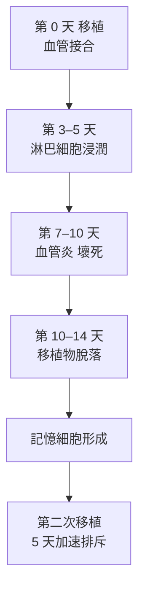

## 1943 - 梅達沃與移植排斥的發現（身體把移植物當作非我）

## 案件摘要

**本案偵破的是：為什麼換來的皮膚總會脫落？免疫的「自己 vs 非自己」第一次在組織層面被定量。**

1943 年，牛津動物學家 Peter Medawar 在英國醫學研究委員會的報告中，以第二次世界大戰燒傷士兵的植皮問題為起點，對家兔進行系統植皮實驗：**自體移植**（自己皮膚）永久存活；**同種異體移植**（他人的皮膚）約 10 天後血管阻斷、被宿主排斥脫落；而**第二次**從同一位供體移植時，排斥加快到約 5 天——**記憶現象出現在移植排斥中**。這證明排斥是一種**主動的免疫反應**，具有特異性與記憶性。移植免疫學、乃至 1953 年免疫耐受（見 `1953-梅達沃免疫耐受實驗.md`）與 1980s 移植藥物時代，都從這份報告起跑。

## 前因 -- 為什麼會有這個案子

- **二戰燒傷潮**。不列顛空戰的燃燒彈造成大量燒傷傷兵；異體植皮是僅有的應急手段，卻幾乎全部失敗——戰爭成為移植免疫的臨床壓力源。
- **歷史的零星線索**。19 世紀 Schöne（1880s）已知自體皮移植成功、異體失敗；1900s Carrel 血管縫合技術讓器官移植在手術層面可行，卻全部被排斥——「手術可行、免疫不可行」的矛盾擺著。
- **腫瘤學的平行發現**。1930s–40s Gross、Foley 等發現小鼠腫瘤在同種小鼠身上被排斥，「移植抗原」概念在癌學圈流傳；Medawar 把它帶入正規實驗動物學。
- **主流解釋的僵局**。當時普遍歸因於「非特異性組織損傷」「營養不良」「神經因素」——沒有人想到排斥是**免疫**。

## 線索與推理 -- 數學式、程式、理論

**線索一：三種移植的對照與二次反應。**

| 移植類型 | 存活時間 | 結論 |
|---|---|---|
| 自體 | 終身 | 手術技術無罪 |
| 同種異體（第一次） | $\sim 10$ 天 | 有主動破壞 |
| 同種異體（同供體第二次） | $\sim 5$ 天 | **免疫記憶** |
| 異種（兔↔鼠） | 更快 | 特異性隨親緣距離增加 |

二次反應的加速是**免疫記憶的組織學證據**——排斥不是技術失誤，而是免疫行為。

**線索二：排斥的免疫學定義。**

$$ \text{排斥} \;\Longleftrightarrow\; \text{特異性} \;\land\; \text{記憶性} \;\land\; \text{可轉移性（至同系個體）} $$

Medawar 與同事後續證明：排斥可由**淋巴細胞**轉移（Mitchison 1954；與 Landsteiner & Chase 1942 的遲發過敏轉移試驗同路，見 `1965-T細胞與B細胞的分工.md`）——排斥的主力是細胞免疫，不是血清抗體。這一點在當年是反主流的。

**線索三：排斥的時間軸。**

**線索四：移植抗原的追捕。** Medawar 與 Snell（Jackson 實驗室，見 `1948-斯內爾組織相容性基因.md`）合作證明：排斥由**細胞表面的遺傳性抗原**決定，親緣越近越相容——這條線索最終指向 MHC（組織相容性複合體），並由 Doherty 與 Zinkernagel 在 1974 年揭示其免疫學真正功能（見 `1974-多赫蒂與青克納格爾MHC限制.md`）。

## 結案 -- 後果與影響

- **移植免疫學誕生**。排斥被正式納入免疫學案卷；「組織相容性」成為器官移植的核心詞彙——腎臟移植（1954 Murray 同卵雙生首例成功）、骨髓移植（1968 Gatti/Thomas）、環孢素（1978–1983 Calne）整條臨床鏈的科學起點。
- **免疫耐受的問題被反問**。排斥證明「非我」會被攻擊；那麼「我」為什麼不被攻擊？——1945 年 Owen 的雙胞胎牛嵌合（見 `1945-歐文紅血球嵌合與免疫耐受.md`）與 1953 年 Medawar 的耐受實驗直接回答了這個反向問題。
- **1960 年諾貝爾獎**。Medawar 與 Burnet 共享（Burnet 的克隆選擇學說，見 `1957-伯內特克隆選擇學說.md`）——選擇理論與耐受實驗同年同獲，免疫學的兩大支柱同框。
- **陰影面**。排斥成為器官黑市與移植不平等的背景板；同時，動物實驗規模化（小鼠近交系工業）也開啟了實驗動物倫理的長期爭議。
- **一句話結案**：Medawar 把植皮失敗從「手術的遺憾」改寫為「免疫的行為」——**身體會檢查每一位訪客的身份證，並記住曾經入侵過的人**；移植醫學的全部戰爭，都是為了偽造這張身份證。

## 關鍵人物與文獻

- **Peter Medawar（1915–1987）**——巴西出生的英國動物學家；移植免疫與免疫耐受的奠基者；1960 年諾貝爾獎；晚年因中風殘疾，仍以《一個科學家的自傳》與幽默隨筆聞名。
- **Thomas Gibson**——格拉斯哥燒傷外科醫生，與 Medawar 合作 1942–43 年的植皮觀察（包括為燒傷病人做自體/異體皮片對照），是本案的臨床起點。
- **George Snell（1903–1996）**——Jackson 實驗室遺傳學家，H-2 組織相容性基因的發現者（1980 諾獎，見 `1948-斯內爾組織相容性基因.md`）。
- **Peter Gorer**——血清學家，與 Snell 合作證明 H-2 抗原與腫瘤排斥相關。
- 原始文獻——Medawar, *The behaviour and fate of skin autografts and skin homografts in rabbits*, J. Anat., 1943–44；Gibson & Medawar, *The fate of skin homografts in man*, J. Anat., 1943。
- 延伸閱讀——`1945-歐文紅血球嵌合與免疫耐受.md`、`1953-梅達沃免疫耐受實驗.md`、`1948-斯內爾組織相容性基因.md`。
