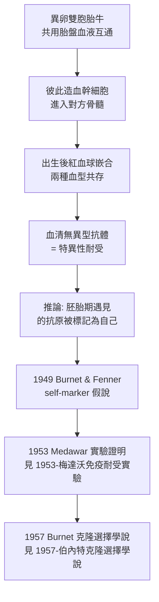

## 1945 - 歐文紅血球嵌合與免疫耐受（身體為什麼不攻擊自己）

## 案件摘要

**本案偵破的是免疫學最大的謎題：免疫系統能攻擊一切非我，為什麼從不攻擊自己？**

1945 年，威斯康辛遺傳學家 Ray Owen 在《Science》報告一個奇怪的事實：**異卵雙胞胎牛**——在子宮裡共用一個胎盤、血液互通的小牛——出生後體內同時循環著**兩種血型的紅血球**（紅血球嵌合，erythrocyte chimera），而且**彼此不會對對方的血型抗原產生抗體**。按 Landsteiner 的規則（見 `1901-蘭茨泰納血型與輸血.md`），B 型牛應該對 A 型紅血球產生 anti-A；但這些小牛終身容忍對方的血球。Owen 的解釋大膽得驚人：**免疫耐受不是天生的，而是在胎兒期「被教會」的——凡是在免疫系統成熟前遇見的抗原，終身被視為自己。** 這篇論文直接催生了 1953 年 Medawar 的實驗耐受（見 `1953-梅達沃免疫耐受實驗.md`）與 Burnet 的克隆選擇學說（見 `1957-伯內特克隆選擇學說.md`）。

## 前因 -- 為什麼會有這個案子

- **農民的百年觀察**。畜牧業早知異卵雙胞胎母牛常有「自由马丁」（freemartin）現象——雌性雙胞胎之一不孕（因為在子宮內被雙胞胎雄性激素影響）。Lillie（1917）證明雙胞胎血液互通是原因——這條畜牧線索在純科學界無人問津。
- **Landsteiner 規則的推論**。按血型免疫學，異型紅血球進入體內應引發抗體（見 `1901-蘭茨泰納血型與輸血.md`）；「共存」是不該發生的現象——**異常的行為往往指向新的規則**。
- **血型鑑定的例行檢查**。Owen 當時在做牛血型的常規分型（農業血緣登記用），嵌合是**從例行數據裡撈出來的意外**——好的偵探不忽略日常卷宗。
- **自身免疫的背景問題**。「為何不攻擊自己」當時流行的解釋是 Ehrlich 的「horror autotoxicus」（自身中毒恐懼，1900）：身體天生忌諱攻擊自己——這是一句格言，不是機制。

## 線索與推理 -- 數學式、程式、理論

**線索一：數據本身。** Owen 以 20 對雙胞胎牛的紅血球凝集試驗證明：絕大多數異卵雙胞胎牛呈現**兩種血型共存的穩定嵌合**，且持續終身；血清中**無**針對對方血型的抗體。

$$ \text{胎兒期引入的異型抗原} \;\longrightarrow\; \text{終身特異性無反應（耐受）} $$

**線索二：Burnet 的靈光（1949）。** Burnet 與 Fenner 在《The Production of Antibodies》第二版中，以 Owen 的觀察為核心推演出「**self-marker hypothesis**」：免疫系統在胚胎期學習何謂「自己」；**凡是此期遇到的抗原，都被寫入自己名單**。這是一個尚未被實驗的理論預言——等待一個敢下注的實驗家。

**線索三：Owen 觀察的邏輯鏈。**

**線索四：與 Ehrlich 格言的對決。** 「horror autotoxicus」假設「攻擊自己」是不可能的；Owen 與 Burnet 反問：**不是不可能，而是被學會了不去做**——耐受是**後天習得**的，因此也可能**失效**（自體免疫病）或**被教錯**（見 `1902-里謝發現過敏反應.md` 的免疫病理）。這個翻轉，把免疫學從「防衛學」變成「辨識學」。

## 結案 -- 後果與影響

- **免疫耐受成為正式案卷**。從 Owen 的牛到 Medawar 的鼠，「耐受」在 8 年內從農場觀察變成實驗科學——1960 年 Medawar 與 Burnet 的諾獎，其問題意識正是 Owen 這篇短文。
- **自體免疫病的新範式**。耐受是學習而來 → 學習可失敗 → SLE、類風濕、第一型糖尿病都是「自我辨識的失誤」；臨床免疫學自此有了統一的病因框架。
- **移植醫學的長期伏筆**。「能否在成人身上人為製造耐受」成為移植免疫的聖杯：骨髓嵌合誘導耐受、腎移植合併骨髓輸注、2020s 的耐受誘導臨床試驗——**Owen 的牛依然是終極目標的藍圖**。
- **陰影面**。耐受理論早期被誤用於解釋腫瘤逃逸（「腫瘤抗原=自己」），延誤了腫瘤免疫的發展；直到 checkpoint inhibitor 時代（見 `2011-艾利森CTLA-4免疫檢查點抑制劑.md`）才修正——理論的勝利有時會遮蔽另一些案卷。
- **一句話結案**：Owen 沒有做一個實驗，他只是**認真對待了一群牛的血型報告**——而免疫學最重要的答案「自己與非我的界線如何畫出」，就寫在異卵雙胞胎小牛的血清裡。

## 關鍵人物與文獻

- **Ray D. Owen（1915–2014）**——加州理工學院遺傳學家；1945 年嵌合發現；後成為免疫遺傳學大師，1978 年 Wolf Prize 得主；一生自謙此發現為「幸運的例行工作」。
- **Frank Macfarlane Burnet 與 Frank Fenner**——1949 年《The Production of Antibodies》第二版提出 self-marker 假說，把 Owen 的觀察理論化。
- **Frank R. Lillie**——1917 年解釋自由马丁現象（胎盤血液互通），Owen 的畜牧學前哨。
- 原始文獻——Owen, *Immunogenetic consequences of vascular anastomoses between bovine twins*, Science, 1945；Burnet & Fenner, *The Production of Antibodies*, 2nd ed., 1949。
- 延伸閱讀——`1953-梅達沃免疫耐受實驗.md`、`1957-伯內特克隆選擇學說.md`、`1901-蘭茨泰納血型與輸血.md`。
