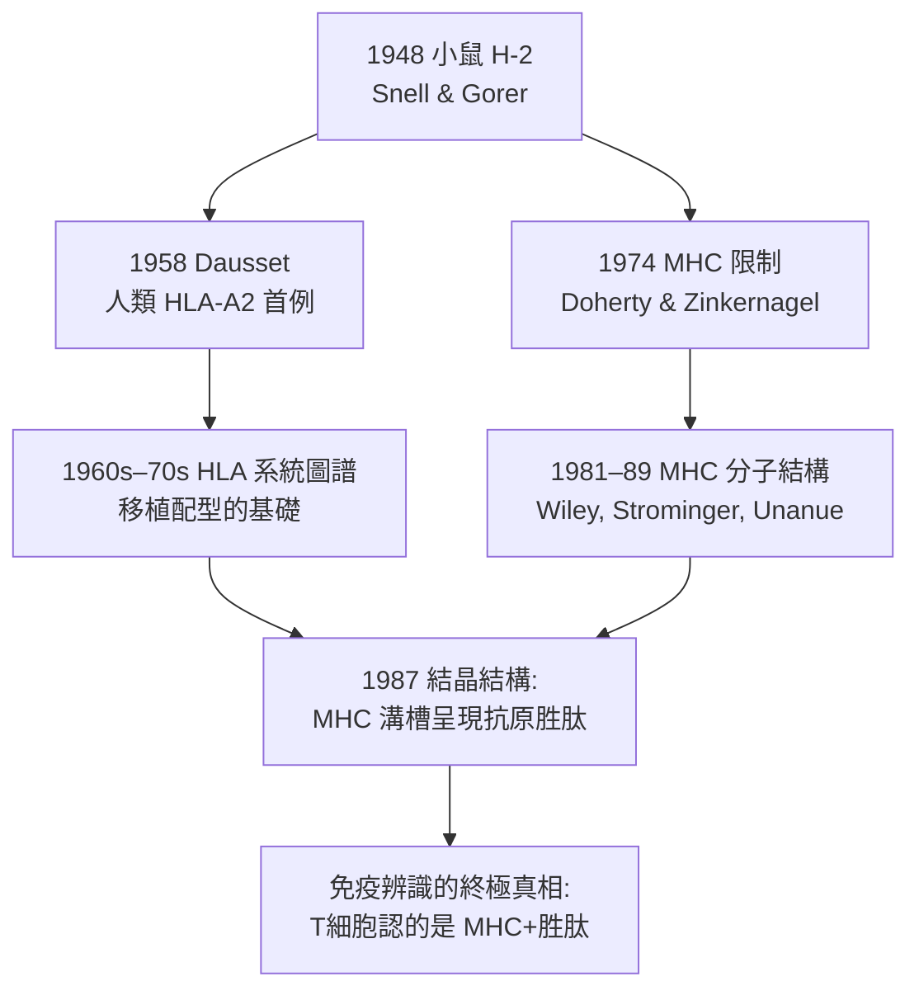

## 1948 - 斯內爾與 H-2 組織相容性基因（移植排斥的遺傳學偵查）

## 案件摘要

**本案偵破的是：排斥是免疫行為，但排斥的「靶子」是什麼？答案是細胞表面的一組遺傳性抗原，編碼在一個複雜的基因座上。**

1948 年，緬因州 Bar Harbor 的 Jackson 實驗室遺傳學家 George Snell 與血清學家 Peter Gorer 確定：小鼠排斥移植腫瘤與正常組織的主基因座位於第 17 號染色體，命名為 **H-2**（Histocompatibility-2）；其上多個基因共同決定「組織相容」。Snell 為此發明了**同類系小鼠**（congenic mice，除一個染色體區段外基因全同）的培育技術，把排斥這種「臨床現象」翻譯成**精確的遺傳學座標**。這條線索在 1960s–70s 進化為 MHC（主要組織相容性複合體）的免疫學真身——1974 年 Doherty 與 Zinkernagel 揭示其功能（見 `1974-多赫蒂與青克納格爾MHC限制.md`），1980 年 Snell、Dausset 與 Benacerraf 共享諾貝爾獎。

## 前因 -- 為什麼會有這個案子

- **移植排斥已被定性為免疫**（見 `1943-梅達沃與移植排斥的發現.md`）——下一個問題自然是：被免疫系統認出來的「非我」到底是什麼分子？
- **腫瘤遺傳學的起點**。Jackson 實驗室自 1920s 培育近交系小鼠（inbred strains），用於腫瘤研究；Little 與 Strong 早已注意到腫瘤移植的成敗與小鼠品系有關——「移植相容性是遺傳的」是圈內常識。
- **Gorer 的血清學前哨（1936–37）**。Gorer 以兔免疫血清在紅血球上發現「抗原 II」，其分布恰好與腫瘤排斥相關——血清學與移植學的第一次握手。
- **技術缺口**。要把排斥定位到基因，需要**遺傳背景完全可控**的動物——當時並不存在。

## 線索與推理 -- 數學式、程式、理論

**線索一：同類系（congenic）的發明。** Snell 的關鍵工具是把「一個染色體區段」導入近交系背景，反覆回交＋選擇：

```python
# 同類系小鼠培育策略（Snell, 1940s 復原）
donor, background = strain_A, strain_B   # 欲研究的排斥基因來自 A
for generation in range(10):
    f1 = cross(donor, background)
    offspring = backcross(f1, background)   # 每代回交 B
    # 只保留「仍能排斥 B 來源腫瘤」的子代 → 該子代攜帶 A 的相容性基因
    donor = select_by_tumor_rejection(offspring, tumor_of_B)
# 10–12 代後: 基因組 ~99.9% 為 B，僅目標區段來自 A
```

如此得到的品系對之間若仍互相排斥，差異必然落在**被導入的那一段**——排斥基因的精確定位由此可能。

**線索二：H-2 的定義。** Gorer 與 Snell 合作（1948）證明：排斥活性與紅血球上的抗原 II 同座——命名 H-2：

$$ \text{排斥表現型} \;\xrightarrow{\text{遺傳連鎖分析}}\; \text{第 17 染色體 H-2 座} $$

後續偵破：H-2 是一個**複合基因座**，含 K、I、S、D 等多個區段，分別編碼不同功能（I 區後被證明是免疫調節/Ir 基因，Benacerraf 的貢獻）。

**線索三：人類 MHC 的平行偵查。**



**線索四：從「移植的敵人」到「免疫的舞台」。** 1970s 的偵探成果（見 `1974-多赫蒂與青克納格爾MHC限制.md`）揭示：MHC 根本不是為了防移植而存在——它是**T 細胞辨識抗原的展示平台**，移植排斥只是免疫系統「認錯人」的副作用。Snell 定位的是舞台，Doherty 揭示的是戲。

## 結案 -- 後果與影響

- **移植配型的科學基礎**。人類 HLA 分型（血清學 1958–、分子 1980s–）成為器官與骨髓移植的常規程序；HLA 錯配程度直接預測排斥風險——遺傳學直接寫進了手術室。
- **免疫遺傳學的誕生**。Snell 的同類系技術成為免疫學通用工具：現代基因改造小鼠（knockout、humanized）仍是其邏輯後裔。
- **1980 年諾貝爾獎**。Snell（H-2）、Dausset（HLA）、Benacerraf（Ir 基因/免疫應答的遺傳控制）共享——把免疫應答徹底納入孟德爾框架。
- **陰影面**。HLA 高度多態性同時是移植最大障礙與族群遺傳標記；血庫與移植中心的 HLA 資料庫引發「誰的組織算誰的」的倫理爭議（如 1990s 的 Moore v. Regents 案）。
- **一句話結案**：Snell 用十二年回交培育把「排斥」從病床翻譯到染色體——**免疫辨識是有地址的**；這個地址後來成為 T 細胞看得見的舞台。

## 關鍵人物與文獻

- **George Snell（1903–1996）**——Jackson 實驗室遺傳學家；同類系技術與 H-2 定位；1980 年諾貝爾生理學或醫學獎。
- **Peter Gorer（1907–1961）**——倫敦 Guy's Hospital 血清學家；抗原 II 與排斥的連結；英年早逝未及諾獎。
- **Jean Dausset（1916–2009）**——法國血液學家；1958 年發現人類 HLA-A2；1980 年共同諾獎。
- **Baruj Benacerraf（1920–2011）**——委內瑞拉裔美國免疫學家；Ir 基因（免疫應答的 MHC 遺傳控制）；1980 年共同諾獎。
- 原始文獻——Gorer, Lyman & Snell, *Genetical studies on the serological relationship between non-H-2 antigens and tumor transplantation*, Proc. Natl. Acad. Sci., 1948；Snell, *Methods for the study of histocompatibility genes*, J. Genet., 1948。
- 延伸閱讀——`1943-梅達沃與移植排斥的發現.md`、`1974-多赫蒂與青克納格爾MHC限制.md`。
