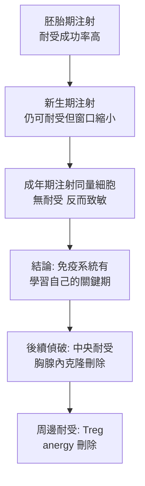

## 1953 - 梅達沃免疫耐受實驗（在胚胎裡種下「假自己」）

## 案件摘要

**本案偵破的是：Owen 的牛與 Burnet 的假說（見 `1945-歐文紅血球嵌合與免疫耐受.md`）能否在實驗室重演？答案是可以——只要在免疫系統成熟之前，把「非我」注入。**

1953 年 10 月，英國《Nature》刊出 Rupert Billingham、Leslie Brent 與 Peter Medawar 的短文：在 CBA 品系小鼠胚胎期或新生期，注射 A 品系小鼠的脾細胞；這些 CBA 小鼠長大後，**終身無法排斥 A 品系的皮膚移植**——牠們把 A 品系當成了「自己」。這是**人工誘導免疫耐受的第一次成功**，直接驗證了 Burnet 的 self-marker 假說，並與其克隆選擇學說（見 `1957-伯內特克隆選擇學說.md`）同獲 1960 年諾貝爾獎。器官移植醫學的終極夢想——「不靠藥物而學會容忍移植物」——由這三隻（實為一整批）小鼠點火。

## 前因 -- 為什麼會有這個案子

- **Burnet 的理論已就位**。1949 年 Burnet 與 Fenner 在《The Production of Antibodies》中預言：胚胎期接觸的抗原會被標記為「自己」——這是一個**可證偽**的明確預言。
- **Medawar 的移植排斥已有定量基礎**（見 `1943-梅達沃與移植排斥的發現.md`）——他有測量「排斥與否」的標準工具（皮膚移植）。
- **資源的巧合**。Billingham 精於皮膚移植技術、Brent 是剛加入的博士生、實驗室恰好有 CBA 與 A 兩個近交系——理論、工具、材料在牛津同時到齊。
- **競爭壓力**。Dwight Inman 在美國（1951 年與 Chase 有初步新生期耐受跡象）與 Milan Hašek 在捷克（1953 年以雞胚嵌合獨立報告耐受）——冷戰兩側同時逼近同一答案，Hašek 的結果甚至更早見刊。

## 線索與推理 -- 數學式、程式、理論

**線索一：實驗設計的簡潔之美。**

```python
# 1953 年牛津耐受實驗（Billingham, Brent & Medawar）
def neonatal_tolerance_treatment(recipient="CBA_embryo_or_newborn"):
    donor_cells = spleen_cells("A_strain")          # 異品系脾細胞
    inject(recipient, donor_cells, route="靜脈/腹腔",
           timing="胚胎期或出生 24 小時內")
    wait_to_adulthood(recipient)
    graft_skin(recipient, donor="A_strain")
    return graft_survival(recipient)                # → 終身存活！

# 對照組: 未處理 CBA 成年鼠 → A 皮膚 10 天排斥
```

結果：

| 組別 | A 品系皮膚移植存活 |
|---|---|
| 正常 CBA 成鼠 | $\sim 10$ 天（排斥） |
| 新生期注入 A 脾細胞的 CBA | **數月–終身**（耐受） |
| 新生期注入 CBA（自身品系）細胞 | 正常排斥（無效對照） |
| 新生期注入第三品系細胞後再植該品系皮 | 該品系耐受（特異性！） |

**線索二：耐受的定義。** 此實驗把「免疫耐受」首次操作化：

$$ \text{耐受} \;=\; \text{抗原特異性} \;\land\; \text{長期（終身）} \;\land\; \text{僅限幼年期誘導（當時所知）} $$

**線索三：時間窗的偵查。**



**線索四：與克隆選擇的互相證成。** 1957 年 Burnet 的克隆選擇學說（見 `1957-伯內特克隆選擇學說.md`）給了耐受實驗一個機制性解釋：胚胎期接觸抗原 → 該抗原特異的**克隆被刪除** → 長大後無克隆可被激活。耐受實驗提供了現象，克隆選擇提供了機制，兩者互為偵探與證人。

## 結案 -- 後果與影響

- **免疫學的「自我」問題被實驗化**。「身體如何分辨自己與非我」從哲學問題變成可操作的實驗系統；中央耐受（胸腺克隆刪除，1980s–90s Kisielow/von Boehmer 與 Kappler/Marrack 偵破）是其分子版續集。
- **移植醫學的終極目標確立**。臨床耐受誘導：骨髓嵌合（與 Owen 的牛遙相呼應）、混合嵌合、Treg 細胞療法——2020s 仍有耐受邀導臨床試驗在跑，起點就是 1953 這篇短文。
- **1960 年諾貝爾獎**。Burnet（理論）＋Medawar（實驗）共享——免疫學史上「假說與驗證同框得獎」的少數案例。
- **陰影面**。新生期耐受被發現有許多例外與局限（劑量、抗原形式、細胞類型都影響成敗），Hašek 的結果更複雜；科學史的版本中，「三隻小鼠改寫教科書」的傳說簡化了當年的混亂——耐受的機制至今仍在補偵查。
- **一句話結案**：Billingham、Brent 與 Medawar 證明——**免疫系統的名單不是天生的，而是在關鍵期寫入的**；既然名單可以寫入，理論上也可以被修改——這是移植醫學一甲子的燈塔。

## 關鍵人物與文獻

- **Peter Medawar（1915–1987）**——見 `1943-梅達沃與移植排斥的發現.md`；1960 年諾貝爾獎；本實驗的設計者與公共代言人。
- **Rupert Billingham（1912–2002）**——植皮大師，後赴美建立發育免疫學派。
- **Leslie Brent（1925–2019）**——納粹德國柏林出生的猶太難民（Kindertransport 逃英），當年的博士生；耐受研究的終身旗手，晚年撰寫免疫耐受史《A History of Transplantation Immunology》。
- **Milan Hašek（1925–1984）**——捷克免疫學家，1953 年以雞胚血型嵌合獨立證明胚胎期耐受；鐵幕科學的犧牲者，未能進入主流敘事。
- 原始文獻——Billingham, Brent & Medawar, 'Actively acquired tolerance' of foreign cells, *Nature*, 1953；Hašek, *Věstník ČSAV*, 1953。
- 延伸閱讀——`1945-歐文紅血球嵌合與免疫耐受.md`、`1957-伯內特克隆選擇學說.md`。
