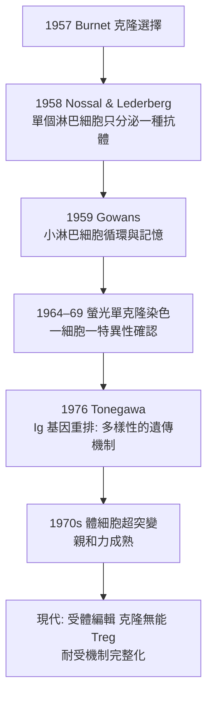

## 1957 - 伯內特克隆選擇學說（免疫學的達爾文時刻）

## 案件摘要

**本案偵破的是：抗體的「量身定做」從何而來？抗原是老師，還是選拔官？**

1957 年，澳洲病毒學家 Macfarlane Burnet 在《Australian Journal of Science》上一篇僅 3 頁的短文中提出**克隆選擇學說**（clonal selection theory）：每個淋巴細胞只表達一種特異性受體（一個細胞＝一個克隆＝一種抗體）；**抗原不教育免疫細胞、只做選擇**——遇到受體吻合的克隆，就把它激活增殖，形成大軍分泌抗體；胚胎期遇到抗原則導致**克隆刪除**（耐受，解釋 1953 年 Medawar 實驗，見 `1953-梅達沃免疫耐受實驗.md`）。這是免疫學的達爾文時刻：變異先行、選擇後至。此學說把免疫學從化學主導轉向**細胞生物學主導**，是 20 世紀免疫學的總綱。

## 前因 -- 為什麼會有這個案子

- **指令學說（instructive theory）的統治**。1930s–50s 主流理論（Breinl & Haurowitz 1930；Pauling 1940）主張抗原像模子一樣把抗體蛋白「折印」成形——抗體的無限多樣性被解釋為**後天模印**，不需要基因多樣性。
- **模印說的物理困難**。Pauling 的模型需要蛋白質變性復性中記住抗原形狀，且無法解釋免疫記憶、耐受、以及 Landsteiner 半抗原的無限多樣性（見 `1901-蘭茨泰納血型與輸血.md`）。
- **Jerne 的自然抗體理論（1955）**。Niels Jerne 提出血清中預先存在大量「天然抗體」，抗原選擇與之互補者——**「選擇」觀念的第一擊**；但 Jerne 仍把產生抗體的主體留在血清，細胞只是工廠。
- **Talmage 的第一步**。David Talmage（1956）提出抗體以「細胞受體」形式存在、抗原有選擇作用——距離克隆選擇只差「一細胞一抗體」這一步。
- **Burnet 的準備**。Burnet 從流感病毒學轉向免疫學，剛完成耐受理論（1949）；他是全場唯一同時持有「耐受—選擇—細胞」三塊拼圖的偵探。

## 線索與推理 -- 數學式、程式、理論

**線索一：學說的核心四命題。**

1. 每個淋巴細胞克隆只表達**一種**特異性受體；
2. 抗原與受體的結合是**選擇信號**，激活該克隆增殖；
3. 增殖的後代分化為效應細胞（分泌抗體）與**記憶細胞**；
4. 胚胎期/新生期接觸抗原 → 該克隆被**刪除** → 耐受。

$$ \text{抗體多樣性} \;=\; \text{預先存在的克隆庫} \;+\; \text{抗原的選擇} \;+\; \text{克隆擴增} $$

**線索二：指令 vs 選擇的對決。**

| | 指令學說 | 克隆選擇學說 |
|---|---|---|
| 抗原的角色 | 模板（老師） | 選拔官（達爾文選擇） |
| 多樣性來源 | 後天折印 | 先天克隆庫＋突變 |
| 耐受 | 難解 | 克隆刪除（自然） |
| 記憶 | 難解 | 記憶細胞克隆 |
| 預言 | 抗體蛋白可無限重排 | **受體存在於細胞上、一細胞一種** |

**線索三：驗證的偵探鏈。**

其中 **Nossal & Lederberg（1958）**是直接驗證：用顯微操作取單個淋巴細胞培養，證明其只能產生**一種**抗體——「一細胞一特異性」成立。**Tonegawa（1976，1987 諾獎）**破解了「如何用有限基因編碼無限抗體」：免疫球蛋白基因的體細胞重排——指令說徹底出局。

**線索四：親和力成熟——學說的自我升級。** Burnet 原版假設克隆庫固定；後續偵破（1964 Siskind & Benacerraf；1970s Weigert、Cohn）發現：免疫反應中抗體親和力**隨時間升高**——因為激活的克隆在生發中心經歷**體細胞超突變**與**競爭性選擇**：

$$ \text{親和力}(\text{第 } n \text{ 次反應}) > \text{親和力}(\text{第 } 1 \text{ 次}) $$

抗體多樣性在**個體一生中持續達爾文化**——克隆選擇不僅解釋免疫，本身就是微觀演化。

## 結案 -- 後果與影響

- **免疫學範式轉移**。從血清化學到細胞生物學：之後 20 年的 T/B 細胞分工（見 `1965-T細胞與B細胞的分工.md`）、MHC 限制（見 `1974-多赫蒂與青克納格爾MHC限制.md`）都在克隆選擇的框架內展開。
- **耐受與自體免疫的機制語言**。克隆刪除、克隆無能（anergy，Nossal 1988）、調節性 T 細胞（Treg，1995 Sakaguchi）——自體免疫病從此有了一整套機制詞彙。
- **疫苗設計的理論基座**。「疫苗的任務是選擇並擴增正確克隆」——包括 2020s 的 mRNA 疫苗（見 `2020-mRNA疫苗與卡里科.md`）與生髮中心的記憶 B 細胞研究，全是克隆選擇的工程應用。
- **陰影面**。Burnet 晚年以「免疫監視」解釋腫瘤免疫失誤，並在優生學言論上有爭議記錄；學說的「一細胞一抗體」也被修正（一細胞一受體、受體可編輯）——理論是燈塔，不是終點。
- **一句話結案**：Burnet 的偵探宣言只有一句——**免疫系統不是被教會的，是被選出來的**；從此免疫學說的是達爾文的語言。

## 關鍵人物與文獻

- **Macfarlane Burnet（1899–1985）**——澳洲病毒學與免疫學家；Walter and Eliza Hall Institute 所長；1960 年諾貝爾獎（與 Medawar）；爵士與勳章等身。
- **Niels Jerne（1911–1994）**——丹麥免疫學家；選擇觀念先驅、免疫網絡學說；1984 年與 Köhler、Milstein 共享諾獎。
- **Gustav Nossal（1931–）**——Burnet 的學生；1958 年單細胞一抗體實驗的第一作者；後任 Hall Institute 所長。
- **Joshua Lederberg（1925–2008）**——1958 年細菌遺傳學諾獎得主，同年與 Nossal 合作免疫實驗；克隆選擇的積極支持者與理論清道夫。
- **Susumu Tonegawa（1939–）**——巴斯德研究所/MIT；免疫球蛋白基因重排（1976）；1987 年諾獎——克隆選擇的遺傳學加冕。
- 原始文獻——Burnet, *A modification of Jerne's theory of antibody production using the concept of clonal selection*, Aust. J. Sci., 1957；Nossal & Lederberg, Nature, 1958；Tonegawa, Nature, 1976。
- 延伸閱讀——`1897-埃爾利希側鏈學說.md`、`1953-梅達沃免疫耐受實驗.md`、`1975-柯勒與米爾斯坦單株抗體.md`。
