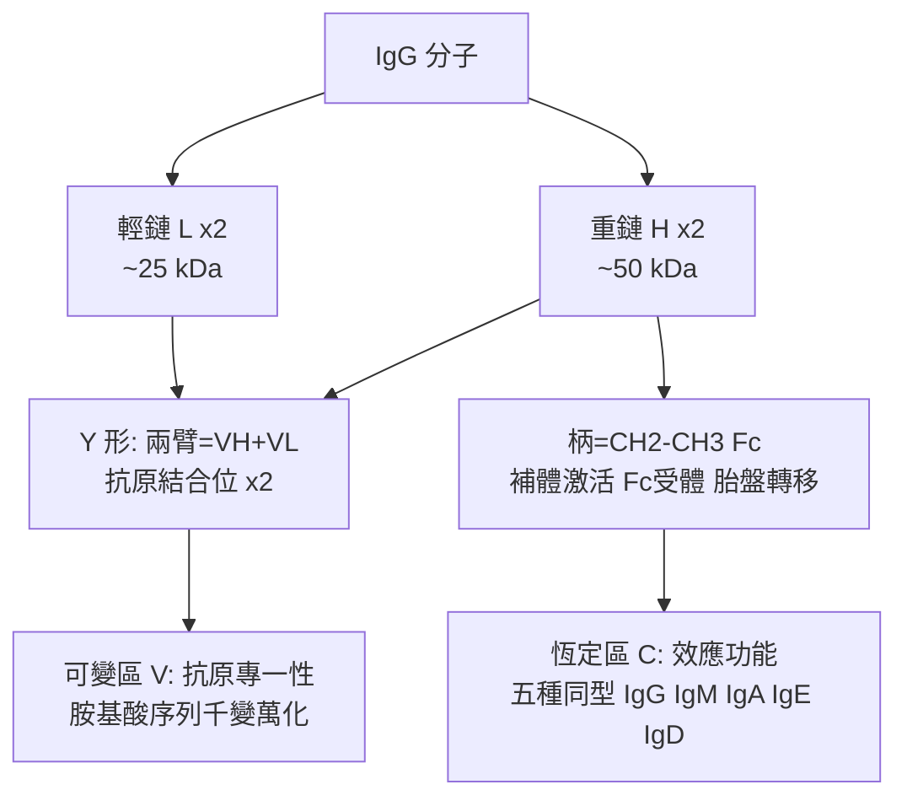

## 1959 - 波特與埃德爾曼解開抗體結構（Y 形的偵查檔案）

## 案件摘要

**本案偵破的是：血清療法（見 `1890-貝林白喉抗毒素.md`）使用了 60 年的那個分子，究竟長什麼樣？**

1959 年，英國的 Rodney Porter 與美國的 Gerald Edelman 各自發表抗體分子的解剖報告：Porter 以木瓜蛋白酶把抗體切成「兩個 Fab（抗原結合臂）＋一個 Fc（結晶段）」三片；Edelman 以還原劑拆開分子，證明它由**兩條重鏈＋兩條輕鏈**組成。兩人拼出免疫球蛋白的 **Y 形結構**：Y 的兩臂特異性抓抗原，柄部執行效應功能。1969 年 Edelman 團隊完成第一個完整抗體的胺基酸全序，發現輕鏈的可變區與恆定區——**抗原結合的無限多樣性，藏在蛋白質的有限段落裡**。1972 年兩人共享諾貝爾化學獎；抗體從「血清裡的效力」變成「可讀出序列的分子」。

## 前因 -- 為什麼會有這個案子

- **血清療法長期「知其效不知其形」**。Behring 之後 60 年（見 `1890-貝林白喉抗毒素.md`），γ-球蛋白（Tiselius 1939 年電泳分離，抗體活性主要在 γ 球蛋白）只是電泳圖上的一條帶。
- **超速離心的分子量線索**。1930s–40s 已知抗體分子量約 150 kDa、對稱形——「兩臂對稱抓抗原」的形狀猜想已有（Valentine & Green 1957 電鏡 Y 形照片）。
- **骨髓瘤的意外禮物**。多發性骨髓瘤病人產生**大量均一**的異常免疫球蛋白（副蛋白）——正常人血清裡的抗體是億萬種混合，根本無法定序；骨髓瘤提供了**單一純種**樣本（Henry Bence Jones 1847 年的尿蛋白即為輕鏈——輕鏈先於重鏈被命名）。
- **技術條件**。酶切（蛋白酶）、變性還原、紙上電泳、胺基酸定序（Edman 1956）——分子解剖的工具箱在 1950s 齊備。

## 線索與推理 -- 數學式、程式、理論

**線索一：Porter 的酶切解剖。** 木瓜蛋白酶把 IgG 切成兩片 Fab（仍能結合抗原、單價、不能沉澱）與一片 Fc（易結晶、無抗原結合力）：

$$ \text{IgG} \;\xrightarrow{\text{papain}}\; 2\, \text{Fab} \;+\; 1\, \text{Fc} $$

用胃蛋白酶則得到保持雙價的 $F(ab')_2$ 與降解的 Fc——**這些片段至今仍是製備抗體片段藥物（如 AbD、双特異抗體）的基礎**。

**線索二：Edelman 的化學拆解。** 2-巰基乙醇斷雙硫鍵＋尿素變性 → 抗體分離為兩種多肽鏈：

**線索三：多樣性藏在序列裡。** Edelman（1969）完成 IgG1 完整序列（約 1,320 個殘基、22 個雙硫鍵）後，與 Wu & Kabat（1970）的**可變性分析**共同揭示：可變區內有 **3 個超高變段**（CDR，互補決定區）——抗原結合位就是 CDR 折疊成的口袋：

$$ \text{專一性} \;\propto\; \text{CDR 序列多樣性} \quad (\text{僅數十個殘基承載全部選擇性}) $$

這個發現把謎題重新定義為「**有限基因如何生成 CDR 無限多樣性**」——1976 年 Tonegawa 以基因重排解答（1987 諾獎，見 `1957-伯內特克隆選擇學說.md`）。

**線索四：1975 年的接力。** 結構知識＋骨髓瘤提供「純種」概念 → Köhler 與 Milstein 用雜交瘤把「均一抗體」從病理現象變成技術（見 `1975-柯勒與米爾斯坦單株抗體.md`）——**結構解剖是單株抗體的路標**：先知道分子像什麼，才知道要量產什麼。

## 結案 -- 後果與影響

- **抗體工程學誕生**。酶切片段、Fc 改造、人源化（1980s Winter）、雙特異抗體、ADC 藥物——現代抗體藥物的全部技術，都站在 1959 年的 Y 形圖上。
- **免疫化學的終點與起點**。抗體結構確定後，「抗體是什麼」結案；「多樣性從哪來」開案——直接催生 Tonegawa 基因重排（1976）與親和力成熟研究。
- **效應功能的地圖**。Fc 段補體結合位、Fc 受體結合位、IgG 通過胎盤（新生兒被動免疫）、IgE 結合肥大細胞（見 `1966-石坂父子發現IgE.md`）——五種同型分工的結構基礎由此清晰。
- **陰影面**。骨髓瘤樣本來自病人；輕鏈澱粉樣變（AL 型）正是這種異常蛋白的疾病面——「樣本病人的病理」與「科學的收穫」共享同一故事。
- **一句話結案**：Porter 用酶、Edelman 用化學，兩人從兩端切開同一個 Y——**血清療法的神秘子彈，原來是一把兩臂對稱、柄部裝填效應程序的分子鉗**。

## 關鍵人物與文獻

- **Rodney Porter（1917–1985）**——英國生物化學家；木瓜蛋白酶片段化；後任 Oxford Whitley 教授；1972 年諾貝爾化學獎。
- **Gerald Edelman（1929–2014）**——美國洛克菲勒大學科學家；還原拆解與 IgG 全序；1972 年諾貝爾化學獎；晚年轉向神經達爾文主義（Neural Darwinism——把選擇論帶進腦科學）。
- **Henry Bence Jones（1813–1873）**——倫敦醫生，1847 年記述骨髓瘤病人尿中的「水合蛋白」（後稱 Bence Jones protein）——輕鏈的百年前身。
- **Frank Putnam 與 Kuhei Koshland**——骨髓瘤抗體的平行定序者。
- 原始文獻——Porter, *The hydrolysis of rabbit γ-globulin and antibodies with crystalline papain*, Biochem. J., 1959；Edelman & Poulik, J. Exp. Med., 1961；Edelman et al., *The covalent structure of an entire γG immunoglobulin molecule*, PNAS, 1969。
- 延伸閱讀——`1890-貝林白喉抗毒素.md`、`1957-伯內特克隆選擇學說.md`、`1975-柯勒與米爾斯坦單株抗體.md`。
