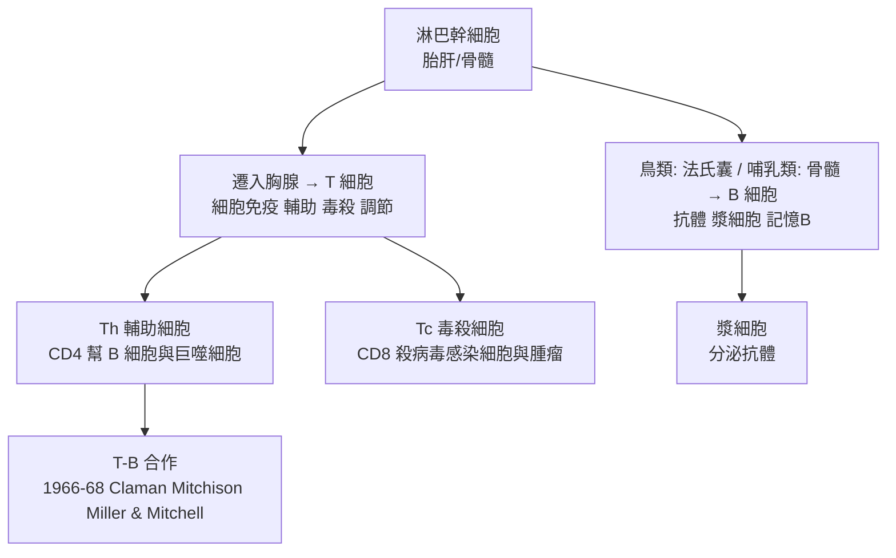

## 1965 - T細胞與B細胞的分工（免疫系統的兩支軍隊終於分清）

## 案件摘要

**本案偵破的是：免疫系統裡的淋巴細胞是一種還是兩種？「一場菜市場的爭論」持續了半世紀。**

1960 年代中期，以澳大利亚的 Jacques Miller 與 Robert Good 為首的兩條偵查線收網：**胸腺來源的淋巴細胞（T 細胞）**負責細胞免疫（排斥、遲發過敏、病毒感染細胞的清除），**法氏囊／骨髓來源的淋巴細胞（B 細胞）**負責抗體（體液免疫）。關鍵實驗：1961–62 年 Miller 切除新生小鼠胸腺 → 移植排斥與細胞免疫喪失；1965 年 Cooper、Good 等切除雞的法氏囊（bursa of Fabricius）→ 抗體消失而細胞免疫保留；1966–68 年 Claman、Mitchison、Miller 與 Mitchell 證明 **T 細胞輔助 B 細胞**產生抗體（T-B 合作）。免疫學自此分成兩個兵種、卻又協同作戰——Ehrlich 與 Metchnikoff 的百年學派之爭（見 `1897-埃爾利希側鏈學說.md`）在細胞層面正式和解。

## 前因 -- 為什麼會有這個案子

- **胸腺的百年冤案**。胸腺在解剖學上早被描述，功能卻完全成謎——切除成年動物胸腺沒什麼後果，它被貼上「退化器官」「進化殘跡」的標籤。
- **Landsteiner & Chase 的細胞轉移（1942）**。結核菌素遲發型過敏可由**淋巴細胞**而非血清轉移——細胞免疫的獨立性已有證據（見 `1943-梅達沃與移植排斥的發現.md`），但細胞身份不明。
- **法氏囊的雞專屬線索**。鳥類有哺乳類沒有的法氏囊；1956 年 Glick 意外發現切除法氏囊的雞**不產生抗體**——這篇被忽視的論文是 B 細胞的種子。
- **放射線嵌合技術**。致死輻射＋骨髓重建（Ford 等 1956）使「哪種細胞做什麼」的移補實驗成為可能。

## 線索與推理 -- 數學式、程式、理論

**線索一：Miller 的新生期胸腺切除（1961–62）。** 切除新生小鼠胸腺 → 皮膚移植存活（不排斥）、對病毒抗性下降、淋巴組織萎縮、早死；成年後切除則影響甚微。結論：**胸腺在圍新生期建立細胞免疫**——「退化器官」實為免疫系統的軍校。

**線索二：法氏囊與骨髓的分工。**

命名於 1968–69 年定型：T＝thymus，B＝bursa（鳥）／bone marrow（哺乳）。

**線索三：T-B 合作實驗的邏輯。** Claman 等（1966）：輻射小鼠只給 T 或只給 B 都不產生抗體，**兩者共存才有抗體**；Mitchison、Miller & Mitchell（1968）證明 T 細胞的作用是「輔助」（helper）——**半抗原—載體效應**的細胞基礎：

$$ \text{抗體反應} = f(\text{B 細胞}) \times f(\text{T 細胞輔助}) $$

半抗原由 B 認、載體胜肽由 T 認——這個「兩把鑰匙」的結構，直接為 1974 年 MHC 限制（見 `1974-多赫蒂與青克納格爾MHC限制.md`）鋪路。

**線索四：命名與分工表。**

| | T 細胞 | B 細胞 |
|---|---|---|
| 來源器官 | 胸腺 | 法氏囊／骨髓 |
| 受體 | TCR（認 MHC＋胜肽） | BCR＝膜上抗體（認立體結構） |
| 效應 | 輔助、毒殺、調節、遲發過敏 | 分泌抗體、記憶 |
| 缺陷病 | DiGeorge、愛滋（見 `1993-細胞因子風暴的命名.md` 之 HIV 脈絡） | 性聯無丙種球蛋白血症（Bruton 1952） |

## 結案 -- 後果與影響

- **細胞免疫學的總開關**。之後 20 年：T 細胞亞群（Th1/Th2, 1986 Mosmann）、細胞因子（見 `1993-細胞因子風暴的命名.md`）、TCR 基因重排（1984 Davis）——免疫學成為細胞與分子雙軌科學。
- **臨床免疫缺陷的分類學**。原發免疫缺陷按 T/B 缺陷分型；愛滋病的病理本質（CD4 T 細胞耗竭）在 1983 年 HIV 發現時已有概念框架（見性病史 `../性病的歷史/1983-蒙塔尼耶發現HIV.md`）。
- **移植與耐受的機制化**。T 細胞是排斥主力的證據鏈完成；耐受＝T 細胞耐受（克隆刪除於胸腺——Miller 的胸腺成為耐受的學校）。
- **陰影面**。法氏囊切除的商業應用（雞群免疫評估）與 Miller 曾長期被忽視（在切斯特貝蒂研究所的邊緣位置）——學術边缘者破案的故事重演。
- **一句話結案**：免疫系統不是一支軍隊而是兩支——**T 細胞是近身格鬥與指揮官，B 細胞是遠程炮兵**；而指揮官還要親口下達「開炮」的命令——T-B 合作是免疫學的授權儀式。

## 關鍵人物與文獻

- **Jacques Miller（1931–2024）**——法國出生、英國受訓、在澳洲 Hall Institute 成名；新生期胸腺切除實驗（1961）；長年被視為諾獎遺珠。
- **Robert Good（1922–2003）**——明尼蘇達大學兒科教授；法氏囊—胸腺分工體系的整合者；首例人類骨髓移植成功（1968）主導者之一。
- **Max Cooper（1933–2024）與 Robert Good**——法氏囊切除系列實驗（1965），確立 B 細胞譜系。
- **Bruce Glick（1927–2016）**——1956 年法氏囊切除與抗體缺失的發現者，論文曾遭退稿與忽視。
- **Henry Claman 與 Jonathan Sprent、Graham Mitchell、Avrion Mitchison**——T-B 合作（1966–68）的偵探群。
- 原始文獻——Miller, *Lancet*, 1961 & *Nature*, 1962；Cooper et al., *J. Exp. Med.*, 1965（法氏囊）；Claman et al., *PNAS*, 1966；Miller & Mitchell, *J. Exp. Med.*, 1968。
- 延伸閱讀——`1897-埃爾利希側鏈學說.md`、`1957-伯內特克隆選擇學說.md`、`1974-多赫蒂與青克納格爾MHC限制.md`。
