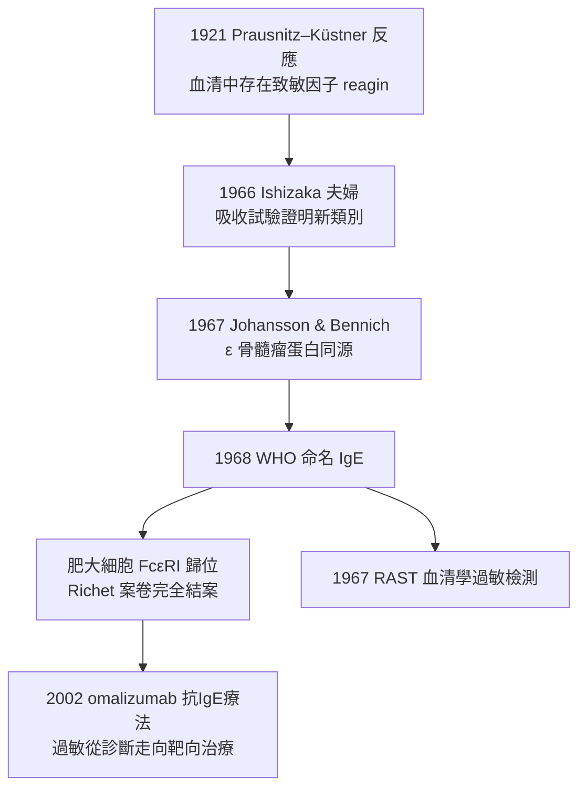

## 1966 - 石坂父子發現IgE（過敏反應 64 年後終於抓到執行分子）

## 案件摘要

**本案偵破的是：Richet 在 1902 年發現的過敏反應（見 `1902-里謝發現過敏反應.md`），到底是哪個分子執行的？血清裡一直藏著一個含量低到無法看見的抗體類型。**

1966 年，美國科羅拉多的日本裔夫妻科學家**石坂照子（Teruko Ishizaka）與石坂公重（Kimishige Ishizaka）**——從枯草熱病人的血清中鑑定出一種全新的免疫球蛋白：它不屬於已知的 IgG、IgM、IgA，**極微量卻能致敏皮膚**，是 Prausnitz–Küstner 反應（1921）的主角。1967 年瑞典的 Gunnar Johansson 與 Bennich 從骨髓瘤病人的異常蛋白（ε 骨髓瘤蛋白）獨立證認同一分子。1968 年 WHO 正式命名為 **IgE**。過敏的執行分子、肥大細胞上的橋樑——64 年的懸案結案。

## 前因 -- 為什麼會有這個案子

- **過敏反應有「可轉移因子」**。1921 年 Prausnitz–Küstner 反應：把過敏病人血清注入健康人皮膚，24 小時後再於同處滴入過敏原，局部出現風團——**過敏是血清因子介導的**，但這個因子在血清中含量極低，常規電泳根本看不見。
- **reagin 的百年謎**。過敏學界稱此因子為「reagin」，性質詭異：熱敏感（56 °C 即破壞）、不能被傳統抗 IgG 血清中和、含量估計僅 $10^{-5}$ g/mL 量級——**偵探知道兇手存在，卻拍不到照片**。
- **骨髓瘤的多樣性紅利**。每一例骨髓瘤都產生一種均一免疫球蛋白；1960s 瑞典的 Bennich 與 Johansson 遇到一例「ε 骨髓瘤蛋白（IgND）」，無法歸入已知四類——**病理提供了唯一的純種樣本**。
- **草花粉過敏的時代背景**。二戰後過敏病（氣喘、枯草熱）在西方激增，臨床需求強烈：需要一個能**定量過敏體質**的檢驗。

## 線索與推理 -- 數學式、程式、理論

**線索一：Ishizaka 的吸收試驗邏輯。** 用抗各類免疫球蛋白的血清逐一「吸收」過敏病人血清，看致敏活性是否消失：

```python
def identify_reagin(allergic_serum):
    for ab_class in ["anti-IgG", "anti-IgA", "anti-IgM", "anti-IgD"]:
        absorbed = absorb(allergic_serum, ab_class)
        if PK_activity(absorbed) == "still positive":
            continue   # 活性還在 → 不是這一類
    # 全部已知類別都吸收後, 活性仍在 → 全新類別!
    new_ab = make_antisera_to_remaining_fraction(allergic_serum)
    assert blocks_PK(new_ab), "新抗血清能中和致敏活性"
    return "未知免疫球蛋白 = IgE"
```

**線索二：兩條線在 1967 年合流。** Ishizaka 的新抗體與 Johansson/Bennich 的 ε 骨髓瘤蛋白抗血清**互相結合**——病理樣本與生理因子是同一分子。1968 年 WHO 以「E」（erythema，皮膚紅腫反應）命名 IgE。

**線索三：肥大細胞的歸位。** IgE 的發現讓 1878 年 Ehrlich 描述、1902 年 Richet 案卷中隱身的**肥大細胞**歸位：

$$ \text{過敏原} + \text{IgE} + \text{肥大細胞 Fc}\varepsilon\text{RI（橋接 2 個 IgE）} \;\longrightarrow\; \text{脫顆粒} \;\longrightarrow\; \text{組織胺} $$

**線索四：IgE 檢測的臨床化。** 1967 年 Johansson 與 Wide 發明 RAST（放射過敏原吸附試驗）：**第一個可以定量「對哪種過敏原、IgE 多少」的血液檢驗**——過敏學從皮試走向血清學，與梅毒血清診斷的技術路線遙相呼應（參見性病史 `../性病的歷史/1905-紹丁發現蒼白密螺旋體.md`）。



## 結案 -- 後果與影響

- **過敏醫學的分子時代**。IgE 定量成為過敏診斷標準；2002 年上市的抗 IgE 單株抗體 omalizumab（見 `1975-柯勒與米爾斯坦單株抗體.md` 的產業延伸）把 1902 年的現象變成靶向藥物。
- **寄生蟲免疫的救贖**。1970s–80s 偵破：IgE 系統的真實演化功能是抗蠕蟲寄生蟲（肥大細胞介導腸道排出）——過敏是防寄生蟲武器的「現代誤觸發」，與衛生假說（1989）連成一套敘事。
- **Ishizaka 夫婦的遺產**。兩人為科學夫妻檔的典範；石坂公重後主持 La Jolla 過敏與免疫研究所；2017 年獲日本文化勳章，2024 年照子與公重相繼辭世——夫妻共同破案的完整故事。
- **陰影面**。IgE 只解釋了過敏的一部分：非 IgE 介導的藥物反應、嗜酸性粒細胞通路（2010s IL-5 靶向治療）仍持續補偵查——Richet 打開的箱子還沒全部清空。
- **一句話結案**：64 年前知道「血清裡有兇手」，64 年後才拍到他的臉——**IgE 是免疫學裡含量最少、存在感最強的分子**；過敏學自此有了指紋檔案。

## 關鍵人物與文獻

- **石坂公重（Kimishige Ishizaka, 1925–2024）與石坂照子（Teruko Ishizaka, 1926–2024）**——日本夫妻科學家；IgE 發現者；後長期主持 Johns Hopkins 與 La Jolla 過敏免疫中心；2017 年共獲日本學士院獎。
- **Gunnar Johansson（1939–）與 Hans Bennich**——瑞典 Uppsala 團隊；ε 骨髓瘤蛋白與 RAST 檢測。
- **Carl Prausnitz 與 Heinz Küstner**——1921 年被動轉移試驗，過敏血清因子的最早證據。
- 原始文獻——Ishizaka, Ishizaka & Hornbrook, *Physico-chemical properties of human reaginic antibody*, J. Immunol., 1966；Johansson & Bennich, *Immunological studies of an atypical (myeloma) immunoglobulin*, Immunology, 1967；WHO 命名公告, 1968。
- 延伸閱讀——`1902-里謝發現過敏反應.md`、`1959-波特與埃德爾曼解開抗體結構.md`。
