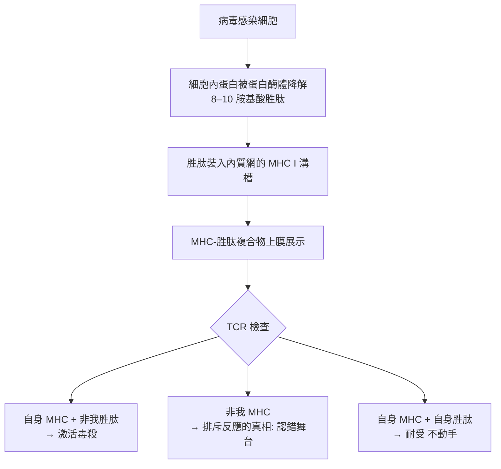

## 1974 - 多赫蒂與青克納格爾MHC限制（T 細胞認的不是病毒，是「MHC＋病毒」）

## 案件摘要

**本案偵破的是：T 細胞到底看見什麼？答案是雙重識別——它認的不是裸露的病毒，而是被自身 MHC 分子「呈遞」的病毒碎片。**

1974 年夏，澳洲 John Curtin 醫學研究院，28 歲瑞士博士後 Rolf Zinkernagel 與 33 歲澳洲住院醫師 Peter Doherty 做了一個簡單實驗：以不同品系小鼠感染淋巴細胞性脈絡叢腦膜炎病毒（LCMV），檢測其脾臟 T 細胞在體外**殺死被 LCMV 感染的靶細胞**的能力。結果出乎意料：T 細胞只殺死**與自己 MHC 相同**的感染靶細胞；同樣被病毒感染、但 MHC 不同的靶細胞，T 細胞視若無睹。這就是**MHC 限制（MHC restriction）**——T 細胞的識別是「**自我 MHC＋非我胜肽**」的雙鍵密碼。1996 年兩人共享諾貝爾生理學或醫學獎。

## 前因 -- 為什麼會有這個案子

- **MHC 的身份危機**。H-2／HLA 被發現 20 年（見 `1948-斯內爾組織相容性基因.md`），主要功能卻不明——它是「移植的敵人」，但移植不是自然現象，演化不會為移植造一個系統。
- **Ir 基因之謎**。Benacerraf 證明免疫應答能力由 MHC I 區基因決定（1980 諾獎）——「MHC 決定反應強弱」已現端倪。
- **Shearer 與 Kindred 的先聲（1973–74）**。TNP 修飾細胞的殺傷實驗已顯示 MHC 相關性——線索零散，缺一個乾淨的生理模型。
- **LCMV 模型的天時**。Doherty 剛在聖路易建立 LCMV 殺傷檢測；Zinkernagel 從瑞士帶來病毒學訓練；實驗室冰箱裡恰好有不同 H-2 品系小鼠——**破案三要素：好問題、好模型、好材料**。

## 線索與推理 -- 數學式、程式、理論

**線索一：交叉殺傷矩陣。**

| T 細胞來源（感染品系） | 靶細胞 H-2 相同＋LCMV | 靶細胞 H-2 不同＋LCMV |
|---|---|---|
| H-2^k 小鼠 | **大量殺傷** | 幾乎不殺 |
| H-2^d 小鼠 | 幾乎不殺 | **大量殺傷** |

$$ \text{殺傷} \;\Longleftrightarrow\; (\text{靶細胞 MHC} = \text{T 細胞自身 MHC}) \;\land\; (\text{靶細胞被 LCMV 感染}) $$

兩個條件**同時**必要——單看任何一個都不成立。這是免疫學史上最乾淨的雙因子依賴實驗之一。

**線索二：兩種解釋的偵探式裁定。** 當時有兩說：(a) **學說一：兩個受體**——T 細胞分別有抗 MHC 與抗病毒受體，需同時結合（像兩把鎖）；(b) **學說二：一個受體**——T 細胞受體辨識「MHC＋病毒胜肽」的複合構象。後續結構生物學裁定（1987 Don Wiley 與 Ian Wilson 的 MHC 結晶結構：溝槽內嵌 8–10 胺基酸胜肽；1996 Garboczi 的 TCR-pMHC 複合體結構）：**單一受體，認複合物**——MHC 是展示平台，胜肽是展品，TCR 是觀眾。

**線索三：移植排斥的真相翻案。** MHC 限制一出，「異體 MHC 為何被排斥」的舊案重審：異體 MHC 分子形似「載滿陌生胜肽的自身 MHC」，大量 T 細胞交叉識別之（alloreactivity）——**排斥不是因為移植醫學做錯了什麼，而是 T 細胞的識別規則使然**。這把 `1948-斯內爾組織相容性基因.md` 的案卷以新語言改寫。

**線索四：胸腺教育的補全。** Zinkernagel 後續提出：T 細胞在胸腺被「正面選擇」——只有能結合自身 MHC 的克隆才存活（見 `1965-T細胞與B細胞的分工.md` 的胸腺軍校）。這解釋了為何 T 細胞天然「偏愛」自身 MHC——限制不是後天學的，是被選出來的（又是克隆選擇邏輯，見 `1957-伯內特克隆選擇學說.md`）。

## 結案 -- 後果與影響

- **免疫辨識的終極規則確立**。「T 細胞認 MHC＋胜肽」成為免疫學總公理；疫苗設計（表位預測）、腫瘤免疫（新抗原 neoantigen）、自體免疫（MHC 呈遞自身抗原）全部以此為底層語言。
- **MHC 終於有了功能**。從「移植的敵人」到「抗原的舞台」——演化之謎結案：MHC 的極度多態性是**族群層面的病原防禦**（不同 MHC 呈遞不同病毒表位，人群中總有人能呈遞）。
- **1996 年諾貝爾獎**。Doherty 現任 St. Jude 兒童研究醫院教授，也是罕見的能寫科幻小說的諾獎得主；Zinkernagel 回蘇黎世大學任所長。
- **陰影面**。MHC 限制也解釋了病毒為何不斷突變表位逃逸（HIV、變異新冠）——**免疫與病原的軍備競賽規則被寫成了教科書**。
- **一句話結案**：Doherty 與 Zinkernagel 用一個交叉矩陣證明——**T 細胞不看表演，只看「在自家舞台上上演的戲」**；MHC 限制是免疫學的視力檢查表，此後所有 T 細胞研究都必須通過。

## 關鍵人物與文獻

- **Peter Doherty（1940–）**——澳洲獸醫出身；現 St. Jude；1996 年諾獎；著《The Beginner's Guide to Winning the Nobel Prize》。
- **Rolf Zinkernagel（1944–）**——瑞士病理學家；後任蘇黎世大學實驗免疫學研究所所長；1996 年共同諾獎。
- **Don Wiley 與 Ian Wilson**——1987 年 MHC I 結晶結構（哈佛／Scripps），為 MHC 限制提供結構解釋。
- **Rolf Zinkernagel & Peter Doherty 的配角**——John Curtin 研究院的 Gordon Ada 實驗室提供了平臺與資源。
- 原始文獻——Zinkernagel & Doherty, *Restriction of in vitro T cell-mediated cytotoxicity in lymphocytic choriomeningitis within a syngeneic or semiallogeneic system*, Nature, 1974。
- 延伸閱讀——`1948-斯內爾組織相容性基因.md`、`1957-伯內特克隆選擇學說.md`、`1965-T細胞與B細胞的分工.md`。
