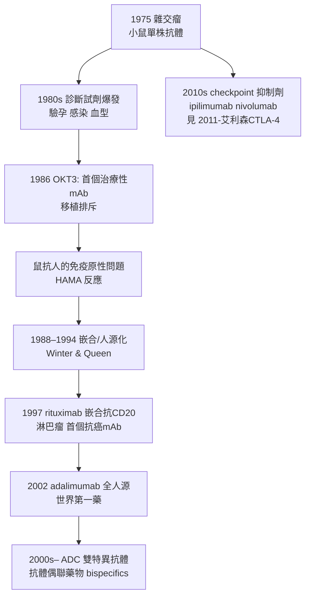

## 1975 - 柯勒與米爾斯坦單株抗體（免疫學裡的複印機）

## 案件摘要

**本案偵破的是：如何把「病人骨髓瘤裡偶然出現的均一抗體」（見 `1959-波特與埃德爾曼解開抗體結構.md`）變成可以**隨訂製、無限複製**的技術？**

1975 年 8 月，英國劍橋 MRC 分子生物學實驗室，25 歲的西德博士後 Georges Köhler 與 48 歲的 César Milstein 以雜交瘤技術製造出**單株抗體**（monoclonal antibody, mAb）：把經抗原免疫的小鼠 B 細胞（能產生想要抗體、但會死）與骨髓瘤細胞（永生化、但不產生特異抗體）融合，篩選出的**雜交瘤**（hybridoma）既有抗體基因又永生——**每一個克隆只分泌一種均一抗體，且可凍存、可無限增殖**。這是免疫學的複印機：抗體從「血清裡的混合物」變成「可工程化的試劑與藥物」。1984 年 Köhler、Milstein 與 Jerne 共享諾貝爾生理學或醫學獎。

## 前因 -- 為什麼會有這個案子

- **多株抗體的天生缺陷**。免疫動物血清中的抗體是億萬克隆的混合：批批不同、特異性交疊、無法標準化——診斷與研究的重複性危機。
- **骨髓瘤的啟示**。骨髓瘤＝天然單株抗體工廠（見 `1959-波特與埃德爾曼解開抗體結構.md`）；「如果能把骨髓瘤的永生與任意抗原的特異性結合就好了」是當時明確的願望清單。
- **體細胞雜交技術**。1960 年 Barski 的細胞融合、1965 年 Harris 與 Watkins 的 Sendai 病毒融合、Littlefield 的 HAT 篩選系統（1964）——融合與篩選工具齊備。
- **Milstein 的務實**。Milstein 起初只想研究**抗體多樣性的體細胞突變率**——單株抗體是為了量測突變而造的工具，技術的革命性是副產品（偵探史上最著名的「順手破案」）。

## 線索與推理 -- 數學式、程式、理論

**線索一：雜交瘤的邏輯。**

$$ \text{雜交瘤} = \underbrace{\text{免疫 B 細胞}}_{\text{抗體基因, 短命}} \times \underbrace{\text{骨髓瘤細胞}}_{\text{永生, 不產抗體}} $$

```python
# 1975 年雜交瘤流程（Köhler & Milstein 復原）
def make_monoclonal(antigen):
    immune_spleen = immunize_mouse(antigen)          # 1. 免疫小鼠取脾
    myeloma = HGPRT_negative_myeloma()               # 2. 缺 HGPRT 的骨髓瘤株
    fused = PEG_fusion(immune_spleen, myeloma)       # 3. 聚乙二醇融合
    survivors = HAT_selection(fused)                 # 4. HAT 篩選:
    #    未融合骨髓瘤(缺HGPRT)死; 未融合B細胞自然死亡;
    #    只有雜交瘤活 → 每孔一個克隆
    for clone in survivors:
        if clone.secretes_antibody_against(antigen):
            return clone                             # 5. 陽性克隆: 凍存, 永續量產
```

**線索二：HAT 篩選的化學邏輯。** HAT 培養基封鎖 DNA 的從頭合成路徑，只留「補救路徑」（需 HGPRT 酶）：

$$ \text{骨髓瘤（HGPRT}^{-}\text{）單獨} \to \text{死} \quad;\quad \text{B 細胞單獨} \to \text{自然壽終} \quad;\quad \text{雜交瘤（帶 B 的 HGPRT}^{+}\text{）} \to \text{永生} $$

**線索三：從試劑到藥物的產業鏈。**



**線索四：理論的加冕。** 雜交瘤是克隆選擇學說（見 `1957-伯內特克隆選擇學說.md`）的工程化驗證——**你只能在體外複製「一克隆一抗體」的自然事實**。Jerne 的入獎（免疫網絡與選擇理論）則象徵：理論、驗證、工具三合一。

## 結案 -- 後果與影響

- **生物科技的支柱產業**。抗體藥物成為全球藥品最大品類之一（adalimumab 年銷峰逾 200 億美元）；COVID 單株抗體、抗蛇毒的重組化——1975 年的技術至今仍在擴張。
- **診斷醫學的革命**。ELISA、快篩、流式細胞術、病理免疫組化——臨床免疫診斷全面 mAbs 化（見 `1966-石坂父子發現IgE.md` 的 IgE 定量也由此普及）。
- **MRC 的公案**。Milstein 與 Köhler 未申請專利（MRC 政策使然），單株抗體成為公共財——科學史上「不申請專利反而普惠」的著名案例；也對比 Behring 專利致富的 19 世紀（見 `1890-貝林白喉抗毒素.md`）。
- **陰影面**。小鼠來源的免疫原性問題（HAMA）花了 20 年解決；雜交瘤技術也使動物免疫規模化，動物實驗倫理爭議延續至今。
- **一句話結案**：Köhler 與 Milstein 把「免疫系統天然會做的事」複印到試管裡——**從此抗體可以像印刷品一樣訂製**；免疫學完成了從自然科學到製造業的跨越。

## 關鍵人物與文獻

- **Georges Köhler（1946–1995）**——西德 Freiburg 博士後（1974–76 在劍橋）；回德國主持 MPI 免疫學研究所；1995 年早逝。
- **César Milstein（1927–2002）**——阿根廷出生；劍橋 LMB；1984 年諾獎；終身強調「基礎研究的不可預測回報」。
- **Niels Jerne（1911–1994）**——免疫網絡學說與選擇理論；1984 年共享諾獎。
- **David Secher、Galfre、Lowe 等**——LMB 的技術夥伴；雜交瘤方法論在論文附錄裡慷慨公開。
- 原始文獻——Köhler & Milstein, *Continuous cultures of fused cells secreting antibody of predefined specificity*, Nature, 1975。
- 延伸閱讀——`1957-伯內特克隆選擇學說.md`、`1959-波特與埃德爾曼解開抗體結構.md`、`2011-艾利森CTLA-4免疫檢查點抑制劑.md`。
