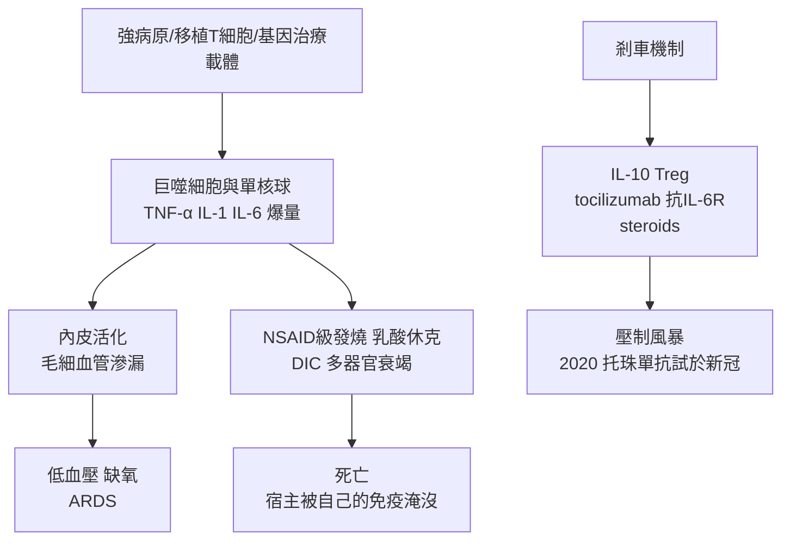

## 1993 - 細胞因子風暴的命名（免疫系統的友軍誤擊）

## 案件摘要

**本案偵破的是：免疫系統的殺傷力失控時，會發生什麼？醫學界為這個現象找了 20 年名字，直到 1993 年才有專有名詞。**

1993 年，骨髓移植先驅 James Ferrara 在研究移植體對宿主病（GVHD）的論文中首次使用「**cytokine storm**」（細胞因子風暴）一詞，描述供體 T 細胞釋放的巨量細胞因子引發的全身性炎症連鎖反應。這個氣象學比喻精準刻畫了免疫病理的新案卷類型：**不是免疫不足、也不是免疫錯認，而是免疫強度失控**——訊號分子（細胞因子 IL-1、IL-6、TNF-α、IFN-γ……）的正回饋迴路越滾越大，直到宿主被自己的防禦系統淹死。此後它被陸續套用在 2002 年 SARS、2005 年禽流感、2019 年新冠、CAR-T 治療的 CRS、乃至 2020 年代細胞因子釋放症候群（CRS）的正式醫學命名上。

## 前因 -- 為什麼會有這個案子

- **細胞因子的發現史**。1957 年干擾素（Isaacs & Lindenmann）、1975 年 TNF（Carswell、Old）、1977 年 IL-1、1986 年 IL-6（岸本忠三平野俊夫）與 Th1/Th2 分類（Mosmann & Coffman）——免疫細胞間的「電報系統」在 1970s–80s 被逐一譯碼。
- **1980s 臨床的危險信號**。以 TNF/IL-2 治癌的臨床試驗出現嚴重「毛細血管滲漏」與休克（Rosenberg 的 IL-2 高劑量療法致命案例）；敗血症研究的 SIRS（全身炎症反應症候群，1991 ACCP 共識）——**「免疫過度」有了臨床輪廓，但無統一名詞**。
- **骨髓移植的 GVHD**。異體骨髓移植後供體 T 細胞攻擊宿主，病理呈「細胞因子濃度全面飆升」——Ferrara 的命名正是為此案卷。
- **1918 年大流感的回溯偵查**。2000s 研究發現 1918 禽流感病毒株對小鼠引發極端細胞因子反應——**「年輕人為何死得最多」的百年謎題獲得新解釋：越強的免疫反應，風暴越猛**。

## 線索與推理 -- 數學式、程式、理論

**線索一：正回饋的失控方程。** 細胞因子風暴的本質是一個自我放大系統：

$$ \frac{d[\text{CK}]}{dt} = \alpha \cdot [\text{病原信號}] + \beta \cdot [\text{CK}]^2 - \gamma \cdot [\text{CK}] $$

其中 $\beta [\text{CK}]^2$ 是細胞因子互相誘導對方分泌的正回饋項——**當 $\beta [\text{CK}]$ 超過降解率 $\gamma$，濃度指數爆炸**，即「風暴」。免疫調控通常靠負回饋（IL-10、Treg、受體脫落）壓住；當病原（或藥物）同時擊發多條通路，負回饋來不及，風暴成型。

**線索二：多米諾的偵查圖。**

**線索三：名詞的譜系。**

| 年代 | 名詞 | 使用者 | 範圍 |
|---|---|---|---|
| 1988 | 毛細血管滲漏症候群 | 臨床腫瘤界 | IL-2 療法 |
| 1991 | SIRS | 重症醫學 | 敗血症／全身炎症 |
| **1993** | **cytokine storm** | **Ferrara（GVHD）** | 骨髓移植 |
| 2002–05 | cytokine storm 流行化 | SARS／禽流感媒體與文獻 | 冠狀病毒、H5N1 |
| 2010s | CRS（cytokine release syndrome） | CAR-T 領域（2017 taxilitus） | 細胞治療 |
| 2020 | COVID 風暴論戰 | 中國醫生（《柳葉刀》通訊）與各地團隊 | COVID-19 |

**線索四：托珠單抗的救援。** 2017 年 CAR-T（axi-cel）治療引發 CRS，以抗 IL-6 受體單株抗體 **tocilizumab**（2008 年上市治類風濕，岸本忠三與平野俊夫的 IL-6 基礎研究 → 2020 年獲拉斯克獎）成功逆轉——**風暴的第一個專門剎車**；2020 年新冠重症亦循同路試驗。這是 1980s 細胞因子基礎研究到 2010s 治療應用的完整接力。

## 結案 -- 後果與影響

- **免疫學的「強度維度」被承認**。免疫反應不只是「對與錯」（特異性問題），還有「多與少」（強度問題）——細胞因子風暴把調節（regulation）從配角推向主角。
- **風暴成為大流行的解釋框架**。1918 流感、SARS、H5N1、COVID——年輕重症者的「免疫過強」解釋，改變了重症治療的思路：**有時該壓制免疫，而非支援免疫**。
- **細胞治療的安全工程**。CAR-T 治療的 CRS 分級與預防協議（分級給藥、tocilizumab 備藥）成為新療法上市的標配——免疫治療的「安全閥工程」。
- **陰影面**。「風暴」是比喻不是診斷：2020 年不少學者批評它在新冠文獻中被濫用、缺乏統一定義與檢測標準——比喻的科學價值需要臨床指標來兌現。
- **一句話結案**：Ferrara 撿起了氣象學的詞——**免疫系統不是永不犯錯的警察，偶爾它會把整座城市當成嫌犯**；免疫學自此開始偵查「剎車」的機制，而非只偵查「引擎」。

## 關鍵人物與文獻

- **James Ferrara（1951–）**——美國血液腫瘤學家；GVHD 與細胞因子風暴研究先驅；1993 年首用該詞。
- **岸本忠三（Tadamitsu Kishimoto, 1939–）與平野俊夫（Toshio Hirano, 1947–）**——IL-6 的發現者（1986）；托珠單抗的科學基礎；2017/2020 拉斯克獎。
- **Steven Rosenberg**——1980s 高劑量 IL-2 免疫療法，副作用預演了 CRS 的臨床樣貌。
- **Karen Ferrante、Carl June**——CAR-T CRS 分級與管理的臨床工程師（2017）。
- 原始文獻——Ferrara et al., *Cytokine dysregulation in acute graft-versus-host disease*, Blood, 1993；Rosenberg et al., NEJM, 1985–87（IL-2）；Lee et al., NEJM, 2014（CAR-T CRS）。
- 延伸閱讀——`1965-T細胞與B細胞的分工.md`、`2011-艾利森CTLA-4免疫檢查點抑制劑.md`、`2020-mRNA疫苗與卡里科.md`。
