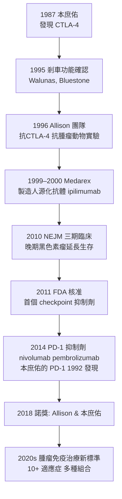

## 2011 - 艾利森與CTLA-4免疫檢查點抑制劑（放開免疫系統的剎車）

## 案件摘要

**本案偵破的是：癌症為何能躲過免疫系統？答案不是免疫「看不見」腫瘤，而是免疫「被踩住了剎車」。**

2011 年 3 月，美國 FDA 核准 **ipilimumab**（Yervoy，抗 CTLA-4 單株抗體）治療晚期黑色素瘤——這是人類第一種「免疫檢查點抑制劑」：它不解攻腫瘤，而是**阻斷 T 細胞上的剎車分子 CTLA-4**，讓 T 細胞持續攻擊。核心思想來自 James Allison：1995 年他的團隊在實驗動物證明，**封鎖 CTLA-4 可以讓免疫系統消滅腫瘤**；2010 年關鍵三期臨床（ipilimumab 使晚期黑色素瘤生存期延長，部分病人活過 10 年）發表於 NEJM；2011 年上市。免疫治療百年失敗史自此翻頁——Allison 獲 2018 年諾貝爾生理學或醫學獎（與本庶佑同獲）。

## 前因 -- 為什麼會有這個案子

- **百年免疫治療的連敗**。1890s Coley 毒素（化膿菌注射液治肉瘤）偶有奇效卻無法重現；1970s–80s 干擾素、IL-2 高劑量療法反應率極低且毒性大——「免疫治療」幾乎是腫瘤學的笑柄。
- **克隆選擇的新難題**。腫瘤抗原確實存在（1980s Boon 找到 CTL 抗原）——那為何免疫系統不除掉腫瘤？「免疫監視」學說（Burnet 1957 提出）無法解釋明顯的腫瘤生長。
- **免疫耐受的另一面**。1980s–90s 偵破：T 細胞活化需要兩個信號——TCR（第一信號）＋共刺激（第二信號，B7-CD28，1987–1990 Linsley、Lafferty）；而 **CTLA-4（1987 本庶佑發現）是共刺激的「對手」**，抑制活化（1995 Walunas 證明其剎車功能）。
- **Bretsher 與 Lafferty 的理論預備**。1970 年的「雙信號學說」預言了：只有第一信號會導致無能（耐受）——共刺激與抑制的平衡，就是「剎車與油門」的分子語言。

## 線索與推理 -- 數學式、程式、理論

**線索一：油門與剎車的模型。**

$$ \text{T 細胞活化} = \underbrace{(\text{TCR} + \text{CD28 油門})}_{\text{促進}} - \underbrace{(\text{CTLA-4 / PD-1 剎車})}_{\text{抑制}} $$

CTLA-4 在 T 細胞活化後上膜，**與 CD28 競爭結合 B7**（親和力更高）並傳遞抑制信號——本庶佑 1992 年的 CTLA-4 基因剔除小鼠（與 Bluestone 1995）顯示：無 CTLA-4 → 淋巴組織爆炸性增生 → **自體免疫**——剎車不可或缺。

**線索二：Allison 的「反面思路」。** 1994–96 年 Berkeley 團隊（Leach、Krummel、Allison）：在小鼠腫瘤模型中以抗 CTLA-4 抗體**封鎖剎車** → 腫瘤消退；合併腫瘤疫苗效果更佳：

**線索三：為何先在黑色素瘤成功？** 偵探線索：黑色素瘤突變負荷極高（紫外線突變）→ 新抗原多 → 潛在免疫靶點多 → **「放開剎車」後 T 細胞有東西可打**。這解釋了為何 checkpoint 抑制劑在突變少的腫瘤（如胰腺癌）反應率低——腫瘤免疫的「燃料」與「剎車」缺一不可。

**線索四：免疫相關副作用的警訊。** 踩下油門的代價是**自身免疫樣副作用**（irAE）：腸炎、肺炎、甲狀腺炎、皮膚炎——**這正是耐受（見 `1953-梅達沃免疫耐受實驗.md`）存在的生理證明**：剎車本來就是防自體攻擊的。免疫治療與自體免疫是同一系統的兩面。

## 結案 -- 後果與影響

- **腫瘤免疫治療成為第四支柱**。與手術、化療、放療並列；PD-1/PD-L1 抑制劑（nivolumab、pembrolizumab、atezolizumab）覆蓋肺癌、腎癌、膀胱癌、何杰金氏淋巴瘤等 20+ 適應症；「長期倖存者」第一次在晚期癌症成為統計現象。
- **免疫檢查點的軍備擴張**。CTLA-4、PD-1、PD-L1、LAG-3（2022 核准）、TIGIT、TIM-3——「剎車分子」的偵查持續擴編；也催生了「組合免疫治療」策略（CTLA-4＋PD-1，例如 ipi+nivo）。
- **2018 年諾貝爾獎**。Allison 與本庶佑共享；Allison 的名言：「我要治療病人，不是發表論文」——基礎免疫學到臨床腫瘤的完整弧線。
- **陰影面**。反應率僅 20–40%（黑色素瘤以外更低）、irAE 可致命、費用高昂（每年數十萬美元）；「免疫治療不等於痊癒」，耐受機制仍是未竟之業。
- **一句話結案**：Allison 的偵探革命是**把「為何免疫不殺腫瘤」的問題從「看不見」改成「被踩住剎車」**——一旦方向對了，解方就是一種已有的技術（見 `1975-柯勒與米爾斯坦單株抗體.md`）。

## 關鍵人物與文獻

- **James Allison（1948–）**——德州出生；Berkeley → Sloan Kettering → MD Anderson；2018 年諾獎；亦為 2015 年 Lasker 獎；本人業餘藍調口琴手。
- **本庶佑（Tasuku Honjo, 1942–）**——京都大學；CTLA-4（1987）與 PD-1（1992）的發現者；2018 年共同諾獎；PD-1 抗體 nivolumab 以其為名（小野藥品 Opdivo）。
- **Dana Leach、Matthew Krummel**——Allison 實驗室的動物實驗執行者（1996）。
- **Jeffrey Bluestone、Peter Linsley**——CTLA-4 功能與 B7-CD28 通路的重要共建者。
- 原始文獻——Leach, Krummel & Allison, *Enhancement of antitumor immunity by CTLA-4 blockade*, Science, 1996；Hodi et al., *Improved survival with ipilimumab in patients with metastatic melanoma*, NEJM, 2010。
- 延伸閱讀——`1953-梅達沃免疫耐受實驗.md`、`1957-伯內特克隆選擇學說.md`、`1975-柯勒與米爾斯坦單株抗體.md`、`1993-細胞因子風暴的命名.md`。
