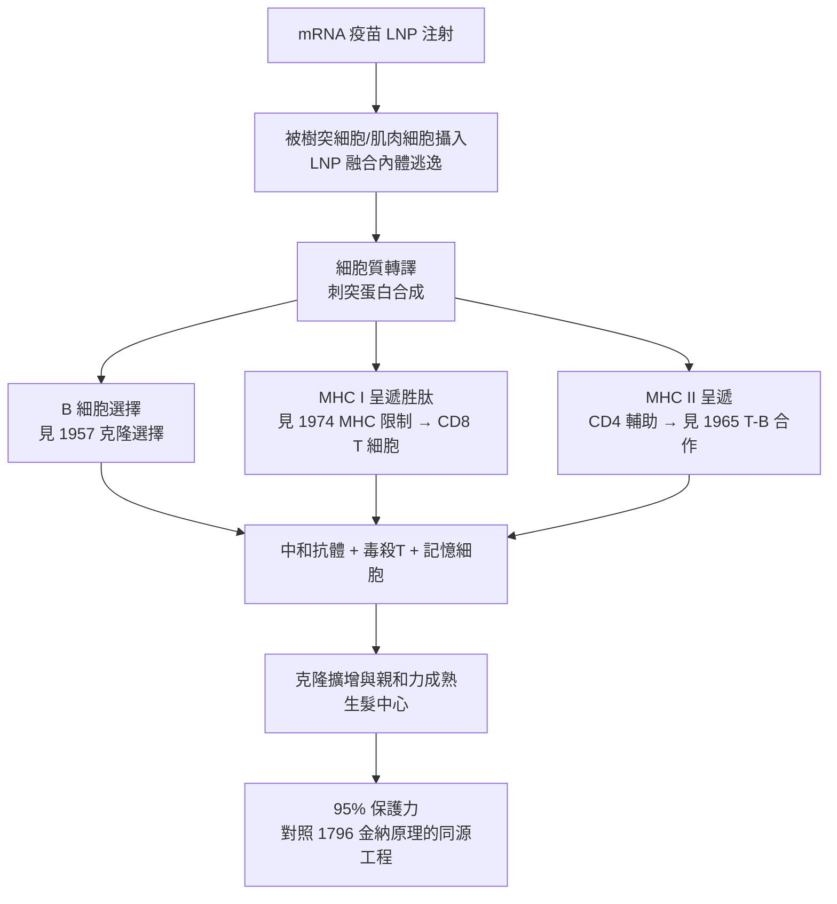

## 2020 - mRNA疫苗與卡里科（免疫學的最後一塊拼圖：由人體自行印製抗原）

## 案件摘要

**本案偵破的是：能不能不要把抗原（蛋白、病毒顆粒）送進身體，而是把「製造抗原的食譜」送進去，讓細胞自己印？**

2020 年 12 月，BioNTech/輝瑞 BNT162b2 與 Moderna mRNA-1273 兩款 mRNA 疫苗在新冠大流行中以不到一年時間完成臨床試驗並獲多國緊急授權，保護力約 95%——史上最快的疫苗開發紀錄。技術基礎來自 **Katalin Karikó 與 Drew Weissman** 賓州大學 2005 年的突破：以**假尿苷（pseudouridine）修飾 mRNA**，繞過免疫系統對外源 RNA 的本能警報（TLR3/7/8、RIG-I），使 mRNA 得以在細胞內安靜地轉譯蛋白。這是疫苗學的三次革命：金納的**整隻病原**（1796）→ 巴斯德的**減毒/組分**（1885 以降）→ mRNA 的**指令**。Karikó 與 Weissman 獲 2023 年諾貝爾生理學或醫學獎。

## 前因 -- 為什麼會有這個案子

- **1980s–90s mRNA 的悲觀**。mRNA 不穩定、難遞送、且**外源 RNA 會引發劇烈炎症**（干擾素反應）——1990 年 Wolff 的裸 DNA 報告之後，核酸疫苗的期望一度轉向 DNA；mRNA 被視為「不實用的想法」。
- **Karikó 的堅持**。1989 年她赴賓大，長期被指「方向錯誤」、1995 年遭降職減薪——仍然在週末與 Weissman（免疫學家，1997 加入）合作，專攻「mRNA 為何惹火免疫系統」。
- **脂質納米顆粒（LNP）的成熟**。Pieter Cullis 團隊與 2018 年 Alnylam 的 siRNA 藥物（ONPATTRO）核准，LNP 遞送技術就位——**mRNA 的「郵差」問題已解**。
- **冠狀病毒研究的長期投資**。2002 SARS、2012 MERS、2015 中東冠狀病毒疫苗研究（ including NIH 與UNC 的 stabilized spike 技術，McLellan 與 Graham 2017）——刺突蛋白的穩定構象設計在疫情前已完成。

## 線索與推理 -- 數學式、程式、理論

**線索一：免疫系統如何「警報外源 RNA」？** 先天免疫的 RNA 感測器（TLR3/7/8、RIG-I、MDA5）把未修飾 RNA 視為病毒訊號：

$$ \text{未修飾 mRNA} \;\xrightarrow{\text{TLR7/8, RIG-I}}\; \text{IFN-}\alpha/\beta \;\longrightarrow\; \text{炎症 ＆ 轉譯關機（見 } 1993\text{-細胞因子風暴的命名）} $$

**線索二：Karikó–Weissman 的核心發現（2005）。** 把 mRNA 中的尿苷替換為**假尿苷**（天然存在於 tRNA 的修飾核苷）：

```python
# 2005 年關鍵發現的概念復原
def translate_mRNA(seq, modified=True):
    if modified:
        seq = replace(seq, "U", "ψ")   # 假尿苷替換
        # 結果: TLR7/8 幾乎不識別 → 干擾素反應消失
        # 但核糖體照常讀碼 → 蛋白產量反而更高
    return ribosome_translate(seq)
```

**「同一份字串、更隱蔽的墨水」**——免疫隱形與轉譯效率雙贏。2008 年再以 5-methylcytidine 等優化；2010 年後含精純化消除污染 dsRNA，工藝完備。

**線索三：免疫學的終極框架。** mRNA 疫苗串起了本書所有偵查成果：



**線索四：開發速度的偵探式解釋。** 疫苗開發為何能快到 11 個月？

| 環節 | 傳統疫苗 | mRNA 疫苗 |
|---|---|---|
| 抗原設計 | 培養病毒／蛋白表達（月–年） | **合成 RNA（天）** |
| 遞送系統 | 已有佐劑 | LNP（2018 已核准） |
| 臨床試驗 | 需等候流行或攻毒 | 4.4 萬人國際三期 |
| 生產 | 培養＋滅活（月） | **體外轉錄（週）** |

**「設計即產品」**——mRNA 把疫苗從「製造問題」變成「資訊問題」，速度提升一個量級。

## 結案 -- 後果與影響

- **mRNA 平台時代**。RSV 疫苗、個體化腫瘤新抗原疫苗（2023–24 Moderna/Mercode 臨床三期）、流感泛疫苗、HIV 嘗試——「把食譜送進細胞」成為通用平台；mRNA 治療（遺傳病蛋白補充）也在展開。
- **免疫學的工程巔峰**。從「看見免疫現象」到「指揮免疫反應」：金納借自然之力、巴斯德馴化病原、mRNA 直接把免疫系統當成印表機——**免疫學完成從觀察到工程的完整進化**。
- **2023 年諾貝爾獎**。Karikó 與 Weissman 共享；Karikó 從被降職的移民研究員到諾獎得主的弧線，成為科學敘事的當代經典。
- **陰影面**。LNP 的過敏反應（PEG 相關）、心肌炎風險（年輕男性）、全球分配不公（非洲接種率一度 <10%）、專利與知識產權爭議（NIH vs Moderna）——技術的普及正義仍是未結案卷。
- **一句話結案**：Karikó 用一個化學修飾解開了免疫系統對 RNA 的百年誤解——**從此疫苗不再是病原的複製品，而是免疫系統的一封信**；免疫學的最後一塊拼圖，是用「資訊」補上的。

## 關鍵人物與文獻

- **Katalin Karikó（1955–）**——匈牙利出生生物化學家；1985 年以黑市換匯藏現金移民美國；賓大從研究副教授到諾獎；2022 年後任 Szeged 大學教授與 BioNTech 資深副總裁。
- **Drew Weissman（1959–）**——美國免疫學家、Fauci 前同事；1997 年起與 Karikó 合作；2023 年共同諾獎。
- **Pieter Cullis**——UBC 脂質納米顆粒先驅；LNP 遞送的幕後功臣。
- **Kizzmekia Corbett 與 Barney Graham**——NIH 疫苗研究中心；穩定刺突蛋白設計與疫苗臨床推進的關鍵人物。
- **Uğur Şahin 與 Özlem Türeci**——BioNTech 創辦人夫妻檔，mRNA 癌症疫苗研究者轉戰新冠；2020 年抗疫的產業英雄。
- 原始文獻——Karikó, Buckstein, Ni & Weissman, *Suppression of RNA recognition by TLRs: the impact of nucleoside modification*, Immunity, 2005；Karikó et al., *Incorporation of pseudouridine into mRNA yields superior nonimmunogenic vector*, Mol. Ther., 2008；Polack et al., *Safety and efficacy of BNT162b2 mRNA vaccine*, NEJM, 2020。
- 延伸閱讀——`1796-金納牛痘接種.md`、`1885-巴斯德狂犬病疫苗與減毒原理.md`、`1957-伯內特克隆選擇學說.md`、`1974-多赫蒂與青克納格爾MHC限制.md`、`1993-細胞因子風暴的命名.md`。
