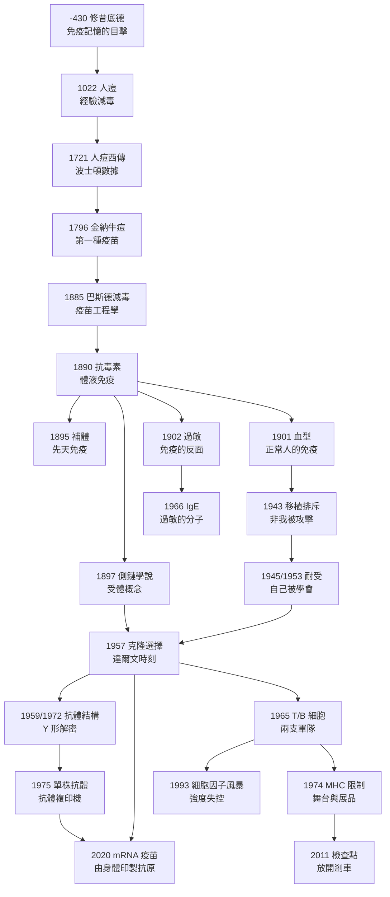

# 免疫科的歷史：從雅典瘟疫的康復者、人痘與牛痘、血清與補體、克隆選擇，到 MHC、單株抗體、檢查點抑制劑與 mRNA 疫苗

> 本書以「推理探案」的體例，為人類免疫學史上的每個關鍵事件寫一篇 wiki：
> 謎題是什麼（身體如何分辨自己與非我）？偵探是誰（鄉村醫生、化學家、動物學家、移民科學家）？
> 線索與推理是什麼（側鏈學說、克隆選擇、免疫耐受、MHC 限制、親和力成熟）？後果又如何？
> 每篇檔名以年份開頭（4 位數，西元前以 `-` 開頭）。

## 主軸：免疫學回答的四個問題

| 問題 | 核心解答 | 代表 wiki |
|---|---|---|
| **免疫為何存在？** | 康復者不再感染——免疫記憶是真實現象 | [-0430-修昔底德與雅典瘟疫的康復者](-0430-修昔底德與雅典瘟疫的康復者.md) |
| **免疫能否人工取得？** | 人痘→牛痘→減毒→mRNA：從借病到造苗 | [1022](1022-人痘接種傳入中國宮廷.md)、[1796](1796-金納牛痘接種.md)、[1885](1885-巴斯德狂犬病疫苗與減毒原理.md)、[2020](2020-mRNA疫苗與卡里科.md) |
| **免疫的分子是什麼？** | 抗毒素、補體、抗體結構、IgE——血清裡的機器 | [1890](1890-貝林白喉抗毒素.md)、[1895](1895-博爾代發現補體.md)、[1959](1959-波特與埃德爾曼解開抗體結構.md)、[1966](1966-石坂父子發現IgE.md) |
| **身體如何分辨自己與非我？** | 血型→耐受→克隆選擇→MHC 限制→檢查點 | [1901](1901-蘭茨泰納血型與輸血.md)、[1945](1945-歐文紅血球嵌合與免疫耐受.md)、[1957](1957-伯內特克隆選擇學說.md)、[1974](1974-多赫蒂與青克納格爾MHC限制.md)、[2011](2011-艾利森CTLA-4免疫檢查點抑制劑.md) |

---

## 年表（非常詳細版）

### 第一篇：古代的直覺——免疫現象的最早目擊與人工免疫的東方起源

| 年份 | 事件 | 意義 | wiki |
|---|---|---|---|
| 約前 430 | 修昔底德記錄雅典瘟疫：康復者照顧病患而不再染病 | 免疫記憶的第一份文獻；「immunity」一詞的希臘源頭 | [-0430-修昔底德與雅典瘟疫的康復者](-0430-修昔底德與雅典瘟疫的康復者.md) |
| 約 1000–1022 | 傳說北宋真宗朝宰相王旦延醫為幼子種痘（峨嵋山人故事） | 人痘接種最早的敘事母題 | [1022-人痘接種傳入中國宮廷](1022-人痘接種傳入中國宮廷.md) |
| 1567–1572（明隆慶） | 寧國府太平縣人痘接種職業化；「熟苗」陳化減毒法成熟 | 經驗版減毒工藝——巴斯德減毒原理的遠祖 | 同上 |
| 17 世紀 | 康熙帝下令為皇族、八旗與蒙古推廣種痘 | 首次國家級人工免疫政策 | 同上 |
| 1688–1710s | 俄國遣人來華學痘；經鄂圖曼帝國傳入君士坦丁堡 | 人痘西傳的通道 | 同上 |
| 1721 | Lady Mary Wortley Montagu 在倫敦為女兒接種；波士頓 Mather–Boylston 群體接種試驗（接種死亡率約 2% vs 天然感染約 15%） | 英語世界人痘元年；第一次用死亡率對比說服社會 | [1721-波士頓人痘試驗與蒙塔古夫人](1721-波士頓人痘試驗與蒙塔古夫人.md) |
| 1722 | 英國兩位公主接種；Cotton Mather 遭炸彈攻擊 | 上層示範效應與反接種暴力的雙重開端 | 同上 |
| 1736 | Benjamin Franklin 幼子死於天花（未接種），Franklin 轉為接種最有力宣傳者 | 名人效應與公衛傳播學的開始 | 同上 |

### 第二篇：牛痘與減毒——免疫學成為工程學科

| 年份 | 事件 | 意義 | wiki |
|---|---|---|---|
| 1774 | 英國 Benjamin Jesty 為家人接種牛痘（農民先行者） | 民間先行、未系統化的牛痘嘗試 | [1796-金納牛痘接種](1796-金納牛痘接種.md) |
| 1796.5.14 | Jenner 為 James Phipps 接種牛痘並以人痘毒攻擊驗證 | 第一種疫苗誕生；「攻擊試驗」設計的首例 | 同上 |
| 1798 | Jenner《牛痘之因與效果探究》出版 | 「vaccine」時代的文獻起點 | 同上 |
| 1853 | 英國強制接種法；Anti-Vaccination League 成立 | 強制公衛與個人自由的百年張力 | 同上 |
| 1879 | Pasteur 因雞霍亂「陳舊培養」意外確立減毒原理；首用「vaccination」泛稱 | 減毒（attenuation）的理論化 | [1885-巴斯德狂犬病疫苗與減毒原理](1885-巴斯德狂犬病疫苗與減毒原理.md) |
| 1881 | Pouilly-le-Fort 炭疽疫苗公開對照實驗（接種羊全活、對照全死） | 首次大規模公開對照驗證 | 同上 |
| 1884 | Chamberland 濾器問世 | 「可濾過病原」（病毒）的發現工具 | 同上 |
| 1885.7.6 | Joseph Meister 接受狂犬疫苗（13 針遞增毒力） | 暴露後免疫首例；疫苗學從預防跨入急救 | 同上 |
| 1887 | Pasteur 研究所國際募款成立 | 免疫學—微生物學的全球母港 | 同上 |

### 第三篇：血清與補體——免疫的分子時代

| 年份 | 事件 | 意義 | wiki |
|---|---|---|---|
| 1888 | Roux 與 Yersin 證明白喉症狀由可濾過毒素造成 | 血清療法的靶點確立 | [1890-貝林白喉抗毒素](1890-貝林白喉抗毒素.md) |
| 1890 | Behring 與北里柴三郎發表白喉／破傷風抗毒素（血清轉移實驗） | 體液免疫概念誕生；抗毒素成為第一種可計量的免疫藥 | 同上 |
| 1891.12 | 柏林兒童醫院以馬血清抗毒素救活白喉女童 | 血清療法首次臨床成功 | 同上 |
| 1894 | Hoechst 量產馬源抗毒素 | 生物製藥產業誕生 | 同上 |
| 1895 | Bordet 證明血清含熱敏感的非特異性殺菌成分（Ehrlich 命名補體） | 先天免疫系統首度現形 | [1895-博爾代發現補體](1895-博爾代發現補體.md) |
| 1901 | Bordet–Gengou 補體結合試驗 | 免疫診斷的間接偵測範式 | 同上 |
| 1906 | Wassermann 補體結合試驗用於梅毒診斷 | 第一個廣泛使用的免疫診斷（見性病史） | 同上 |
| 1897 | Ehrlich 提出側鏈學說：側鏈（受體）被抗原選擇、過量再生、脫落為抗體 | 受體概念誕生；「選擇論」哲學的首次宣言 | [1897-埃爾利希側鏈學說](1897-埃爾利希側鏈學說.md) |
| 1900 | Ehrlich 提出「horror autotoxicus」（不攻擊自己） | 自我耐受問題的最早格言（後被 Owen–Burnet 修正） | 同上 |
| 1901 | Behring 獲首屆諾貝爾生理學或醫學獎（北里未同獲） | 免疫學首獎；諾獎史著名遺珠 | [1890-貝林白喉抗毒素](1890-貝林白喉抗毒素.md) |
| 1901 | Landsteiner 發現 A、B、C（O）血型；1902 補上 AB | 正常人體內首現抗原—抗體反應；輸血科學化 | [1901-蘭茨泰納血型與輸血](1901-蘭茨泰納血型與輸血.md) |
| 1902 | Richet 與 Portier 發現過敏性休克（anaphylaxis） | 免疫的反面：防衛系統可反噬宿主 | [1902-里謝發現過敏反應](1902-里謝發現過敏反應.md) |
| 1903 | Arthus 反應（局部免疫複合物損傷） | Ⅲ 型過敏的動物模型 | 同上 |
| 1903 | Wright 與 Douglas 提出 opsonin（調理素） | 吞噬學說與血清學的和解 | [1895-博爾代發現補體](1895-博爾代發現補體.md) |
| 1906 | Pirquet 提出「allergy」與血清病機制 | 免疫病理學誕生 | [1902-里謝發現過敏反應](1902-里謝發現過敏反應.md) |
| 1908 | Ehrlich 與 Metchnikoff 共享諾貝爾獎 | 體液與細胞兩派的第一次官方和解 | [1897-埃爾利希側鏈學說](1897-埃爾利希側鏈學說.md) |
| 1913 | Richet 獲諾貝爾獎（過敏反應） | 免疫病理獲得承認 | [1902-里謝發現過敏反應](1902-里謝發現過敏反應.md) |
| 1917–1921 | Landsteiner 半抗原實驗：人工抗原的無限多樣性 | 指令學說的難題、選擇論的伏筆 | [1897-埃爾利希側鏈學說](1897-埃爾利希側鏈學說.md) |
| 1919 | Bordet 獲諾貝爾獎 | 補體研究加冕 | [1895-博爾代發現補體](1895-博爾代發現補體.md) |
| 1930 | Landsteiner 獲諾貝爾獎（血型） | 血型偵探的加冕 | [1901-蘭茨泰納血型與輸血](1901-蘭茨泰納血型與輸血.md) |

### 第四篇：耐受與選擇——免疫學的達爾文革命

| 年份 | 事件 | 意義 | wiki |
|---|---|---|---|
| 1942 | Landsteiner & Chase：遲發過敏可由淋巴細胞轉移 | 細胞免疫獨立性的關鍵證據 | [1965-T細胞與B細胞的分工](1965-T細胞與B細胞的分工.md) |
| 1943 | Medawar 與 Gibson：家兔與燒傷病人植皮排斥實驗；二次移植加速 | 排斥是免疫行為（特異性＋記憶性） | [1943-梅達沃與移植排斥的發現](1943-梅達沃與移植排斥的發現.md) |
| 1944–45 | Owen 發表異卵雙胞胎牛的紅血球嵌合與特異性無反應 | 胚胎期接觸抗原→終身耐受的猜想 | [1945-歐文紅血球嵌合與免疫耐受](1945-歐文紅血球嵌合與免疫耐受.md) |
| 1948 | Snell 定位小鼠 H-2 組織相容性基因；同類系小鼠技術 | 排斥的遺傳學座標；MHC 研究的開端 | [1948-斯內爾組織相容性基因](1948-斯內爾組織相容性基因.md) |
| 1949 | Burnet 與 Fenner 提出 self-marker 假說 | Owen 現象的理論化；可證偽的預言 | [1945-歐文紅血球嵌合與免疫耐受](1945-歐文紅血球嵌合與免疫耐受.md) |
| 1953 | Billingham、Brent & Medawar：新生期注射異品系脾細胞→終身接受該品系皮膚 | 人工誘導免疫耐受首次成功 | [1953-梅達沃免疫耐受實驗](1953-梅達沃免疫耐受實驗.md) |
| 1953 | Hašek 以雞胚嵌合獨立報告胚胎期耐受（捷克） | 鐵幕兩側同時逼近同一答案 | 同上 |
| 1955 | Jerne 提出自然抗體選擇理論 | 「選擇」觀念的第一擊 | [1957-伯內特克隆選擇學說](1957-伯內特克隆選擇學說.md) |
| 1957 | Burnet 提出克隆選擇學說：一細胞一特異性、抗原只選不教、胚胎期克隆刪除 | 免疫學的達爾文時刻 | [1957-伯內特克隆選擇學說](1957-伯內特克隆選擇學說.md) |
| 1958 | Nossal & Lederberg 證明單個淋巴細胞只分泌一種抗體 | 克隆選擇的直接驗證 | 同上 |
| 1959–62 | Porter（酶切片段）與 Edelman（重輕鏈）解開抗體 Y 形結構 | 血清療法的分子解剖 | [1959-波特與埃德爾曼解開抗體結構](1959-波特與埃德爾曼解開抗體結構.md) |
| 1960 | Burnet 與 Medawar 共享諾貝爾獎 | 理論與實驗同框得獎 | [1953-梅達沃免疫耐受實驗](1953-梅達沃免疫耐受實驗.md) |
| 1964–70 | Siskind–Benacerraf、Weigert 等：抗體親和力隨反應成熟升高 | 體細胞超突變＋競爭選擇＝微觀演化 | [1957-伯內特克隆選擇學說](1957-伯內特克隆選擇學說.md) |
| 1969 | Edelman 團隊完成 IgG 完整胺基酸序列；Wu & Kabat 找出超高變段（CDR） | 多樣性問題被重新定義 | [1959-波特與埃德爾曼解開抗體結構](1959-波特與埃德爾曼解開抗體結構.md) |
| 1972 | Porter 與 Edelman 共享諾貝爾化學獎 | 抗體結構的加冕 | 同上 |
| 1976 | Tonegawa 發現免疫球蛋白基因重排 | 有限基因生成無限抗體的機制；1987 諾獎 | [1957-伯內特克隆選擇學說](1957-伯內特克隆選擇學說.md) |

### 第五篇：細胞分工與 MHC——免疫系統的兩支軍隊與舞台

| 年份 | 事件 | 意義 | wiki |
|---|---|---|---|
| 1956 | Glick：切除雞法氏囊→不產生抗體 | B 細胞的第一顆種子（長年被忽視） | [1965-T細胞與B細胞的分工](1965-T細胞與B細胞的分工.md) |
| 1961–62 | Miller：新生期胸腺切除→細胞免疫喪失 | 胸腺是「軍校」；T 細胞現形 | 同上 |
| 1965 | Cooper 與 Good：法氏囊／胸腺＝B/T 兩個譜系 | 免疫系統的兩支軍隊分清 | 同上 |
| 1966–68 | Claman、Mitchison、Miller & Mitchell：T 細胞輔助 B 細胞產生抗體 | T-B 合作；半抗原—載體效應的細胞基礎 | 同上 |
| 1952 | Bruton 描述性聯無丙種球蛋白血症 | 原發免疫缺陷病的分類學起點 | 同上 |
| 1958 | Dausset 發現人類 HLA-A2 | 人類 MHC 的開端 | [1948-斯內爾組織相容性基因](1948-斯內爾組織相容性基因.md) |
| 1962–63 | Murray 完成同卵雙生腎移植；1960s 硫唑嘌呤時代 | 移植醫學的臨床開端 | [1943-梅達沃與移植排斥的發現](1943-梅達沃與移植排斥的發現.md) |
| 1974 | Zinkernagel & Doherty：T 細胞只殺死「MHC 相同＋病毒感染」的靶細胞 | MHC 限制：免疫辨識的雙鍵密碼 | [1974-多赫蒂與青克納格爾MHC限制](1974-多赫蒂與青克納格爾MHC限制.md) |
| 1980 | Snell、Dausset、Benacerraf 共享諾貝爾獎（H-2／HLA／Ir 基因） | 免疫應答納入孟德爾框架 | [1948-斯內爾組織相容性基因](1948-斯內爾組織相容性基因.md) |
| 1981 | Klein 等：胸腺正向選擇學說成形 | T 細胞為何天然偏愛自身 MHC | [1974-多赫蒂與青克納格爾MHC限制](1974-多赫蒂與青克納格爾MHC限制.md) |
| 1987 | Wiley 與 Wilson 解出 MHC I 結晶結構：溝槽內嵌 8–10 胺基酸胜肽 | MHC 限制的結構解釋 | 同上 |
| 1996 | Garboczi 等 TCR-pMHC 複合體結構；Doherty 與 Zinkernagel 獲諾貝爾獎 | 「MHC＋胜肽」雙重識別的最終確證 | 同上 |

### 第六篇：過敏的分子與免疫的反面

| 年份 | 事件 | 意義 | wiki |
|---|---|---|---|
| 1878 | Ehrlich 以亞甲藍描述肥大細胞 | 肥大細胞進入檔案（功能待 88 年後揭曉） | [1966-石坂父子發現IgE](1966-石坂父子發現IgE.md) |
| 1921 | Prausnitz–Küstner 反應：過敏血清因子（reagin）可被動轉移 | 過敏的血清學定性 | 同上 |
| 1966 | Ishizaka 夫婦以吸收試驗鑑定出全新免疫球蛋白類別 | 64 年懸案告破的關鍵一步 | 同上 |
| 1967 | Johansson 與 Bennich 的 ε 骨髓瘤蛋白與 reagin 合流；RAST 血清學過敏檢測發明 | 兩條偵查線合併；診斷革命 | 同上 |
| 1968 | WHO 正式命名 IgE | 過敏執行分子定名 | 同上 |
| 1970s–80s | IgE 的抗寄生蟲功能確認；1989 Strachan 衛生假說 | 過敏是抗蟲武器的現代誤觸發 | 同上 |
| 2002 | 抗 IgE 單株抗體 omalizumab 上市 | 過敏從診斷走向靶向治療 | 同上 |

### 第七篇：工具、風暴與剎車——從單株抗體到檢查點

| 年份 | 事件 | 意義 | wiki |
|---|---|---|---|
| 1975 | Köhler 與 Milstein 雜交瘤：單株抗體 | 抗體可以訂製、無限複製；1984 諾獎 | [1975-柯勒與米爾斯坦單株抗體](1975-柯勒與米爾斯坦單株抗體.md) |
| 1980s | mAbs 診斷試劑爆發（驗孕、感染、血型、免疫組化） | 臨床診斷的全面 mAbs 化 | 同上 |
| 1986 | OKT3 成為首個治療性 mAb；Mosmann & Coffman 提出 Th1/Th2 分類 | 治療性抗體與細胞因子分類的開始 | [1993-細胞因子風暴的命名](1993-細胞因子風暴的命名.md) |
| 1985–87 | Rosenberg 高劑量 IL-2 療法的嚴重毒性 | 「免疫過度」的臨床預演 | 同上 |
| 1988–91 | 毛細血管滲漏症候群；SIRS 共識 | 免疫過度有了臨床輪廓 | 同上 |
| 1993 | Ferrara 首用「cytokine storm」描述 GVHD | 細胞因子風暴的命名 | 同上 |
| 1986 | 岸本忠三與平野俊夫發現 IL-6 | 後來托珠單抗的科學基礎 | 同上 |
| 1987 | 本庶佑發現 CTLA-4；1992 發現 PD-1 | 免疫剎車分子的發現 | [2011-艾利森CTLA-4免疫檢查點抑制劑](2011-艾利森CTLA-4免疫檢查點抑制劑.md) |
| 1995 | Walunas、Bluestone 證明 CTLA-4 的抑制功能；Allison 提出封鎖剎車治癌思路 | 剎車可以被反轉為武器 | 同上 |
| 1996 | Leach、Krummel & Allison：抗 CTLA-4 抗體使小鼠腫瘤消退 | checkpoint 抑制的動物驗證 | 同上 |
| 1988–2008 | Nossal 克隆無能（anergy）；Sakaguchi 發現調節性 T 細胞（Treg） | 耐受機制的完整化 | [1957-伯內特克隆選擇學說](1957-伯內特克隆選擇學說.md) |
| 2010 | ipilimumab 三期臨床：晚期黑色素瘤生存延長，部分長期倖存 | 腫瘤免疫治療的臨床突破 | [2011-艾利森CTLA-4免疫檢查點抑制劑](2011-艾利森CTLA-4免疫檢查點抑制劑.md) |
| 2011 | FDA 核准 ipilimumab | 首個免疫檢查點抑制劑 | 同上 |
| 2014 | PD-1 抑制劑 nivolumab、pembrolizumab 上市 | checkpoint 時代全面展開 | 同上 |
| 2017 | CAR-T 治療的 CRS 以抗 IL-6R 托珠單抗逆轉 | 風暴的第一個專門剎車 | [1993-細胞因子風暴的命名](1993-細胞因子風暴的命名.md) |
| 2018 | Allison 與本庶佑共享諾貝爾獎 | 剎車研究的加冕 | [2011-艾利森CTLA-4免疫檢查點抑制劑](2011-艾利森CTLA-4免疫檢查點抑制劑.md) |

### 第八篇：mRNA——由身體自行印製抗原

| 年份 | 事件 | 意義 | wiki |
|---|---|---|---|
| 1989–95 | Karikó 在賓大研究 mRNA 遞送，屢遭質疑與降職 | 孤軍偵查的起點 | [2020-mRNA疫苗與卡里科](2020-mRNA疫苗與卡里科.md) |
| 2005 | Karikó & Weissman：假尿苷修飾使 mRNA 免疫隱形且轉譯更高效 | 核心突破：繞過 TLR/RIG-I 警報 | 同上 |
| 2008 | 更優化的核苷修飾＋精純化消除 dsRNA 污染 | 工藝完備 | 同上 |
| 2017 | McLellan 與 Graham 的穩定化刺突蛋白設計（冠狀病毒疫苗預研） | 疫情前完成的靶點工程 | 同上 |
| 2018 | LNP 遞送的 siRNA 藥物 ONPATTRO 獲核准 | mRNA 的「郵差」技術就位 | 同上 |
| 2020.1 | 中國公佈新冠病毒基因序列；BioNTech/Moderna 數日內完成疫苗序列設計 | 「設計即產品」的速度 | 同上 |
| 2020.11–12 | BNT162b2 與 mRNA-1273 三期保護力約 95%；多國緊急授權 | 史上最快疫苗開發紀錄 | 同上 |
| 2021–22 | 全球數十億劑接種；變異株適配疫苗以週計更新 | mRNA 平台的威力與分配不公並存 | 同上 |
| 2023 | Karikó 與 Weissman 獲諾貝爾生理學或醫學獎 | mRNA 時代的加冕 | 同上 |
| 2020s | 個體化腫瘤新抗原疫苗、RSV/流感泛疫苗、mRNA 治療展開 | 免疫學從觀察到工程的最終形態 | 同上 |

---

## 理論演進速覽

| 理論 | 提出者 | 核心主張 | wiki |
|---|---|---|---|
| 側鏈學說 | Ehrlich（1897） | 細胞表面側鏈（受體）被抗原選擇、過量脫落為抗體 | [1897](1897-埃爾利希側鏈學說.md) |
| 吞噬學說 | Metchnikoff（1883） | 細胞吞噬是免疫主力 | [1895](1895-博爾代發現補體.md) |
| 指令學說 | Breinl–Haurowitz、Pauling（1930–40） | 抗原像模子直接折印抗體（後被推翻） | [1957](1957-伯內特克隆選擇學說.md) |
| 克隆選擇學說 | Burnet（1957） | 一細胞一特異性；抗原只做選擇；胚胎期克隆刪除 | [1957](1957-伯內特克隆選擇學說.md) |
| 免疫耐受 | Owen → Burnet → Medawar（1945–53） | 「自己」的清單在免疫成熟關鍵期寫入 | [1945](1945-歐文紅血球嵌合與免疫耐受.md)、[1953](1953-梅達沃免疫耐受實驗.md) |
| MHC 限制 | Doherty & Zinkernagel（1974） | T 細胞認的是「自身 MHC＋外源胜肽」 | [1974](1974-多赫蒂與青克納格爾MHC限制.md) |
| 親和力成熟 | Siskind–Benacerraf、Weigert 等（1964–70s） | 生髮中心超突變＋競爭選擇使抗體越打越準 | [1957](1957-伯內特克隆選擇學說.md) |
| 雙信號／檢查點 | Bretscher–Lafferty → Allison、本庶佑（1970–2011） | T 細胞活化需要油門（共刺激）與剎車（抑制受體）的平衡 | [2011](2011-艾利森CTLA-4免疫檢查點抑制劑.md) |

## 全書結構圖

## 閱讀順序建議

- **想看「人」**：從 [-0430](-0430-修昔底德與雅典瘟疫的康復者.md) 的修昔底德、[1796](1796-金納牛痘接種.md) 的金納與 Phipps、[1885](1885-巴斯德狂犬病疫苗與減毒原理.md) 的 Meister，到 [2020](2020-mRNA疫苗與卡里科.md) 的 Karikó——免疫學史是一部「邊緣者破案史」。
- **想看「理論」**：[1897 側鏈](1897-埃爾利希側鏈學說.md) → [1945/1953 耐受](1945-歐文紅血球嵌合與免疫耐受.md) → [1957 克隆選擇](1957-伯內特克隆選擇學說.md) → [1974 MHC 限制](1974-多赫蒂與青克納格爾MHC限制.md)，這是「自己與非我」問題的四幕劇。
- **想看「技術」**：[1022 人痘](1022-人痘接種傳入中國宮廷.md) → [1796 牛痘](1796-金納牛痘接種.md) → [1885 減毒](1885-巴斯德狂犬病疫苗與減毒原理.md) → [1890 血清](1890-貝林白喉抗毒素.md) → [1975 單株抗體](1975-柯勒與米爾斯坦單株抗體.md) → [2020 mRNA](2020-mRNA疫苗與卡里科.md)。

## 主要參考方向

- Silverstein, *A History of Immunology*（1989；2009 二版）——免疫學史權威通史。
- Burnet, *The Production of Antibodies*（1941/1949）；*Natural History of Infectious Disease*。
- Medawar, *The Uniqueness of the Individual*（1957）；Brent, *A History of Transplantation Immunology*（1997）。
- 各篇 wiki 末「原始文獻」列出該案的原始論文。

## 相關書目（同系列）

- [性病的歷史](../性病的歷史/README.md)——血清診斷、606 魔法子彈與愛滋免疫的姊妹篇。
- [生理醫學史](../生理醫學史/README.md)。
