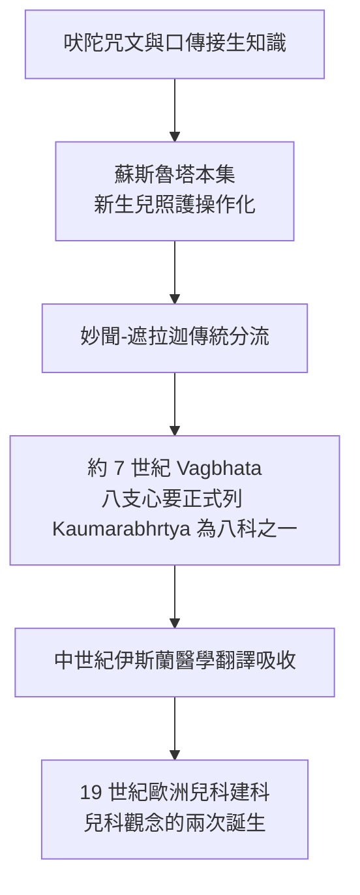

## 約前 600 - 蘇斯魯塔與古代兒童照護（第一部「兒科教科書」的印度線索）

## 案件摘要

**本案偵破的問題是：兒童照護何時開始被當成一門「專門的學問」？**

在藥理學之父蘇斯魯塔（Suśruta）編纂的梵文外科經典《蘇斯魯塔本集》（*Suśruta Saṃhitā*，約公元前 6 世紀定型）中，出現了專門討論新生兒照護的章節（Kaumārabhṛtya，字面意為「幼兒的照顧」）：新生兒的清潔與口腔清理、臍帶處理、初乳與哺乳指導、嬰兒疾病、以及兒童心理發展分期。Kaumārabhṛtya 後來成為印度阿育吠陀八大分支（Aṣṭāṅga Āyurveda）之一——這是醫學史上最早的「兒科是一個獨立分科」的正式記載，比歐洲兒科建科早了兩千五百年（見 `1860-雅可比兒科獨立建科.md`）。本案的真相是：兒科並非西方發明，而是古代文明的共同直覺——嬰兒死亡率高得可怕，任何想降低它的社會都必須發展出專門知識。

## 前因 -- 為什麼會有這個案子

- **高嬰兒死亡率是古代的常態**。史前與古代社會，約 30–50% 的兒童在 5 歲前死亡；生育是「賭命」，新生兒照護知識主要掌握在接生婆與祖母手中，靠口耳相傳。
- **吠陀醫學的體系化**。公元前 600–500 年間，印度次大陸的醫學知識從口傳頌歌轉入系統性文本：《阿闥婆吠陀》已有治療疾病與護佑新生兒的咒文，隨後分化出內科（Charaka 系統）與外科（Suśruta 系統）兩大傳統。
- **國王需要繼承人**。王室對子嗣與後代健康的重視，使「幼兒照顧」（Kaumārabhṛtya）有制度性需求——宮廷醫師必須懂得接生、新生兒急救與兒童疾病。
- **外科傳統的意外禮物**。蘇斯魯塔是外科醫師，而新生兒照護最初正是外科技術的應用：切斷臍帶、處理產傷、口腔清理、甚至後世文獻記載的胎位不正之處理。

## 線索與推理 -- 理論與文獻

**線索一：新生兒照護的操作流程。**《蘇斯魯塔本集》 Śārīra-sthāna 第 10 章描述新生兒出生後的標準流程：先清除口鼻黏液（新生兒窒息急救）、以溫水清洗、臍帶留距離切斷並以無菌性油膏（麻油與草藥）包紮、刺激啼哭、然後才行餵養。以現代觀點檢驗：

$$ P(\text{新生兒存活} \mid \text{清道流程}) \gg P(\text{存活} \mid \text{不處理}) $$

其中「清除呼吸道黏液」正是今日新生兒復甦術（NRP）的第一步——古代技術直擊了現代新生兒醫學的核心。

**線索二：哺乳與初乳的洞見。** 文本強調產後即應哺乳、初乳不應捨棄——這與 19 世紀西方部分醫師「初乳不潔應丟棄」的錯誤觀點相反，而與現代免疫球蛋白 IgA 透過母乳傳遞被動免疫的理論一致：

$$ \text{初乳} \to \text{sIgA} + \text{乳鐵蛋白} + \text{寡糖} \Rightarrow \text{被動腸道免疫} $$

**線索三：分科的制度化。** 後世 Vāgbhaṭa《八支心要》（*Aṣṭāṅga Hṛdayam*，約 7 世紀）明確列出阿育吠陀八科，Kaumārabhṛtya 列為其一，涵蓋孕產、新生兒、嬰兒與兒童疾病。這是「兒科作為制度性專科」的最早文獻證據。

**線索四：與其他古文明的平行比較。** 古埃及《埃伯斯紙草》（見性病書 `../性病的歷史/-1550-埃伯斯紙草與利未記的不潔.md`）有兒童疾病處方；希波克拉底文集有兒科觀察（見 `-0400-兒童不是小號的成人.md`）；中國宋代《小兒藥證直訣》（見 `1119-錢乙小兒藥證直訣.md`）建立兒科辨證體系。三條線索共同指向一個結論：兒童不是「小號的成人」這件事，古代人已經直覺知道——真正困難的是把它重新發明為科學。

## 結案 -- 後果與影響

- **兒科分科的最早制度化**。Kaumārabhṛtya 作為正式醫學分科持續至今——現代印度的大學仍設有 Kaumārabhṛtya 學系，是活著的兩千五百年傳統。
- **新生兒急救的操作化**。清道、保暖、臍帶處理、早期哺乳的組合流程，被視為新生兒復甦術與「新生兒包裹式照護（ kangaroo care ）」的古代先聲。
- **翻譯鏈**。8 世紀起《蘇斯魯塔本集》被譯為阿拉伯文（*Kitab-i-Susrud*），進入伊斯蘭醫學知識體，再輾轉影響中世紀歐洲——兒科知識的絲路遠比教科書寫的長。
- **一句話結案**：兒科的第一個發明不在歐洲，而在恆河平原——當一個文明把「照顧幼兒」寫進醫學的正式分類表，嬰兒就從「會不會活著」的賭局，變成了「該怎麼救」的技術問題。

## 關鍵人物與文獻

- **蘇斯魯塔（Suśruta）**——傳說中的外科醫師與《蘇斯魯塔本集》編纂者，活動於約公元前 600 年的貝拿勒斯（今瓦拉納西）；被尊為外科學與藥理學之父。
- **Vāgbhaṭa**——約 7 世紀醫師，《八支心要》作者，正式確立阿育吠陀八分科架構。
- **遮拉迦（Charaka）**——內科傳統的編纂者，《遮拉迦本集》同樣含兒科章節。
- 原始文獻——*Suśruta Saṃhitā*，Śārīra-sthāna 10（新生兒照護章）；Bhishagratna 英譯本，1907–1916。
- 現代註腳——WHO 與印度醫學界在 2000 年代曾就 Kaumārabhṛtya 的現代化進行合作研究；古代初乳知識在現代母乳免疫學中獲得完全平反。
